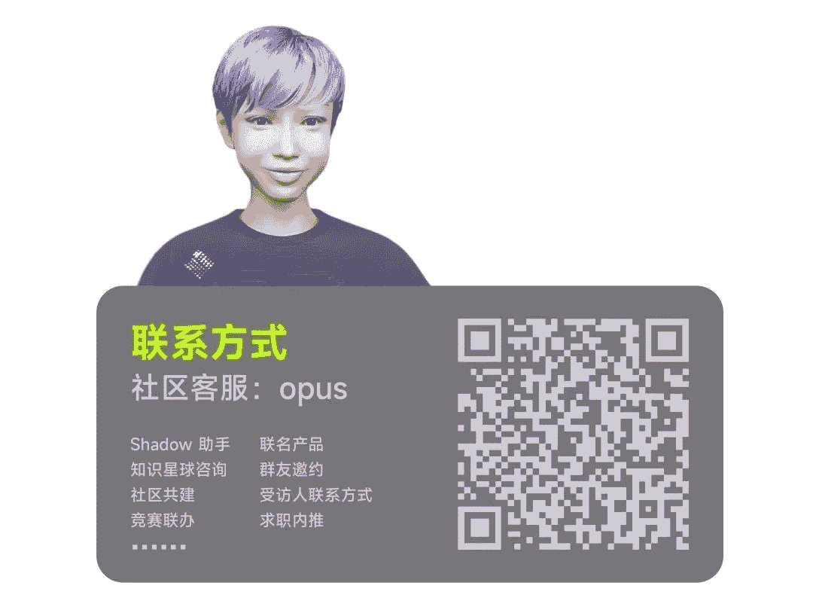

# 使用OpenClaw构建属于你自己的24小时个人助理

> 来源：[https://now.feishu.cn/docx/GPwzdoBVGopWm4xeSWbcDcPinMe](https://now.feishu.cn/docx/GPwzdoBVGopWm4xeSWbcDcPinMe)

# 属于你自己的24小时·个人助理

> 💰 ¥249·小白可入门·实战驱动·定制你的专属数字员工

---

### 🎯 定位

**掌握「主动式 Agent」的**使用技巧，从被动问答的对话框，升级为常驻后台、自主感知、主动行动的个人助理。通过「环境→配置→技能→集成→实战」五步学习路径，亲手打造能替你收集情报、挖掘需求、管理待办的24小时在线数字员工。

---

### 🗂️ 提纲

📖 第一部分：认知篇 —— 什么是主动式 Agent？

+   被动式 LLM vs 主动式 Agent 的核心差异

+   四种工作模式：定时任务｜消息监听｜外部钩子｜心跳模式

+   三大应用场景实战解析：主动式待办｜主动式情报收集｜主动式需求挖掘

🛠 第二部分：工具篇 —— 认识 OpenClaw

+   OpenClaw 是什么：私有化部署的个人 AI 操作系统

+   核心生态：ClawHub 技能市场 + Gateway 连接网关

+   同类项目对比：Nanobot / ZeroClaw / NanoClaw / Claude Code

💻 第三部分：实战篇 —— 环境搭建与部署

+   基础设施：腾讯云轻量服务器配置指南

+   两种安装方式：应用模板（小白）vs 手动安装（开发者）

+   关键步骤：SSH 隧道映射 + 后台 Token 登录

+   LLM 配置：免费方案（Nvidia）与生产推荐（MiniMax）

🧩 第四部分：技能篇 —— Skills 开发与管理

+   技能获取三路径：ClawHub 市场｜自然语言安装｜自然语言生成

+   环境变量管理：解决 Cron 任务中配置失效问题

+   手动上传技能包：scp + npm install + 重启生效全流程

🔩 第五部分：连接篇 —— IM 平台集成

+   Webhook 配置：让 Agent 接入飞书/企业🛰️

+   防火墙设置：腾讯云端口放行指南

+   机器人凭证对接：App ID / Secret 配置实操

🤖 第六部分：调教篇 —— soul.md 人格设定

+   角色定义：从"聊天机器人"到"设计 - 工程构建者"

+   核心信念：Agentic Engineering > Vibe Coding

+   边界准则：隐私优先、拒绝半成品、独立专业立场

❤️ 第七部分：心跳与记忆 —— 让 Agent 持续进化

+   HEARTBEAT.md 配置：周期性自检与记忆维护

+   记忆流转逻辑：每日日志 → 精选记忆 → 长期归档

+   心跳参数调优：间隔/活跃时段/告警目标

---

### 📦 内容包含

```
📁 2026-主动式-Agent-实战/
│
├── 📹 录播讲解视频
│
├── 📄 文档资料/
│   ├── 属于你自己的 24 小时·个人助理指南.pdf
│   ├── OpenClaw 案例精选.pdf
│   └── 一位设计黑客的 soul.md 设定.pdf
│
├── 🧰 技能/
│   ├── solo-scope/          # 情报收集
│   ├── qq-email/            # 邮件收发
│   ├── insight-from-chat/   # 痛点挖掘
│   └── todo-list/           # 待办管理
│
└── 🔗 社群权益/
    ├── OpenClaw 付费社群
    └── 案例投稿与曝光通道
```

---

### 📝 课后作业

1.  在腾讯云成功部署 OpenClaw

1.  申请 MiniMax API Key 并完成配置

1.  安装指定技能，设置定时任务并成功运行

---

## 👉 立即加入，开启你的 24 小时个人助理构建之旅！

¥249｜CodeNow 会员专享价 ¥199


📩 联系小助手获取会员折扣



> 这一次，让 Agent 真正为你工作，而不是你为 Agent 调试。