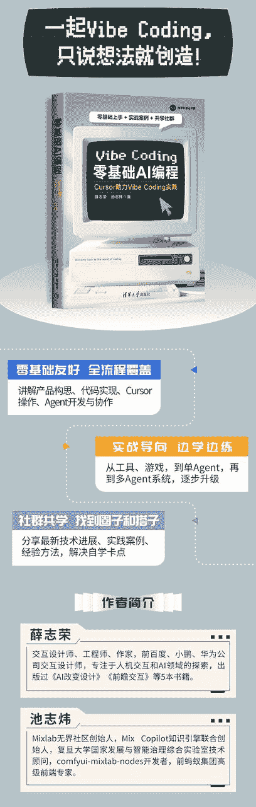

# 《零基础AI编程：Cursor助力Vibe Coding实践》

> 来源：[https://now.feishu.cn/docx/JskmdD6csoHnrmxxKGscdQ0qnBh](https://now.feishu.cn/docx/JskmdD6csoHnrmxxKGscdQ0qnBh)

# 购买链接（全网最低价格）

https://item.jd.com/14505039.html

# 相关介绍

# 目录

## 第1章　什么是AI编程？

1.1　为什么编程这么难学？

1.2　AI 编程的思维革命：人机交互的新篇章

1.3　AI编程：重新定义创造的可能性

1.4　如何掌握AI编程

## 第2章　产品构思与规划

2.1　一句话生成一个产品

2.2　理解提示工程的本质

2.3　从想法到代码：3种需求开发方式

2.4　技术方案探索

2.5　从需求到文档：打造清晰的产品设计文档

2.6　如何高效使用 Cursor 制作自己的项目

2.7　基于组件的设计与交互考量

## 第3章　基础知识准备

3.1　必须掌握的代码知识

3.2　数据结构和数据存储

3.3　客户端和服务端

3.4　GitHub 使用教程

3.5　如何部署Node.js环境

3.6　不同平台使用的Node.js 框架

3.7　实战：开发一个 Todo List

## 第4章　使用Cursor开发Agent

4.1　Agent基础知识介绍

4.2　实现一个Chatbot

4.3　实现一个AI产品经理

4.4　实现一个新闻摘要Agent

## 第5章　多Agent的设计系统：AI协作的未来

5.1　认识多Agent系统

5.2　基本的界面框架

5.3　实现后端接口和前后端联调

5.4　实现多Agent协作

5.5　实现ComfyUI Agent

5.6　项目优化与重构

## 第6章　打造带记忆模块的AI知识助手 Agent

6.1　项目概述与技术选型

6.2　搭建MCP服务端

6.3　构建Agent记忆模块

6.4　客户端开发与用户体验

6.5　测试与迭代

结语