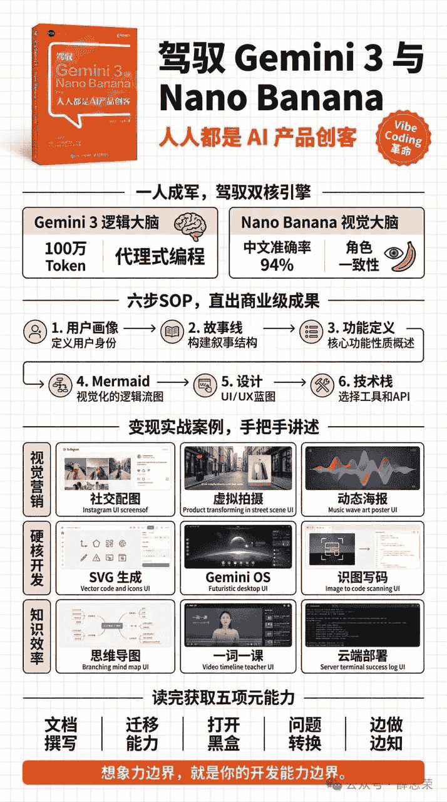
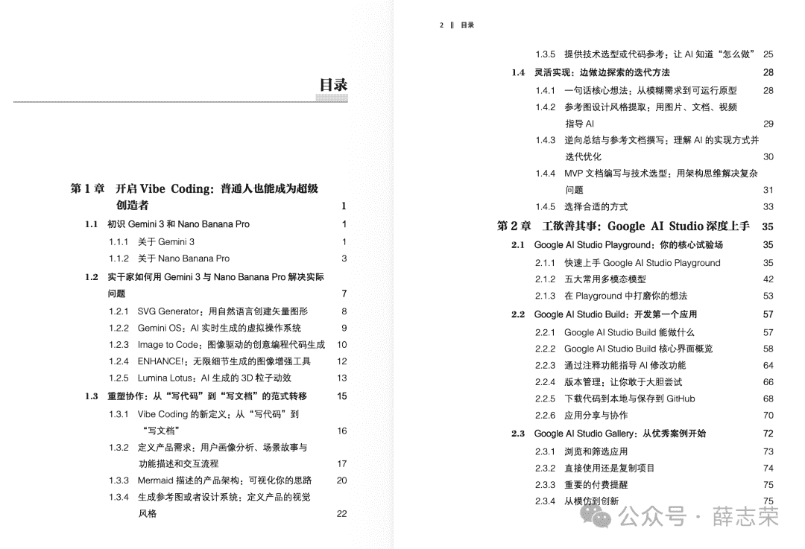
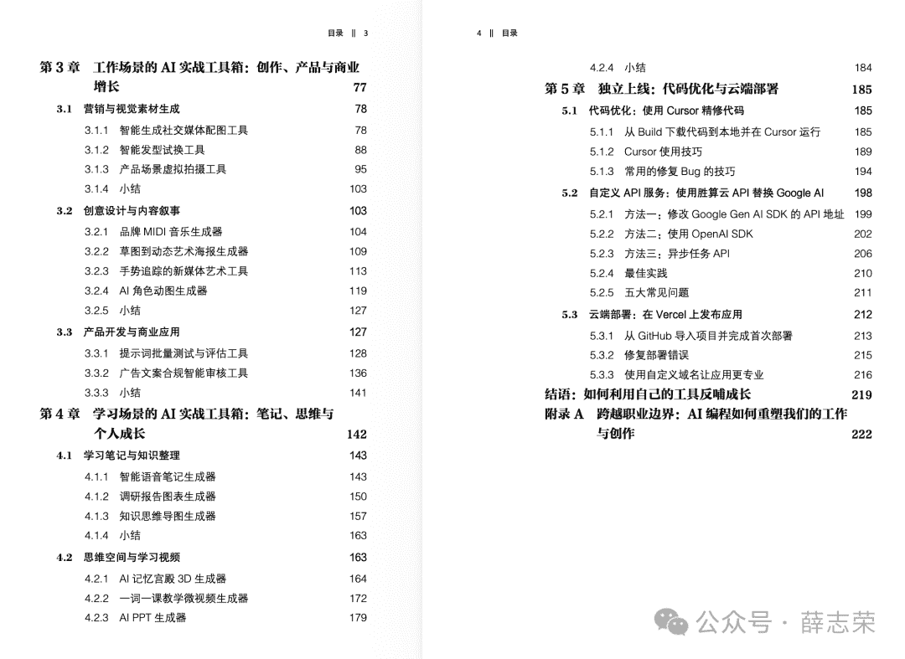

# 《驾驭 Gemini 3 与 Nano Banana》

> 来源：[https://now.feishu.cn/docx/JfePdrIkuoq73KxNVXbc570Nn2S](https://now.feishu.cn/docx/JfePdrIkuoq73KxNVXbc570Nn2S)

2025 年 7 月，我们出版了国内第一本 Vibe Coding 书籍《人人皆可 Vibe 编程》，在 8 月份，我们出版了面向进阶的《零基础 AI 编程》。那时候，我们向读者介绍这种全新创作方式：通过自然语言与 AI 对话，让没有编程基础的普通人也能创造属于自己的数字产品。我们以为，这已经是 AI 编程领域一次重大变革了。

与此同时，全球顶尖学府也在跟进这股浪潮。2025 年秋季学期，斯坦福大学**计算机系开设**了一门新课 CS 146S《现代软件开发者》，对学生的要求只有一条：不写一行代码。学生必须主要依赖 AI 完成开发任务，并在 Git 提交时附带与 AI 的对话记录以供核查。开课仅两个多月，就有许多学生成功发布了完整的全栈应用产品。

然而，不到几个月的时间，AI 技术又迎来了一轮升级。

2025 年 11 月，Google 发布了 Gemini 3 和 Nano Banana Pro，这两款产品重新定义了 Vibe Coding 体验。如果说过去我们与 AI 协作的比例是 7:3——你需要花大量时间做架构设计、与 AI 反复交互、不断调整方案——那么现在，这个比例已经变成了 4:6，甚至对于一些简单应用来说，可能达到了 1:9。这意味着什么？意味着你只需要把想法清晰地表达出来，AI 就能完成绝大部分工作。

与此同时，在过去一年中，我们举办了 20 多期 AI 编程线上线下训练营，帮助了数百名学员从零开始掌握 Vibe Coding。这些实战教学经验让我们沉淀出一套新的方法论——如何让零基础学员快速上手，如何设计更短的学习路径，如何把抽象概念变成具体操作。

正是 AI 技术的飞跃和教学实践的积累，促使我们决定写作《驾驭 Gemini 3 与 Nano Banana》。我们希望让更多人了解：在 Gemini 3 和 Nano Banana Pro 的加持下，Vibe Coding 门槛已经降到历史最低点。任何人都可以成为数字世界的创造者。而本书的每一章内容，都经过真实教学场景的打磨和验证。

### 你学的东西会白学吗？

在过去一年多的 AI 编程线下培训和指导中，我们听到学员问得最多的问题就是："AI 编程技术进化得这么快，万一过几个月又出了更强的工具，那我现在学的东西岂不是白学了？"

这个问题值得认真回答。

经过一年多的实践总结，我们发现 AI 编程真正需要掌握的并不是某个具体工具或某种特定技术，而是五项核心能力。无论未来出现 Gemini 4、Gemini 5，还是其他更先进的 AI 模型，这五项能力都将是你在 AI 时代立于不败之地的根基。

第一项能力是写文档，也就是逻辑表达能力。 在 AI 编程时代，"写代码"的重心正在向"写文档"转移。你需要能够清晰地描述你想要什么、为什么需要、产品应该如何运作。这种表达能力，本质上是你思维逻辑的外显。AI 再强大，也需要你告诉它方向在哪里。

第二项能力是迁移能力，简单来说就是找参考。 你不需要知道播放器的底层技术原理，也不需要了解什么是 FFmpeg，你只需要找到一个现成的播放器作为参考，然后告诉 AI："我想做一个类似的东西。"这种能力对非计算机专业的人尤其重要——你可以把它理解为"找竞品"的思维。当你不知道怎么做一个产品时，先看看别人是怎么做的，然后让 AI 帮你复刻和改进。

第三项能力是打开黑盒子，也就是搜索和分析能力。 当你找到了正确的参考，你就已经初步打开了黑盒子。但要真正理解和运用它，你需要具备一定的搜索技巧和分析思维。好消息是，现在的 AI 搜索工具已经很成熟，你只需要学会问对问题，就能获得需要的答案。

第四项能力是用黑盒子解决黑盒子，也就是问题转换和工具替代。 在 AI 编程过程中，你一定会遇到一些看起来很专业、很复杂的技术问题。这时候，你不需要真的去学习那些专业知识，而是可以换一个角度思考：能不能用另一种方式绕过这个问题？能不能用现有工具来替代？很多时候，80% 到 90% 的问题只需要"稍微打开一下黑盒子"就能解决，剩下那 10% 真正困难的问题，往往可以通过问题转换来化解——如果技术上解决不了，那就换一种产品设计。

第五项能力是边行边知，也就是在实践中学习。 不要想着"我要先把所有东西都学会，然后再开始做"，因为等你学完，技术可能又变了。正确的方式是：边做边学。遇到不懂的就问 AI，解决一个问题就学会一个知识点。这种"干中学"的模式，才是 AI 时代最高效的学习方式。

### 掌握核心能力，从容应对技术进化

当你真正理解并掌握了这五项核心能力，技术进化得越快，你反而越从容。因为这些能力是"元能力"——它们不依赖任何具体工具或平台，而是让你能够快速适应和驾驭任何新工具。

当新的 AI 模型发布时——无论是 Gemini 3 性能超越 Gemini 2，还是未来出现更先进的工具——你不会感到焦虑，反而会感到兴奋。因为这意味着你用同样的方法可以做出更好的产品。当新的工具让编辑图像变得更容易时，你不会担心自己学过的技能过时，而是会看到你的创意可以更快落地。AI 的进化不是你的敌人，而是你的盟友——它在不断降低创造门槛，让你的核心能力发挥更大价值。

所以，请放下"学了会白学"的担忧。你真正需要修炼的，从来都不是某个特定工具的使用技巧，而是上面这五项能够伴随你一生的核心能力。

### 这本书将带给你什么

在这本《驾驭 Gemini 3 与 Nano Banana》中，我们将以 Google AI Studio、Gemini 3 和 Nano Banana Pro 为主要工具，带你从零开始体验 Vibe Coding。你将学会如何用自然语言描述产品想法，如何让 AI 帮你生成完整的应用程序，如何在工作和生活中运用这些技能解决实际问题。

更重要的是，我们会在每一章的实战案例中，不断强化那五项核心能力的训练。当你读完这本书并完成其中的练习后，你获得的不仅仅是几个可以运行的应用程序，更是一套能让你在 AI 时代持续创造价值的思维方式和行动框架。

无论你是第一次接触 Vibe Coding 的新读者，还是读过我们第一本书的老朋友，我们都相信这本书会给你带来全新收获。技术在进化，我们的方法论也在进化，但我们的初心始终未变：让每一个有想法的人，都能成为自己创意的实现者。