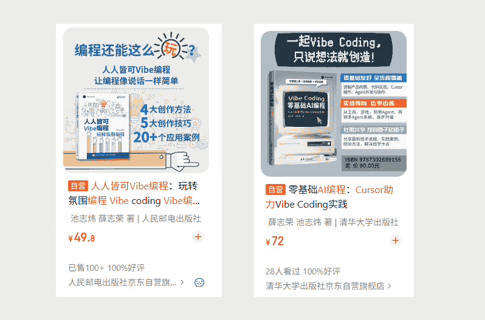
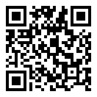

# Mixlab 线下活动 8-22

> 来源：[https://now.feishu.cn/docx/IaTtdVsLooajZ2xc3Fvcv3I7n6G](https://now.feishu.cn/docx/IaTtdVsLooajZ2xc3Fvcv3I7n6G)

# Mixlab 线下活动8-22

### 探索AI的无限可能

在8月22日，上海线下聚会，两位作者：shadow和薛志荣，将一起和大家交流。

这是一场面向AI使用者、跨学科研究者、AI产品经理及爱好者的深度交流聚会。无论你是刚接触AI编程的新手，还是希望进阶提升的使用者，或是寻求业务合作与职业发展的从业者，这里都有你需要的干货与资源！

### 活动亮点

1.  新手友好：交流VibeCoding的趣味玩法与实用技巧；

1.  AI编程进阶，交流如何系统提升AI编程能力；

1.  QA答疑：解决AI编程的“最后一公里”，任何AI编程问题的现场解答；

1.  职业发展与业务合作

+   AI产品经理专场：能力要求、行业趋势、内推机会；

+   跨领域合作：如何将AI技术应用于你的行业；

+   **AI面试，应对技巧**

+   创业者、企业代表自由对接，探索合作可能。

1.  AI赋能行业：知识生产与品牌营销

+   用AI自动化生成内容（报告、课程、营销文案）；

+   互动讨论：你的领域+AI=？

---

### 活动形式：

+   圆桌讨论

+   自由交流环节（带项目来聊！）

+   开放麦提问（任何问题都可抛）

### 适合人群：

+   AI初学者或资深使用者；

+   产品经理、创业者、企业技术负责人；

+   对AI应用落地的跨行业从业者；

+   想拓展人脉与资源的探索者。

---

**备注：** 请携带你的好奇心和具体问题，现场解锁更多可能性！

---

### 参与方式：

**¥199**

含2本签名版书籍+1杯饮品

新书[《人人皆可Vibe编程》](https://mp.weixin.qq.com/s?__biz=MzA3MDgyMjMwMA==&mid=2649981372&idx=1&sn=199f0309f4a38de73bea3d285d4a1bd9&scene=21#wechat_redirect)

适合0基础入门vibe coding，提高自己的文档驱动软件开发的技能，了解AI编程能做什么，开拓思路。

另一本是**清华大学出版社**出版的，适合零基础通往进阶之路，从基础到掌握更为全面的vibe coding技能，全栈开发。

**¥69**

1杯饮品

时间：

2025年8月22号（星期五） 晚上

17:45-21:45

地点：

上海 地铁12号线-国际客运中心站附近

报名锁定席位

**仅限15人**

http://mixlab-co.mikecrm.com/IHvkMlG

报名后

微信联系 litnmnm

# 过往活动

[第一期活动8-8](https://qwyofiv4bd3.feishu.cn/wiki/Vwh0wk35niiBYSkwsDEcaTCYnDf)