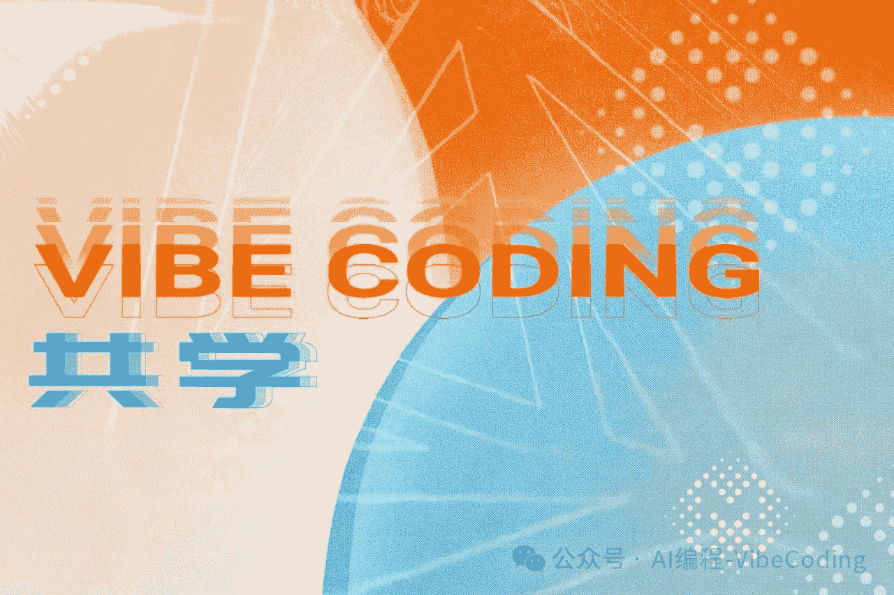
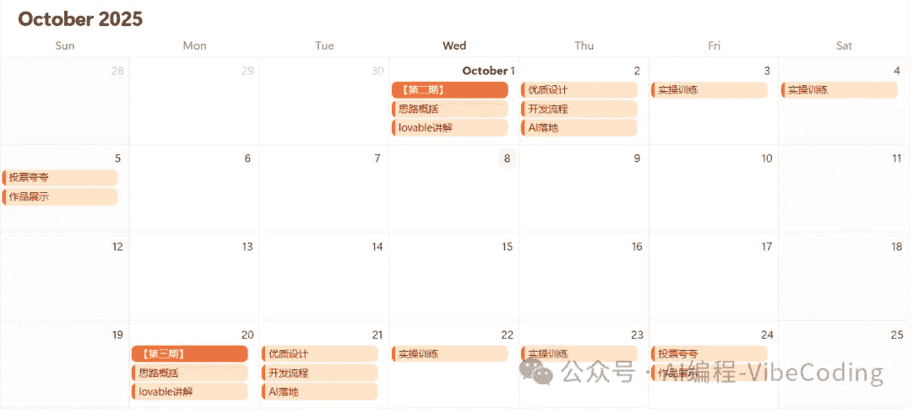
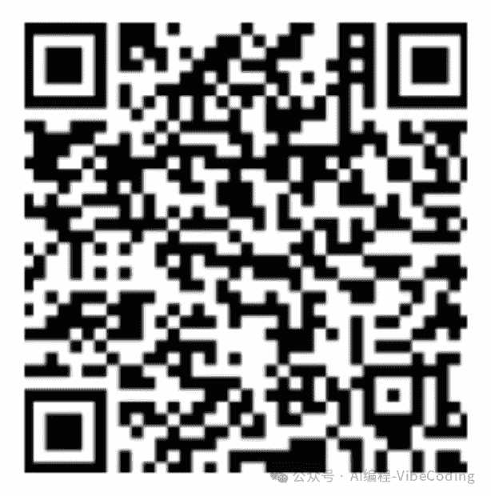
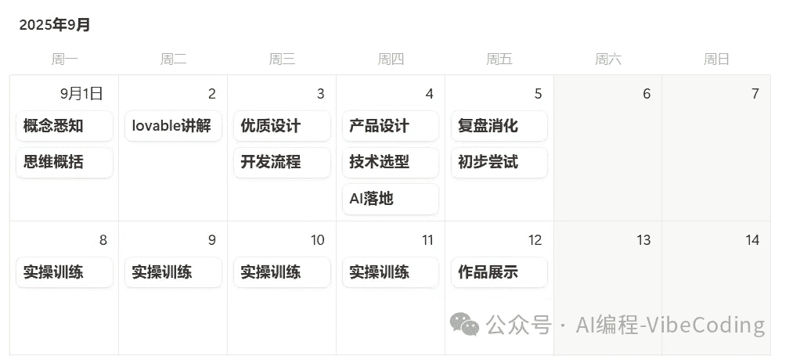
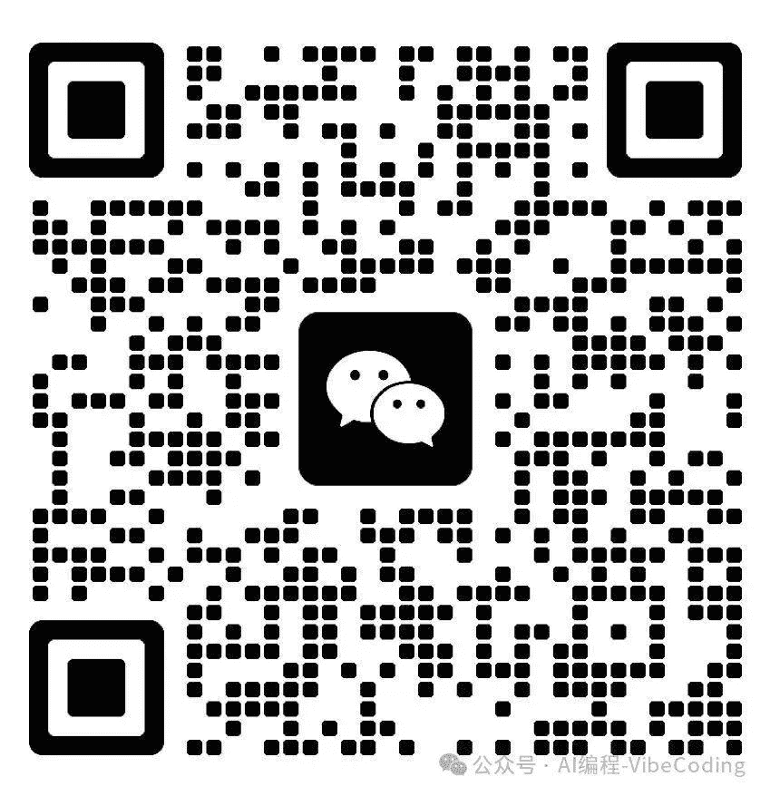
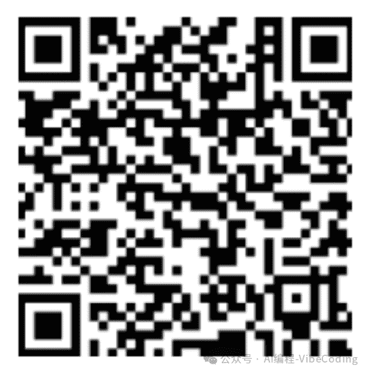

# 9.9元 Mixlab Vibe Coding 共学营

> 来源：[https://now.feishu.cn/docx/EoMjdIVpwo3947xFaFscekXmnxr](https://now.feishu.cn/docx/EoMjdIVpwo3947xFaFscekXmnxr)

# 共学是什么样的？

**想象一下——**

灯光温柔、音乐律动，屏幕前的你说出第一个想法，屏幕上一步步想法成真。

这就是 **Vibe Coding**——像喝咖啡、听歌一样轻松上瘾的生产方式。

在这里，你**不需要任何基础****，也不必立刻挑战高**难度项目。只要带着一**点好奇心**和 想法，就能找到属于自己的专注节奏。

---

### 📌让想象力得以实现；让思维和创造模式发生跃迁

Vibe Coding不仅是效率工具，也是一种认知方式的变化，想象力可以迅速转化为具体的产物。

🎮一个临时的灵感，可以转化为一款简单的小游戏并直接落地。想象力得以即时实现。

📝从简单的一纸简历，到长期更新的个人展示网站。思维与交互模式发生转变。

这不只是生产效率的提升，更是 **创造模式的跃迁**：任何人都能以最低成本，把想法转化为现实。

### 📌AI 聊天制图是「单次辅助」，而Vibe coding是「可复用杠杆」

AI 聊天节省**20分钟*1次**的时间。

AI 编程节省的可能是**20分钟*20次**。

⚙️一种写作主题，可以变成一个自动生成文章、排版和配图的工作流。

📊重复的数据整理工作的时间可以被用于更有价值的决策上。

**前者着眼于即时**问题的解决，后者则针对结构性问题。它的核心不在于获得答案，而在于构建 AI 驱动的资产，能够持续运行、不断复用，长期产生价值。

### 📌大多数人知道，只有少数人实践，所以我们致力于为共学者降低门槛

关于 AI 的讨论已经铺天盖地，但真正动手的人寥寥无几。因此我们计划最大程度地降低门槛——最少的金额，最少的时间，和一群人一起学习，最高效的产出。🌱

---

# 🎯 课程内容

[课程内容](https://qwyofiv4bd3.feishu.cn/wiki/AOZNwVI7Wi5CKNkPrPzcqaE3n9b)

---

# 🎯 往期共学作品

[第一期：作品汇总&灵感涌现](https://qwyofiv4bd3.feishu.cn/wiki/K6CiwB8HniUCegkfKzAcJOxKn6b)

---

#  📌如何报名

## **📚 共学内容**

我们将在1周的时间里，一起更轻松地、互助地共学vibe coding并落地一个属于你自己的小项目。

+   **第1天**：深入了解 Vibe Coding 的理念与核心思路 + Lovable工具详解

+   **第2天**：掌握MVP开发流程，开发一个专属于你的AI导师

+   **第3天**：实操训练

+   **第4天**：实操训练

+   **第5天**：赠送夸夸积分 + 分享产品和经验

+   分享共学资料，快速建立编程基础技能/认知

+   群内鼓励互相提问、互相分享，哪怕是初学者，也能在交流中找到答案和方向

+   将所学内容投入到实际开发中，完成2个作品。哪怕是最简单的展示网站，也足以让我们前进一大步

+   从"有个想法"到"2个小时就能实现"，这是最有成就感的一步

**这里的学习，不是苦苦鏖战**——不再是传统枯燥、逻辑至上的工程工作，而更像是一种「沉浸式创作」。你会因为有伙伴并肩前行而更加有动力。两周后，你不仅会知道什么是 Vibe Coding，还会亲手完成属于自己的3个小作品。

Vibe On，Code On！ 🎵💻

---

## **🎯 共学机制**

### 为了让这段学习旅程更有趣、更温暖，我们设计了“夸夸积分”互动机制——让每一次帮助、每一次鼓励都能被看见。

1️⃣ **夸夸积分怎么玩？**

+   每位参与者初始获得**2个夸夸积分**。

+   **不能留着自己用**，只有送给别人，才会真正生效！

+   你可以把积分送给：

+   在学习中**帮助你最多的人**

+   **最喜欢的产品**的开发者

2️⃣ **有心就有奖**

+   **共学结束时，在所有完成作品的学员里，夸夸得分前10%的同学，将解锁价值599的vib**e coding进阶课程。前20%将获得价值199的Vibe coding助手。前30%将获得599录播课程5折券。

+   不是比技术谁最强，而是谁能在共学中带来最大价值与温度。

3️⃣ **打卡并结营，返还全部押金**

+   每天坚持学习、互助分享。

+   完成整个共学周期打卡、并且完成2个结营作品的同学，将退还押金。

在这里，学习不仅是掌握技能，更是建立连接。你会惊喜地发现，自己既能成为被帮助的人，也能成为别人前进的动力——而这，正是共学最美妙的地方。

---

## **📅 活动信息**

+   **招募人数**：20 - 100 人

+   **共学时间**：国庆五天（10.1-10.5）每天1小时（7:00-8:00）

+   **课程内容**：vibe coding 精选视频课 + 共学资料 + 2个实战作品

+   **学习媒介**：🛰️群聊 / 腾讯会议 / 飞书文档

+   **适用人群**：零经验人群

---

## **📝 报名方式**

**门票**：9.9 元

（一杯瑞幸换一个长期高效技能！）

**押金**：30 元

（全勤打卡、完成所有作品可全额返还）

扫码报名

客服🛰️

往期学员作品

#  📌往期信息

## 📚 共学内容

我们将在2周的时间里，一起更轻松地、互助地共学vibe coding并落地一个属于你自己的小项目。

**第一周——学习积累**

+   观看精心准备的录播视频，了解 Vibe Coding 的理念与工具使用。

+   分享共学资料，快速建立编程基础技能/认知。

+   群内鼓励互相提问、互相分享，哪怕是初学者，也能在交流中找到答案和方向。

**第二周——实战创作**

+   将所学内容投入到实际开发中，完成3个作品。哪怕是最简单的展示网站，也足以让我们前进一大步。

+   从“有个想法”到“2个小时就能实现”，这是最有成就感的一步。

**这里的学习，不是苦苦鏖战**——不再是传统枯燥、逻辑至上的工程工作，而更像是一种「沉浸式创作」。你会因为有伙伴并肩前行而更加有动力。两周后，你不仅会知道什么是 Vibe Coding，还会亲手完成属于自己的3个小作品。

Vibe On，Code On！ 🎵💻

---

## 🎯 共学机制

**为**了让这段学习旅程更有趣、更温暖，我们设计了“夸夸积分”互动机制——让每一次帮助、每一次鼓励都能被看见。

1️⃣ **夸夸积分怎么玩？**

+   每位参与者初始获得**2个夸夸积分**。

+   **不能留着自己用**，只有送给别人，才会真正生效！

+   你可以把积分送给：

+   在学习中**帮助你最多的人**

+   **最喜欢的产品**的开发者

2️⃣ **有心就有奖**

+   共学结束时，**收到夸夸得分前10%的同学**，将解锁特别奖品——价值599的vibe coding进阶课程。

+   不是比技术谁最强，而是谁能在共学中带来最大价值与温度。

3️⃣ **打卡并结营，返还全部押金**

+   每天坚持学习、互助分享。

+   完成整个共学周期打卡、并且完成3个结营作品的同学，将退还押金。

在这里，学习不仅是掌握技能，更是建立连接。你会惊喜地发现，自己既能成为被帮助的人，也能成为别人前进的动力——而这，正是共学最美妙的地方。

---

## 📅 活动信息

+   **招募人数**：20 - 100 人

+   **共学时间**：9月1日 - 9月12日，共两周

+   **所需时间**：1小时×10天

+   **学习安排**：第一周课程学习，第二周实战开发

+   **课程内容**：4堂 vibe coding 精选录播课 + 共学资料 + 3个实战作品

+   **学习媒介**：🛰️群 / 腾讯会议 / 飞书文档

+   **适用人群**：零经验人群

---

## 📝 报名方式

**门票**：9.9 元

（一杯瑞幸换一个长期高效技能！）

**押金**：30 元

（全勤打卡、完成所有作品可全额返还）

[报名链接](http://o1cj7d6gi952jpj8.mikecrm.com/KYEfMba)

客服🛰️

[往期学员作品](https://qwyofiv4bd3.feishu.cn/wiki/LVHpw4mTjiDbmUkvji5cw9IbnQh)

---

## 🎯 打卡统计

[打卡统计](https://qwyofiv4bd3.feishu.cn/sheets/OAsAsgTwphcBK1taTCtc7TcBnrd?sheet=3e0538)

##