# 🌟 公益赞助计划：VibeCoding共学营

> 来源：[https://now.feishu.cn/docx/XlePdqnQDoDTrLxYq6ycxGnSn2e](https://now.feishu.cn/docx/XlePdqnQDoDTrLxYq6ycxGnSn2e)

## 🌟 公益赞助计划：赋能未来AI开发者

由Mixlab联合胜算云、四百盒子社区提供支持。

本计划旨在通过赞助高校学生组织者，推广Vibe Coding理念与AI编程工具的使用，帮助大学生零基础迈出AI编程的第一步，成为未来的AI应用构建者。

### 什么是 Vibe Coding？

Vibe Coding的概念，在2025年2月开始走红，后来主要指的是0代码用自然语言描述软件的功能，让AI编程生成软件的一种编程方式。国内外主流的Vibe Coding产品有Lovable、v0、Blot.new、百度秒哒等。

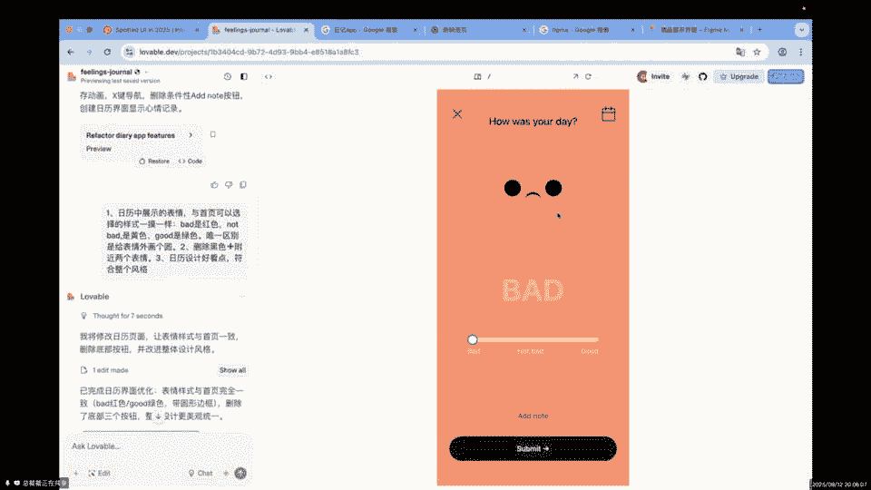

[总裁裁-趣味调酒app-1.mp4](https://internal-api-drive-stream.feishu.cn/space/api/box/stream/download/all/WHO5bRGvPozWGuxkth3c6LOonTf)

共学营学员分享vibe coding出来的小项目

### 📝 赞助方案核心框架

**赞助对象：**高校Vibe Coding共学营的负责人（学生）以及共学营学员。

**赞助内容：**

1. Vibe Coding精选录播课：Mixlab 提供共学营所需的课程资源以及社群答疑。

2. 多模态AI模型API：胜算云为每位高校学员提供算力资源与 API 支持，帮助同学们真正“动手做出 AI 作品”。

3. 优秀作品线下展览：将由四百盒子社区（苏州、南京）提供作品线下展出，免费住宿 1-2 天，办公室3-6 个月免租。四百盒子社区作为奇绩校友企业向奇绩创坛推荐优秀项目，并为入驻社区的团队提供申请指导。

**申请条件：**

1. 申请人需提供学生证截图以验证在校大学生身份。

2. 申请人作为共学营负责人，组织至少20名同学系统学习课程。

3. 申请人需建立并维护一个20人以上的🛰️群，用于学习讨论和进度同步。

### 1. 为什么值得参与？

这远不止是一次简单的赞助，而是一次宝贵的个人能力跃迁机会：

+   **领导力实践**：你将真正负责一个项目的全流程，从0到1组建团队、管理进度、解决实际问题，这是任何一门课程都难以提供的实战经验。

+   **前沿技能认证**：作为组织者，你将深度掌握Vibe Coding和AI编程工具的使用，在AI应用开发领域快人一步，这份经历将成为简历上极具分量的亮点。

+   **社区建设者网络**：你将加入一个由Mixlab、胜算云、400盒子社区等联合发起方支持的全国高校优秀组织者构成的社群，共享资源，交流经验，拓展宝贵的同行人脉。

### 2. 如何成功组织共学营？

+   **第一阶段：筹备与招募**

+   **制定计划**：参考提供的1周共学模式（课程学习、实战创作），制定适合本校学情的详细时间表。

+   **招募学员**：利用课程“零基础入门”的特点作为宣传点，吸引不同专业的同学参与。

+   **第二阶段：运营与共学**

+   **建立节奏**：组织定期集体观看录播课，并安排固定的答疑时间。

+   **激发互动**：鼓励学员在社群内分享每日学习心得和作品。

+   **目标导向**：以确保每位参与者最终能完成3个属于自己的小作品（如个人展示网站、趣味小工具等）为目标，推动学习进程。

+   **第三阶段：展示与沉淀**

+   **成果展示会**：在共学营结束时，组织一场线上成果展示会，让学员分享自己的作品，激发成就感。

+   **收集反馈**：汇总学习过程和作品，这既是宝贵的社群资产，也是赞助效果的有力证明。

### 3. 专家指导

针对共学营组织者，将由2位专家指导如何开展。

Shadow

+   《人人皆可Vibe编程》《零基础AI编程》作者

+   Mixlab创始人、程序员、设计师、连续创业者

+   复旦大学国家发展与智能治理综合实验室技术顾问

+   前蚂蚁集团高级前端架构师

薛志荣

+   《人人皆可Vibe编程》《零基础AI编程》《AI改变设计》《前瞻交互》《写给设计师的技术书》等书籍作者

+   设计师、程序员、作者

+   复旦大学国家发展与智能治理综合实验室技术顾问

+   前华为人机交互实验室高级工程师

### 4. 共学内容

花一周时间，一起更轻松地、互助地共学vibe coding并落地一个属于你自己的项目。

+   **第1天**：深入了解 Vibe Coding 的理念与核心思路 + Lovable工具详解

+   **第2天**：掌握MVP开发流程，开发一个专属于你的AI导师

+   **第3天**：实操训练

+   **第4天**：实操训练

+   **第5天**：交流分享产品和经验

+   学习共学内容，快速建立编程基础技能/认知

+   群内鼓励互相提问、分享，初学者也能在交流中得到启发

+   将所学内容投入到实际开发中，完成2个作品

+   从"有个想法"到"2个小时就能实现"，最有成就感

## 社区建设者网络

Mixlab：跨学科创新社区，致力于探索人机协作的未来模式。通过融合设计、技术、艺术与科学，Mixlab 聚集全球创作者、研究者与实践者，共同实验、共创和分享前沿项目，推动创新从概念走向现实，构建开放、协作、智能的下一代社区生态。

胜算云：胜算云是由 长三角国家技术创新中心重点扶持 的 AI 基础设施科创企业，致力于推动 AI 科研与产业创新落地，让每位创新者都能一键调用全球最前沿的大模型，涵盖 GPT、Sora、Gemini、Banana 等 100+ 国际主流模型。依托统一 API 接口，用户可体验文本、图像、视频、语音等多模态 AI 能力，无需复杂部署，即可快速上手 AI 编程与创作。

四百盒子社区：在个体时代，越来越多的年轻人选择独居，却也渴望更有连接的生活。“四百盒子的共享社区城市”应运而生——我们致力于为志趣相投的人打造协作共生的新一代青年社区。每个居民享有独立空间，也能在开放区域自由交流、共创灵感。我们缩小私人面积，放大人与人之间的连接界面，并提供 Ai 社区助手，让社交与创新自然发生。我们会将四百盒子社区模式开源，提供给不同社群主理人，希望在不远的将来看到各种主题社区如音乐、艺术、舞蹈、设计、游戏社区等遍地开花。

## 申请成为组织者

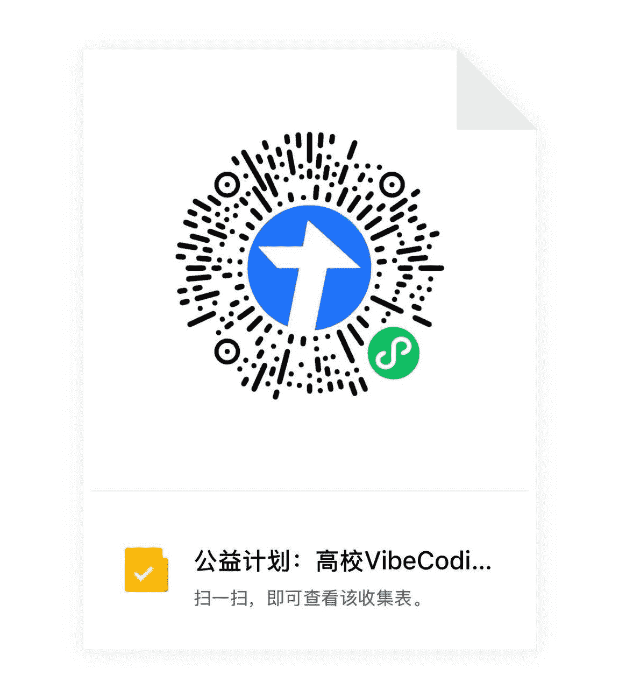

## 学习内容申请

[课程内容](https://qwyofiv4bd3.feishu.cn/wiki/KYBmwfvKFiC0vrkecGKco6zhnLc)

## 共学营作品分享

[jinjin-爱的一万种方式-1.mp4](https://internal-api-drive-stream.feishu.cn/space/api/box/stream/download/all/NvJNbCmsuo3E07xdbMrcjC6Vn40)

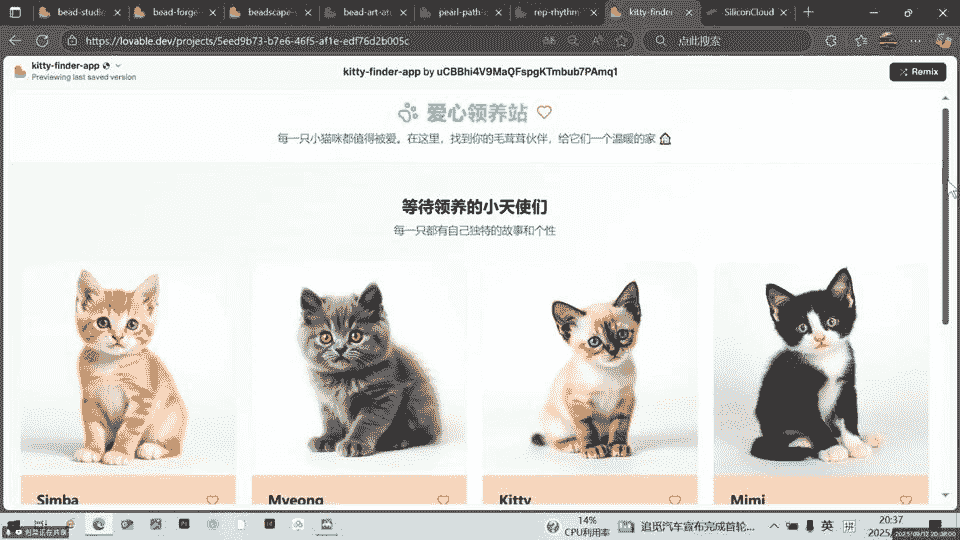

[爱心领养站-1.mp4](https://internal-api-drive-stream.feishu.cn/space/api/box/stream/download/all/UW6gbsG8dogU2hxpSRscwJYinwd)

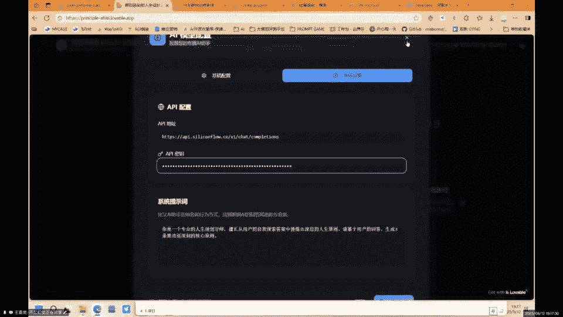

[不二幻觉-人生设计系统-1.mp4](https://internal-api-drive-stream.feishu.cn/space/api/box/stream/download/all/DDjGbxSigonnTmxQnYDcWWPqnqb)

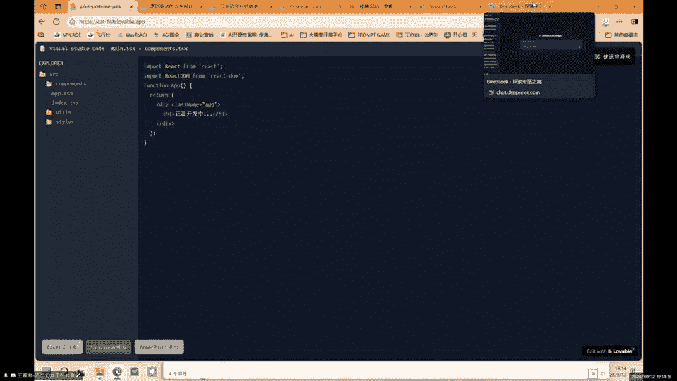

[不二幻觉-小猫钓鱼-1.mp4](https://internal-api-drive-stream.feishu.cn/space/api/box/stream/download/all/BiXibMfvfojgrxxMCQtcJ2X7nYb)

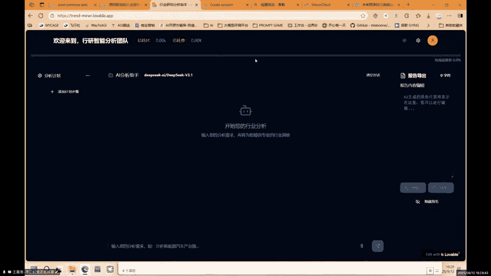

[不二幻觉行研智能分析团队-1.mp4](https://internal-api-drive-stream.feishu.cn/space/api/box/stream/download/all/JiDJbs9wFo1Xe2x1SeKc3L3qnJh)

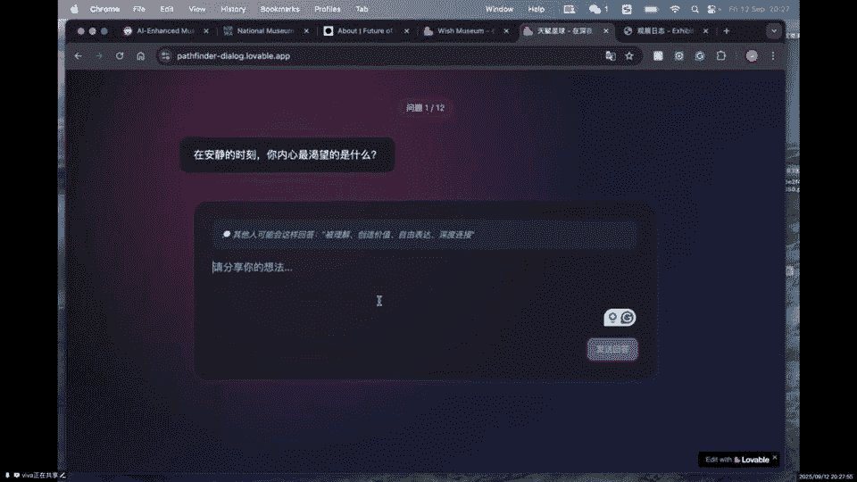

[观展日志-1.mp4](https://internal-api-drive-stream.feishu.cn/space/api/box/stream/download/all/GJOTba65fogEKQxIt3zcp684nte)

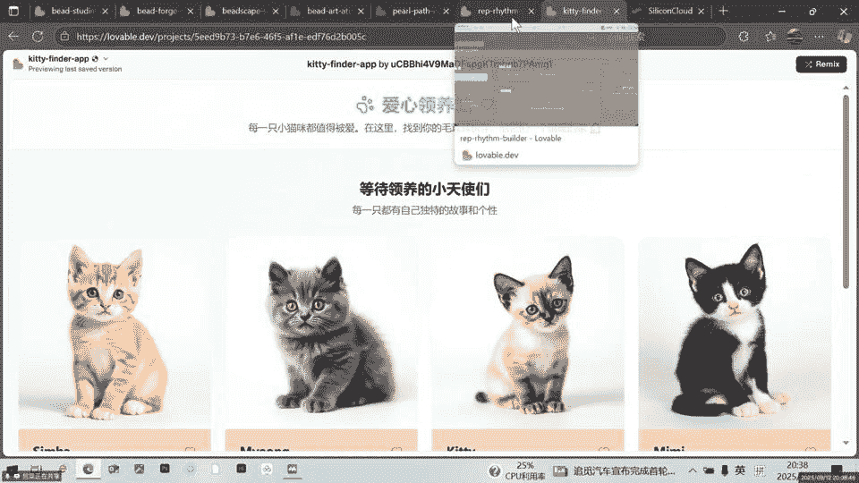

[健身视频编辑器-1.mp4](https://internal-api-drive-stream.feishu.cn/space/api/box/stream/download/all/H6WaboqkxoB6b0xDszWce6apn0T)

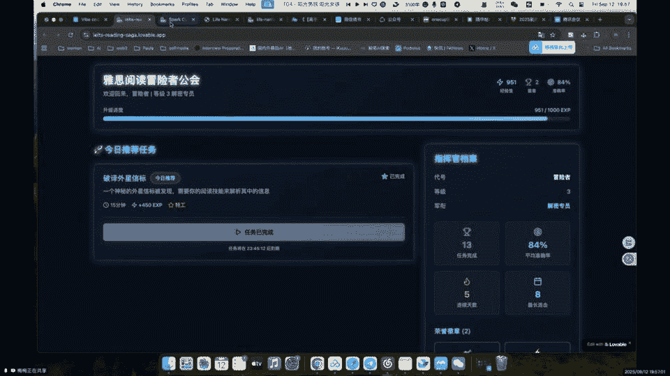

[梅梅-spark cycle，把灵感变成实践-1.mp4](https://internal-api-drive-stream.feishu.cn/space/api/box/stream/download/all/ErONb4Vo1omKj7xzNu3cDO5Rn5c)

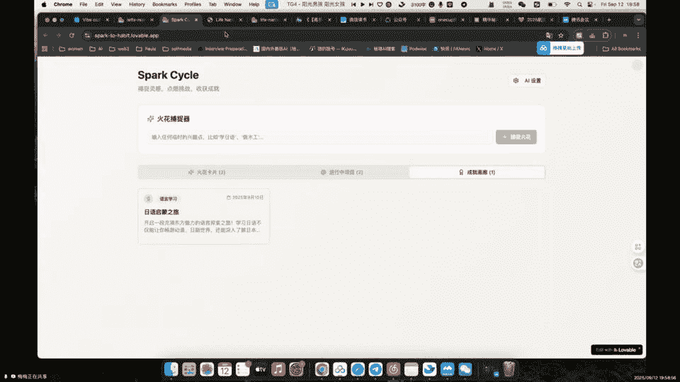

[梅梅-人生叙事诗-1.mp4](https://internal-api-drive-stream.feishu.cn/space/api/box/stream/download/all/Pu5Ebbn6LoxFJ3x7fMBc0tJunNd)

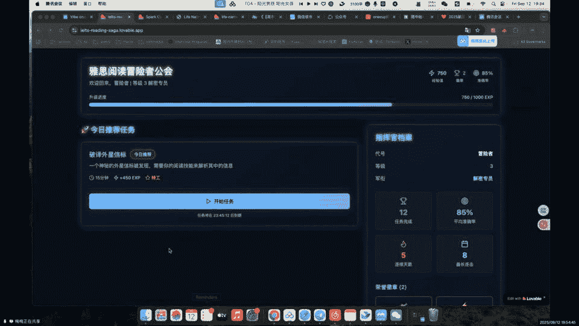

[梅梅-雅思阅读冒险者公会-1.mp4](https://internal-api-drive-stream.feishu.cn/space/api/box/stream/download/all/MNmCbbcJNolL9Bxxo6ycwURsnrc)

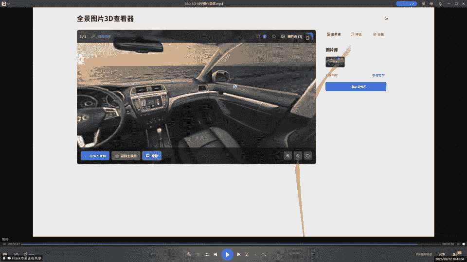

[木易-CMF分析器-1.mp4](https://internal-api-drive-stream.feishu.cn/space/api/box/stream/download/all/Sx4PbLLhJoFCtYxlLFpcgHzbnWb)

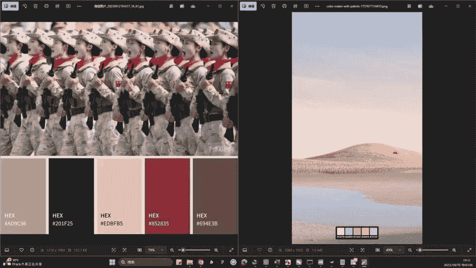

[木易-全景3D图片查看器-1.mp4](https://internal-api-drive-stream.feishu.cn/space/api/box/stream/download/all/KVPEb6ko1oerWkxQfZacsBvnnXd)

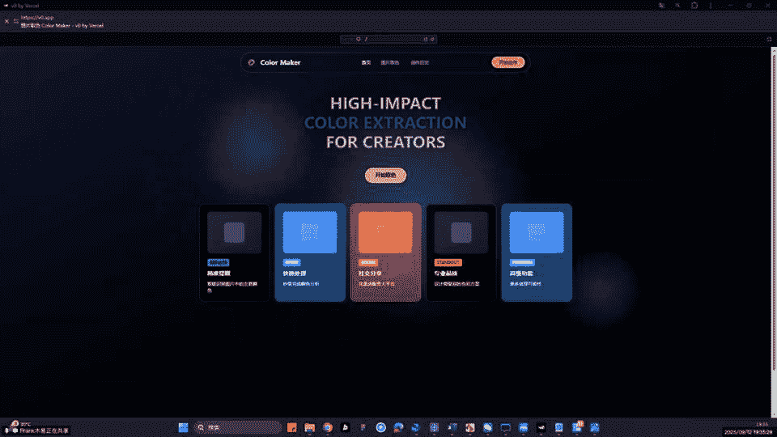

[木易-色彩提取网站-1.mp4](https://internal-api-drive-stream.feishu.cn/space/api/box/stream/download/all/VZrub4dBMoFkrexa89rcwJxhnzf)

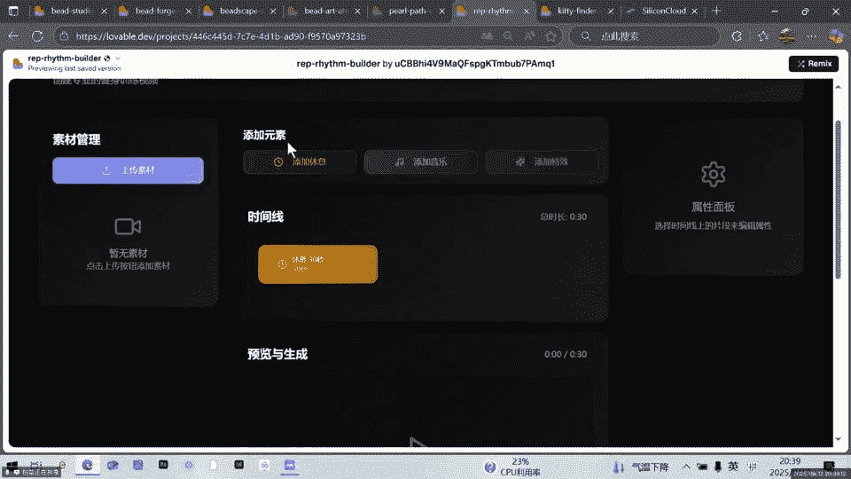

[设计串珠网页-1.mp4](https://internal-api-drive-stream.feishu.cn/space/api/box/stream/download/all/RsKObbpHCoeQv8xdFYpcxnSnnle)

[天赋星球-1.mp4](https://internal-api-drive-stream.feishu.cn/space/api/box/stream/download/all/KCEib8MFoobEtzxmDdEcczPinyA)

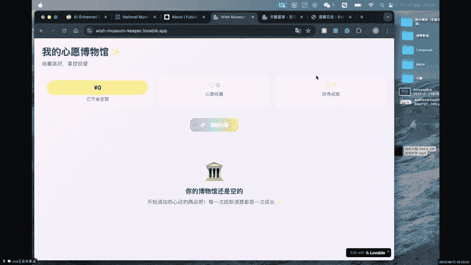

[我的心愿博物馆-1.mp4](https://internal-api-drive-stream.feishu.cn/space/api/box/stream/download/all/Za5Mbrb14oDboKxF3QJcoP8ynih)

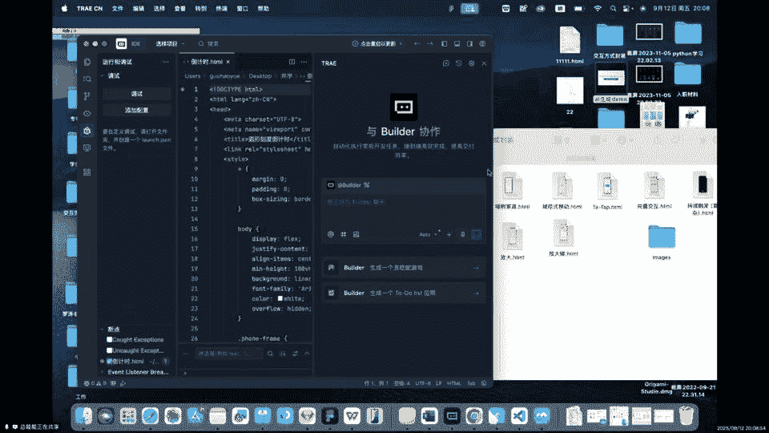

[总裁裁-交互小demo-1.mp4](https://internal-api-drive-stream.feishu.cn/space/api/box/stream/download/all/J9bIbJTctol2SzxxTDDcqhodnkb)

[总裁裁-情绪记录APP，你今天怎么样？-1.mp4](https://internal-api-drive-stream.feishu.cn/space/api/box/stream/download/all/PzGnbSJ23oQHzPxneGwcctDSn2T)

[总裁裁-趣味调酒app-1.mp4](https://internal-api-drive-stream.feishu.cn/space/api/box/stream/download/all/YSKcbtYuXoOXqixJUHJcfpMmnqd)

[总裁裁-旋转计时器APP-1.mp4](https://internal-api-drive-stream.feishu.cn/space/api/box/stream/download/all/U9qebuDoqoUtYBxwXMic2tsRn4d)

[作品1-打卡-1.mp4](https://internal-api-drive-stream.feishu.cn/space/api/box/stream/download/all/M7M5bvTaroADnwx9X7PcVW7cnah)

[作品2-找东西-1.mp4](https://internal-api-drive-stream.feishu.cn/space/api/box/stream/download/all/JLxPbSnSJoSTapxtSD7cWsJInxr)

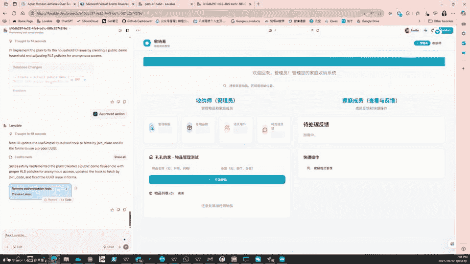

[作品3-演讲+感悟-1.mp4](https://internal-api-drive-stream.feishu.cn/space/api/box/stream/download/all/PCrObEU9RookSJxPvjlcYJSBn2Y)

## 📱 生产力工具类

### 记录管理

+   **语音todolist/记账系统** - 基于移动网页的语音操作待办事项和记账功能

+   **智能记账应用** - 支持截屏和语音记账，自动记账和消费复盘功能

+   **家庭账本系统** - 关联支付宝、🛰️、信用卡和银行卡，详细记录家庭收支并按月汇总

+   **工厂管理系统** - 完整的前后端系统，记录从客户下单到出货的全流程数据

+   **付款申请应用程序** - 简化财务审批流程

+   **订阅软件续费管理工具** - 基于Gmail的自动订阅管理和续费提醒

### 信息整理

+   **个人碎片化信息整理工具** - 分类整理日常碎片化信息和知识

+   **智能卡片笔记本** - 质性研究AI工具，收集想法来源，推荐研究方法，完成大纲

+   **信息订阅与自动整理工具** - 自动收集和整理订阅信息

+   **剪贴板管理小工具** - 高效管理复制粘贴内容

+   **桌面文件整理工具** - 按需求自动整理桌面文件

### 日程时间管理

+   **日程表应用** - 个人日程管理系统

+   **智能时钟** - 可个性化配置模块的时钟系统

+   **儿童时间管理App** - 专为儿童设计的时间管理工具

## 🧠 学习教育类

### 语言学习

+   **背单词小程序** - 复刻MeowBread记忆面包的单词记忆工具

+   **单词记忆和复习工具** - 科学化的词汇学习系统

+   **自定义口语app** - 循环播放影视剧台词，用户自定义学习内容

+   **法语学习小程序** - 专门的法语学习平台

### 综合学习

+   **学习社区平台** - 根据个人基础自定义学习规划的社区系统

+   **课程系统** - 跨平台多端适配的在线课程平台

+   **可自定义题型的考研平台** - 支持参考书输入，自动生成模拟卷的备考工具

+   **Arduino硬件学习平台** - 基于Arduino的硬件设计学习系统

+   **启发式小学生辅导工具** - 辅导课后作业和预习的智能工具

+   **H5智能伴学Agent** - 基于H5的学习陪伴系统

### 专业学习

+   **美股投资网站** - 面向高中生的美股投资教育平台

+   **思辨阅读共读** - 提升阅读思辨能力的工具

+   **设计研究系统** - 专业设计研究平台

## 💖 健康心理类

### 心理健康

+   **心理疗愈APP** - 专业的心理健康支持应用

+   to live list心理支持App - 鼓励心理疾病患者维持日常必做事项的打卡应用

+   **人体记录仪** - 记录饮食、穿着、心情、身体感受、用药、运动、作息等，提供健康分析建议

+   **舒缓压力软件** - 专注于压力释放的心理健康工具

+   **冥想app** - 冥想指导和练习平台

## 习惯养成

+   **移动端习惯记录工具** - 跟踪和管理个人习惯
+   **健康习惯养成辅助工具** - 科学化的习惯培养系统
+   **睡眠记录可视化工具** - 记录睡眠时间，提供可视化表现和等级奖励机制
+   **提高专注力的记录器** - 专注力训练和记录系统

## 生活记录

+   **个人生命状态管理程序** - 检查、评估、调整和重建个人生活状态
+   **女儿成长记录小程序** - 支持上传视频、照片、文字的成长档案
+   **个人作品成长网站** - 记录个人作品、成长经历、重大事件、生活随记，可选择性公开，具有交友功能

## 🎨 创意内容类

### 设计创作

+   **头像图片生成系统** - 跨平台多端适配的个性化头像生成
+   **分镜头一致性工具** - 保持视频分镜的视觉一致性
+   **科幻UI设计系统** - 完整的科幻风格UI组件库
+   **个人创意网站** - 展示个人创意作品的平台
+   **AI国学文化饰品设计器** - 个性化国学文化饰品设计与故事生成
+   **摄影作品展示网站** - 高端文艺的拍立得作品展示平台，卡片式陈列，支持翻转查看故事和现场视频

### 内容生成

+   **视频生成平台** - 完整的视频内容生成系统
+   **短视频解决方案生成器** - 自动生成解决方案的短视频内容
+   **AI辅助图文创作agent** - 协助用户进行图文创作，生成类似网易云听歌报告的个性化内容
+   **多智能体协作界面** - 实现多个`AI`智能体协同工作的平台

### 灵感收集

+   **童趣治愈作品收集平台** - 收集童趣治愈作品及图片，按信息重合性归纳分组描述
+   **创意笔记系统** - 基于记忆重塑的个人创意管理系统

## 📊 数据分析类

### 商业数据

+   **行业数据调研工具** - 帮助收集和分析行业数据
+   **新闻收集分析工具** - 自动收集和分析新闻信息
+   **网站用户评论爬虫** - 收集指定网站用户留言评论，自动展开折叠内容
+   **美团数据分析工具** - 统计美团开店信息、单价、销量、总价、评价等数据，支持导出`Excel`
+   **网络销售数据分析工具** - 分析网络销售平台产品销量、好差评数据
+   **定时网页爬取工具** - 指定网页定时爬取信息并分类总结

### 金融投资

+   **web3 RWA+AI项目** - 结合去中心化交易所算法稳定币的区块链项目
+   **股票建议系统** - 智能股票投资建议平台
+   **炒股AI软件** - `AI`驱动的股票交易分析工具

## 🛠️ 实用工具类

### 移动出行

+   **地铁门序号快搜** - 快速搜索离电梯最近的地铁门序号
+   **自动驾驶卡车货运平台** - 货运物流管理应用
+   **行程规划系统** - 跨平台的智能行程规划工具

### 技术工具

+   **安卓手机自动化工具** - 连接特定`APP`内工作流，具有`OCR`识别自动保存和预约功能
+   **浏览器视频控制插件** - 快捷控制视频快进快退的浏览器扩展
+   **👸号图片转PDF工具** - 批量将👸号图片转换为`PDF`文件
+   **视频拉流网页** - 实现视频流功能的网页应用
+   **网格交易系统** - 自动化交易网格策略工具

## 💼 专业服务类

### 设计开发

+   `Review Aloud`设计评审工具 - 为交互设计师提供的语音`AI`设计评审工具，找出特殊状态、缺省值、逻辑漏洞等
+   **简历制作工具** - 让`HR`眼前一亮的专业简历制作平台
+   **数字化课件集成网站** - 教师的教学资料整合管理平台

### 专业应用

+   **ESG智能问答机器人** - 企业`ESG`相关咨询的智能助手
+   **🛰️谈判进度记录器** - 主动式谈判过程记录和管理工具
+   **评审记录系统** - 可溯源决策依据与结果，为后续设计提供依据
+   **学习搭子安卓App** - 配置扣子智能体，适配手表和平板设备
+   **可用性测试平台** - 支持`A/B`方案动态演示、数据追踪对比的测试工具

## 🎯 特色应用类

### 情感社交

+   **语音电子男友** - 随时语音唤起的虚拟伴侣系统
+   **爱的翻译器** - 识别亲子和亲密关系情绪困境，优化日常沟通表达
+   **找室友APP** - 帮助用户找到合适室友的匹配平台
+   **kpop明星小卡收集图鉴** - 面向`kpop`粉丝的明星卡片收集平台

### 文化娱乐

+   **易经APP** - 传统易经文化的数字化应用
+   **文字冒险游戏** - 与`ChatGPT`共创故事的互动游戏
+   **线上电子画展** - 数字艺术作品展示平台
+   **自定义菜单合集** - 个性化菜单管理工具

### 项目协作

+   **共创项目可视化账本** - 记录项目参与者历史行为，支持互动打分评论，成果代码可嵌入其他应用
+   `build your own x with AI` - 用`AI`打造各种自定义项目的开发平台

## 🔍 专项功能类

+   **爱的理解记录系统** - 记录人类表达爱的一万种不同理解方式
+   **客户零分意见爬取** - 专门爬取和分析客户负面反馈的工具
