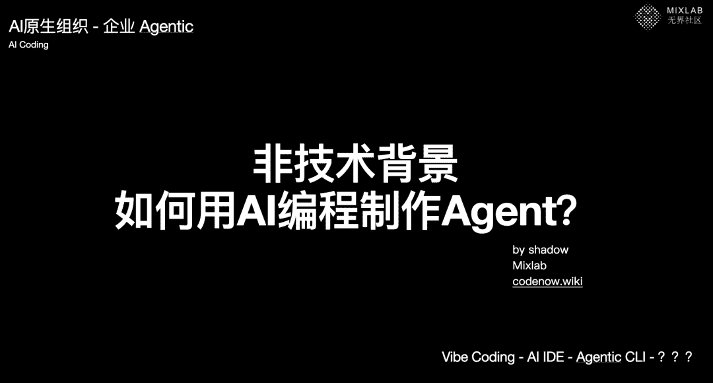
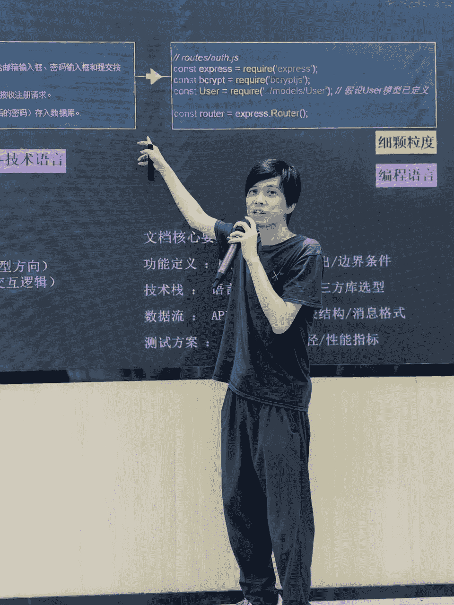
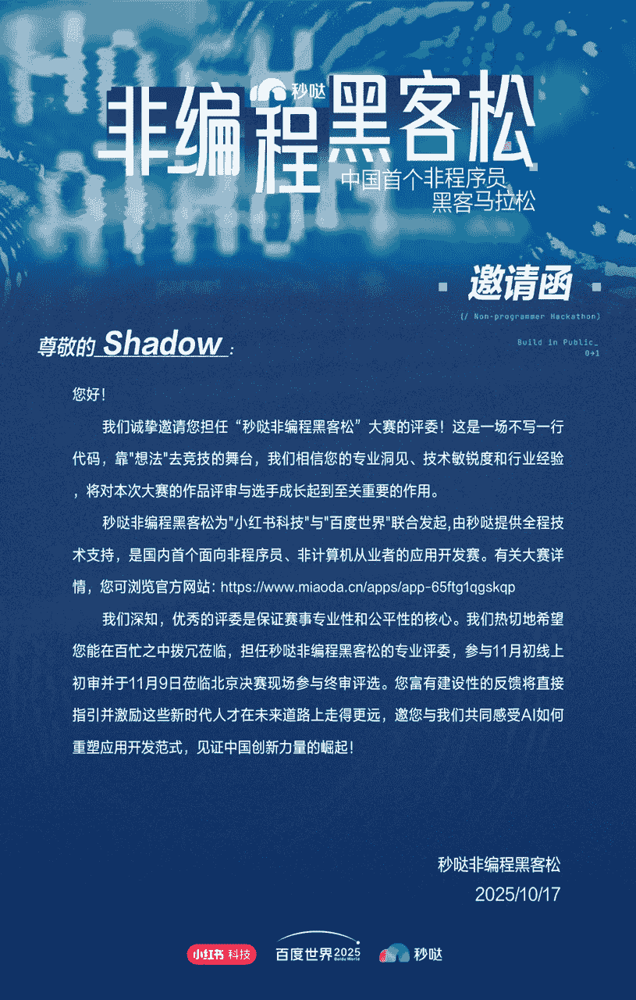
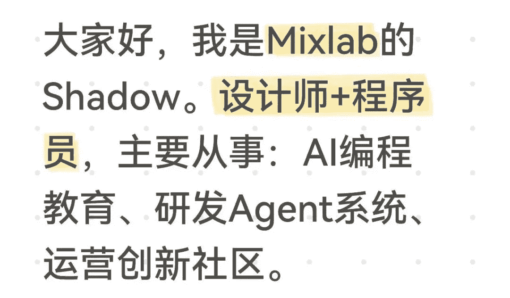
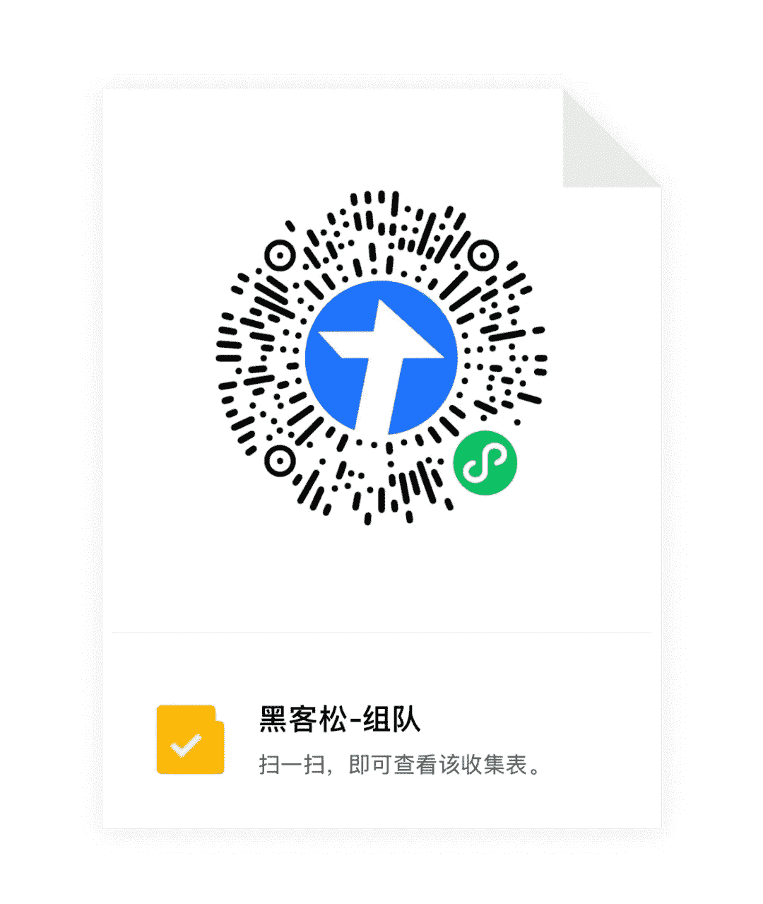

# 奖金30w现金、百万流量，非程序员也能做出下一个爆款 AI 应用#非编程·百度秒哒黑客松大赛#📕曝光

> 来源：[https://now.feishu.cn/docx/TdjYdj1ATojgBBxXi25cd5oYnJb](https://now.feishu.cn/docx/TdjYdj1ATojgBBxXi25cd5oYnJb)

文 / Shadow

Mixlab 创新教练 · AI 编程教育者 · 设计师&程序员

这周，我在同济大学校友会做了一场分享：《非技术背景如何用 AI 编程制作 Agent》。台下坐满了设计师、产品经理、创业者、金融从业者、健康行业从业者，基本都是非计算机背景。

他们问得最多的问题是：**“我真的能行吗？”**

shadow 10.16 在同济大学校友会活动分享：

《非技术背景如何用AI编程制作Agent》

过去一年，作为 AI 编程训练营的指**导老师，我带着近 300** 位零基础学员从“连代码是什么都不知道”，到亲手做出能对话、能执行任务、能解决实际问题的智能体（Agent）。课程结束时，很多人说：

“原来做 App 不需要会写代码”

“我第一次觉得，技术离我这么近。”

这让我更加确信：AI 正在彻底重构“创造”的定义——创意，才是新时代的硬通货。

而就在最近，一个真正为“非程序员”量身打造的机会来了。

由 **百度世界** 联合 **📕科技** 共同发起、**Mixlab 跨学科创新社区** 支持的中国首个 **非编程黑客松** 。

***

「一起来按『模』｜秒哒非编程黑客松」

这是一场打破边界、拥抱多元的 AI 创新实验：

+   🎯 两**大赛道：**聚焦 Agent 应用与生活场景创新；

+   💰 3**0 万元奖金池，**为有价值的创意提供真金白银的支持；

+   📱 百**万级📕流量包，**让你的作品被看见、被讨论、被使用；

+   🛁 决**赛在汤泉馆举行—**—边泡汤、边按摩、边“按模”（调试 AI 模型）。

是的，你没看错。泡出来的不止一身轻松，还有下一个爆款应用。

作为本次赛事的评委，我想对你说：

你不需要会写代码，但你需要一个开始的勇气。

+   也许你是个擅长洞察用户需求的产品人，

+   也许你是个能画出惊艳交互的设计师，

+   也许你只是有个“要是有个 App 能帮我做 XX 就好了”的念头

这些，都足够成为一支优秀团队的核心。

***

我们将通过 Mixlab 社群为参赛者匹配队友和交流想法等支持。只要你填写报名表，就能加入这个由全球创作者、研究者与实践者组成的临时“共创部落”。

顺便说一句，最近我也在📕做 AMA（Ask Me Anything），欢迎来问：“非技术背景怎么入门 AI 编程？”“黑客松怎么组队？”

—— 欢迎来找我聊聊，有问必答 😊

---

**这不是一场只属于程序员的比赛。**

这是一场邀请所有人“动手创造未来”的聚会。

如果你心中有想法，**那就来吧。**

我们在汤泉等你，把想象，变成现实。

👉 报名及组队申请：

当然有任何问题

可以🛰️联系我 litnmnm