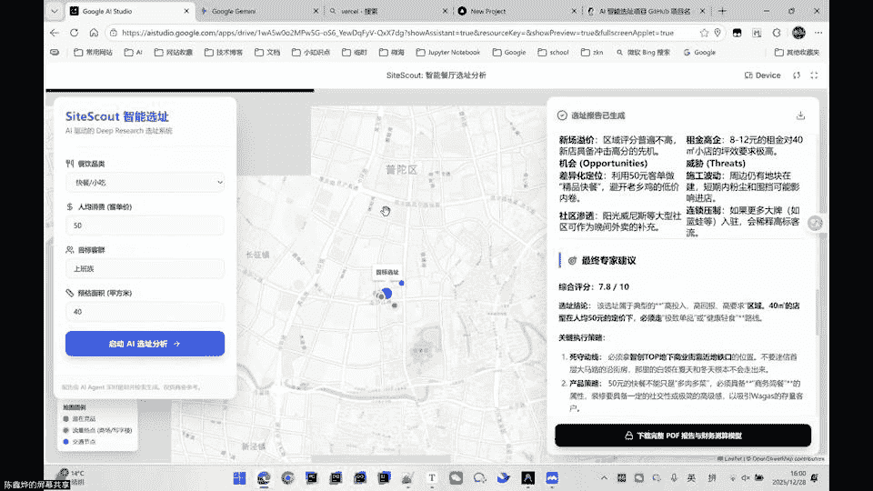

# 智能选址报告生成器

> 来源：[https://now.feishu.cn/docx/CgjQdmNXNoacGoxp4yvcqgFfnvf](https://now.feishu.cn/docx/CgjQdmNXNoacGoxp4yvcqgFfnvf)

[智能选址报告-1.mp4](https://internal-api-drive-stream.feishu.cn/space/api/box/stream/download/all/K1cWbfanLoImQKxstKpct1QxnXd)

今天分享的是我们 Mixlab AI 编程训练营第 22 期学员鑫烨做的作品，智能选址报告系统。

鑫烨一直在服务连锁餐饮企业——古茗、奈雪这些都是他的客户。他观察到一个很实际的问题：这些品牌开新店时，老板们手里有预算、有想法、也找好了几个备选商圈，但就是缺一个数据层面的决策依据。

这个观察触动了我，因为它指向了一个很具体的痛点。不是「餐饮行业需要数字化」这种宏大叙事，而是「我已经看好了三个商场，到底选哪个」这样一个真实的决策困境。

鑫烨的解决思路也很直接：用多智能体系统来做深度调研。他设计了三个智能体——规划智能体负责拆解调研任务，执行智能体去搜索公开数据（周边人口结构、竞品分析、租金成本），撰写智能体把所有信息整合成一份完整的选址报告。

演示的时候有个细节让我印象深刻。当他输入「人均消费 50 元、主要客群是上班族、店面 70 平方」这些参数后，系统开始执行调研计划。我看到执行智能体在 1 公里范围内分析居住人口结构、搜索周边竞品、调研租金水平，最后生成一份包含流量分析、消费能力评估、SWOT 决策模型的报告。整个过程就像真的请了一个调研团队在做实地考察。

更有意思的是他提到的商业对比。美团现在提供类似的选址报告服务，50 元一份。但餐饮老板通常不会只看一个商圈，可能要对比 10 个备选地点，那就是 500 元。而且美团的数据虽然全面（外卖数据、商圈数据都有），但毕竟是标准化产品。鑫烨说他这个系统目前用的是公开数据，但可以接入客户自己的私有数据——这意味着可以把品牌自己积累的会员数据、消费数据也纳入分析维度。

我很期待看到这个产品真正用在客户决策场景里的样子。毕竟，对一个要投入几十万开店的老板来说，能把几个备选商圈的数据清晰地摆在面前对比，这个价值远不止省下几百块调研费那么简单。

[Mixlab Agent OS + AI编程 线上训练营（12.17-1.17）N21期](https://qwyofiv4bd3.feishu.cn/wiki/P4LSwyb9WiZx0AkKraDcj3JonTh)

[Mixlab AI 编程线下训练营N23（1.24-1.25）](https://qwyofiv4bd3.feishu.cn/wiki/BKn7w8qvxiBMvTkaT2YchlknnQg)