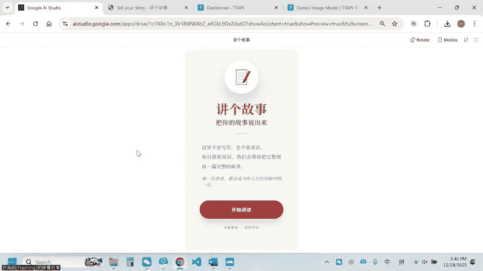

# 讲个故事

> 来源：[https://now.feishu.cn/docx/ZZdud8Vv6oksiNxMKKRcNonQnqg](https://now.feishu.cn/docx/ZZdud8Vv6oksiNxMKKRcNonQnqg)

[讲个故事（面向银发族）-1.mp4](https://internal-api-drive-stream.feishu.cn/space/api/box/stream/download/all/Ori5bfWmjoClU6xiYIbc1Ozgnld)

今天分享的是我们 Mixlab AI 编程训练营第 22 期学员海明做的作品，《讲个故事》。

海明观察到家里的老人特别爱讲过去的事，翻来覆去地讲，但这些故事从来没有被好好记录下来。他想做个东西，能把老人那些高光时刻、开心的记忆都保存下来。

我们都知道老人爱讲故事，但很少有人想到把它做成一个产品。海明说他一开始想做「回忆录」，结果发现老人很抵触——「我才多大，你就让我写回忆录？」这个细节很有意思，他后来改成了「讲故事」。这个转变让我意识到，产品设计不只是功能，更是心理。

于是他把这个想法做成了APP。你可以用语音或文字输入，比如说「我小时候喜欢钓鱼」，AI 就会引导你把这件事讲清楚。聊完之后，AI 会根据你讲的内容生成一个故事，还会配上图。演示的时候我注意到，如果你讲得太少，AI 会提醒你「要不要再聊一点，否则故事里会有很多虚构的内容」。这个设计很细心，它在帮用户把控故事的真实性。

生成的故事会按照童年、中年、今年这样的时间线归类，形成一个个卡片。你可以随时打开看，也可以修改故事或配图。海明还设计了一个分享功能，可以把故事生成一张图片，方便发朋友圈。图片左上角会打上 logo，他说这是「推广一下这个 APP」。

有个设计让我觉得很聪明。他没有一上来就让用户注册，而是先让他们体验生成一个故事。因为生成故事之后，你会很想把它保留下来，这时候就有了注册的冲动。他说这是为了降低老人使用的门槛。这个逻辑很清晰——让用户先感受到价值，再引导他们注册。

海明提到一个有意思的规划。他想做一个「故事广场」，可以随机刷到别人公开的故事。他说这样能激发不同人的分享欲，也能降低创作门槛——看到别人是怎么讲的,自己也会想讲。我觉得这个想法很有意思。老人的故事往往是相似的，但每个人的讲述方式不一样。如果能在故事广场上看到别人的生活片段，可能会让更多人愿意开口。

海明还想推出装订成册的实体书，可以送人。如果老人的故事真能变成一本可以翻阅的书，我想那会是很温暖的一件事。

[Mixlab Agent OS + AI编程 线上训练营（12.17-1.17）N21期](https://qwyofiv4bd3.feishu.cn/wiki/P4LSwyb9WiZx0AkKraDcj3JonTh)

[Mixlab AI 编程线下训练营N23（1.24-1.25）](https://qwyofiv4bd3.feishu.cn/wiki/BKn7w8qvxiBMvTkaT2YchlknnQg)