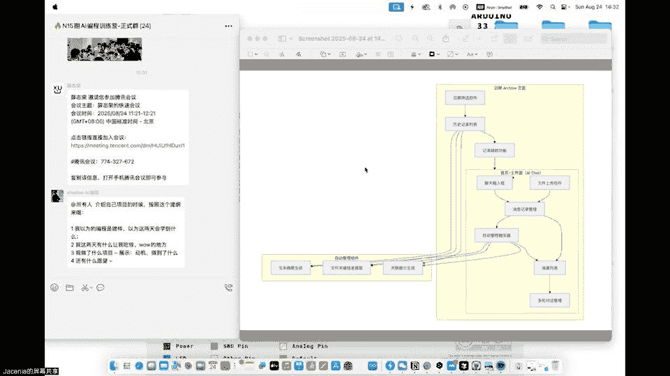

# AI 记忆助手

> 来源：[https://now.feishu.cn/docx/MiTYdtalOoj9FqxtbCFc91DAnjf](https://now.feishu.cn/docx/MiTYdtalOoj9FqxtbCFc91DAnjf)

[用于记忆的AI助手-1.mp4](https://internal-api-drive-stream.feishu.cn/space/api/box/stream/download/all/G3Zabv3v7ouB3XxMza3cSmtEnHd)

今天分享的是我们 Mixlab AI 编程训练营第 15 期学员 Jacenia做的作品，AI 记忆助手。

Jacenia 观察到一个很有意思的现象——我们生活里经常会遇到这样的情况：随手记下一些琐碎的信息，比如某个不常用的账号密码、牛仔裤放在柜子的第几层、朋友推荐的那家餐厅名字。这些信息你不会特意去整理，但总在需要的时候想不起来。关键是，你往往记得「大概什么时候记过这件事」，却想不起来「具体内容是什么」。

这个观察触动了我。我们确实有很多笔记工具、待办清单，但它们都要求你主动去「记录」、去「整理」。而 Jacenia 想做的是另一种东西——你只是在和 AI 聊天的过程中随口提了一句，它就帮你记住了。等你想不起来的时候，用同样聊天的方式问它，它就能调出之前的记忆告诉你。

演示的时候她给我看了一个场景：她在对话框里说「我的牛仔裤在柜子第三层」，AI 回复「已添加到记忆」。过了一会儿，她问「牛仔裤在哪里？」，AI 就根据之前的对话告诉她答案。整个过程非常自然，不需要打开「新建笔记」，不需要选择分类，就是聊天。

我意识到她其实在做一件很微妙的事——把「记笔记」这个动作从一个刻意的行为变成了对话的副产品。你不需要想着「我现在要记笔记了」，你只是在说话，AI 自己判断什么值得记住。这种方式和我们平时用的那些笔记工具完全不一样。

Jacenia 还加了一个按日期查看聊天记录的功能。你可以选择某一天，或者选择一个时间段，筛选出那段时间的所有对话。我觉得这个设计很有意思，因为它对应的正是她一开始观察到的那个场景——很多时候你记不清具体内容，但你记得「大概是上个月某一天」。通过日期来找回记忆，这个思路比传统的搜索关键词更符合人的记忆习惯。

她提到未来想加入提醒功能。比如你在对话中说「下个月要考会计师」，AI 会在合适的时间点提醒你。这让我想到，这个工具其实已经不只是一个记忆助手了，它有点像是把 to-do list 的功能内化到对话里——你不需要专门去「创建任务」，只是在聊天时提了一句，AI 就知道这是一个需要提醒的事情。

如果通过对话就能把生活里那些琐碎的记忆都留住，会是个挺有意思的尝试。