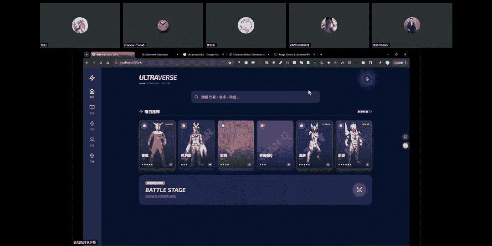

# 奥特曼战斗

> 来源：[https://now.feishu.cn/docx/AAcud9x1doBnd0xE4eqckTcOncd](https://now.feishu.cn/docx/AAcud9x1doBnd0xE4eqckTcOncd)

[奥特曼-1.mp4](https://internal-api-drive-stream.feishu.cn/space/api/box/stream/download/all/AVDnbiRJGoU3J7xvXXncz4OonRe)

今天分享的是我们 Mixlab AI 编程训练营第 23 期学员徐阳化名做的作品，奥特曼图谱和对战卡片。

徐阳 4岁 的儿子痴迷奥特曼，能认出上百个角色，每天抱着卡片玩对战游戏。但徐阳发现，市面上根本没有适合这个年龄段孩子的数字版奥特曼游戏——现有的游戏要么太复杂，要么就是简单的点击按钮。

她观察到一个很有意思的现象：孩子对这些角色如数家珍，随口就能说出「泰罗奥特曼」「贝利亚」这些名字，但让他在屏幕上点击按钮操作，反而不流畅。这个观察让她决定：与其做成点击游戏，不如让孩子「说」。

所以她做了一个语音触发的对战系统。孩子对着 iPad 说出两个角色的名字，系统就会自动生成一场战斗——不只是简单的动画，还会生成战斗故事和结果。比如孩子说「迪迦」和「怪兽哥尔赞」，系统会讲述这场战斗是怎么发生的，谁赢了，为什么赢。

这个设计打动我的地方在于：她没有把技术强加给孩子，而是顺着孩子的天然行为方式去设计交互。4岁的孩子本来就是通过「说」来玩角色扮演游戏的，语音输入对他们来说比任何界面都自然。

徐阳还做了个知识图谱，把这100多个角色的家族关系可视化出来。演示的时候我注意到，这不只是个花哨的展示，而是真的在帮孩子理解这些角色之间的关联——谁是谁的父亲，谁和谁是兄弟。对一个4岁孩子来说，这种可视化的关系网络比文字描述容易理解得多。

除此之外，她在考虑给语音系统加上内容过滤。因为 AI 生成战斗故事的时候，可能会出现不适合幼儿的暴力描述。这让我想到一个经常被忽视的问题：当我们用 AI 给孩子生成内容时，不只是要考虑内容的趣味性，还得考虑表达方式是否适龄。同一个战斗场景，描述得太激烈就不合适了。

在过去的黑客松里我都没见过有家长给自己的小孩做奥特曼的玩具，所以，想象力和就地取材真的很重要。

[Mixlab AI编程 线上训练营（2.3-1.17）N24期](https://qwyofiv4bd3.feishu.cn/wiki/RtdNwh2f1isNOpkrF8TcsqDqnEz)

[Mixlab Agent OS 线上训练营（12.17-1.17）N21期](https://qwyofiv4bd3.feishu.cn/wiki/P4LSwyb9WiZx0AkKraDcj3JonTh)

[Mixlab AI 编程线下训练营N23（1.24-1.25）](https://qwyofiv4bd3.feishu.cn/wiki/BKn7w8qvxiBMvTkaT2YchlknnQg)