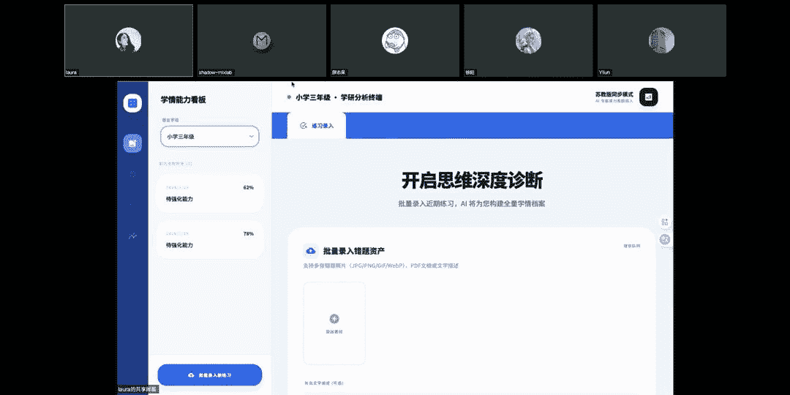

# 一个家长做的错题分析工具

> 来源：[https://now.feishu.cn/docx/Xjiod7v51o0RiKxV60acfh7JniC](https://now.feishu.cn/docx/Xjiod7v51o0RiKxV60acfh7JniC)

[学情能力看板-1.mp4](https://internal-api-drive-stream.feishu.cn/space/api/box/stream/download/all/JyXEbQkfgoz8GnxDia7cnymrnUc)

今天分享的是我们 Mixlab AI 编程训练营第23期学员Laura做的作品，学情能力看板。

Laura 做这个项目的出发点让我印象很深刻。她自己也是家长，用过市面上很多号称有 AI 能力的学习软件，但她发现这些软件有个共同的问题——错题分析太粗糙了。

她举了个例子：孩子做错了几何题，软件会打上「几何问题」的标签，然后推一堆几何错题让孩子练。但这些题和孩子真正出错的点根本不匹配。可能孩子错的是空间想象环节，推荐的题却是在考计算能力。对家长来说，这种错题库完全没法用。

这个观察触动了我，因为它指向了一个经常被忽视的问题：我们以为 AI 已经能精准分析错题了，但实际上大部分产品只是在做粗糙的关键词匹配。「几何」这个标签太宽泛了，它没有告诉你孩子到底是哪个环节出了问题。

所以 Laura 想做一个真正能分析「错在哪里」的工具。她的思路是：上传错题照片或文件，让 AI 去推导孩子在这些题目上暴露出的具体能力问题——不是笼统的「几何不好」，而是「空间想象能力弱」或者「建模能力不足」。

演示的时候，她上传了一些错题，系统生成了一份报告。报告里不只是列出错误类型，还会给出可行的提升方案。让我印象深刻的是，这些方案分两类：一类是针对性的练习题，另一类是生活中的思维训练。

比如发现孩子空间想象能力弱，除了推荐相关题目，还会建议家长在日常生活中让孩子做一些「把东西运到某个地方」这样的规划任务。这个设计很有意思——它在试图把能力训练从做题延伸到生活场景里。

Laura 说她理想中还想做一个功能：追踪同一个知识点在不同学段的关联。比如小学阶段的空间想象力，到了初中、高中会怎么发展，需要什么样的提升。这样家长能看到一个长期的能力成长路径，而不只是盯着眼前的错题。

她还可以根据分析出的薄弱点，定制生成练习卷。家长选择想强化哪些内容，系统就生成对应的题目和解答，可以直接打印出来用。

演示结束后 Laura 提到一个很实际的问题：现在这个工具是个网站，一刷新数据就没了。她想解决的是怎么把这些长期数据存下来，持续追踪孩子的能力变化。我觉得这个问题很关键——如果只能看单次的错题分析，那和市面上的工具也没太大区别。真正的价值在于长期追踪，看到能力曲线的变化。

Laura 说她想把这个做成真正能用起来的产品。如果真能做到精准分析错在哪里，然后给出对症的练习和生活场景建议，这会是个很实用的工具。