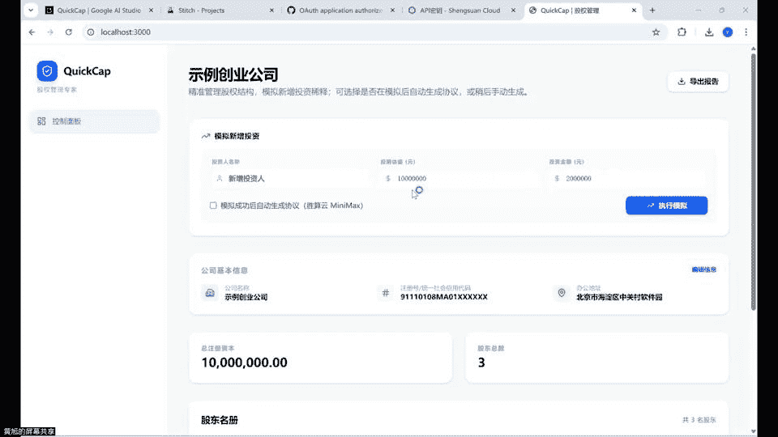

# 股权管理专家

> 来源：[https://now.feishu.cn/docx/Z1EQd9MAnoBRXmx0ArVcOOSxnuc](https://now.feishu.cn/docx/Z1EQd9MAnoBRXmx0ArVcOOSxnuc)

[股权管理专家-1.mp4](https://internal-api-drive-stream.feishu.cn/space/api/box/stream/download/all/V5n1bmG2Solbw0x1t5IcHN4ontc)

今天分享的是我们 Mixlab AI 编程训练营第 25 期学员黄旭做的作品，股权管理与协议生成系统。

黄旭在公司做法务，平时要处理投资人进入的股权计算。他说这件事有很强的勾稽关系:投钱多少、估值多少、每股单价怎么算、注册资本怎么变、股权比例怎么调整，一环扣一环，手动用 Excel 做很容易出错，而且一旦出错后果会很大。

但真正让我印象深刻的不是这个痛点本身，而是他在做这个项目时的一个观察。

他说，人工做一份投资协议可能要一天，交给律所要十几万到二十万。但演示的时候有人问他:「律所做一份协议要十几万?」黄旭说是的，基本都是这个价格。然后有人追问:「那你这个产品岂不是可以卖给律所?」

黄旭的回答让我觉得很有意思。他说如果律所有很成熟的模板，律师能做的其实就是确认一遍有没有 bug，「价值没有那么大，但市场上被炒得很高」。

这个观察触动了我。很多「专业壁垒」本质上是信息不对称和流程不透明造成的。一旦把底层逻辑梳理清楚、把 SOP 标准化，这些壁垒就会被打破。黄旭做的系统就是在做这件事:把股权计算的勾稽关系结构化，把协议生成的逻辑流程化。

他做了一个股东名册管理页面，可以调整每个股东的出资额、注册资本、股权比例，系统会自动计算每股单价和整体股比变化。更重要的是，他加了一个模拟功能:输入新投资人的投资金额和投前估值，系统会直接算出新投资人的投资单价和进入后的股东名册。演示的时候我看到，投资金额 2000 万、投前估值 1 亿，系统算出新投资人单价是 11 块多，股权比例也同步更新了。

这个功能的价值在于:它把原本需要反复验算的复杂计算变成了可以直接看到结果的模拟器。做投资文件之前，各方可以先在这里模拟一遍，确认数字没问题再往下走。

黄旭还加了一个 AI 生成协议的功能。他演示了生成的投资协议，很简单，但基本条款都有:投资金额、估值、股权比例、交割条件、争议解决等等。他说目前还不完善，但如果把公司常用的协议模板喂给模型，让它按模板定制化生成，基本上可以完全完成这部分工作。

最让我意外的是黄旭对自己工作的思考。他说，以前工作重点是处理这些具体事务，未来可能会转向 SOP 梳理——把流程理清楚之后，很多东西可以让 AI 自动化解决。更进一步，等 SOP 清楚、AI 能做完之后，法务可能更多变成内部培训师，教大家怎么用、在什么时候需要用。

这个思考让我重新看待很多专业岗位的未来。不是被 AI 替代，而是角色转变:从「处理事务的人」变成「梳理流程的人」，再变成「教会别人用工具的人」。这个转变的前提是，你得先把自己领域的 SOP 梳理清楚。

黄旭说公司投资本身很复杂，可能有可转债、股转、增资等各种形式，不同轮次还会叠加，但他觉得都可以勾稽、流程化。如果这些复杂的事务真的能被结构化，那些被市场炒高的「专业壁垒」会是什么样子?