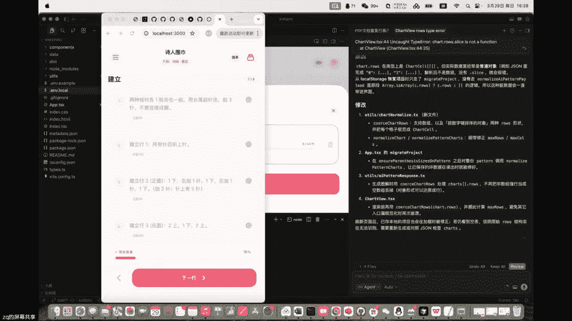

# 编织笔记本

> 来源：[https://now.feishu.cn/docx/FfLsdbE8Jo9DOaxB4nfcF3aCnub](https://now.feishu.cn/docx/FfLsdbE8Jo9DOaxB4nfcF3aCnub)

[编制笔记本-1.mp4](https://internal-api-drive-stream.feishu.cn/space/api/box/stream/download/all/OlzebXtjZo6jeJxLfOLcblSUncd)

今天分享的是我们 Mixlab AI 编程训练营第 25 期学员周倩(化名)做的作品，编织图解进度追踪器。

周倩做这个项目的出发点让我印象很深刻。她是个织女，经常织毛衣。但她遇到的痛点不是「不会织」，而是「忘了织到哪儿了」。

她给我看了一张编织图解，密密麻麻写着:第一行织几针，第二行织几针，还分 S、M、L 不同尺码，每个尺码要对照找。她说最头疼的是，织到一半放下，再拿起来就不知道刚才织到第几行了。如果同时织三件，就更乱了。

这个观察触动了我。因为她指出了一个经常被忽视的认知负担:不是技能不够，而是记忆本身就是消耗。编织这种重复性任务，你需要不断记住「我在第几步」，这个记忆成本比织本身还累。

周倩做的解决方式很直接：用手机拍 PDF 图解，AI 识别成逐行指令，织完一行点一下「下一行」，系统自动记录进度。她用的是 Gemini 的多模态识别，把那些复杂的图解转成结构化的步骤列表。

演示的时候有个细节让我印象深刻。她可以筛选尺码，比如只看 M 码的织法，系统会把其他尺码的行数都隐藏掉。这个设计很巧妙——不是简单地高亮，而是直接让不相关的信息消失。这才是真正的「减少认知负担」，而不是「帮你标记重点」。

周倩说，她在社交媒体上发了个小 demo，11 万阅读量，很多人留言说需要这样的产品。这个数据让我重新思考「小众需求」这个词。编织看起来是小众爱好，但当你解决的是「如何追踪长周期、多项目进度」这个底层问题时，需求就不小众了。

她提到课程让她更清楚每个工具的特点，什么阶段该用 Cursor、什么阶段该用 AI Studio。我觉得这个反馈很真实——不是学会了某个工具，而是知道了工具之间的边界，这才是真正的「会用」。

周倩说她想试试做收费功能，毕竟有 API 消耗。我很期待看到这个产品真正上线的样子，看看还有多少人在被「记住我在第几步」这件事困扰。