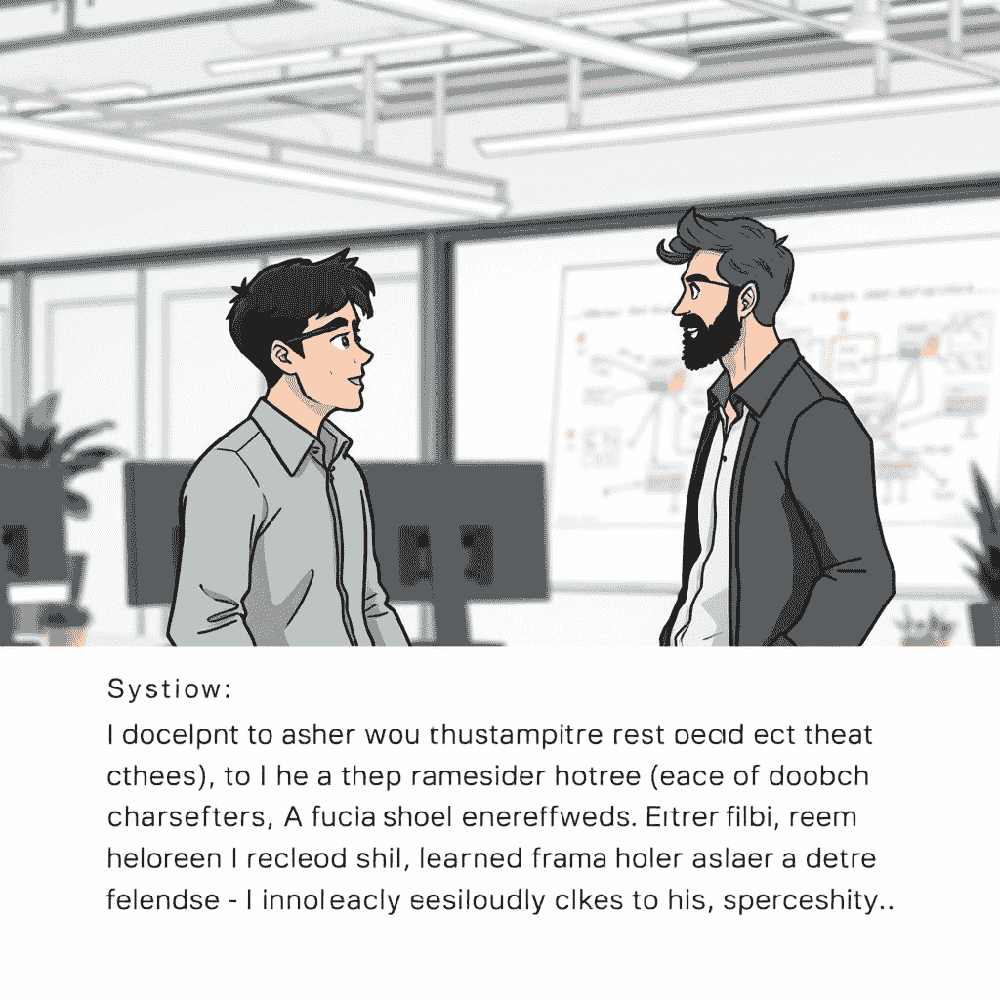

# 探索的真正意义在于超越自己的能力边界：AI编程线下训练营 - 程序员回访

> 来源：[https://now.feishu.cn/docx/NnPZd8qWPo4d9Uxlrjecu0Rmnke](https://now.feishu.cn/docx/NnPZd8qWPo4d9Uxlrjecu0Rmnke)

在过去两个月的AI编程训练营中，我们有约15%的学员是专业程序员，大部分是从事机器学习和后端开发。为什么已经熟悉编程的工程师会对AI编程感兴趣？在与他们深入交流后，我发现了一个共同点：他们都在寻找突破技术边界的方法。AI编程对他们而言，不仅是一个工具，更是一个跨越专业领域的桥梁。

“探索的真正意义在于超越自己的能力边界。”

——

为了更好地理解他们的需求和转变，我采访了几位学员。下面是其中一段很有代表性的对话：

---

Shadow: 你是一位后端开发工程师对吧？是什么让你对AI编程产生兴趣的？

程序员: 是的，我主要做Java后端开发。其实最开始是因为一个私人项目让我意识到AI编程的价值。我一直想做一个属于自己的side project，一个程序员技术博客平台。但你也知道，作为后端开发，前端是我的软肋，UI设计更是完全不懂。之前找前端朋友帮忙，但大家都很忙，项目就一直搁置着。

Shadow: 后来你是怎么解决这个问题的？

程序员: 说来有趣，我在一次技术分享会上看到有人用AI编程工具几分钟就生成了一个完整的页面，包括UI设计和前端代码。这让我特别震惊，因为以前做一个漂亮的前端界面，起码要折腾好几天。我立刻尝试了一下，真的只用了一个周末就把我的博客平台的界面搭建出来了。

Shadow: 听起来AI编程帮你突破了技术栈的限制。说说在UI设计这块遇到过什么困扰？

程序员: 说到UI就是一把辛酸泪啊(笑)。记得之前做一个数据大屏项目，后端API我三天就写完了，结果卡在前端界面整整两周。那些像素级的对齐、配色方案、响应式布局，对我来说简直是噩梦。找设计师帮忙吧，光改动就要来回沟通好多次。自己调CSS呢，改一个地方就会影响其他地方，最后整个页面都乱了。

Shadow: 后来用AI编程是怎么解决这些问题的？

程序员: 太神奇了！现在我只要告诉AI"我要一个深色主题的数据大屏，左边是导航栏，中间是实时数据展示，右边是各种图表"，它就能生成一套专业的界面，包括精确的像素对齐、合理的配色、还有平滑的动画效果。以前我花一天时间调试的样式问题，现在几分钟就搞定了。

最让我惊喜的是，AI生成的代码还自带响应式布局，在手机上也能完美展示。这在以前对我来说是高难度操作，现在完全不用担心这些技术细节。

Shadow: 在公司的工作中有用到AI编程吗？

程序员: 在公司最近有个很典型的案例。我们接到一个需求，要做一个数据可视化的管理后台。以前这种项目我们后端就只管API，前端的图表、界面都要分给前端团队，常常要等上几周。现在用AI编程，我自己就能快速构建出一个完整的原型，包括各种数据图表。这不仅加快了开发效率，还让我能更好地理解和优化整个系统的数据流。

Shadow: 这确实是个很大的改变。对找工作有影响吗？

程序员: 太有影响了！上个月我去面试，面试官看到我的作品集，特别惊讶我一个后端工程师能做出这么完整的全栈项目。我跟他分享了我是如何利用AI编程扩展技术栈的，还现场演示了如何快速构建一个前端界面。最后拿到的offer薪资比预期高了不少。面试官说他们正在寻找能驾驭全栈开发的工程师，而AI编程正好弥补了这个需求缺口。

Shadow: 听起来AI编程给了你很大的信心。除了UI设计，还开拓了其他技术领域吗？

程序员: 对，这是最有意思的部分。以前我总觉得要精专于一个方向，现在借助AI，我的技能树疯狂分支了。比如最近我尝试做了个AI助手项目，涉及到了NLP处理、向量数据库、前端界面设计。换作以前，这种跨度这么大的项目，我想都不敢想。

现在有了AI编程，它就像一个全能助手。我遇到不熟悉的技术领域，就让AI生成示例代码，然后我再基于这些代码深入学习和改进。这种学习方式特别高效，因为你能直接看到代码是怎么工作的，而不是从零开始啃文档。

Shadow: 从你的经历来看，AI编程帮助你拓展了职业机会。对于想尝试的朋友，你会怎么建议？

程序员: 我建议先放下固有的技术认知。不要觉得"我是后端就只能写后端"。现在借助AI编程，技术边界很容易就能突破。而且要善用AI处理那些繁琐的实现细节，把更多精力放在项目的创意和架构设计上。

最重要的是要有探索精神。很多朋友可能担心不熟悉新领域就不敢尝试，其实有了AI编程，尝试新技术的成本真的很低。

Shadow: 说到探索精神，我最近带了几期AI编程训练营，遇到不少像你这样突破自我的学员。特别让我印象深刻的是一位设计师，他的经历可能对你也有启发。

程序员: 哦？设计师也来学AI编程？

Shadow: 是的。这位设计师刚来的时候说自己有"代码恐惧症"(笑)。但一天课程下来，他用AI编程做了个设计灵感收集网站。现在他告诉我，接到新需求后，不用再求着开发帮忙做Demo了，自己就能快速做个原型给用户测试。他现在的设计流程完全改变了。拿他负责的一个社区团购小程序来说，以前画原型图要两周，最后交给开发做出来还发现很多交互问题。现在他先用AI编程做个简单Demo，让用户实际体验，发现问题立刻就能修改。

程序员: 这个思路确实不错。我们后端接到需求也经常觉得产品文档说得不够清楚，如果能快速做个Demo来验证，确实能省很多返工的时间。

Shadow: 说回来，你最近参加了AI编程训练营，感觉如何？

程序员: 收获特别大。说实话，虽然之前也听说过AI编程，但总觉得是噱头。参加训练营后才发现，关键是要知道怎么用。比如环境配置这块，如果自己摸索真的很容易卡住，光部署环境可能就劝退了。课程手把手指导，一下就能上手。

Shadow: 课程结束后，有尝试做什么项目吗？

程序员: 对，我用课上学的知识，做了一个技术文档管理平台。这个项目之前在公司就想做，但因为要兼顾前端开发和数据可视化，一直搁置着。现在两天就做出来了，还加了Markdown编辑器和实时预览功能。最让同事惊讶的是界面的精致程度，完全不像程序员做的(笑)。

最重要的是，现在我知道该怎么规划项目了。以前面对新需求，总是纠结于技术细节。现在我会先用AI快速做个原型，让产品经理和用户试用，根据反馈再迭代。这种开发方式特别高效，也更容易做出用户真正需要的功能。

Shadow: 听起来对工作方式产生了很大改变。

程序员: 没错。最大的变化是心态吧。以前遇到不熟悉的技术领域就发怵，现在反而很享受尝试新东西的感觉。课程教会我的不只是AI编程的技术，更重要的是一种拆解问题、善用工具的思维方式。

---

通过这次对话，我对程序员群体有了新的认识。他们对AI编程的追求不是盲目跟风，而是为了突破技术栈的限制，解决实际工作中的痛点。

有趣的是，程序员们很快就适应了AI编程的思维模式。他们不再纠结于技术细节，而是学会用更宏观的视角思考问题。正如他们说的，这就像多了一个"全能的技术搭档"。

最让我印象深刻的是那句"现在不用被技术栈限制住了"。这句简单的话，道出了许多程序员的心声。从"我只是个后端开发"到"全栈开发其实没那么难"的转变，展现了AI编程最大的价值 - 它不只是提高效率的工具，更是打破技术藩篱的助手，让每个开发者都能自由探索和创造。

—— 无边界探索 @mixlab

https://wj.qq.com/s2/16783219/4vir/