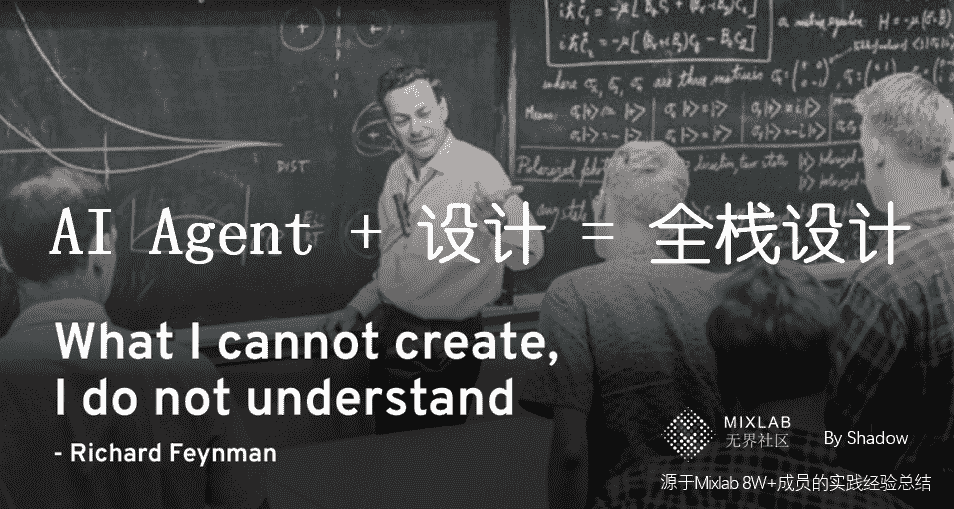

# 毕设选题：AI Agent 全栈设计#AI编程训练营 - 学生回访

> 来源：[https://now.feishu.cn/docx/PAdXdbJq4oIOQOxaM5YcjZ6JnEb](https://now.feishu.cn/docx/PAdXdbJq4oIOQOxaM5YcjZ6JnEb)

在过去两个月的AI编程训练营中(1-4期)，我发现约15%的学员是在读研究生，他们大多面临着开题和毕设的压力。有趣的是，这些同学基本都不是计算机专业，却被导师要求在项目中加入AI Agent功能。这让我很感兴趣。

想当年，我的毕设选择了参数化设计，已经算是比较超前的了，在比较传统的园林设计里，大量采用计算机来生成空间。没想到，现在的设计学方向的毕设，竟然已经“玩起了”AI Agent。

AI Agent 为什么会被大家所关注？

最直接的原因就是：能做到全自动，并且模拟某个角色的职能完成某项工作。多智能体，意味着，复杂的协作，都可以让AI完成。而设计学科，本身就涉及到多种角色的不同分工，比如：设计师视角、使用者视角、工程师视角等等。如果采用多智能体，来完成设计的任务，无疑可以更快地找到最优解。

在AI编程训练营，我也和这些非计算机专业的学生交流了主要的几个观点，下面是其中一段很有代表性的对话：

## 毕设选题：**AI Agent + 设计**

Shadow: 听说你最近在准备开题？我很好奇非计算机专业的同学是怎么想到做AI相关的课题的。

学生: 其实不是我想做(笑)。我是工业设计专业的，本来打算做个普通的产品设计系统。结果开题前导师说："现在AI这么火，你得加点新东西，要不然开题不好过"。我其实尝试过很多方法...看B站视频自学编程，但光是配环境就卡了好几天。后来想找计算机学院的同学帮忙，但人家都在忙春招，根本没空理我。

Shadow: 我遇到很多同学都是这种情况。你现在打算做一个什么样的系统呢？

学生: 我想做个设计创意生成和评估的工具。输入一个主题，能自动产出一些设计方案，然后给出评价。但是光是配Python环境就搞了好几天，还没成功...现在都快开题了，真的很慌。而且我觉得如果能真正掌握这个技能，对找工作也有帮助。现在很多设计岗位都在招懂AI开发的，薪资待遇会好很多。

Shadow: 其实用AI编程的方式，这个项目没你想象的那么复杂。现在有很多现成的API可以直接用，比如ComfyUI生成图像、ChatGPT做分析，关键是懂得把这些功能组装起来。

学生: 最大的阻碍就是不知道从哪开始...而且我看网上那些教程都是针对专业程序员的，对我来说太深奥了。我其实就想做出一个能用的作品，不需要很复杂的底层原理。关键是要能在简历里写出来，面试的时候能讲清楚项目的价值。你们之前好像指导过类似的同学？能具体说说她是怎么做到的吗？

Shadow: 当然可以。有一位同学的情况和你很像。她虽然会用ComfyUI做设计，但对编程完全不懂，更别说实现多个AI协作了。我们先分析了她的项目：让AI系统能自动生成设计方案，同时要有多个AI角色来评估设计。

使用AI编程的实现思路是：先用几行代码把ComfyUI的API接入进来，这样就能用代码控制设计生成。然后用GPT帮我们写代码，设计了几个不同的AI角色，比如艺术指导、用户体验专家、市场分析师，让他们一起评估设计方案。整个过程她都在参与，所以对每个环节都很清楚。

学生: 真得赞，这个就是我想象中的多智能体的毕设选题。现在很多设计岗位都要求掌握 AI ，如果能证明自己既懂设计又能做开发，应该很有竞争力吧？

## 会设计Agent的全栈设计师

Shadow: 当然。现在企业最看重的就是应对新技术的能力。使用AI编程，从0到1，技能比早些年提的全栈设计师更全。这个项目包含了API调用、多Agent系统设计、前端界面开发，还有产品设计思维。通过我们倡导的在实践中学，你可以真正掌握AI编程和多智能体的原理。毕设开题完全可以讲清楚每个技术细节。

学生: 确实！我看很多设计师现在都在学AI，但大多停留在用工具层面。如果能把多智能体运用到毕设里，应该能脱颖而出。那具体学习过程大概需要多久？而且我特别担心学习曲线太陡峭，怕跟不上...

Shadow: 关键不在时间长短，而在于你真的理解了开发思路。比如那位同学，虽然是一天时间做出了Demo，但因为每个步骤都是她自己完成的，所以对整个开发流程特别熟悉。这比花几个月写一堆看不懂的代码要有价值得多。而且这个过程本身就是很好的学习经历，展示了你的学习能力和动手能力，这些在做论文研究的时候，都是加分项。

关于学习曲线，传统编程的学习门槛比较高，AI编程更像是和AI一起做事，门槛反而低很多——使用cursor在chat和composer模式直接进行切换，更能帮助我们边学边做。

我个人一直都是倡导费曼学习法，在实践中边学边思考总结，用AI来编程，整个开发过程，都是你在主导 - 你负责设计功能、分解任务、让AI写代码、测试调整。每一步你都参与其中，所以肯定能说清楚实现思路。

而且现在越来越多的组织/机构都开始重视这种能力，既懂设计又能做AI应用的复合型人才肯定特别受欢迎。

---

## 产品思维 + AI 编程

通过这次聊天，我发现了个有意思的现象：

这些非计算机专业的学生，看似是被逼着做AI开发（笑），但其实他们才是最适合玩AI编程的人。

为什么？他们不会被传统编程思维束缚，反而更愿意把AI当成"搭档"。比如那位设计系的同学，她压根不纠结代码怎么写，而是专注在想做什么产品。这恰恰是AI编程最需要的思维方式。

有意思的是，这些同学都很清醒 - 知道现在光会用AI工具已经不够了，得真能做出点东西来。特别是在找工作时，"会用"和"会开发"是完全不同的竞争力。

最让我感触的是看到他们从"完全不敢碰代码"到"诶，好像也没那么难"的转变。

这可能就是AI时代最大的魔力 —— 它把创造的门槛降到了人人都能试试看的程度。

https://wj.qq.com/s2/16783219/4vir/