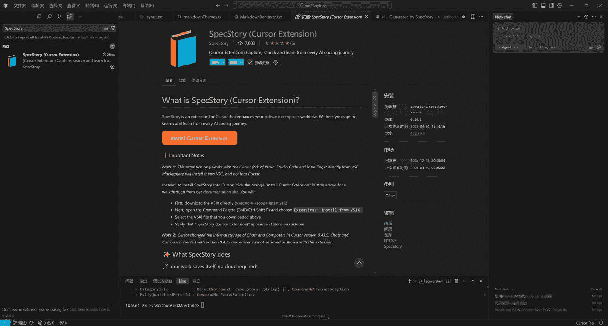
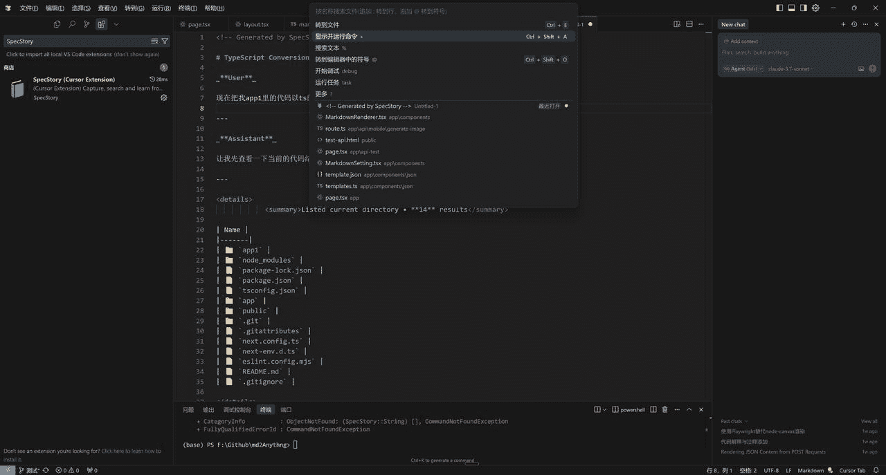
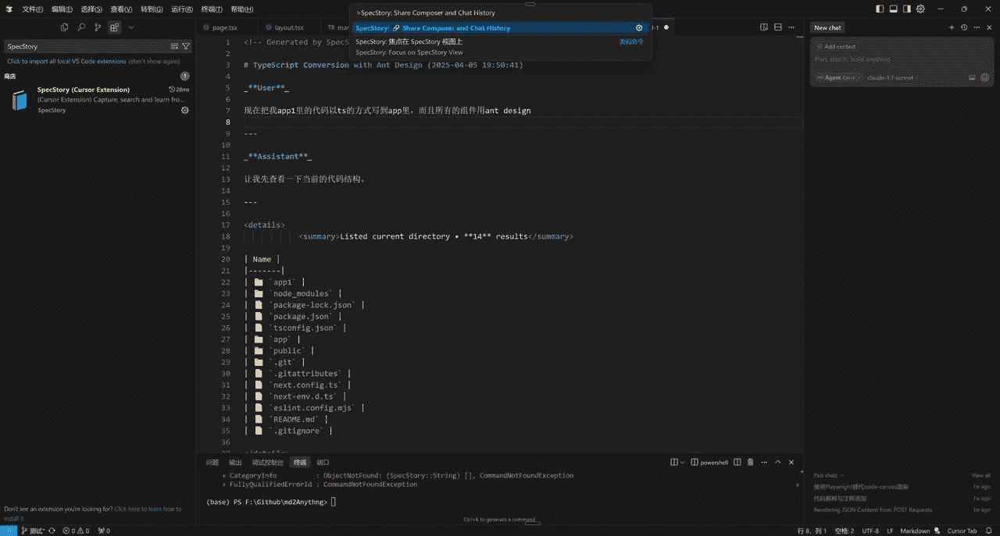
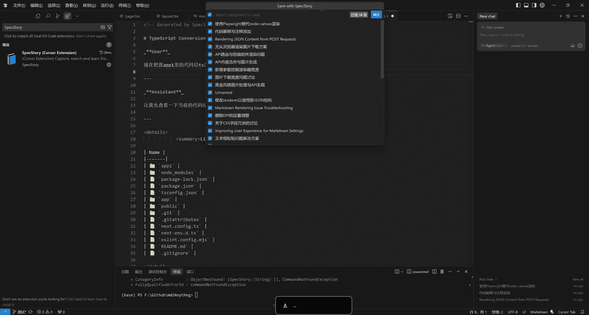
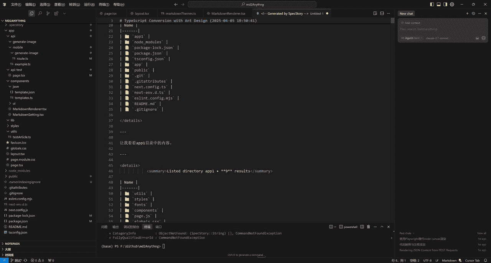
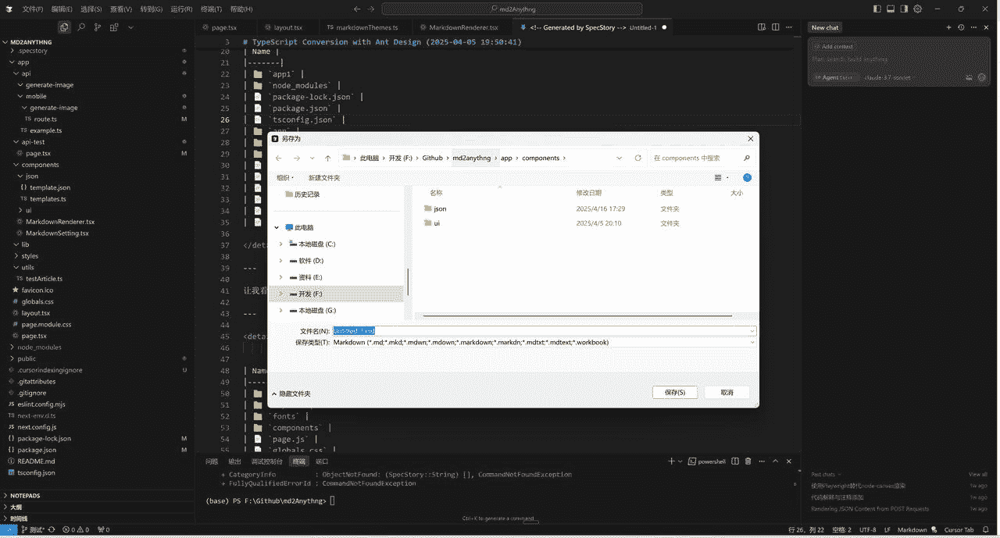
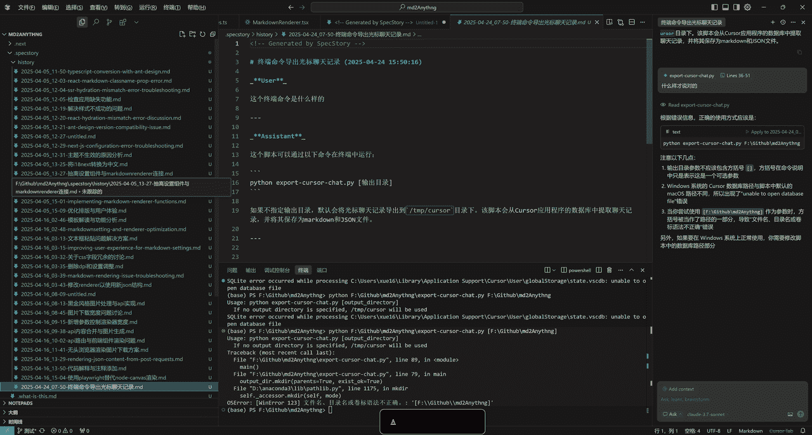

# 如何保存Cursor的历史对话记录

> 来源：[https://now.feishu.cn/docx/ZT5idFIbno384ExVHrxci232nAg](https://now.feishu.cn/docx/ZT5idFIbno384ExVHrxci232nAg)

1.  下载SpecStory并重启

1.  点击顶部搜索框，选择第二项

1.  输入：SpecStory: Save Composer and Chat History

1.  选择需要保存的历史记录并确定

1.  打开md

1.  保存md

左侧目录结构也能看到之前的对话历史

