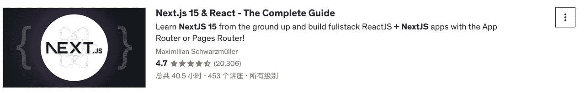

# udemy的付费课程资源

> 来源：[https://now.feishu.cn/docx/Na4WdPjNjoHONPxZkiJcFXiWnug](https://now.feishu.cn/docx/Na4WdPjNjoHONPxZkiJcFXiWnug)

https://udemylearning2024.udemy.cn/course/the-ultimate-react-course/

udemy（优领思）的React终极教程

部分章节的免费资源，可以快速参考一下

上面是项目的最终效果，你可以用下面的starter模板试一下，自己完成这个项目

https://github.com/mschwarzmueller/nextjs-complete-guide-course-resources/tree/main

Next.js 15 & React - The Complete Guide的配套仓库