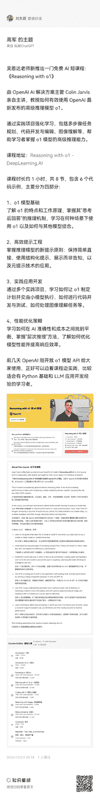

# Reasoning with o1

> 来源：[https://now.feishu.cn/docx/XabmdaLdvoVwOJxmaXpc439cnQh](https://now.feishu.cn/docx/XabmdaLdvoVwOJxmaXpc439cnQh)

吴恩达老师新推出一门免费AI短课程:《Reasoning with o1》

由 OpenAI AI解决方案主管Colin Jarvis亲自主讲，教授如何有效使用OpenAI最新发布的高级推理模型 o1。

通过实践项目强化学习，包括多步骤任务规划、代码开发与编辑、图像理解等，帮助学习者掌握 o1模型的高级推理能力。

课程地址: https://www.deeplearning.ai/short-courses/reasoning-with-o1/

