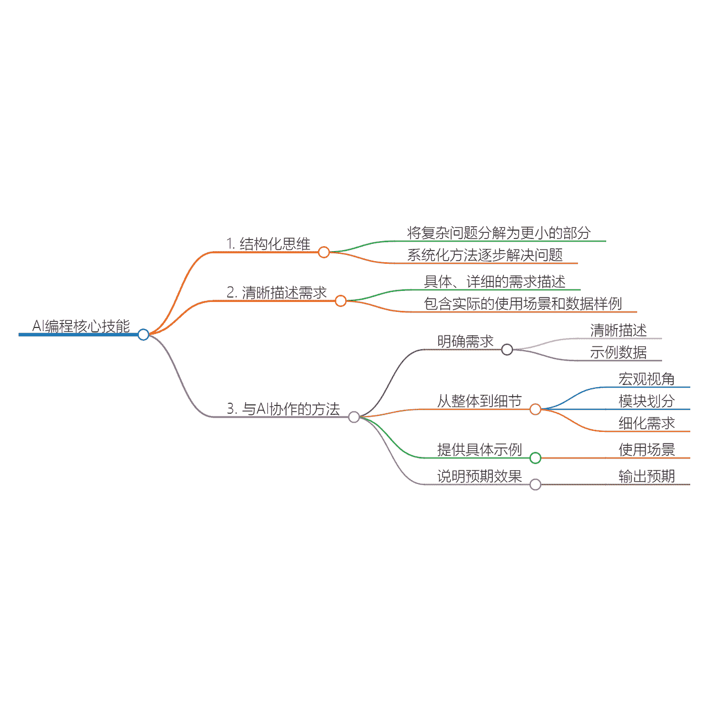

# AI编程入门指南003：AI编程的核心技能

> 来源：[https://now.feishu.cn/docx/NHUndg5mjoe9hGxhnCEcdtMSn2b](https://now.feishu.cn/docx/NHUndg5mjoe9hGxhnCEcdtMSn2b)



#

在如今这个科技飞速发展的时代，人工智能已经成为了各行各业的关键推动力。而掌握AI编程技能，不仅能够提升你的职业竞争力，更能让你在未来的工作中游刃有余。无论你是编程新手，还是有经验的开发者，这篇文章将带你深入了解AI编程的核心技能，帮助你从零开始，逐步掌握与AI协作的技巧。让我们一起踏上这段充满挑战和机遇的学习旅程吧！

1.  **结构化思维**

1.  **清晰描述需求**

1.  **与AI协同工作的方法**

# 结构化思维

结构化思维指的是将复杂的问题分解成更小、更易处理的部分，并通过系统化的方法逐步解决这些部分。对于编程来说，这种思维方式尤为重要。

示例：开发一个简单的Web服务器

在Node.js中，我们可以使用Express框架来构建一个简单的Web服务器。以下是一个结构化思维的示例：

```
// 导入 Express 模块
const express = require(&#x27;express&#x27;);
const app = express();
// 定义端口号
const PORT = 3000;
// 定义路由处理函数
function handleHomePage(req, res) {
    res.send(&#x27;Welcome to the Home Page!&#x27;);
}
function handleAboutPage(req, res) {
    res.send(&#x27;This is the About Page.&#x27;);
}
// 设置路由
app.get(&#x27;/&#x27;, handleHomePage);
app.get(&#x27;/about&#x27;, handleAboutPage);
// 启动服务器
app.listen(PORT, () =&gt; {
    console.log(
Server is running on http://localhost:${PORT}
);
});
```

在这个示例中，我们将Web服务器的功能分解为不同的路由处理函数，并分别实现这些函数。然后，我们将这些函数整合到Express应用中，最后启动服务器。

1.  清晰描述你的需求

清晰的需求描述是确保AI能够准确理解并执行你的要求的关键。好的需求描述应当具体、详细，并包含实际的使用场景和数据样例。

#### 示例1：实现一个用户注册功能

##### 需求描述：

1.  用户通过POST请求发送注册信息，包括用户名和密码。

1.  服务器接收并验证这些信息。

1.  将用户信息存储到数据库中（此示例中使用内存存储）。

1.  返回注册成功的消息。

##### Node.js代码实现：

```
// 导入必要模块
const express = require(&#x27;express&#x27;);
const bodyParser = require(&#x27;body-parser&#x27;);
const app = express();
app.use(bodyParser.json());
// 模拟数据库
let users = [];
// 用户注册处理函数
app.post(&#x27;/register&#x27;, (req, res) =&gt; {
    const { username, password } = req.body;
    // 简单验证
    if (!username || !password) {
        return res.status(400).send(&#x27;Username and password are required.&#x27;);
    }
    // 存储用户信息
    users.push({ username, password });
    // 返回成功消息
    res.send(&#x27;Registration successful!&#x27;);
});
// 启动服务器
const PORT = 3000;
app.listen(PORT, () =&gt; {
    console.log(
Server is running on http://localhost:${PORT}
);
});
```

#### 示例2：实现一个商品搜索功能

##### 需求描述：

1.  用户通过GET请求发送搜索关键词。

1.  服务器接收关键词并在商品列表中进行搜索。

1.  返回匹配的商品信息。

##### Node.js代码实现：

```
// 导入必要模块
const express = require(&#x27;express&#x27;);
const app = express();
// 模拟商品数据库
let products = [
    { id: 1, name: &#x27;Apple&#x27;, price: 3 },
    { id: 2, name: &#x27;Banana&#x27;, price: 1 },
    { id: 3, name: &#x27;Cherry&#x27;, price: 2 }
];
// 商品搜索处理函数
app.get(&#x27;/search&#x27;, (req, res) =&gt; {
    const { keyword } = req.query;
    if (!keyword) {
        return res.status(400).send(&#x27;Keyword is required.&#x27;);
    }
    // 搜索匹配的商品
    const results = products.filter(product =&gt;
        product.name.toLowerCase().includes(keyword.toLowerCase())
    );
    // 返回搜索结果
    res.json(results);
});
// 启动服务器
const PORT = 3000;
app.listen(PORT, () =&gt; {
    console.log(
Server is running on http://localhost:${PORT}
);
});
```

#### 示例3：实现一个文本生成功能

##### 需求描述：

1.  用户通过POST请求发送一个提示信息（prompt）。

1.  服务器将该提示信息发送到OpenAI的API。

1.  返回OpenAI生成的文本。

##### Node.js代码实现：

```
// 导入必要模块
const express = require(&#x27;express&#x27;);
const bodyParser = require(&#x27;body-parser&#x27;);
const axios = require(&#x27;axios&#x27;);
const app = express();
app.use(bodyParser.json());
// siliconflow API密钥
const API_KEY = &#x27;your_siliconflow_api_key&#x27;;
// 文本生成处理函数
app.post(&#x27;/generate-text&#x27;, async (req, res) =&gt; {
    const { prompt } = req.body;
    if (!prompt) {
        return res.status(400).send(&#x27;Prompt is required.&#x27;);
    }

    const data = {
      model: &#x27;deepseek-ai/DeepSeek-V2.5&#x27;,
      messages: [
        {
          role: &#x27;user&#x27;,
          content: prompt
        }
      ],
      stream: false,
      max_tokens: 512,
      temperature: 0.7
    };
    try {
        const response = await axios.post(&#x27;https://api.siliconflow.cn/v1/chat/completions&#x27;,data, {
            headers: {
                &#x27;Authorization&#x27;: Bearer ${API_KEY},
                &#x27;Content-Type&#x27;: &#x27;application/json&#x27;
            }
        });
        let generatedText=&quot;&quot;
        // 检查响应数据并提取生成的文本内容
        if (response.data &amp;&amp; response.data.choices &amp;&amp; response.data.choices.length &gt; 0) {
          generatedText = response.data.choices[0].message.content;
          console.log(&#x27;Generated text:&#x27;, generatedText);
        } else {
          console.log(&#x27;No content found in response.&#x27;);
        }
        res.send(generatedText);
    } catch (error) {
        res.status(500).send(&#x27;Error generating text.&#x27;);
    }
});
// 启动服务器
const PORT = 3000;
app.listen(PORT, () =&gt; {
    console.log(
Server is running on http://localhost:${PORT}
);
});
```

##### 总结

通过这些示例，我们展示了如何进行清晰的需求描述，包括具体的功能需求、输入和输出的详细说明，并通过Node.js进行实际代码实现。这种方式可以帮助AI更好地理解和执行你的需求，从而提高开发效率和代码质量。希望这些内容对你有所帮助！

# 与AI协作的方法

与AI协作编程是一项非常有用的技能，下面我们将介绍一些基本方法来提高你与AI合作的效率。

#### 1. **明确需求**

在开始与AI协作之前，你需要清楚地知道你想要什么。以下是一些关键步骤：

+   **清晰描述**：确保你的需求描述足够详细。比如，不是说“我需要一个搜索功能”，而是“我需要一个功能，用户可以输入关键词搜索商品，返回商品的名称、价格、图片和库存信息。”

+   **示例数据**：提供实际的使用场景和数据样例。例如，如果你在描述一个搜索功能，可以列出一些可能的搜索关键词和相应的搜索结果。

```
def getUserInput():
    print(&quot;请输入你的问题或请求：&quot;)
    input = input()
    return input
    
def isInputClearAndDetailed(input):
    if len(input) &lt; 10 or &quot;关键词&quot; not in input.lower():
    return Falsereturn True
    
def main():
    input = getUserInput()
    while not isInputClearAndDetailed(input):
        print(&quot;输入信息不够清晰或详细，请提供更多信息。&quot;)
        input = getUserInput()
    output = processInput(input)
    print(&quot;输出结果：&quot;, output)
    
main()
```

#### 2. **从整体到细节**

+   **宏观视角**：先从大局出发，概述整个系统或应用的功能。比如，一个购物网站可能包括用户管理、商品浏览、购物车、订单管理等。

+   **模块划分**：将需求分成不同的模块，并为每个模块列出其功能。

+   用户管理：注册、登录、修改密码等。

+   商品浏览：浏览、搜索、查看商品详情等。

+   购物车：添加商品、修改数量、删除商品等。

+   **细化需求**：深入每个模块，详细描述其具体功能。例如，用户注册需要填写用户名、密码、邮箱等。

#### 3. **提供具体示例**

+   **使用场景**：提供实际的使用场景，让AI更容易理解你的需求。

+   例如，描述搜索功能时，可以提供几个具体的搜索关键词和预期的搜索结果。

#### 4. **说明预期效果**

+   **输出预期**：明确说明你希望AI提供的输出是什么样子的。

+   比如，描述商品展示区时，说明每个商品卡片应显示哪些信息，如商品图片、标题、价格、销量等。

#### 总结

通过以上方法，你可以更有效地与AI协作：

+   提供清晰详细的需求描述。

+   从宏观到微观逐步细化需求。

+   用具体的例子来帮助AI理解。

+   明确说明你期望的输出效果。

### 总结

通过掌握结构化思维、清晰描述需求以及与AI协同工作的方法，你可以大幅提升AI编程的效率和质量。结构化思维让你能够系统地解决复杂问题，清晰的需求描述确保AI能够准确理解并执行你的要求，而与AI协作的方法则能帮助你更好地利用AI的能力来实现目标。无论你是初学者还是有经验的开发者，这些核心技能都是你在AI编程领域取得成功的关键。不妨从今天开始，应用这些方法来优化你的编程实践，让AI成为你强有力的助手，共同迎接未来的挑战和机遇。