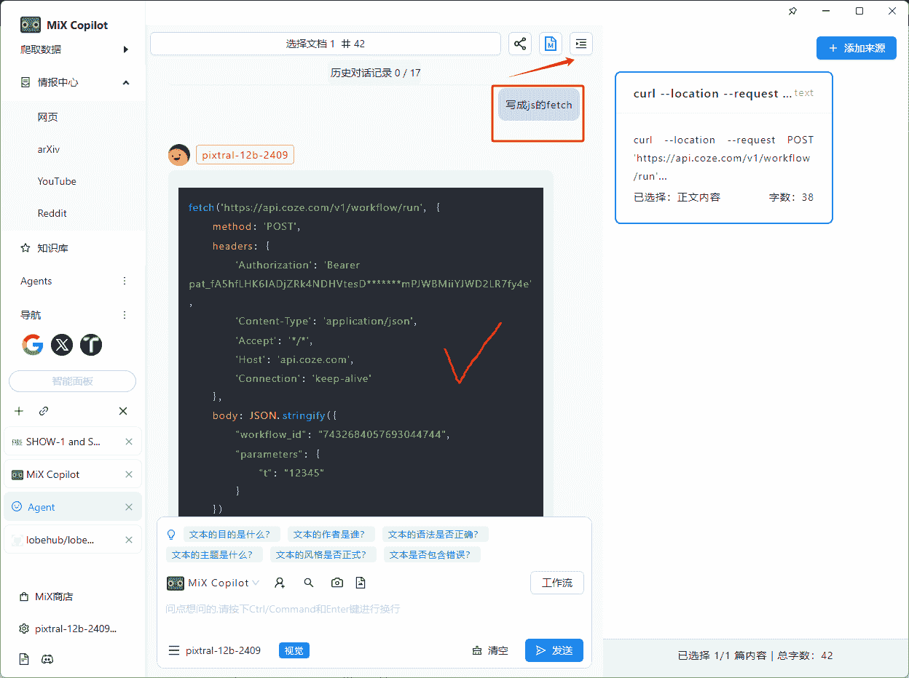
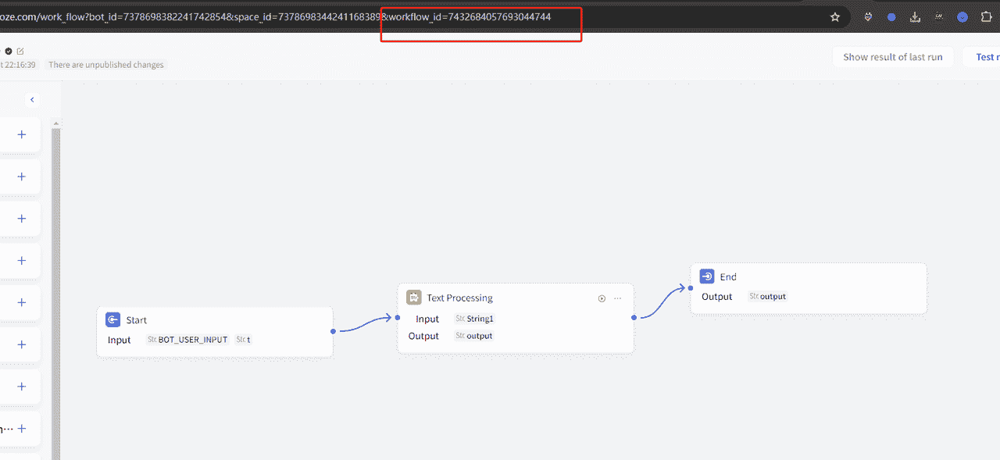

# Coze api 如何运行workflow？

> 来源：[https://now.feishu.cn/docx/IZPLdUTcHoRqGsxfa4Acl47Gn1f](https://now.feishu.cn/docx/IZPLdUTcHoRqGsxfa4Acl47Gn1f)

官方文档：

https://www.coze.com/docs/developer_guides/workflow_run?_lang=zh

**让LLM改写成js的fetch请求，复制官方提供的curl请求示例，打开**Mixcopilot，点击右上角的信息源，添加后，发送指令：写成js的fetch



```
fetch(&#x27;https://api.coze.com/v1/workflow/run&#x27;, {
    method: &#x27;POST&#x27;,
    headers: {
        &#x27;Authorization&#x27;: &#x27;Bearer pat_fA5hfLH***********&#x27;,
        &#x27;Content-Type&#x27;: &#x27;application/json&#x27;,
        &#x27;Accept&#x27;: &#x27;*/*&#x27;,
        &#x27;Host&#x27;: &#x27;api.coze.com&#x27;,
        &#x27;Connection&#x27;: &#x27;keep-alive&#x27;
    },
    body: JSON.stringify({
        &quot;workflow_id&quot;: &quot;7432684057693044744&quot;,
        &quot;parameters&quot;: {
            &quot;t&quot;: &quot;12345&quot; 
        }
    })
})
.then(response =&gt; response.json())
.then(data =&gt; console.log(data))
.catch(error =&gt; console.error(&#x27;Error:&#x27;, error));

```

工作流id：




加入社群