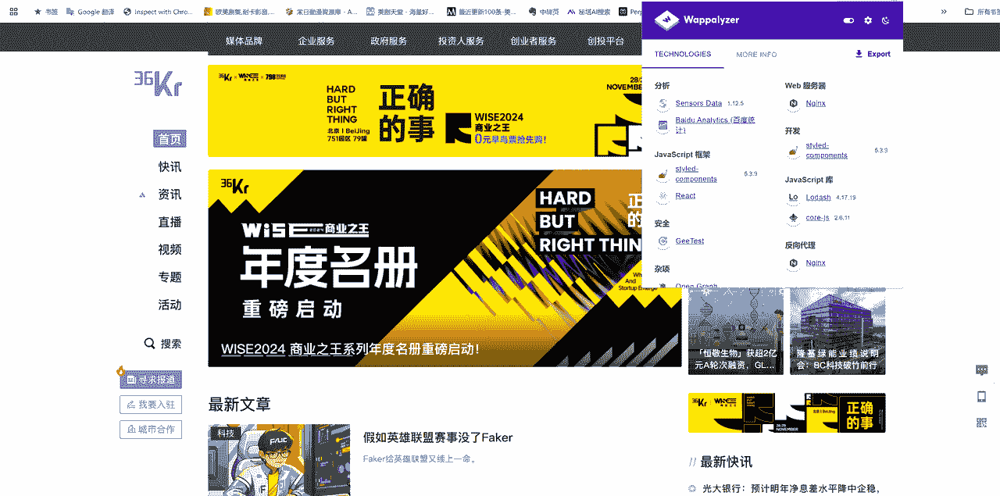
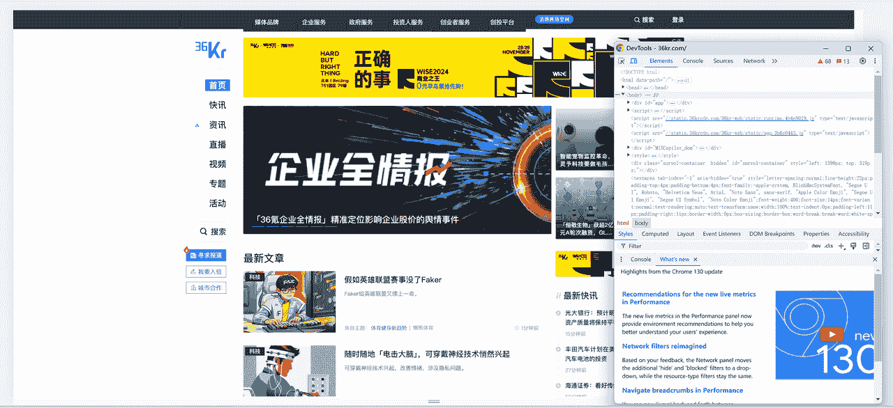

# 如何知道网站使用了哪些技术？

> 来源：[https://now.feishu.cn/docx/OIxVdV25OoEWFsxARV2cbgcEnLd](https://now.feishu.cn/docx/OIxVdV25OoEWFsxARV2cbgcEnLd)

使用以下几种网站和技术来查找某个网页使用的开源项目：

1.  **BuiltWith**：这个网站可以分析网页并提供其使用的技术栈，包括开源库和框架。

https://chromewebstore.google.com/detail/builtwith-technology-prof/dapjbgnjinbpoindlpdmhochffioedbn?hl=en

1.  **Wappalyzer**：这是一个浏览器扩展，可以实时分析网页并显示其使用的技术，包括开源项目。

https://chromewebstore.google.com/detail/wappalyzer-technology-pro/gppongmhjkpfnbhagpmjfkannfbllamg?hl=en

1.  **GitHub**：有些项目的源代码可能会在网页上有链接，你可以查看页面的源代码或使用开发者工具找到相关的GitHub链接。

1.  **Sourcegraph**：通过这个工具可以搜索特定网页的代码，查看其依赖项和开源项目。

1.  **开发者工具**：在浏览器中使用开发者工具（F12），查看网络请求和资源，可以找到一些使用的库和框架的信息。

