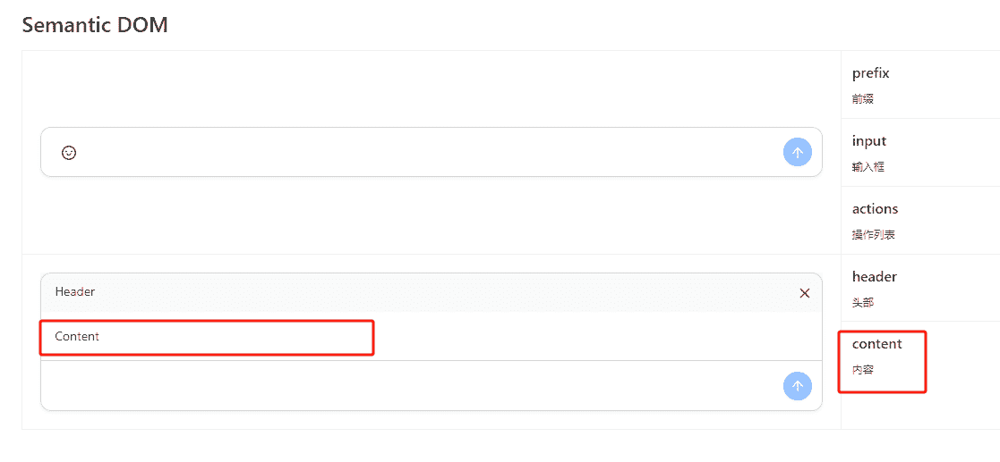

# 考考你：x.ant design 的Sender组件如何自定义Content内容？

> 来源：[https://now.feishu.cn/docx/EmdQdlv1bofXDPx8ctFcAiJvnCe](https://now.feishu.cn/docx/EmdQdlv1bofXDPx8ctFcAiJvnCe)

如下图所示，官方文档里，没有提供如何自定义content的示例，请研究下如何自定义？

文档地址：https://x.ant.design/components/sender-cn#semantic-dom

何时使用

+   需要构建一个对话场景下的输入框