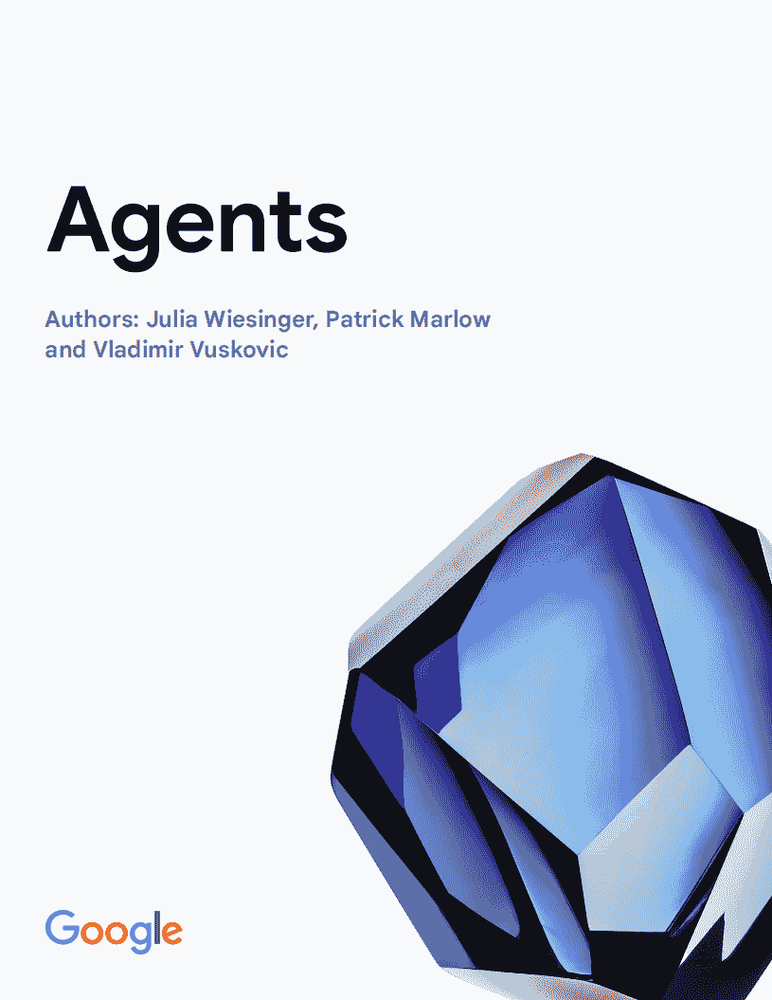

# Agents的实现

> 来源：[https://now.feishu.cn/docx/Jcs9dnl8KoeDGJxyBbpc4IRRn1f](https://now.feishu.cn/docx/Jcs9dnl8KoeDGJxyBbpc4IRRn1f)

nut.js

Agent：LLM+Tool+循环决策

https://mp.weixin.qq.com/s/-SrmbXBbejUqQvyu0fyKoQ

[谷歌agent白皮书.pdf](https://internal-api-drive-stream.feishu.cn/space/api/box/stream/download/all/Y7IMbzKK1of7PVxkIXBc3I6DnIb)