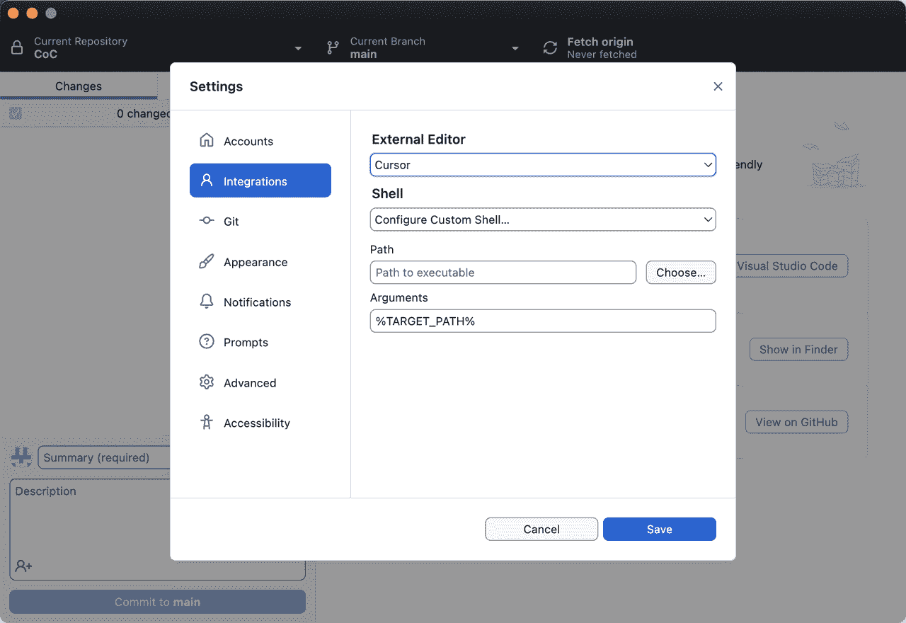
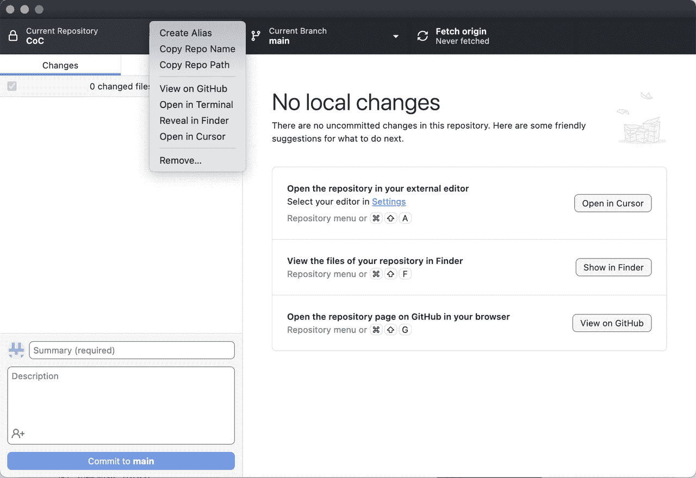
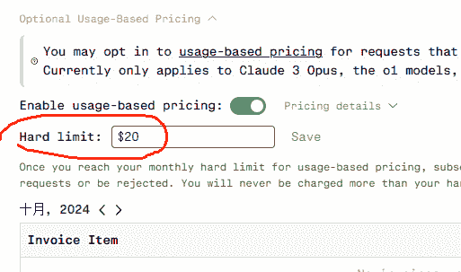

# 使用技巧（必看）

> 来源：[https://now.feishu.cn/docx/Tw8Ud7KGrojo6axYhMRcZFCwnph](https://now.feishu.cn/docx/Tw8Ud7KGrojo6axYhMRcZFCwnph)

#### 用Github Desktop直接打开Cursor

#### 项目管理与结构

1.  **空文件夹启动**：始终在一个空的文件夹中开启新项目，以保持项目结构清晰。

1.  **明确需求表达**：尽量清晰且谨慎地表述需求，避免模糊信息导致实现难度增加。

1.  **README.md文档**：从项目开始就让Cursor编写README.md，记录产品功能和技术栈，并在关键节点及时更新。

1.  **Git版本管理**：使用Git进行版本管理，关键节点提交时务必写清说明，便于日后复原。

#### 编码与调试

1.  **实时测试与版本控制**：使用Composer启动项目时，选择实时测试而非全部接受，确保新更改无误后再确认。

1.  **注释与学习**：让Cursor为代码块写清晰注释，帮助理解实现逻辑。

1.  **上下文感知的代码生成**：在代码周围添加注释描述想要实现的功能，获取更相关的代码生成。

#### 高效使用Cursor

1.  **多文件上下文**：利用Cursor理解项目中多个文件的关系，在复杂重构或新功能添加时获取精准建议。

1.  **AI代码审查**：在提交前使用Cursor的代码审查功能，发现潜在问题或改进建议。

1.  **交互式调试辅助**：描述调试问题症状，获取新的调试思路。

#### 提高工作效率

1.  **自定义代码片段**：输入特定关键词（如“Logdecorator”）快速生成完整的日志装饰器代码。

1.  **标记相关文档**：将官方文档（如Next.js、Supabase等）添加到Cursor，确保获取最新、准确的回复。

1.  **现有代码模板**：从GitHub上的开源项目开始，基于验证的基础构建，节省重复任务时间。

#### 学习与交流

1.  **AI解释与学习**：使用AI帮助解释代码，以初学者的视角深入理解困惑的概念。

1.  **询问其他AI模型**：在遇到问题时，将错误信息复制到其他AI模型（如Claude、GPT-4）中，以获得不同的解决方案。

1.  **复用有效代码**：从项目中其他部分复制有效代码进行复用，使AI适应新的使用场景。

#### 额外技巧

1.  **文档链接**：将常用的文档链接加入Docs中，方便使用时快速访问。

1.  **设置AI规则**：在Settings中设置提示词，调整Cursor的回答节奏和风格，有助于提高项目效率。

1.  **账户管理**：注册账户后，免费期限用完时可删除账户再用原邮箱登录，获得新权限。

1.  **限额关闭：**针对高用量情况下被拒绝，即cursor突然不回复用户了，很可能是用户使用量超出了平台设置的每月限额，此时需要用户点击 Cursor Settings -->General --> Account --> Manage --> 跳转至官网设置页面 --> 将Enable usage-based pricing（启用按使用量定价）下的 Hard limit 修改为大于原始值（$10）的钱数即可，如 $20 可以试一试有什么效果。

这是调整后的

