# Cursor官方使用技巧

> 来源：[https://now.feishu.cn/docx/WqA8dv07roTwbqxROK8ckf8snah](https://now.feishu.cn/docx/WqA8dv07roTwbqxROK8ckf8snah)

# Tab 标签

Cursor 包含强大的自动完成功能，可预测您的下一次编辑。启用后，此功能将始终处于打开状态，并会根据您最近的更改建议跨多行编辑您的代码。

### 代码生成

Cursor 可以看到您最近的更改，因此它可以预测您下一步要做什么。

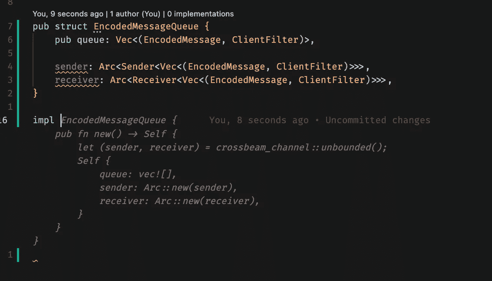

### 多行编辑

Cursor 可以一次建议多个编辑，从而节省您的时间。

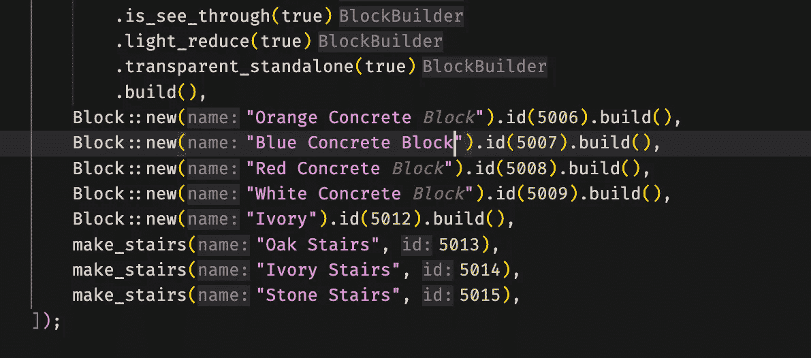

### 智能重写

随意打字，Cursor 会修复你的错误。

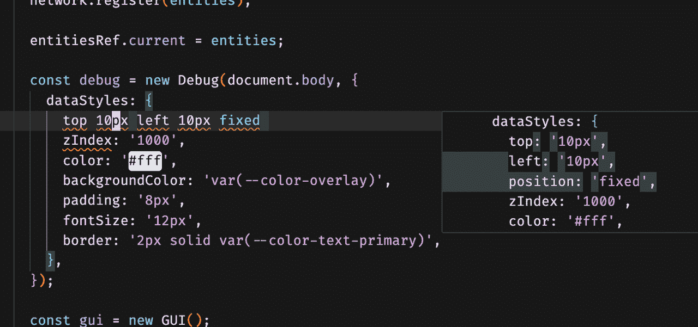

### Cursor预测

Cursor 预测您的下一个光标位置，以便您可以无缝导航您的代码。

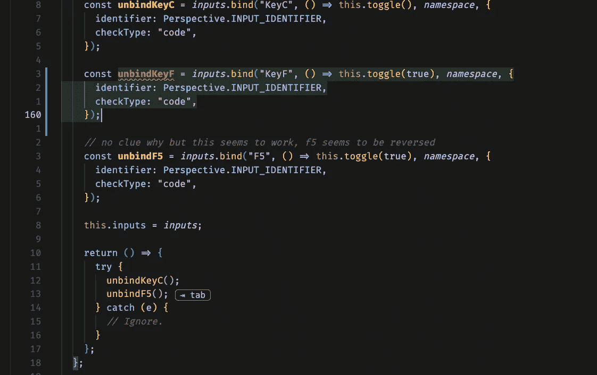

# 聊天

聊天功能可让您与能够看到您的代码库的 AI 进行交谈。聊天功能始终可以看到您当前的文件和光标，因此您可以询问它诸如“这里有错误吗？”之类的问题。您可以使用Ctrl +Shift+L 或“@”将特定代码块添加到上下文中。您可以使用Ctrl +Enter与整个代码库聊天。

### 代码库答案

使用 @Codebase 或Ctrl Enter 询问有关代码库的问题。光标将搜索您的代码库以查找与您的查询相关的代码。

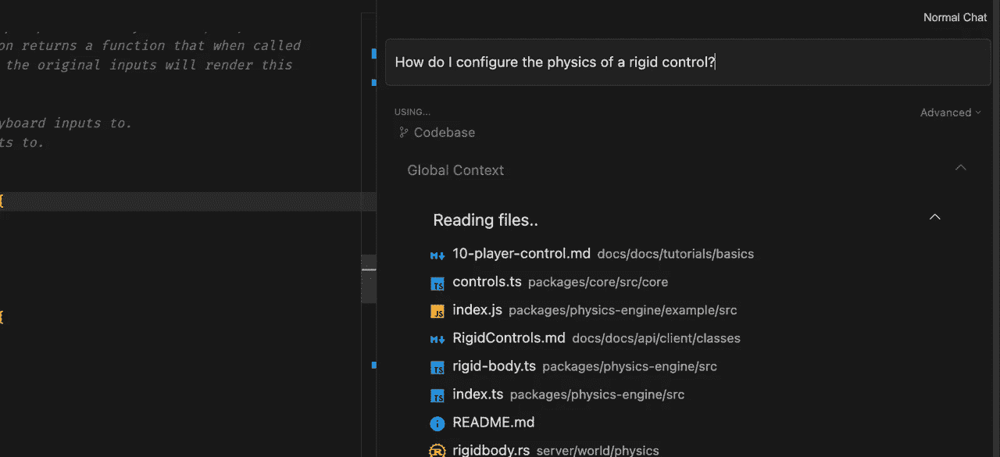

### 参考你的代码

引用带有 @ 符号的代码作为 AI 的上下文。只需输入 @ 即可查看文件夹中所有文件和代码符号的列表。

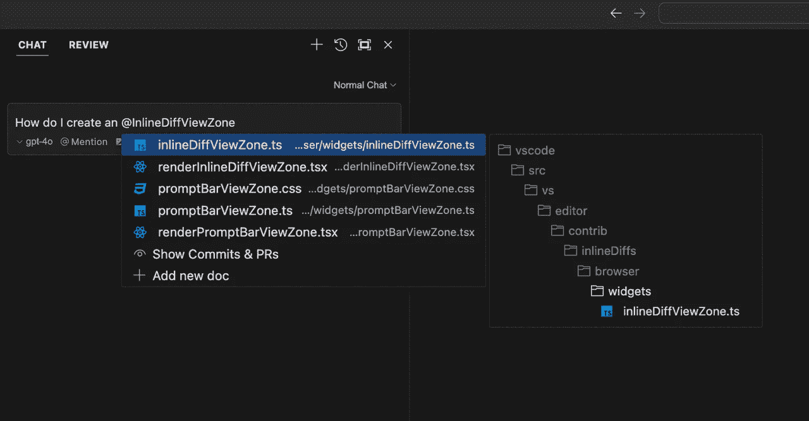

### 使用图像

点击聊天下的图像按钮或将图像拖入输入框以将视觉内容纳入聊天。

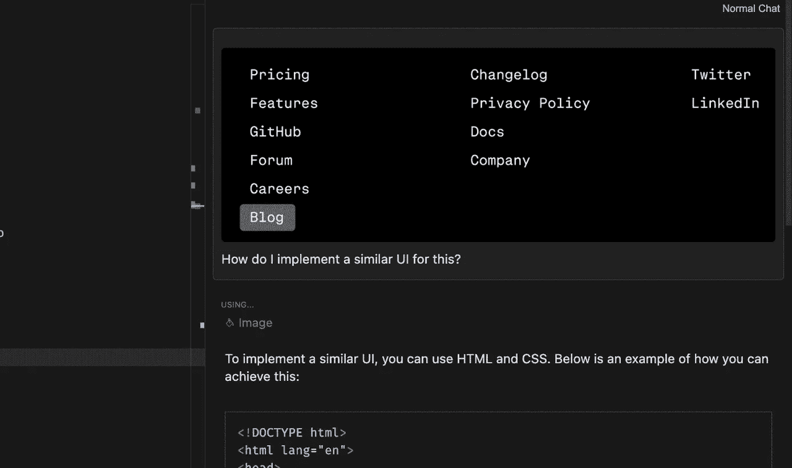

### 询问网络

使用@Web 从互联网获取最新信息。Cursor 将为您搜索网络并使用最新信息来回答您的问题。

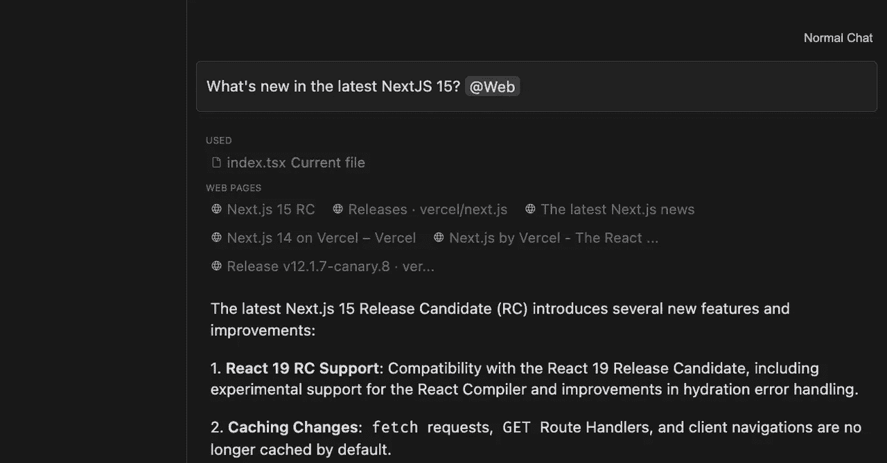

### 立即申请

通过单击任何聊天代码块顶部的播放按钮，将聊天中的代码建议应用回您的代码库中。

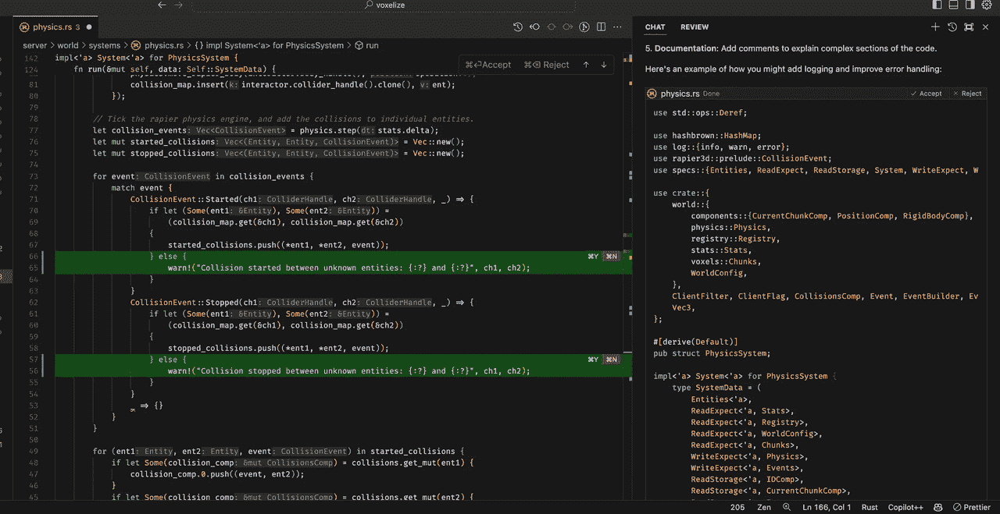

### 使用文档

使用@LibraryName 引用流行的库，或使用@Docs → 添加新文档添加您自己的库。

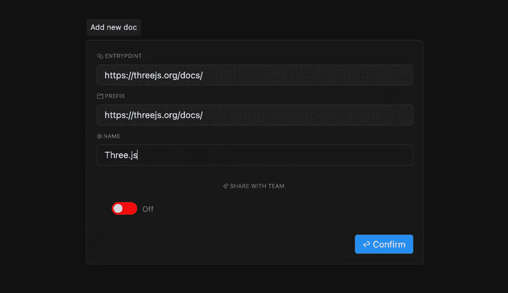

# Ctrl键

Ctrl K 可让您使用 AI 编辑和编写代码。要编辑，请尝试选择一些代码，单击“编辑”，然后描述应如何更改代码。要生成全新的代码，只需键入Ctrl K，而无需选择任何内容。

### 快速编辑

使用 AI 编辑和编写代码。选择一些代码，单击 Ctrl K，然后描述应如何更改代码。或者，使用Ctrl K 生成新代码而不选择任何内容。

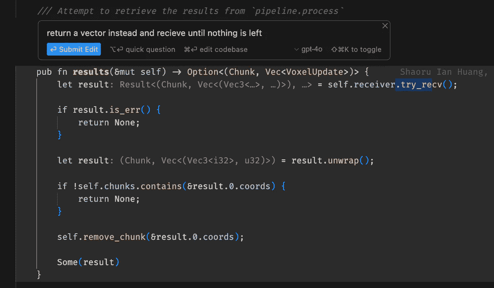

### 终端控制键

在终端中使用Ctrl K 以简单的英语编写终端命令。Cursor 会将它们转换为您需要的终端命令。

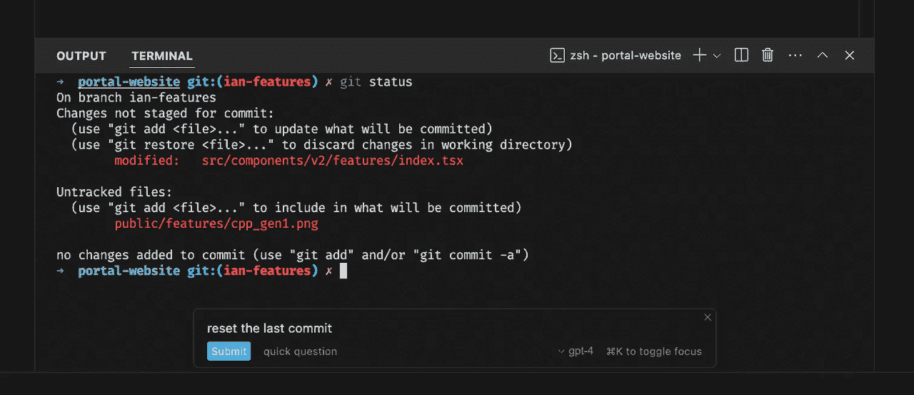

### 快速问答

如果您对代码的某些部分有任何快速问题，您可以选择并单击“快速问题”以立即获得答案。

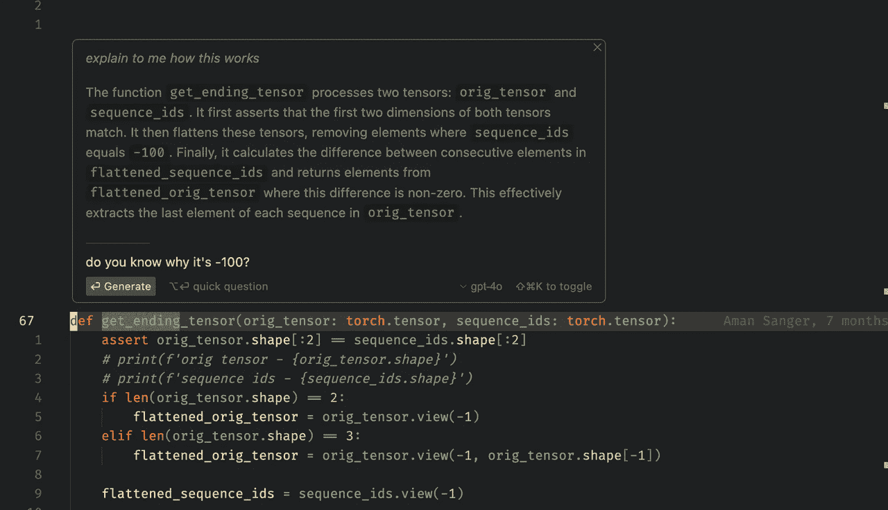