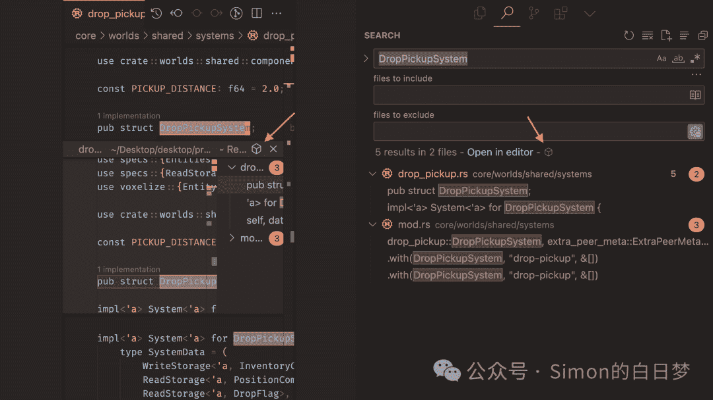

# 快捷键使用技巧

> 来源：[https://now.feishu.cn/docx/KnP4dxCGcoAjIVxjHf2cCXx9nOd](https://now.feishu.cn/docx/KnP4dxCGcoAjIVxjHf2cCXx9nOd)

作者 - **Simon Meng**

AI 编程工具 Cursor 最近实在太火了，身边好多朋友在用，我自身感觉能把编程效率提高10倍…… 以下是我在外网看到的一个很有用的经验帖，翻译过来和大家分享哈！

> **“**

> Cursor 是一款强大的 AI 编程工具，旨在帮助开发者更快、更智能地编写代码。本文将分享一些 Cursor 的使用技巧，助您充分发挥其潜力，提升编码效率。出处：https://x.com/shaoruu/status/1841548020174950467

## 一、通用技巧

1.  **使用Cursor标签页加速编码**

在Cursor中，使用Cursor标签页可以更快速地进行编码。它提供了智能的代码补全和建议，帮助您更高效地完成开发任务。

1.  **熟练使用快捷键**

+   **Cmd+L**：打开聊天窗口

+   **Cmd+I**：打开Composer

+   **Cmd+K**：进行编辑

掌握这些快捷键，可以让您在操作Cursor时事半功倍。

1.  **在提示输入框中使用@添加上下文**

在任何提示输入框中，输入 **@** 可以快速添加上下文信息，例如文件、链接或其他资源，方便AI更准确地理解您的需求。

1.  使用“+”按钮为聊天或Composer添加文件

**在聊天**或Composer界面中，点击 “+” 按钮，可以轻松添加文件，为AI提供更多参考资料。

1.  **使用Cmd+/在模型之间切换**

按下 **Cmd+/** 可以在不同的AI模型之间快速切换，选择最适合当前任务的模型，提高工作效率。

1.  在聊天中使用Cmd+Enter进行全代码库聊天

在聊天窗口中，按下 **Cmd+Enter**，可以与AI就整个代码库进行交流，获取全局性的建议和帮助。

1.  **拖放、复制或粘贴图像到聊天**

您可以将图像拖放、复制或粘贴到聊天窗口，与AI一起讨论或参考这些图像内容。

## 二、进阶技巧

1.  **在Composer中，先按“Sav**e all”再按“Accept all”

**在使用Compose**r时，先点**击 “Save all”**，再点击 “Accept all”。这样，您可以在测试代码后再决定是否接受修改，避免不必要的错误。

1.  使用Cmd+Shift+I打开更大的Composer视图

按下 **Cmd+Shift+I** 可以打开更大的Composer窗口，方便查看和编辑更多内容。

1.  在聊天中按Alt+Enter发送不包含当前文件的消息

**如果您想发送一条不**包含当前文件的消息，在聊天窗口中按下 Alt+Enter 即可。

1.  在聊天中按Cmd+I将消息弹出到Composer

在聊天中，按下 **Cmd+I** 可以将当前消息弹出到Composer，方便进一步编辑和处理。

1.  **使用@web获取最新信息**

**在聊天或**Composer中，输入 @web 可以获取最新的网络信息，确保您的资料是最新的。

1.  **使用@git引用您的更改**

您可以使用 **@git** 来引用代码更改。例如，@某个提交（commit），并请求AI进行审查或反馈。

1.  使用@<链接>，让AI在回答前访问链接

在输入框中输入 **@<链接>**，AI会在回答前访问该链接，获取相关信息，提供更准确的回复。

1.  在Cursor设置中添加外部文档

通过 **C**ursor Settings > Features，添加外部文档后，您可以在输入框中使用 @ 引用这些文档，供AI参考。

1.  **使用/命令引用打开的编辑器**

使用 **/** 命令，可以引用当前打开或活动的编辑器窗口，快速添加上下文信息。

1.  为聊天或Composer开启建议文件

开启建议文件功能，可以让聊天或Composer更容易添加相关文件，提升效率。

1.  利用界面中的小方块触发Composer

Cursor界面中有许多小方块，您可以点击它们来触发Composer。例如，使用所有搜索结果进行批量操作。

来源：

https://mp.weixin.qq.com/s/_EfoPxrE811eqZbpc9fMzg

https://x.com/shaoruu/status/1841548020174950467