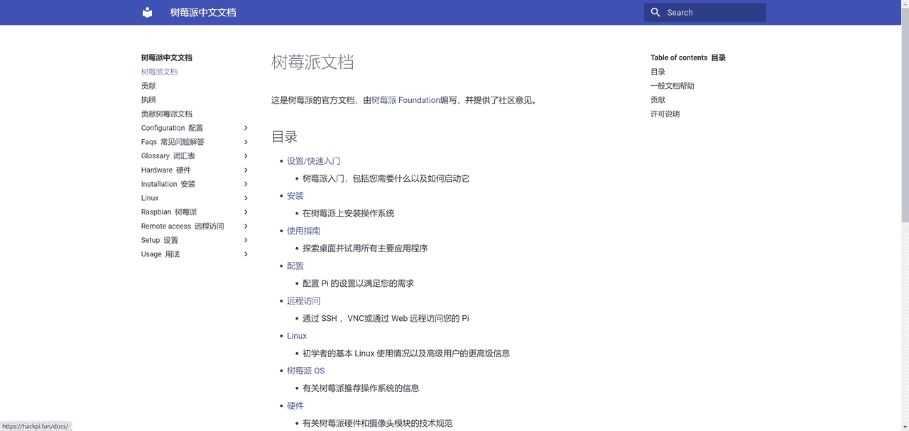
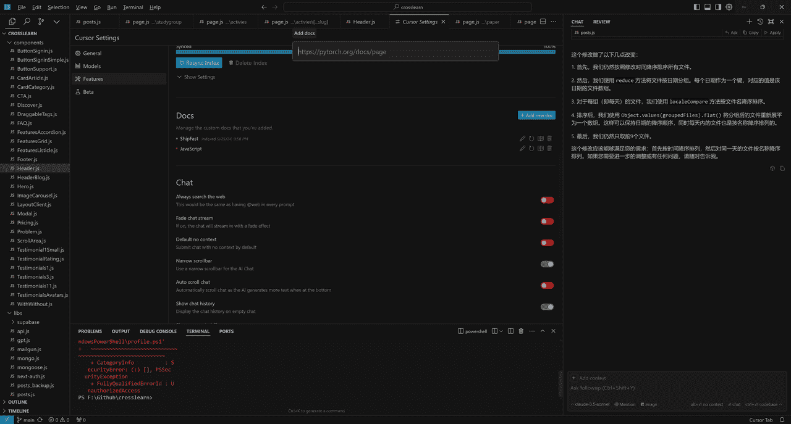

# 先验知识（RAG）

> 来源：[https://now.feishu.cn/docx/HU0EdM2T5o5K4jx6tlbcvfl1nQe](https://now.feishu.cn/docx/HU0EdM2T5o5K4jx6tlbcvfl1nQe)

# **介绍**

Cursor的RAG功能可以将一些网站内容变成先验知识，例如你要开发树莓派的功能，你可以把树莓派相关文档喂给Cursor，这样Cursor在写代码时会参考文档进行开发

# 相关知识网站

## 编程语言

https://www.coderwithai.top/

## 树莓派

https://hackpi.fun/docs/

https://www.raspberrypi.com/documentation/

# 使用技巧

1.  选择一个你正在使用的编程语言，例如https://www.coderwithai.top/React

1.  进入设置-feature，将网址填到Docs里，这样能把一些跟你项目相关的先验知识喂给Cursor

