# AI编程：10个Cursor AI最佳使用方式

> 来源：[https://now.feishu.cn/docx/MibAdad5Eow0qaxQmuccnGgqnlc](https://now.feishu.cn/docx/MibAdad5Eow0qaxQmuccnGgqnlc)

原文链接：https://www.datacamp.com/tutorial/cursor-ai-code-editor

我经常将代码复制粘贴到 ChatGPT 中，询问为何无法运行，或是对其进行重构，或者只是让我解释代码。然而，在我的代码编辑器和 ChatGPT 之间切换可能会变得有些乏味。

AI 编辑器通过将 GPT 直接整合到代码编辑器中来解决这个问题。通过直接与我们的代码编辑器集成，GPT 获得了关于整个项目更多的上下文信息，这显著提高了其输出质量。

在这篇文章中，我们将探讨最受欢迎的代码编辑器之一：Cursor AI。OpenAI 和 Perplexity 的工程师们信任 Cursor AI，它提供 AI 辅助编程、智能代码建议以及与各种开发工具的集成。

##

## 什么是 Cursor AI 及其能做什么？

Cursor AI 是一个由 AI 驱动的代码编辑器，旨在使软件开发更加便捷。作为 Visual Studio Code（VS Code）的分支，它保留了 VS Code 的友好界面和广泛生态系统，使得已经熟悉该平台的开发人员更容易使用。

Cursor AI 集成了 ChatGPT 和 Claude 高级 AI 能力。这种集成使 Cursor AI 能够提供智能代码建议、自动化错误检测和动态代码优化。

### 一键自动补全特性

Cursor 提供了自动补全和预测代码功能：

1.  自动完成和代码预测：可以预测多行编辑并根据最近的更改进行调整。

1.  代码生成：预测我们接下来想要做什么，并相应地建议代码。

1.  多行编辑：可以建议跨越多行的编辑。

1.  智能重写：编辑器可以自动修正并改进我们的代码，即使我们输入时粗心大意。

1.  光标预测：它预测下一个光标位置，允许快速浏览代码。

### 聊天功能

Cursor还集成了高级聊天功能，以促进更好的互动：

1.  代码库回答：它将遍历文件以提供相关答案。

1.  代码引用：参考特定的代码块或文件，将它们整合到我们的查询上下文中。

1.  图像支持：将图像拖入聊天界面，添加视觉上下文。

1.  网络搜索：直接将互联网的最新信息引入到代码查询中。

1.  一键应用：通过点击按钮，直接将聊天中的代码建议应用到代码库中。

1.  文档集成：引用流行库，并添加我们自己的文档，以便快速访问。

## 如何安装 Cursor AI

Cursor AI 在其官网上提供了适用于 Linux、Windows 和 MacOS 的安装文件，可以免费下载。

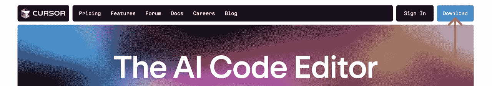

安装后，我们被提示以下配置屏幕：

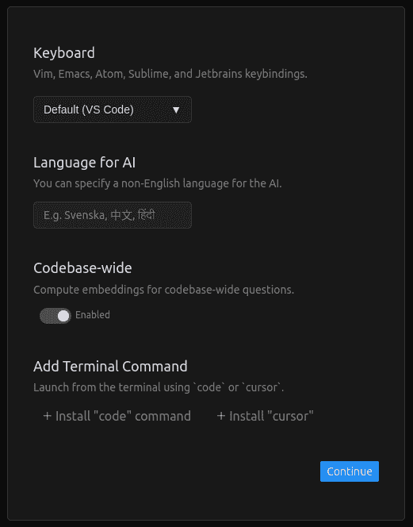

+   键盘：此选项允许我们配置键盘快捷键。默认情况下，它使用 VS Code 的快捷键。

+   人工智能的语言：在这里，我们可以设置中文，作为与人工智能交互的选项。

+   代码库范围：启用此选项使 AI 能够理解整个代码库的上下文。

+   添加终端命令：允许从终端运行 Cursor AI 编辑器

## 如何使用 Cursor AI：10 个应用场景

在本指南中，我们将使用 Cmd ⌘ 键提供 MacOS 快捷键。如果你在 Windows 或 Linux 上使用光标，快捷键相同，只是使用的是 Ctrl 键。

### 内联代码生成

我们使用 Cmd+K 快捷键打开内置代码生成器。这会打开一个小提示窗口，我们在其中输入提示以生成代码：

生成代码时，我们输入提示然后点击生成按钮：

这将生成代码，并通过点击确认按钮将其添加到我们的项目中：

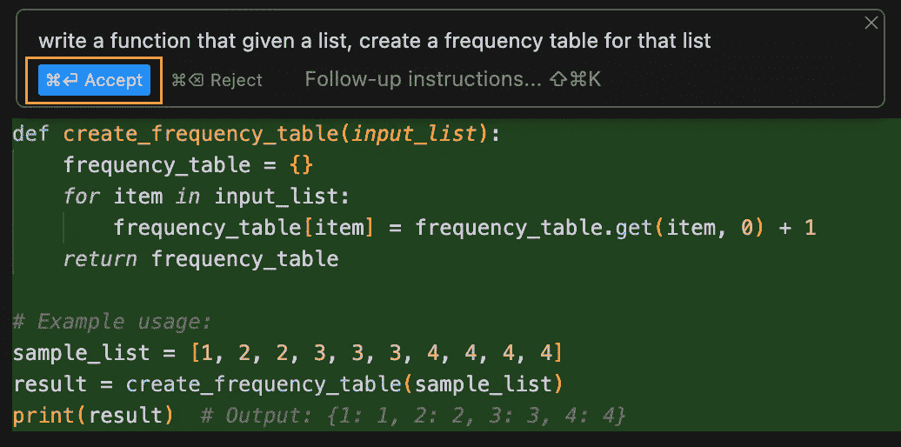

在这种情况下，我们使用了 claude-3.5-sonnet 模型。我们可以通过模型下拉选择器选择另一个模型：

### 与现有代码互动

我们还可以通过在使用 Cmd+K 快捷键之前选择相关代码来使用内联聊天与现有代码进行交互。这可以用于对代码进行更改，例如重构，或者询问关于代码的问题。在输入提示后，点击提交编辑按钮以获取修改。

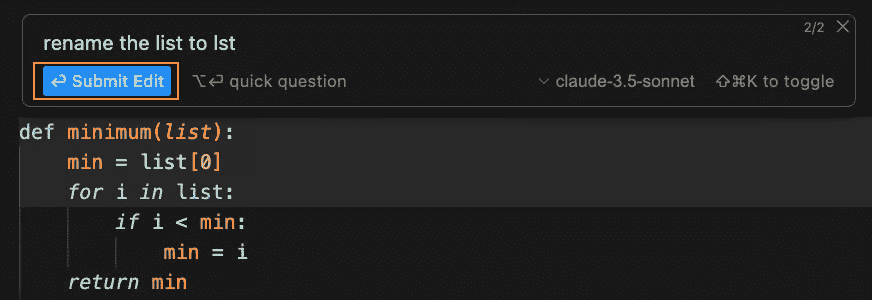

代码更改在光标中以差异形式呈现。红色线条表示将由更改删除的行，而绿色线条代表将要添加的新更改：

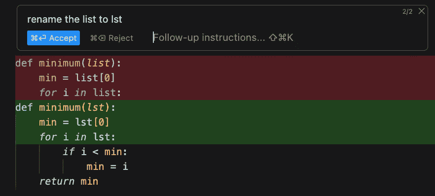

### 询问现有代码的问题

同样地，我们可以通过选择代码片段并使用 Cmd+K 快捷键来对一段代码提出问题。在提出问题的情况下，我们点击 quick question 按钮提交提示。

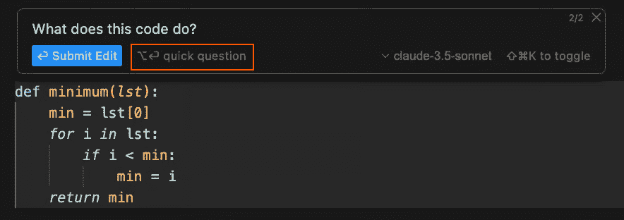

提交问题后，系统将生成答案并以如下方式显示：

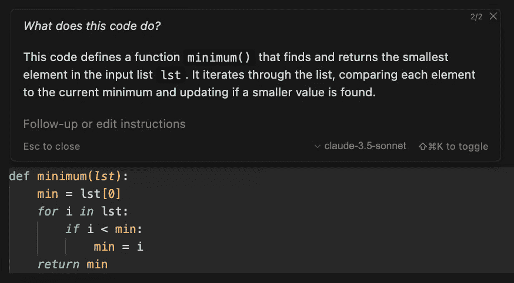

### 自动补全与制表符

在编写代码时，光标会建议使用 AI 生成的代码补全。类似于传统的代码补全，我们可以使用 Tab 键将这些建议整合到我们的代码中。

例如，假设我们开始实现一个名为 maximum() 的函数。光标会识别我们的意图并建议一个合适的实现方式。通过按下 Tab ，我们可以添加建议的代码：

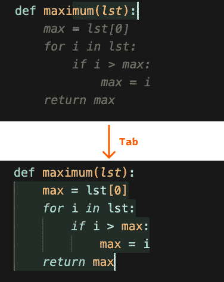

自动完成也适用于用自然语言编写的代码。例如，如果我们想要创建一个双层 for 循环来遍历列表中的所有配对，我们只需用普通文本描述这一过程。光标随后将提供相应的自动完成建议，通过按下 Tab 键可以集成这一建议。

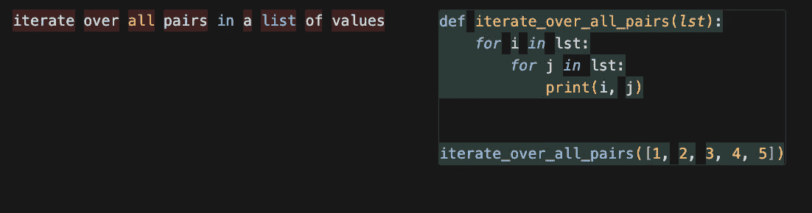

### 聊天界面概览

打开聊天窗口，请使用 Cmd+L 快捷键。聊天窗口比内置生成器更为灵活，不仅能够生成代码，还可以提问。以下是聊天界面的概览：

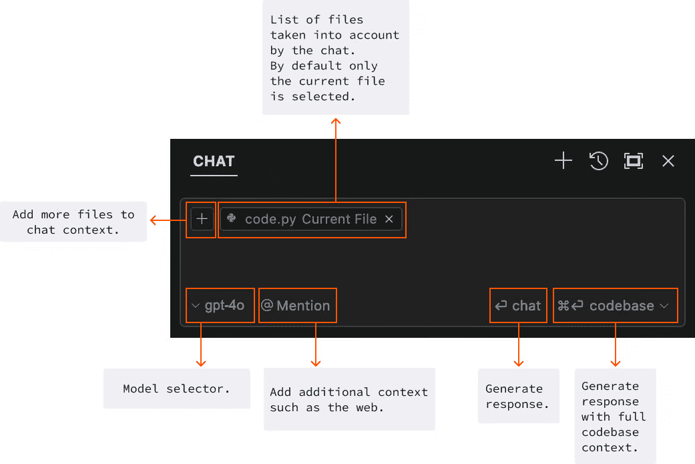

### 代码生成通过聊天

类似于通过实时聊天生成内容，我们也可以使用聊天功能生成代码。在代码窗口右上角点击应用按钮后，生成的代码可以被整合到项目中。

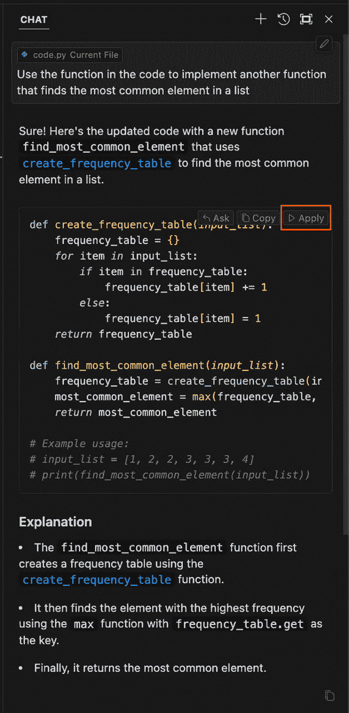

### 增强查询上下文使用@

聊天窗口最重要的功能是 @ Mention 选项。该选项允许我们为 AI 提供更多的数据以生成响应。这涵盖了从简单的文件和文件夹到网络搜索，或者让 AI 访问 GitHub 仓库等多种形式。

例如，我们可以使用 @Web 来允许 AI 在网络上查找答案。

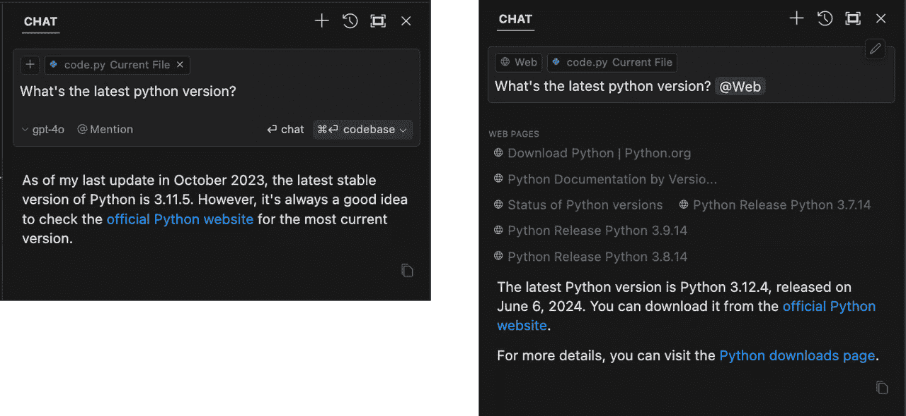

请记住，在某些情况下，与 AI 共享整个代码库或私有 GitHub 仓库可能会有问题。我们应该谨慎考虑与 AI 共享的内容，并避免共享敏感或私人数据。.

### Codebase

在处理大型项目时我发现最有用的一个功能是可以快速通过提出问题来查找代码片段，而问题的范围涵盖了整个代码库。最近，我想要在一个项目中找到一个计算应用程序导航方向的函数。借助 Cursor，我只需描述函数的功能就可以非常简单地找到它。

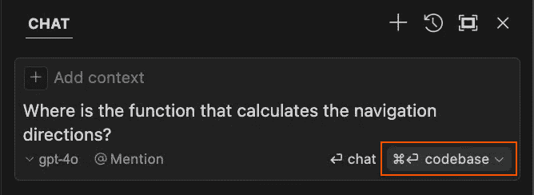

请注意，在这种情况下我们使用了 codebase 选项。尽管由于某种原因，Cursor 没有显示实际的代码，但点击代码框仍然打开了正确的文件，并滚动到了我正在查找的函数：

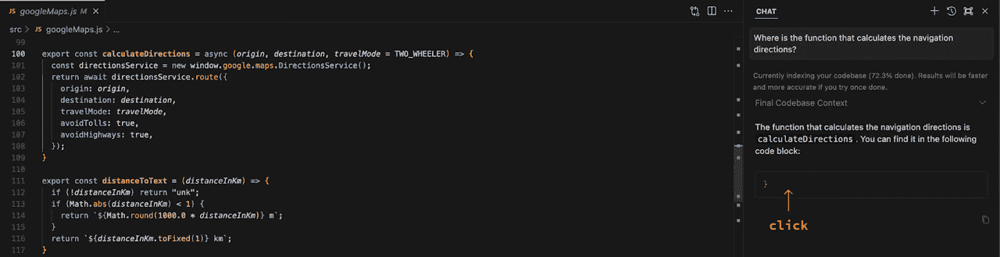

### 图像支持

光标聊天还支持图像输入。例如，我们可以绘制一个网站的 UI 设计，并询问它生成相应的 HTML 和 CSS 代码。要添加图像，可以将其拖放到聊天窗口中。

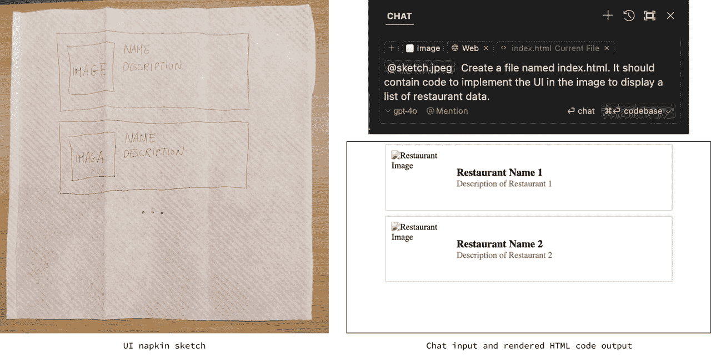

### 添加文档

Cursor AI 的一个非常有用的功能是可以添加文档引用。这对于那些不太知名或私有的库特别有用，这些库的文档可能并未在 AI 训练过程中使用过。

要添加文档条目，我们使用 @ 符号，然后从下拉菜单中选择 Docs

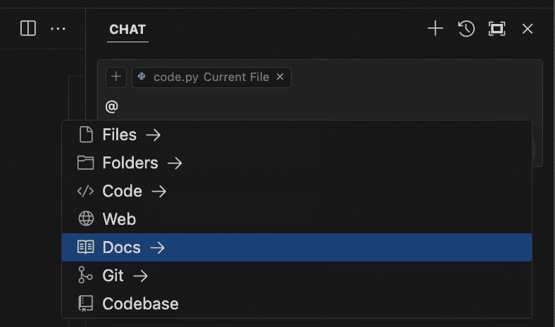

这将打开一个窗口，要求输入文档的 URL。让我们以 PyTorch 文档为例：

在插入 URL 后，我们可以为文档条目命名。在这种情况下，我们使用 PyTorch 。然后，我们可以通过 @PyTorch 来在聊天提示中引用此文档。

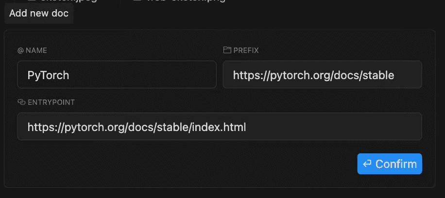

文档引用也可以在光标设置的“功能”选项卡中进行管理：

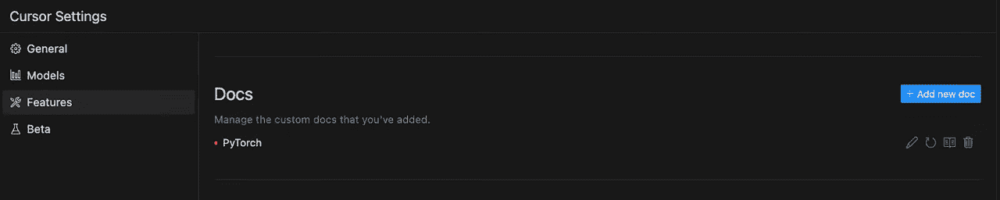

## Cursor AI:额外功能和益处

### 语言支持

本文中展示的示例使用了 Python、HTML 和 CSS，但 Cursor 并非针对任何特定编程语言进行构建。由于其代码生成基于通用目的的LLMs，Cursor 能够在任何编程语言中生成代码。它会使用文件扩展名来猜测应使用哪种语言。

### 扩展

由于 Cursor 建立在 VS Code 之上，因此它继承了其丰富的扩展生态系统。我们可以在 View 菜单中访问这些扩展。

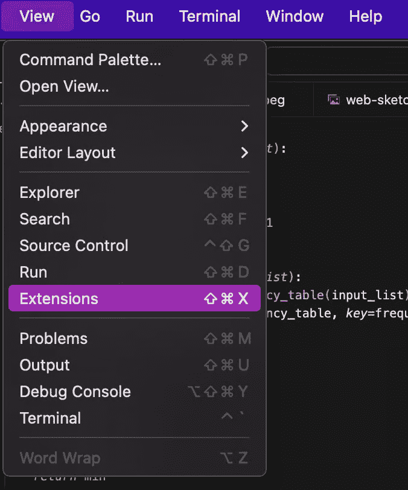

设置 Cursor 与 Python 工作时，我推荐使用 VSCode Python 设置教程，因为 Cursor 和 VSCode 上应具备相同的功能。

### 与他人合作

使用诸如 Git 与 Cursor 之类的协作工具，与在任何代码编辑器中使用它们相似。这些工具并不依赖于代码的编写方式。存在特定的扩展程序旨在协助 Git 的使用。

记住，Cursor 的聊天功能允许您使用 @ 操作符在上下文中使用 Git 仓库。请注意，如果仓库包含私有数据，应谨慎使用此功能。

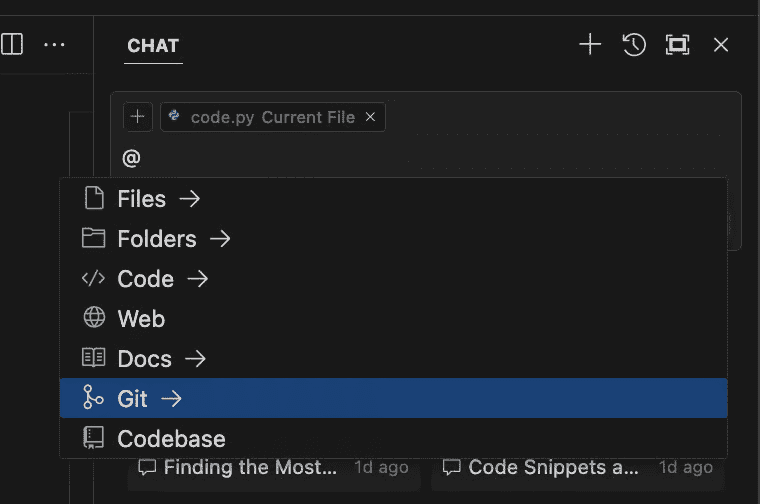

### 设置自定义 AI 规则

光标允许我们通过特定规则引导 AI。这些规则可以在通用设置菜单下访问。

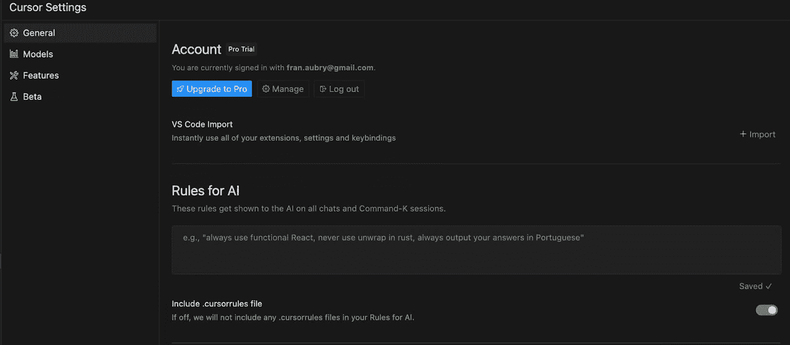

这些规则可以在无需反复提示的情况下修改 AI 的行为。例如，我们可以通过添加一条规则，如“在 Python 函数定义中始终使用类型提示”，来确保 AI 总是使用类型提示。

### 自定义 AI 模型

游标的一个有趣特性是可以添加其他 AI 模型。此选项可以在 Models 设置中找到：

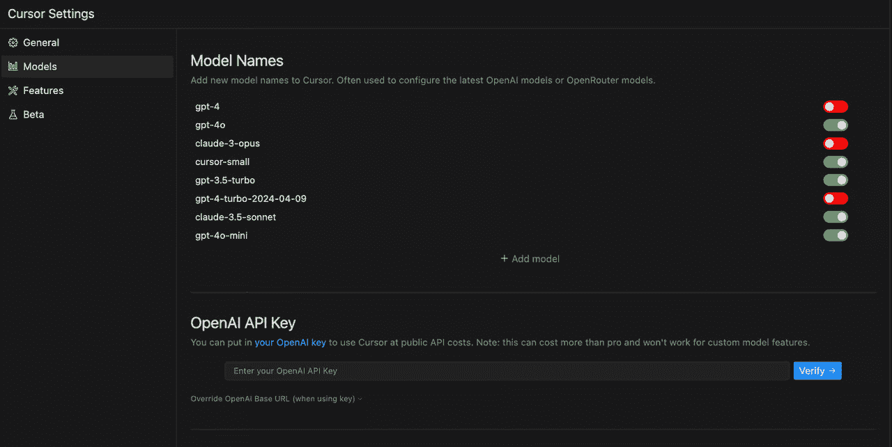

在这里我们可以添加新的模型。这些模型设置还使我们有可能添加我们的 API 密钥，如果需要的话。

## Cursor AI vs GitHub Copilot

Cursor AI 和 GitHub Copilot 都是基于人工智能的代码助手，各自提供独特的功能。

Cursor AI 基于 VSCode 构建，作为一个独立的编辑器运行。它与编码环境紧密集成，自动化任务并提供直观的代码建议，有助于简化代码编写和重构过程。它特别适合那些偏好与熟悉集成开发环境深度整合的开发者。

GitHub Copilot，由 GitHub 和 OpenAI 开发，与 Visual Studio Code 等流行代码编辑器集成。它根据用户的编程风格和项目上下文提供上下文感知的代码建议。GitHub Copilot 在预测后续代码行方面表现出色，并支持广泛的语言和框架。

从集成角度来看，Cursor AI 在其基于 VSCode 的独立环境中提供了显著的自定义选项，可能为某些用户提升了工作流程。相比之下，GitHub Copilot 因其易于设置和与广泛使用的 IDE 的集成而受到关注，这为许多开发者提供了便利的采用途径。

两个工具都提供了实时代码建议和对多种语言和框架的支持。Cursor AI 在深度整合方面可能对专业任务有优势，而 GitHub Copilot 广泛的 IDE 支持和简单的设置使其对更广泛的用户群体更具吸引力。

最终，选择 Cursor AI 和 GitHub Copilot 之间的差异可能取决于定制需求、集成偏好和预算等因素。这两款工具都以不同的方式旨在提高编码效率。

## 结论

工具如 ChatGPT 使得编程变得更加易于访问，允许用户通过用自然语言解释其目标来编写代码。Cursor 进一步推进了这一点，直接与代码编辑器集成，消除了在编辑器和聊天界面之间切换的需要。

当使用 Cursor AI 时，它提供了一个全面的独立解决方案，专门针对 VSCode 环境进行深度整合。而像 GitHub Copilot 这样的工具则在各种流行的集成开发环境（IDE）中提供灵活性。在两者之间做出选择最终取决于个人对于定制化和设置简便性的需求和偏好。

总之，Cursor AI 是一个强大的、由 AI 驱动的代码编辑器，承诺改变开发者处理编码、重构和调试的方式。