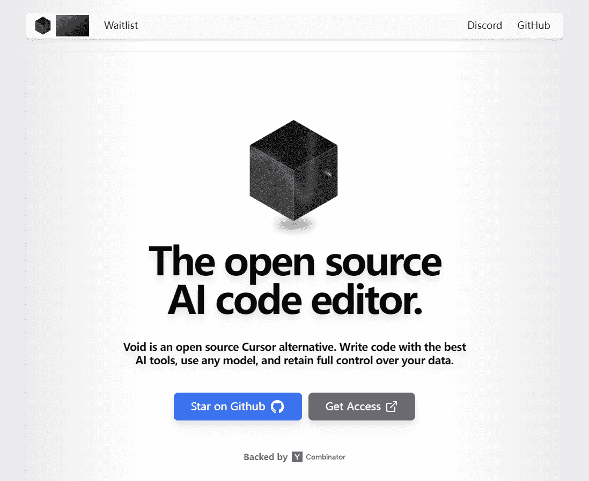

# Void

> 来源：[https://now.feishu.cn/docx/H6E3dQtMzoqjejxsNr4cioz2nIe](https://now.feishu.cn/docx/H6E3dQtMzoqjejxsNr4cioz2nIe)

Void是一个开源的AI代码编辑器，基于VS Code开发，支持用户将现有的主题、快捷键和设置一键迁移。它提供了多种AI功能，如自动补全、内联编辑和文件查询，且支持本地模型托管和直接与Claude、GPT及Gemini等模型通信，无需通过第三方中介。

<https://github.com/voideditor/void#readme>