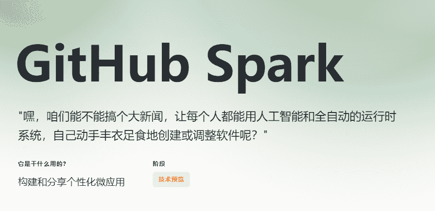
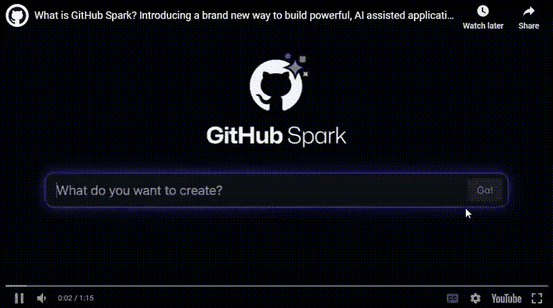
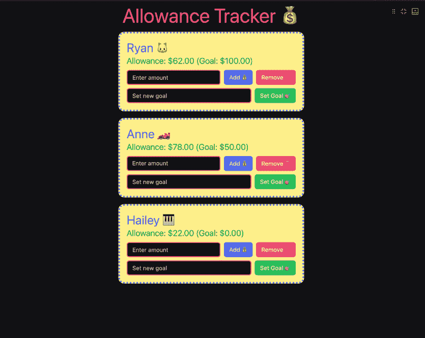
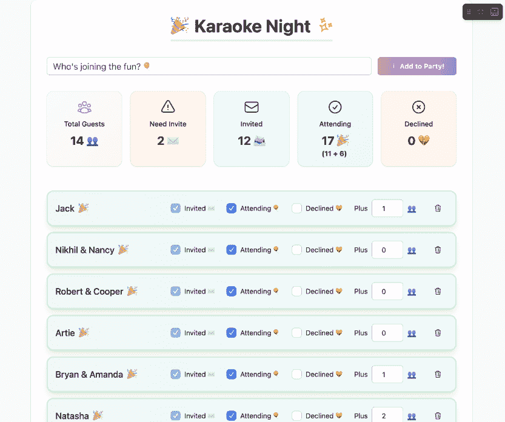
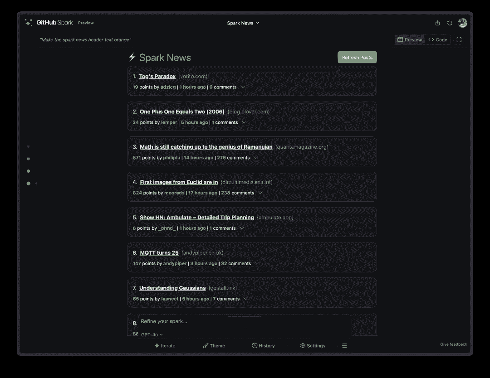
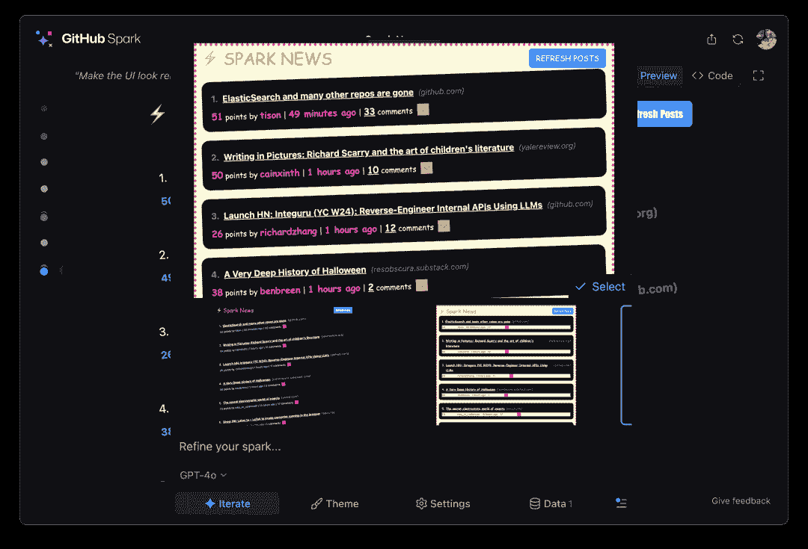
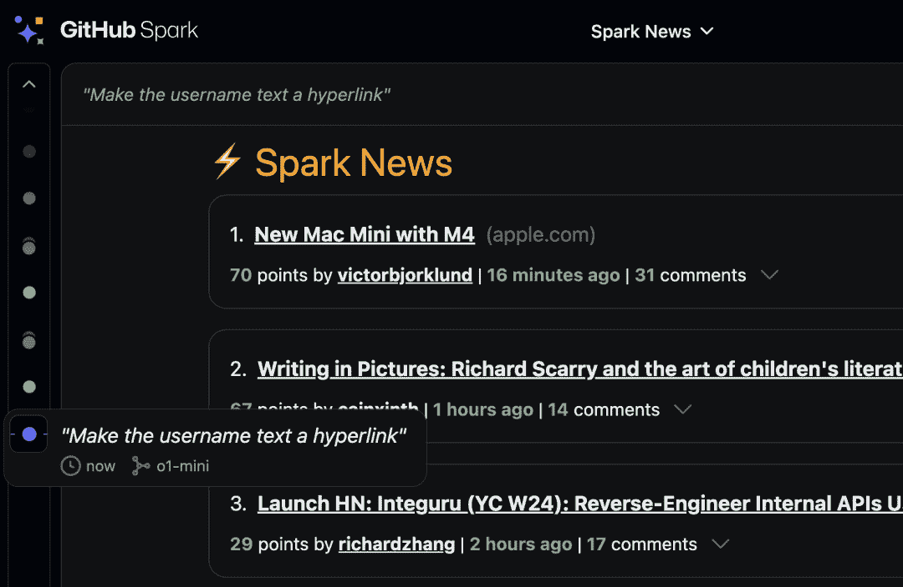
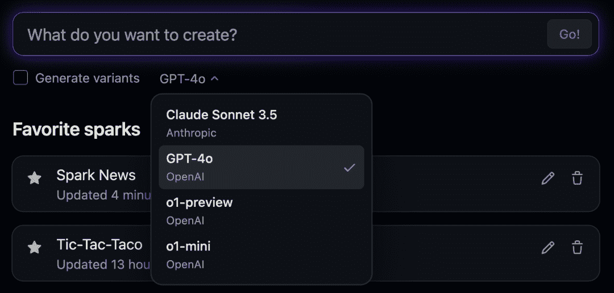
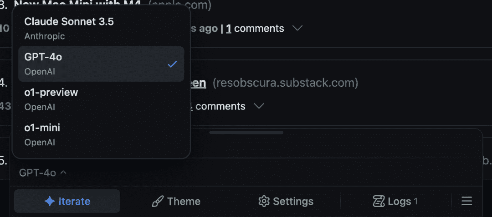
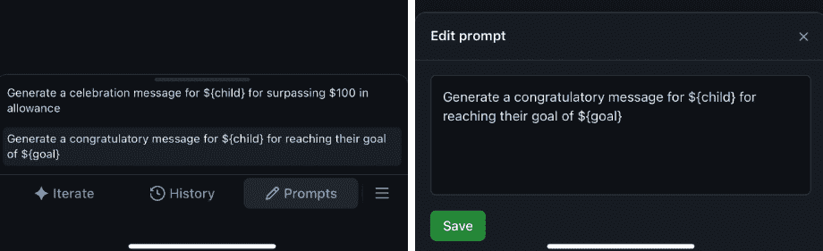

# Github Spark

> 来源：[https://now.feishu.cn/docx/Q7LmdSbcGoZbl9xAuIdcsgDenqg](https://now.feishu.cn/docx/Q7LmdSbcGoZbl9xAuIdcsgDenqg)

通过自然语言表达你的想法。GitHub Spark让任何人都能使用人工智能，为自己创建软件

我**们能否让任何人都能使用人工**智能，为自己创建软件？尽管开发者喜欢定制自己的开发环境以提高效率和趣味性，但创建个性化应用程序的复杂性常常阻止他们这样做。

如何使个性化软件的创建变得像定制开发环境一样简单?并让更多人能够轻松实现这种个性化。

---

**

shadow**：我今天仔细学习**了Github最新发****布的Spar****k介绍。Spark 不是用**来生成代码的工具，而是用来生成应用的工具。并且，倡导生成解决问题的“微应用”，微应用聚焦解决单一的问题，而不是大而全，并且是个性化的问题。

在Spark的功能上，有非常多值得学习的新的人机交互的方式和功能点。我把重点信息都做了加粗，分享给大家：

###

### **GitHub Spark 简介**

GitHub Spark 是一款由人工智能驱动的工具，用于创建和共享微应用（sparks），这些微应用可以根据您的确切需求和偏好进行定制，并可直接从您的桌面和移动设备上使用。无需编写或部署任何代码。它通过3个主要功能实现：

1.  **基于 NL 的编辑器**，可轻松描述您的想法，然后随着时间的推移不断完善它们

1.

1.  **托管运行时的环境**，用于托管您的 Spark，并让其访问数据存储、主题和 LLM

1.  **支持 PWA 的管理后台**，让你可以从任何地方管理和启动你的 spark

此外，GitHub Spark 还允许您与他人共享您的 spark，并控制他们的只读或读写权限。然后，他们可以选择收藏 spark ，并直接使用它， 或重新混合它（fork？），以进一步适应他们的偏好。

非常……个性化！

让我们看看它是如何工作的🎬

### **什么是“微应用程序”？**

GitHub Spark 遵循Unix的应用哲学，软件应该专注于完成一个特定的任**务，并且要做到最好。这个任务应**特别满足用户的需求，无论其使用时长如何。换句话说，软件应简单、专注、高效地解决一个问题，即使这个问题是短暂的或小众的。

（Unix的应用哲学强调软件应专注于做好一件事，通过简单、模块化和可组合的设计来实现高效和灵活的解决方案）

**所以“微”**并不是指应用程序的价值大小，而是指其功能复杂性的大小。

灵感/案例

以下是使用 GitHub Spark 制作应用的一些灵感。这些灵感包括生活管理工具、学习辅助工具、搞笑动画和新闻客户端。但它们的共同点是：它们的外观和感觉完全符合创作者的期望。不多也不少 ❤️

儿童零花钱追踪器，可以以只读或读写模式（父母）使用，并在达到收入目标时使用 LLM 生成庆祝信息。

一个六岁孩子想象并创造的动画：汽车世界。

一款用于追踪每周卡拉 OK 之夜以及每位受邀嘉宾状态的应用程序。

由一名 10 岁的孩子在学校创建和使用的一款地图应用，允许按名称搜索城市，然后使用 LLM 生成有趣的 tldr 描述。

TL;DR（Too Long; Didn't Read）是对长篇内容的极简总结，通常只有一句话，旨在快速传达核心信息。

一个自定义的 HackerNews 客户端，显示前 20 个帖子，并使用 LLM 总结评论（这真的很有用！）。这是某个团队的日常 HN 驱动程序。

GitHub Spark 主要功能👍

### **基于 NL 的工具链**

创建应用时**，您必须知道自己想要什么**。不仅仅是总体思路，还有确切的功能、详细的交互行为以及整体外观和感觉。不幸的是，这可能会变得相当复杂，甚至可能让人不知所措，甚至中途放弃。这正是GitHub Spark 要解决的问题！

GitHub Spark 让你从一个简单的想法开始，例如 ：“一个跟踪我孩子零花钱的应用程序”。

然后通过“辅助探索”让复杂性慢慢浮现。特别是，它基于 NL 的编辑器旨在让创建过程变得轻松有趣！

—— 四个核心功能：

交互式预览

修订版本

自动历史记录

模型选择

####

#### **交互式预览**

当您在 GitHub Spark 中输入** NL 表达式时，它不仅会生成**代码，还**会立即运行并通过交互式预览**显示它。这种“以应用程序为中心的反馈循环”允许您根据需要，快速地调整细节，直观地了解您的意图时进行迭代：

“嗯，我想我想要在这里添加一个切换按钮！”

####

#### **修订版本**

**当您创建或迭代 spark 时，您可以选择请**求一组变体。这将生成 3-6 个不同版本的请求，每个版本都有细微但有意义的差别。

你可能知道自己想要某个功能，但不太清楚它的外观或行为，因此获得一些可以启发和扩展思维的想法会很有帮助。就像一个 AI 思想伙伴！

（和你一起在做头脑风暴

要求对模棱两可的修订版本进行修改

#### **自动历史记录**

当你迭代 spark 时，每个修订都会自动保存，只需单击一下即可恢复。这样你就可以探索想法（**和变体），而不必担心丢失任何进度。更重要的是，你**无需自己管理版本控制。这可以实现一种“好奇心驱动的开发”，你可以先有一个想法，然后尝试一下，而不必担心会产生任何负面后果（例如弄乱你的应用程序）。

**

从协作的角度**来**看****，历史记**录也非常引人注目，因为每当有人与您分享火花时，它都会提供一种“语义查看源代码”的形式。在创建 Gi**tHub Spark **时，我们发现我们会自然而然地互相分享新想法，然后立即查看历史记录以了解他们是如何实现的。这几乎就像能够窥视他人的思想，并看到他们序列化的思维过程。

模型选择创建或修改火花时，您可以从四个 AI 模型中选择一个：Claude Sonnet 3.5、GPT-4o、o1-preview 和 o1-mini。这很棒，因为它允许您尝试一个想法，如果您没有得到预期的结果，您可以撤消并使用完全不同的模型重试。此外，历史记录会跟踪您每次修订使用的模型，这让您可以看到火花随着时间的推移如何演变。

创建新 spark 时选择模型

修改现有火花时选择模型

###

### **托管运行时环境**

**我们将 Gi**tHub Spark 称为“以应用为中心”的工具（而不是“以代码为中心”的工具）。这并不是因为它不允许您查看或编辑代码（它可以！），而是因为它旨在创建可供查看、感受和使用的应用 — 而不是简单地生成代码，然后期望您使用它来执行某些操作（构建、部署、配置数据库等）。

它通过为其工具链添加一个托管运行时环境来实现这一点，该环境围绕四个核心功能构建：

免部署托管

主题化设计系统

持久数据存储

集成模型提示

**

免部署**托管当你创建或修改 spark 时，更改会自动部署，并且可以在你的桌面、平板电脑或移动设备上运行和安装（**通过 PWA）。从这个意义上讲**，GitHub Spark 有点像一个微应用云，它将创建、部署和使用软件的行为简化为一个动作：通过自然语言表达你的想法 🚀

**主题化设计系统****为了确保您的应用外观和感觉良好，Gi****tHub S****park 包**含一组内置 UI 组件和一个可主题化的设计系统。因此，每当您创建新应用时，表单控件、布局和图标等内容看起来都应该是开箱即用的。如果您想进一步调整任何内容，可以使用主题编辑器更改默认的强调色、边框半径、应用间距和颜色主题（浅色/深色）。

持久数据存储无论是制作待办事项列表、园艺规划器还是井字游戏，大多数有趣的应用都需要存储数据。GitHub Spark 运行时可以满足您的需求，它提供托管键值存储，并自动知道何时使用它。此外，GitHub Spark 还提供数据编辑器，让您轻松查看和编辑 Spark 正在使用的数据。这样，您就可以完全控制任何状态，而无需担心任何细节。

集成模型提示GitHub Spark 运行时与GitHub Models集成，允许您向 Spark 添加生成式 AI 功能，而无需任何 LLM 知识（例如，总结文档、为儿童睡前应用生成故事）。此外，它还提供了一个提示编辑器，可让您查看 GitHub Spark 生成的提示，并允许您根据需要对其进行调整 - 而无需编辑任何代码。

查看你的 spark 正在使用的 AI 提示，然后手动编辑一个

呼！这可真不少。但为了让 GitHub Spark 实现愿景：

**

将应用程序创建成本降至**零

我们觉得这个工具链和运行时是绝对必要的。而且我们认为用户会喜欢它的使用体验 🥰

另外我们还在探索以下方向：

**扩展协作模式**：

例如公共画廊，允许用户对某人在其 spark 分叉中所做的更改进行语义合并、多人游戏

**扩展编辑器界面**：

例如，提供“X射线模式”，允许总结和调整应用程序的精确行为。

**X光模式**，该模式允许用户：

1/** 总结应用的整体结构和组**件：帮助用户了解应用的各个部分是如何组织和相互联系的。

2/ **调整应用的具体行为和交互**：使用户能够精细地控制和修改应用的行为，确保其运行方式完全符合个人需求。

这种“X光模式”旨在为用户提供更深入的理解和更精细的控制，使他们能够更准确地调整和优化他们的微应用（sparks），从而更好地满足特定的使用场景和需求。

**扩展运行环境**：

例如更多内置组件、更好地与第三方服务集成、实现文件存储和向量搜索

最后，Github提到了：

还有很多我们还没有想到的很酷的东西！

欢迎分享本文，

目前有130人

在[Mixlab AI编程社区](http://mp.weixin.qq.com/s?__biz=MzA3MDgyMjMwMA==&mid=2649976303&idx=1&sn=22aab06f49a018eccaa03f32a61b3812&chksm=87313d1cb046b40a84e8cb35977836891545b7a5c97a765d2431922e086e01f3b993d8dc9c98&scene=21#wechat_redirect)探索

个性化应用的无限可能~~

原文：

https://githubnext.com/projects/github-spark