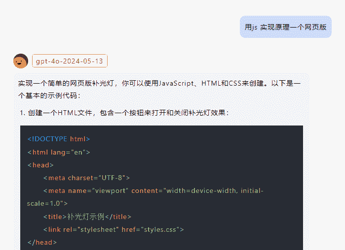
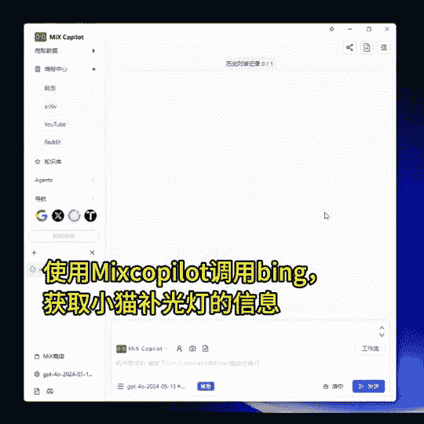
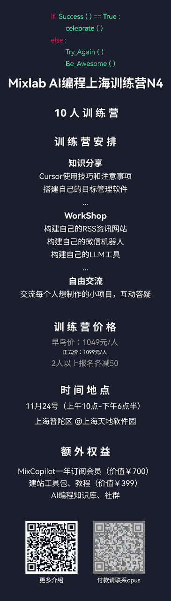

# 118万阅读量，一个小时开发的APP火了，这是人人都能做APP的时代

> 来源：[https://now.feishu.cn/docx/SVLxdgAX5olEbAx12pocFbEIntg](https://now.feishu.cn/docx/SVLxdgAX5olEbAx12pocFbEIntg)

> 一个小时开发，三万人下载，登上APPStore排行榜第20名...

> 这不是专业开发团队的战绩，而是一个普通人用AI编程的成果。

> 在AI时代，人人都能成为开发者，打造专属于自己的应用。

## 一个小时开发的APP火了

最近，一个叫"小猫补光灯"的APP在📕上火了。这款APP的开发者只用了一个小时就完成了开发，发布后获得了惊人的成绩：

+   118万阅读量

+   7.3万点赞

+   3.1万+ APP下载量

+   APP Store日排名最高到第20名，与Instagram、Canva等知名应用并列

更让人惊讶的是，开发者并非专业程序员，而是借助AI编程工具快速实现了自己的想法。这个案例印证了一个观点：在AI时代，人人都能成为应用开发者。

在实现上不算复杂，通过代码改变了屏幕的颜色和明暗度。直接给 AI 下达这个需求，就能实现了。我简单实现了下：

https://shadowcz007.github.io/KittenLight-web/

[Mixcopilot复刻小猫补灯Web版.mp4](https://internal-api-drive-stream.feishu.cn/space/api/box/stream/download/all/GpL0b07zOoRHfLxdeq4cqVaLnjh)

## AI时代，人人都是开发者

### 从用户到创造者的转变

过去，开发软件是专业程序员的专属领域。但现在，借助AI编程工具，普通人也能将想法转化为现实：

+   老师可以开发课程管理工具

+   摄影爱好者可以制作专属修图应用

+   健身达人能做私人订制的训练APP

+   阅读爱好者可以打造个性化的读书笔记工具

### 为什么现在是最好的时机？

1.  **技术门槛大幅降低**

+   AI编程工具（如Cursor）让编程变得简单直观

+   不需要深厚的编程功底就能开发应用

+   从想法到实现的周期大大缩短

1.  **个性化需求的爆发**

+   标准化的应用无法满足所有人的需求

+   小众需求往往被大公司忽视

+   个人开发者更了解身边人的真实需求

1.  **开发成本显著降低**

+   AI工具降低了开发成本

+   云服务使部署维护变得简单

+   不需要大量资金投入

## 如何开始你的开发之旅？

1.  发现需求

+   观察身边人的痛点

+   在社交平台验证需求

+   关注小众但真实的需求

1.  快速开发

+   使用AI编程工具（如Cursor）开发原型

+   不追求完美，先发布再优化

+   保持迭代更新的节奏

1.  寻找用户

+   在合适的平台分享你的作品

+   收集用户反馈

+   根据反馈持续改进

## 新时代的机遇

现在，任何人都可以成为应用开发者。你不需要成为专业的程序员，只需要：

+   发现真实的需求

+   掌握基本的AI编程技能

+   持续学习和改进

想象一下，你可以开发：

+   专属于你的效率工具

+   解决特定问题的应用

+   服务特定群体的软件

在AI时代，做一款APP就像做一顿饭一样平常。每个人都能根据自己的需求，创造独特的解决方案。

## 从想法到实践：AI编程训练营

看到这里，你可能会问：具体该如何开始？

为了帮助更多人迈出第一步，我们开设了专门的AI编程训练营。目前，累计30人，从Mixlab AI编程训练营开启了制作产品之旅。在这里，你将：

联系opus，获取更高折扣。

软件开发不再是技术精英的专属领域。借助AI工具，任何人都能将想法转化为现实。现在正是开始你的开发之旅的最佳时机，让我们一起拥抱这个人人都能开发应用的新时代！

想要报名或了解更多详情，请添加🛰️：opus（备注：AI编程训练营报名）