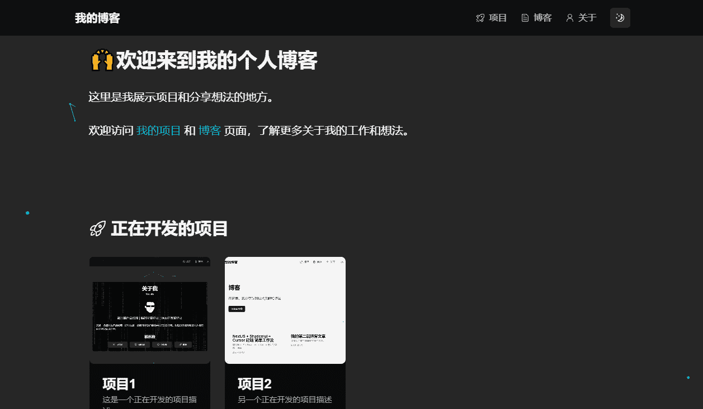
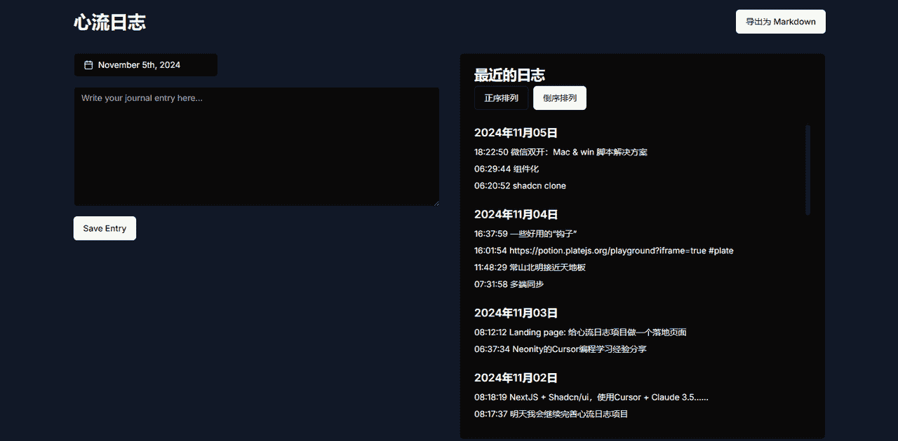
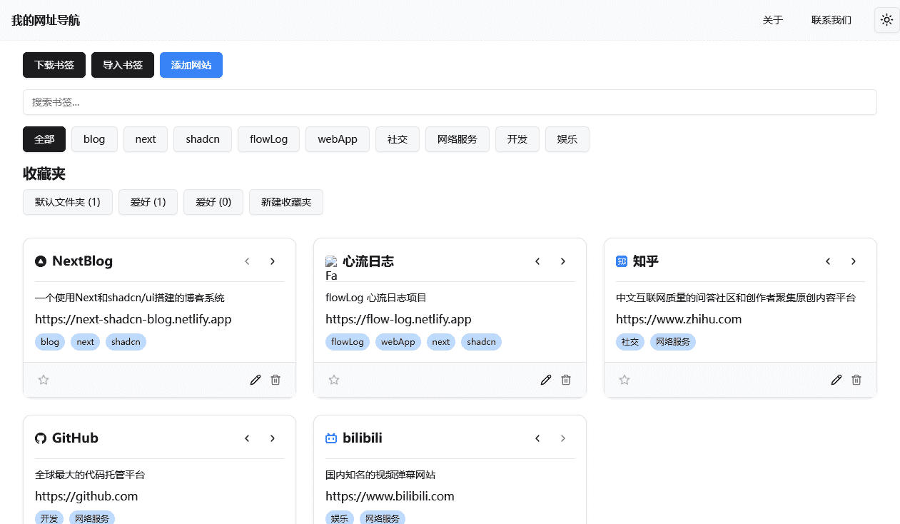
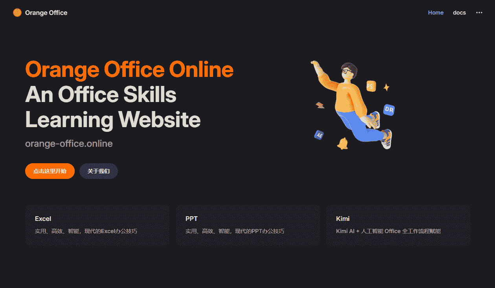
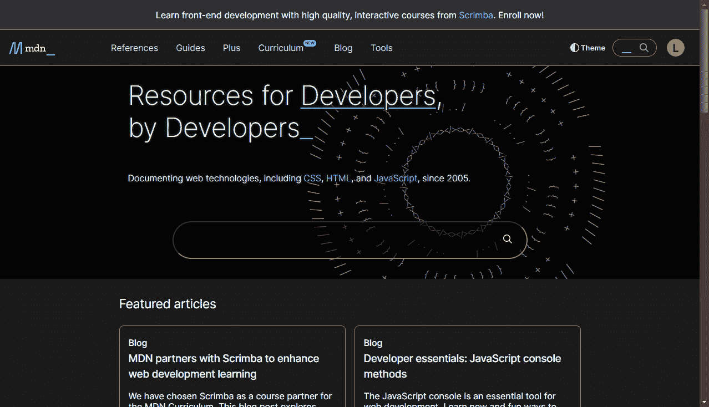
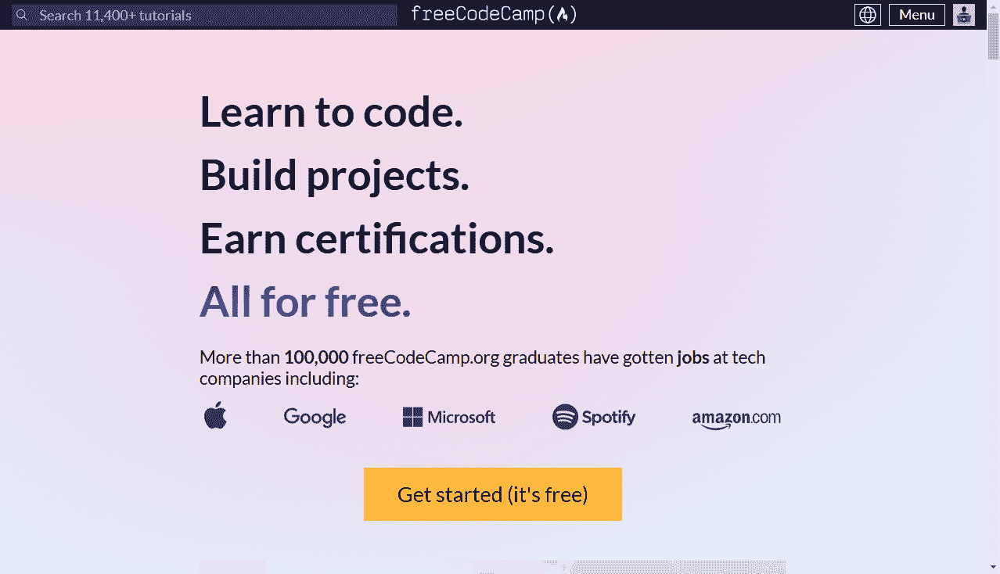

# Neonity的Cursor编程学习经验分享

> 来源：[https://now.feishu.cn/docx/DK6YdZCu1olRiLxx1WWcjmePnGK](https://now.feishu.cn/docx/DK6YdZCu1olRiLxx1WWcjmePnGK)

By Neonity

分享点自己学习编程的经验、心路。

## 不要给自己设限

这是个终身学习者的黄金时代，只要你想学，就不怕找不到学习资源；只要你热爱，就能掌握自己做项目的知识和能力。

不要给自己一开始就给自己设置诸多限制——我不是程序员，我没经验，我不懂设计……

你只要有解决困难的勇气，甚至在某一方面有爱好，就可以通过学习编程，去订制化的解决自己的问题：

[你喜](https://next-shadcn-blog.netlify.app)欢写作，可以自己动手，创建一个能让自己文思泉涌、码字不停的博客(→跳转我的博客项目）；

你可以去学习写个[网址导航](https://neo-bookmark.netlify.app)[（→跳转](https://vitepress-orange-office.netlify.app)网址导航项目）帮自己管理网址书签；做个电子文档网站：甜橙办公

你也可以给自己做个[心流日志](https://flow-log.netlify.app)的web App，来记录、沉淀自己日常的灵感、闪念，而不受到干扰……

以上都是我在一个月不到的时间内学习、开发出来的，而我的基础也仅仅是会用Js写个小网页。我也是非计算机专业、完全0基础自学的。

Cursor让学习路径也不再陡峭——你不再需要花几年时间，去学习庞大的web知识体系，而只需要了解必要的概念和框架，就可以上路了，有Cursor、Copilot、bolt.new、v0、Cline……等如六丁六甲，一众神仙为你保驾护航，不厌其烦帮你引路、帮你写代码。

你只需要拥有热爱，就足够了。

## 不要畏惧英语和代码

英语不懂的同学，推荐安装【沉浸式翻译】这个LLM网页翻译插件，几乎可以解决你一切语言障碍（赞美新时代的巴别鱼~）

80%的新手都是在看到第一行代码的时候放弃的，剩下的80%在部署编程环境时放弃了

所以说，前文提到的热爱，可以帮你对抗对于代码的畏惧

拥抱英语和代码，会是一个好的开端

## 必要的知识框架

**web前端三件套**：

+   HTML：声明网页的基本结构

+   CSS：对网页的样式进行定义和渲染（PS：推荐学习一下tailwind CSS，写项目真的很方便）

+   JavaScript：对网站的交互进行构建的脚本语言

其实你甚至不用写一行代码，也是可以利用Cursor完成一些小型的项目的，但没有前端基础，很难给Cursor下足够具体的指令，它生成的代码你也不容易理解，碰见问题无法很好的应对和debug

所以，web前端的内容还是需要快速的过一遍的，程度达到可以自己写个网页就可以了（个人经验），大概一周时间就差不多了

推荐的学习网站：

+   MDN：https://developer.mozilla.org/zh-CN/

+   Free Code Camp：https://www.freecodecamp.org/

### MDN

MDN是mozzila公司（firefox火狐浏览器的开发者）的开放web学习文档站点，有丰富的前端三件套知识和案例，通俗易懂，可以帮助开发者从0开始学习web技术，而且难能可贵的是，多年来（从2005年至今）一直保持更新。从这里开始学习

### Free Code Camp

非常好的编程挑战项目网站，能让你**在做项目挑战的**过程中无痛学习。重要的是，几乎全是免费的

## 前端框架

接下来，你要知道什么是前端框架。

前端三件套虽然已经可以完备地建立网站、web应用，但实际写起来很麻烦，不能很好地复用代码——如果你用JS写程序，要经常性的复制粘贴代码片段，这非常违背编程的理念。于是，大神们就基于JS，开发了一些前端框架

目前最流行的有前端框架有三个：

+   REACT：目前应用的最广的现代前端框架，NextJS就是REACT项目。所以也是我们最应该熟悉和了解的

+   Vu[e：在](https://vitepress-orange-office.netlify.app)REACT之后出现的框架，是大神尤雨溪开发、发起的。是仅次于REACT最流行的框架，但因入门简单，心智负担相对低，为众多开发者喜爱。我也用Vue框架的VitePress做了一个文档站的小项目

+   Angular：是谷歌公司的前端框架，目前呈下降的趋势。不推荐学习

## NodeJS

+   集成了浏览器环境的编程基础设施

+   几乎我们所有用的编程工具都离不开Nodejs

## NextJS + Shadcn/ui

+   [NextJS](https://nextjs.org)：Vercel公司开发的，使用REACT的全栈框架，最适合Cursor编程的开发框架

+   [Shadcn/ui](https://ui.shadcn.com/)：时下最热的组件库，与NextJS可以说是珠联璧合

### 什么是NextJS？

## [什么是 Next.js?](https://nextjscn.org/docs#%E4%BB%80%E4%B9%88%E6%98%AF-nextjs)

Next.js 是一个用于构建全栈 Web 应用程序的 React 框架。你可以使用 React 组件来构建用户界面，而 Next.js 则提供额外的功能和优化。

在底层，Next.js 还抽象化并自动配置了 React 所需的工具，如打包、编译等。这使你能够专注于构建应用程序，而不必花时间在配置上。

无论你是个人开发者还是大型团队的一员，Next.js 都能帮助你构建交互式、动态且快速的 React 应用程序。

### 什么是[Shadcn/UI](https://ui.shadcn.com/)？

一个美观、开源的组件集，使用Tailwind CSS构建，你可以使用复制粘贴的方式来将组件添加到你的应用

## GitHub的使用

+   什么是Git？

+   什么是GitHub？

+   如何使用GitHub管理代码？

### 关于Git

[Git](https://baike.baidu.com/item/%E5%88%86%E5%B8%83%E5%BC%8F/19276232?fromModule=lemma_inlink)[（读音为](https://baike.baidu.com/item/%E7%89%88%E6%9C%AC%E7%AE%A1%E7%90%86/2511538?fromModule=lemma_inlink)/gɪt/）是一个开源的分布式版本控制系统，可以有效、高速地处理从很小到非常大的项目版本管理。我们使用git来进行代码的版本控制操作。我们最常用的GitHub就是一个基于Git的代码托管平台。

如何使用git来进行版本控制，可以参考菜鸟教程：

## 关于GitHub

每个开发者都应该熟练使用GitHub，因为它是目前最好的代码托管平台，有着丰富的免费资源，也可以找到众多优秀的开源项目去学习，甚至二开使用。

ps：使用GitHub，可以一键部署到网站托管平台

### 代码托管平台推荐

+   Vercel

+   CF（Cloud Flare）

+   Netlify

+   zeabur

## 相信社群的力量

积极参与社群活动，多和大家互动

利用费曼技巧去教学相长