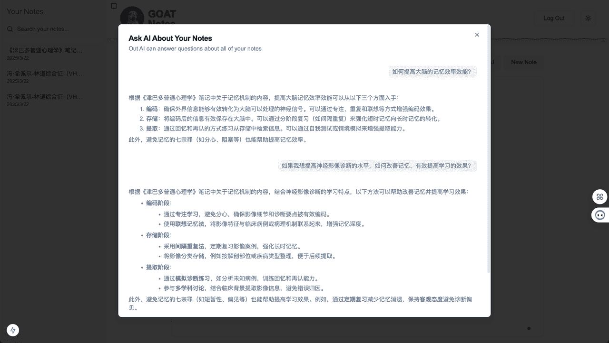

# FreeCodeCamp教程推荐：NextJS+Supabase构建AI笔记应用

> 来源：[https://now.feishu.cn/docx/O62Vd2kO2oAc6WxcnxTcfNrYnPe](https://now.feishu.cn/docx/O62Vd2kO2oAc6WxcnxTcfNrYnPe)

【使用 Next.js 和 Supabase 构建全栈 AI 笔记应用程序】 https://www.bilibili.com/video/BV18HX6YvEPh/?share_source=copy_web&vd_source=276126e6cf709e1eb2f51fd5f67896e1

使用 Next.js 15 App Router、Supabase（用于身份验证和数据库管理）、Prisma ORM 和 shadcn（用于简洁、现代的样式）构建全栈笔记应用程序。我们还将集成 OpenAI API 以添加 ChatGPT 功能，这样你就可以与笔记进行交互，并使用 Vercel 将完成的应用程序部署到网络上。

GitHub 仓库：https://github.com/ColeBlender/goat-notes

视频油管链接：https://www.youtube.com/watch?v=6ChzCaljcaI，作者：@coleblender

网站：https://coleblender.com

（中文字幕为机翻，如有错误，欢迎指出）

我们的朋友 Scrimba 为该频道提供了支持 - Scrimba 是一个重新发明了互动学习的编码平台：https://scrimba.com/freecodecamp

免费编程课程：https://www.freecodecamp.org/chinese/learn

在专栏阅读技术文章：https://www.freecodecamp.org/chinese/news

在论坛获得帮助：https://forum.freecodecamp.org/c/chinese/533

⌨️ (0:00:00) 介绍

⌨️ (0:02:44) 开始项目

⌨️ (0:06:48) 添加 shacn/ui、暗黑模式和 Toast

⌨️ (0:08:48) 构建头部

⌨️ (0:17:21) 构建 LogOutButton

⌨️ (0:22:19) 添加认证页面

⌨️ (0:32:12) 创建 Supabase 项目

⌨️ (0:35:48) 添加 Supabase 代码

⌨️ (0:40:52) 添加认证代码逻辑

⌨️ (0:50:02) 添加 Prisma 代码

⌨️ (0:58:35) 构建侧边栏

⌨️ (1:04:25) 构建主页

⌨️ (1:09:11) 设置 OpenAI 账户

⌨️ (1:11:22) 构建笔记 TextInput

⌨️ (1:18:18) 创建上下文和自定义 Hook

⌨️ (1:22:06) 编写更新笔记的服务器 Action

⌨️ (1:24:27) 完成 NewNoteButton

⌨️ (1:29:23) 完成侧边栏

⌨️ (1:51:31) 添加中间件

⌨️ (1:59:43) 添加 AskAI 按钮

⌨️ (2:21:43) 部署到 Vercel

⌨️ (2:26:02) 结束

实操体验：

1.  项目写得非常简洁，能够快速让小白上手NextJS+Supabase+Shadcn+Prisma技术栈，开发完全属于自己的AI问答知识库

1.  如果没有耐心听完，可以直接去clone项目源码，在Cursor的指导下二开

1.  教程里用的OpenAI，我用Cursor 5分钟就给改成了DeepSeek并跑通了