# 网页

> 来源：[https://now.feishu.cn/docx/PZ89dDrgMobtJpxcbO7ci8t2nnb](https://now.feishu.cn/docx/PZ89dDrgMobtJpxcbO7ci8t2nnb)

### 日历工具

By Jackit

用 bolt.new 做了一简单的日历工具：https://willowy-meringue-c3ff77.netlify.app/

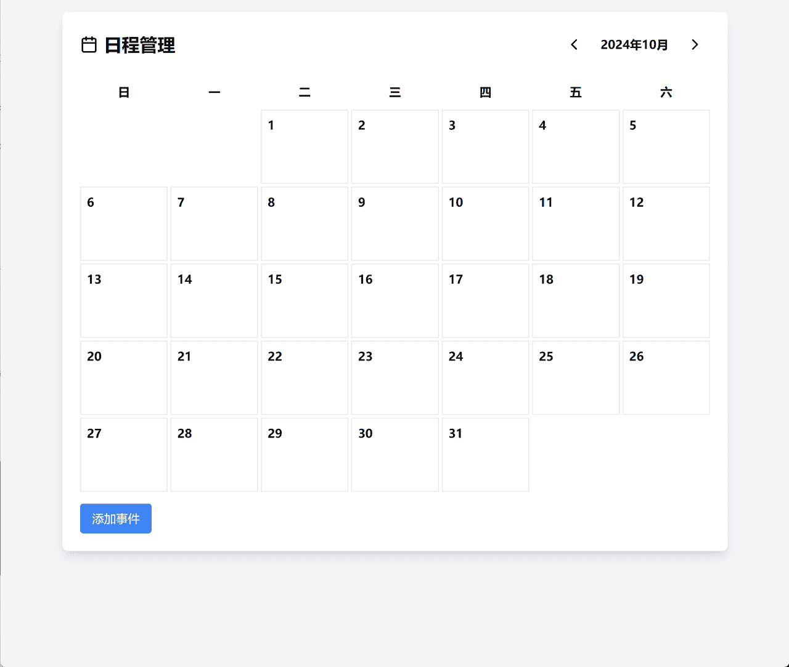

### 时钟

By Jackit

https://stirring-gingersnap-622df3.netlify.app

用bolt.new做了一个时钟。

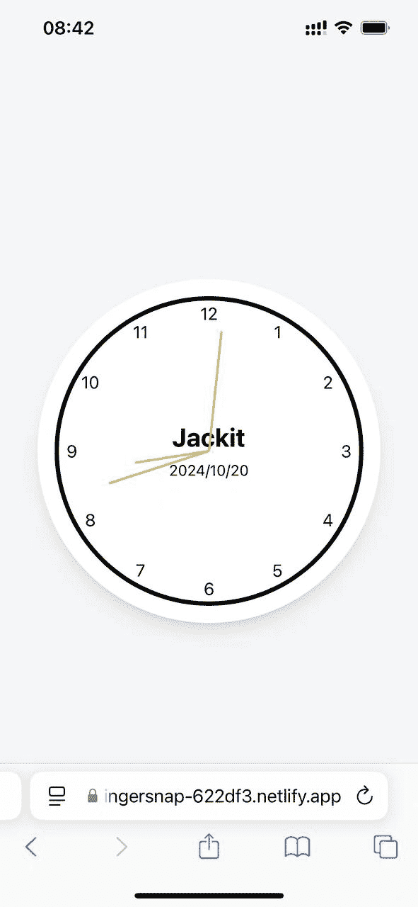

### 磁力迷宫挑战

By 刘东君

我用 Claude Artifact 给朋友过我做的网页小游戏，是关于初中物理课的，制作过程太丝滑了，几句话小游戏就出来了，非常简陋，幼儿园小孩也能做。https://claude.site/artifacts/402972db-a939-4830-a10e-a5936de136eb

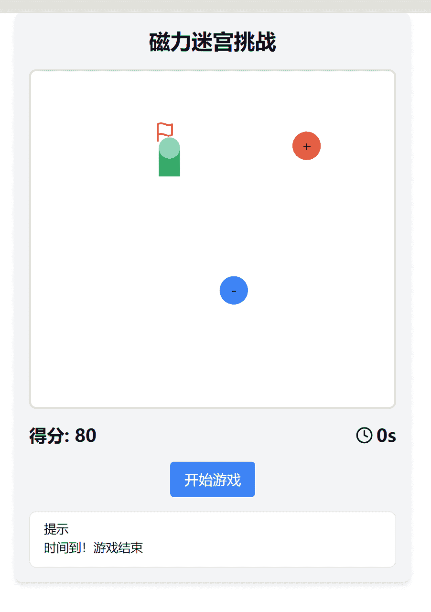

### 电脑人生成器

By Shadow

提示词  ，使用bolt完成整个项目的生成 https://bolt.new/~/sb1-ecr2zo

[prompt.md](https://internal-api-drive-stream.feishu.cn/space/api/box/stream/download/all/E68dbi7vHo4R5Sx7bdWc1N4Angg)

体验网站：https://shadowcz007.github.io/RobotGenerator/

需要使用硅基流动提供的key：https://cloud.siliconflow.cn

实现了LLM和图像生成的整合。

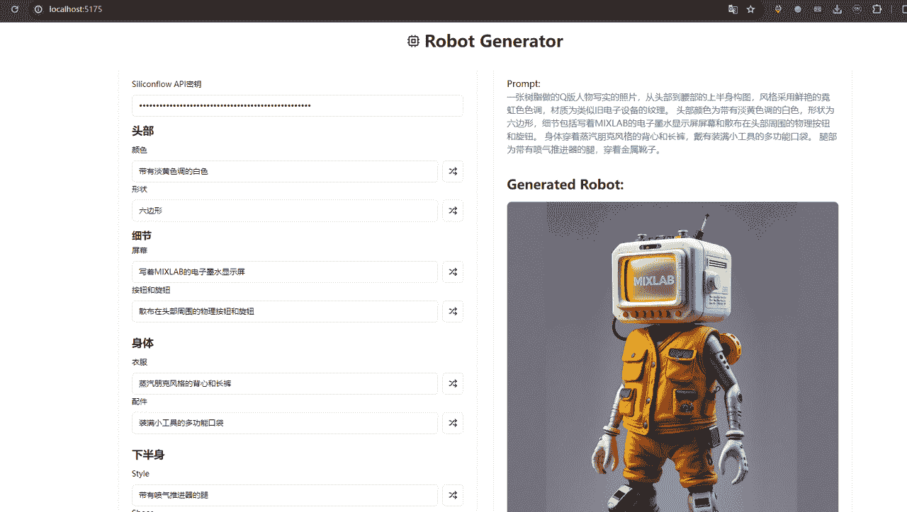

使用claude-dev优化UI和修改代码：

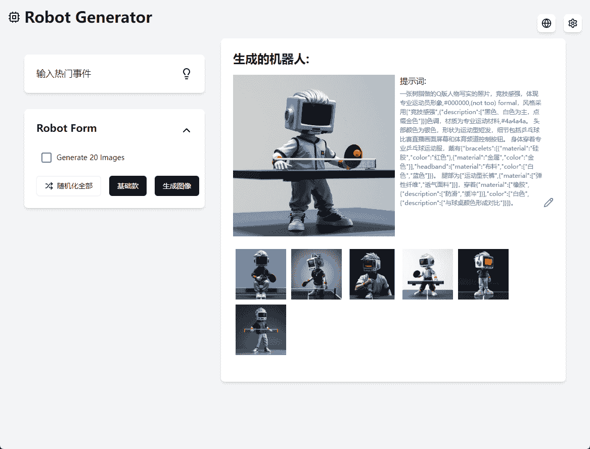

### 跨学科学习小组积分排行榜

By [薛志荣](https://www.xiaohongshu.com/user/profile/556e6d72e58d132ebb6fc920)

https://www.mixknowledge.com/studygroup

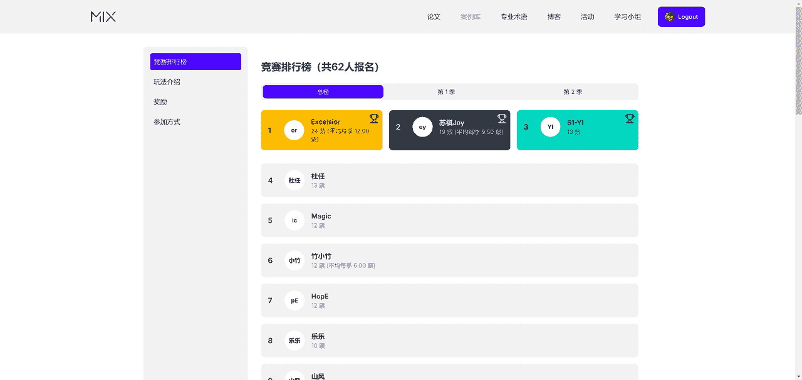

### 问题拆解器

By [薛志荣](https://www.xiaohongshu.com/user/profile/556e6d72e58d132ebb6fc920)

你只要输入一个问题，它就能拆解成若干问题并通过思维导图显示

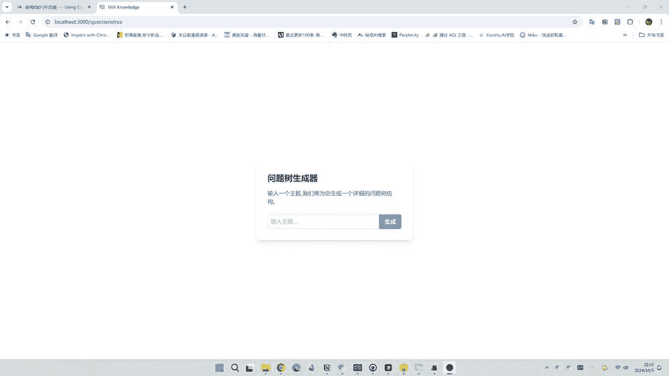

[2024-10-05_22-55-16.mp4](https://internal-api-drive-stream.feishu.cn/space/api/box/stream/download/all/RAekbyf0PoLzFRxFCCJcZ2oCnUf)

### 目标分解器

By [薛志荣](https://www.xiaohongshu.com/user/profile/556e6d72e58d132ebb6fc920)

做了一个多模态文本输入框，以及一个LLM执行模块。多模态文本输入框支持语音输入，也可以将内容翻译成其他语言，挺实用的。LLM执行模块站在可解释性的角度来设计，支持多个LLM Prompt串行运行。最后这个产品做成了一个目标管理小应用。

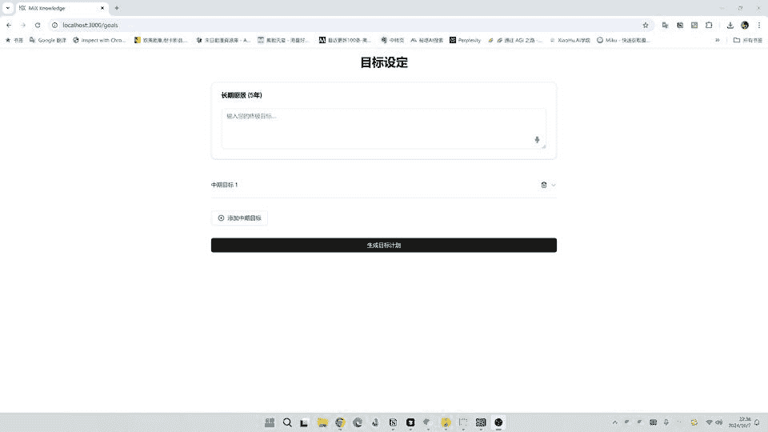

[2024-10-07_22-38-56.mp4](https://internal-api-drive-stream.feishu.cn/space/api/box/stream/download/all/LtGIbdgrSonmQNx9pJJcGnLCnoe)

### 单词卡片

By shadow

用v0完成基础代码 https://v0.dev/chat/iGLtTxbld8W，然后用claude-dev 完成了大部分，

claude_dev：

[claude_dev_task_oct-3-2024_9-52-29-pm.md](https://internal-api-drive-stream.feishu.cn/space/api/box/stream/download/all/ZLeqbyWpto9F4gxak7AcDAyEn7g)

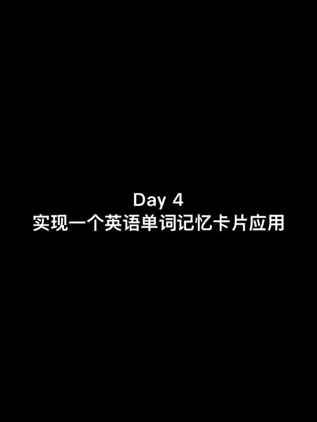

[stodownload (1).mp4](https://internal-api-drive-stream.feishu.cn/space/api/box/stream/download/all/PQyAbdCbUoIySPxHbiocCg5Fnnd)

### 国旗头像合成

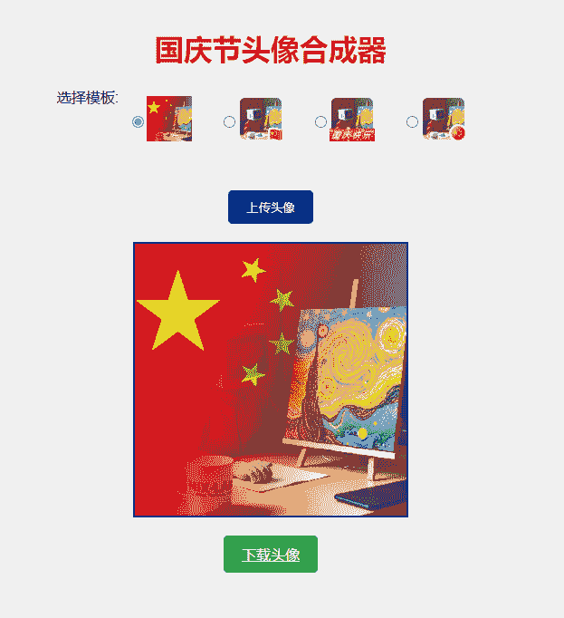

网站访问

### 👸号排版编辑器

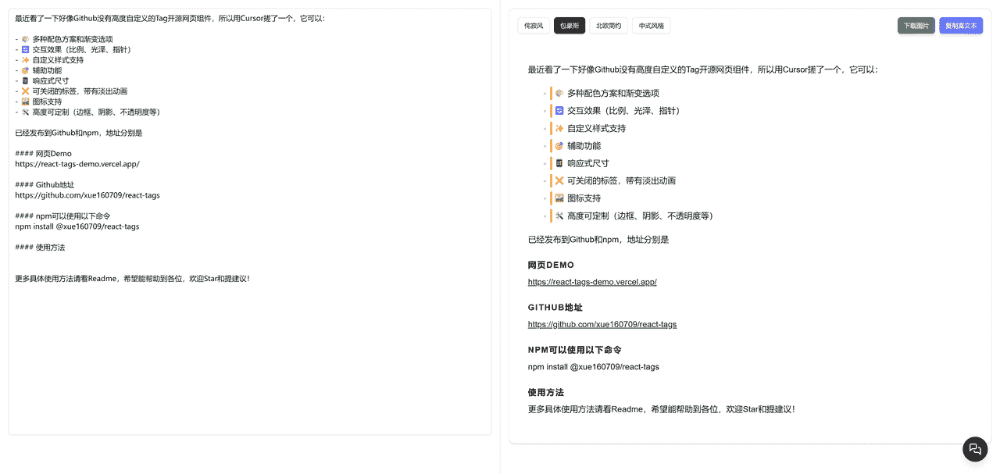

html-style-transformer.vercel.app