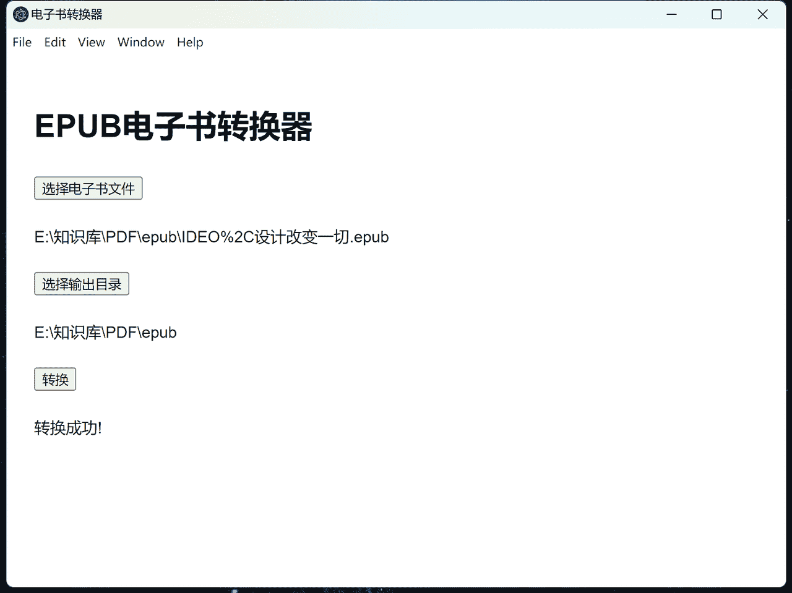

# 桌面应用

> 来源：[https://now.feishu.cn/docx/RZf0d5i6NoAyP9xduwQcYjLtnHb](https://now.feishu.cn/docx/RZf0d5i6NoAyP9xduwQcYjLtnHb)

### Epub转Markdown

By [薛志荣](https://www.xiaohongshu.com/user/profile/556e6d72e58d132ebb6fc920)

可以将epub转成Markdown，而且分章节保存。这样方便导进Obsidian或者在其他软件里用LLM操作Markdown了

开源和下载地址：https://github.com/xue160709/Epub2Markdown

