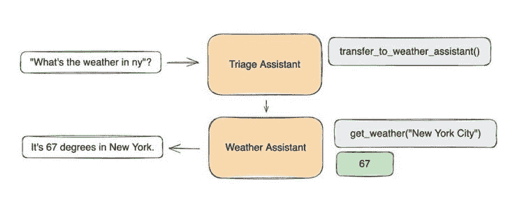
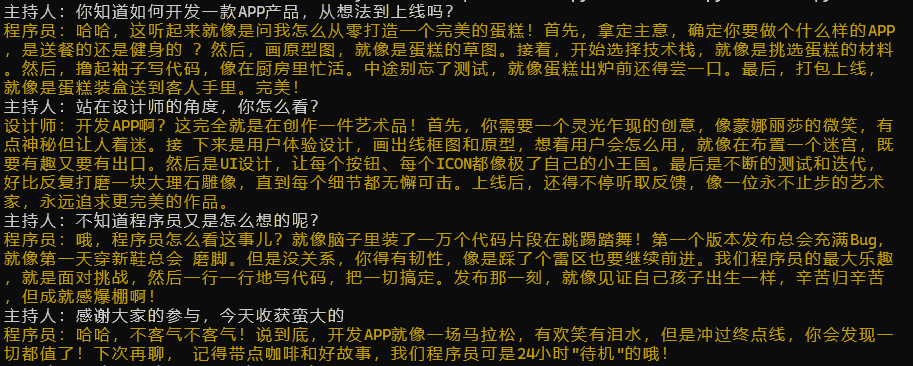
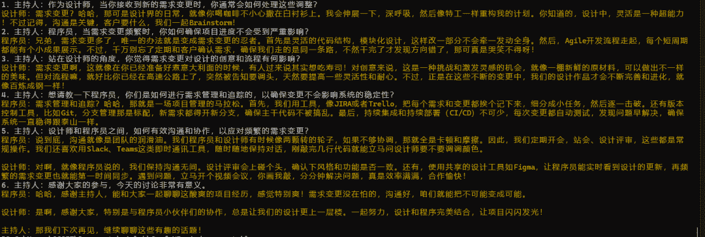
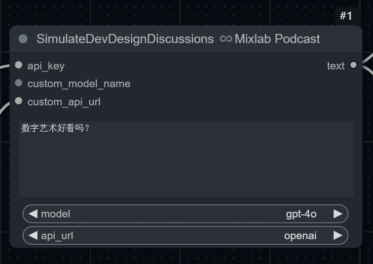
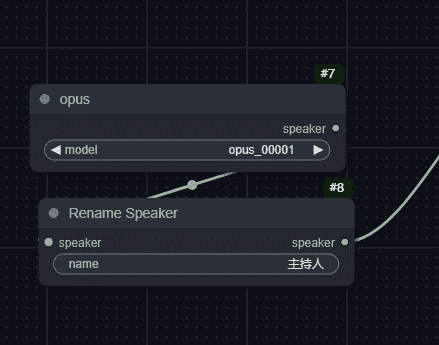
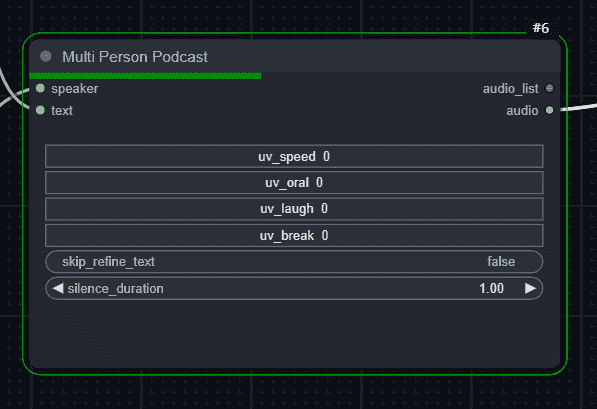
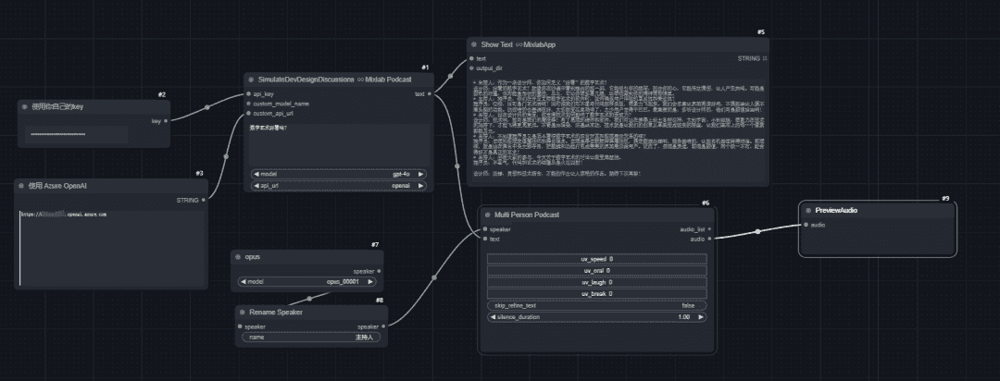
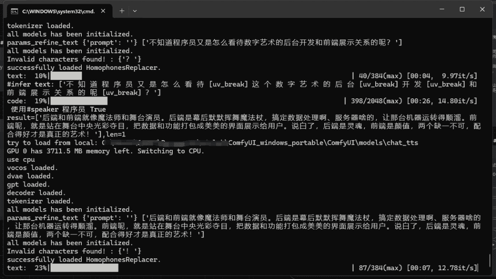
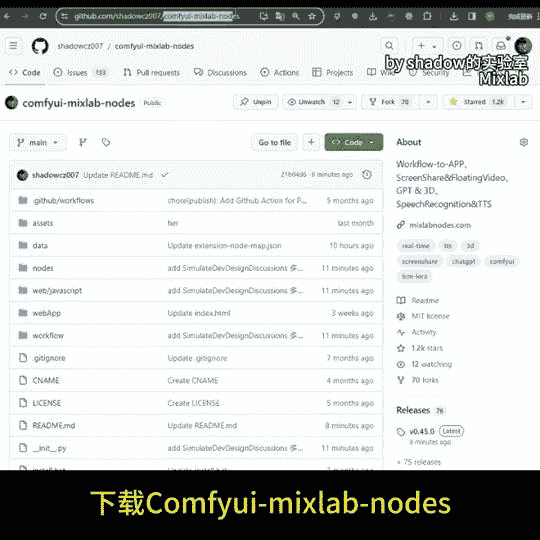

# ComfyUI节点

> 来源：[https://now.feishu.cn/docx/LrQfd6DQpo39DSxnzdzcTOycn9b](https://now.feishu.cn/docx/LrQfd6DQpo39DSxnzdzcTOycn9b)


主要实现了节点：SimulateDevDesignDiscussions ♾️Mixlab Podcast

源代码：https://github.com/shadowcz007/comfyui-mixlab-nodes/blob/main/nodes/ChatGPT.py#L845

**

使用Swarm来**写多智能体的代码，非常简洁高效。

什么是Swarm？

**

Swarm是**由OpenAI开发的一个实验性多代理系统框架，旨在探索多代理系统的高效接口。该框架注重轻量级、可控性高且易于测试，主要用于展示代理之间的交接与例行操作模式。Swarm适用于需要处理大量独立功能和指令的场景，并提供了比Assistants API更高的透明度和精细的控制。Swarm通过Python实现，并使用Chat Completions API来处理代理之间的无状态通信。



官方的示例：

**代理转移**

examples/basic/agent_handoff.py

介绍了如何将说西班牙语的用户从一个英语代理转移到一个西班牙语代理。具体实现是：创建两个代理，一个只能说英语，另一个只能说西班牙语。当用户用西班牙语发送消息时，english_agent 会调用 transfer_to_spanish_agent 函数，将用户转移到 spanish_agent。最终，客户端会处理这个请求并返回响应。

理解了原理之后，我们开始修改。我先改造成了设计师和程序员的代理切换，针对不同的问题，自动切换合适的角色来回答。



**有了第一步的**尝试，我把这个代理切换的DEMO升级成了一个播客生成器。

1 首先创建一个主持人代理，用来根据话题创建若干问题。

2 把创建好的问题，一个个输入给Swarm

3 自动选择角色来回答问题

4 最后合并成一个播客的稿件



更进一步**，我制作了一个ComfyUI的节点：

Simul**ateDevDesignDiscussions ♾️Mixlab Podcast



输入新的话题：数字艺术好看吗？

我是用的是gpt-4o，用了自定义的API URL（由Azure提供的）。

主持人的音色采用之前生成好的Opus的音色：



多人播客语音的生成，也很简单使用由ChatTTS提供支持的Multi Person Podcast节点，直接把生成好的配音稿，输入即可：



整体的 ComfyUI 工作流设计，如下：



第一期播客生产中：





[10月12日 (1)实现原理.mp4](https://internal-api-drive-stream.feishu.cn/space/api/box/stream/download/all/AqNAbS9QKodxPKxlF18cS3obnlg)

实现原理

最后的制作效果：


[10月12日-多智能体播客.mp4](https://internal-api-drive-stream.feishu.cn/space/api/box/stream/download/all/QmbZbIteRoIw6NxGzwLcIlN1nOb)

[

欢迎加入AI编程社区交](http://mp.weixin.qq.com/s?__biz=MzA3MDgyMjMwMA==&mid=2649976094&idx=1&sn=b8ccca9e75b0184b6ad2f4c400aa274f&chksm=87313dedb046b4fbb8bf691560a66ba6b37f33de33611ca456442ee79805957d199ce6172d23&scene=21#wechat_redirect)流

Cursor AI编程#Mix线下训练营@上海N1

# 如何创建新的ComfyUI节点？

输入：

```
social_profile = {
    &quot;username&quot;: &quot;shadow&quot;,
    &quot;profile_id&quot;: &#x27;ML000&#x27;,
    &quot;skills&quot;: [
        &quot;Design Hacker&quot;,
        &quot;Programmer&quot;,
        &quot;Architect&quot;,
        &quot;Experience Designer&quot;
        ]
}
```

> 参考上面的json，创建一个comfyui节点，基于以下代码修改：# 用于定义社交名片

> class SocialProfileNode: @classmethod def INPUT_TYPES(s): return { "required": { "json_string":("STRING", {"forceInput": True,}), "key":("STRING", {"multiline": False,"dynamicPrompts": False,"default": ""}), }, "optional":{ "json_string2":("STRING", {"forceInput": True,}) }, } INPUT_IS_LIST = False RETURN_TYPES = ("STRING","STRING",) RETURN_NAMES = ("json_string","value",) FUNCTION = "run" # OUTPUT_NODE = True OUTPUT_IS_LIST = (False,False,) CATEGORY = "♾️Mixlab/GPT" def run(self, json_string,key="",json_string2=None): return (json_str_with_chinese,v,)

(上面粘贴了一个comfyui节点的简单示例代码)

LLM回复：

下面是修改后的 SocialProfileNode 类，用于定义社交名片：

```
class SocialProfileNode:
    @classmethod
    def INPUT_TYPES(cls):
        return {
            &quot;required&quot;: {
                &quot;username&quot;: (&quot;STRING&quot;, {&quot;forceInput&quot;: True}),
                &quot;profile_id&quot;: (&quot;STRING&quot;, {&quot;forceInput&quot;: True}),
                &quot;skills&quot;: (&quot;STRING&quot;, {&quot;forceInput&quot;: True, &quot;multiline&quot;: True, &quot;default&quot;: &quot;&quot;}),
            },
        }

    INPUT_IS_LIST = False
    RETURN_TYPES = (&quot;STRING&quot;, &quot;STRING&quot;)
    RETURN_NAMES = (&quot;json_string&quot;, &quot;value&quot;)
    FUNCTION = &quot;run&quot;
    OUTPUT_IS_LIST = (False, False)
    CATEGORY = &quot;♾️Mixlab/GPT&quot;

    def run(self, username, profile_id, skills):
        import json

        # 将skills字符串分割为列表
        skills_list = [skill.strip() for skill in skills.split(&quot;,&quot;)]

        # 创建社交名片的JSON对象
        social_profile = {
            &quot;username&quot;: username,
            &quot;profile_id&quot;: profile_id,
            &quot;skills&quot;: skills_list,
        }

        # 将社交名片转换为JSON字符串
        json_string = json.dumps(social_profile, ensure_ascii=False)

        # 返回JSON字符串和一个示例值
        return (json_string, &quot;社交名片已生成&quot;)

# 示例调用
node = SocialProfileNode()
print(node.run(&quot;shadow&quot;, &quot;ML000&quot;, &quot;Design Hacker, Programmer, Architect, Experience Designer&quot;))

```

进一步修改需要comfyui节点开发的专业知识。