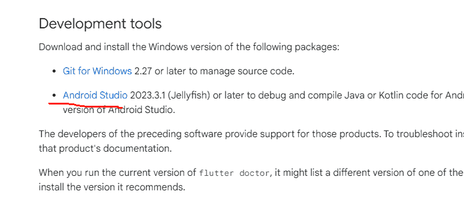
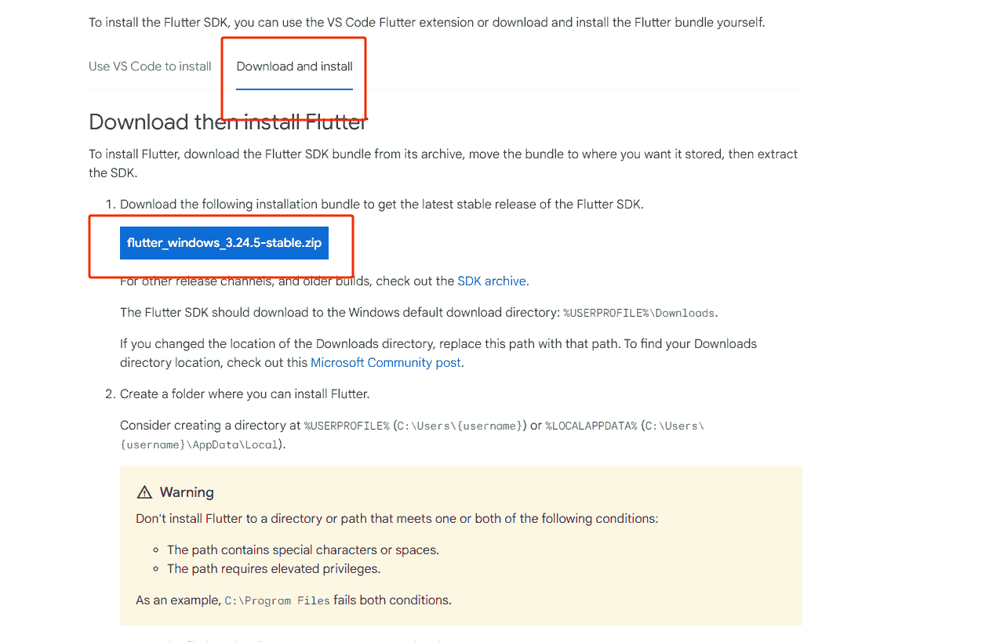
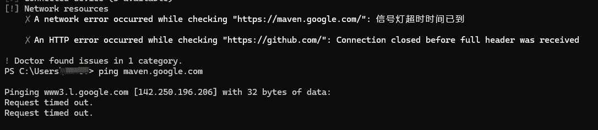
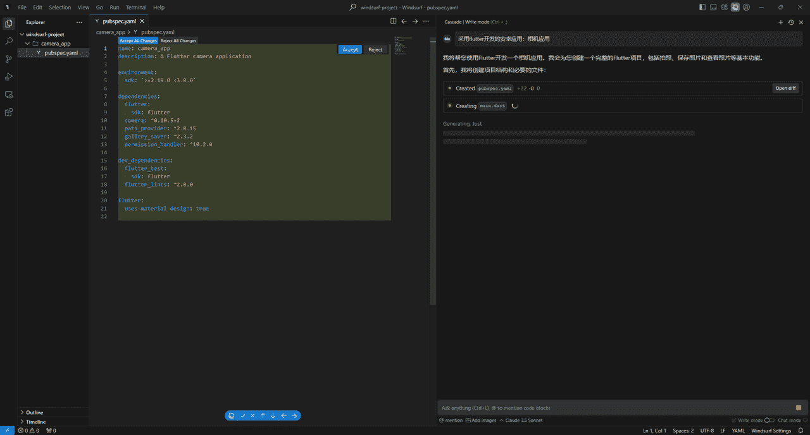

# 在window上用Flutter 开发安卓应用

> 来源：[https://now.feishu.cn/docx/XGJDd85egoCj0WxVdI2c5cIinfd](https://now.feishu.cn/docx/XGJDd85egoCj0WxVdI2c5cIinfd)

https://docs.flutter.dev/get-started/install/windows/mobile

1 下载安装Android Studio

https://developer.android.com/studio?hl=zh-cn

2 flutter sdk

3 flutter doctor

按提示完成环境安装

Visual Studio not installed; this is necessary to develop Windows apps.

Download at https://visualstudio.microsoft.com/downloads

4 windsurf

1.  安装项目依赖： 在项目根目录（camera_app文件夹）下运行：

flutter pub get

2 运行

先要运行模拟器

flutter emulators --launch Medium_Phone_API_35

flutter devices

flutter run -d Pixel_3a

flutter create .

https://codelabs.developers.google.com/codelabs/flutter-codelab-first?hl=zh-cn#2

网络问题： Flutter配置Gradle镜像，解决国内下载慢问题

https://juejin.cn/post/7299346813261676544

gradle版本问题

https://docs.flutter.dev/release/breaking-changes/android-java-gradle-migration-guide

如何修改为合适的java的版本？