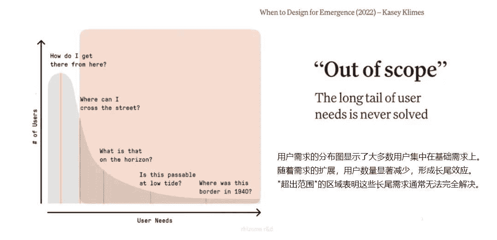
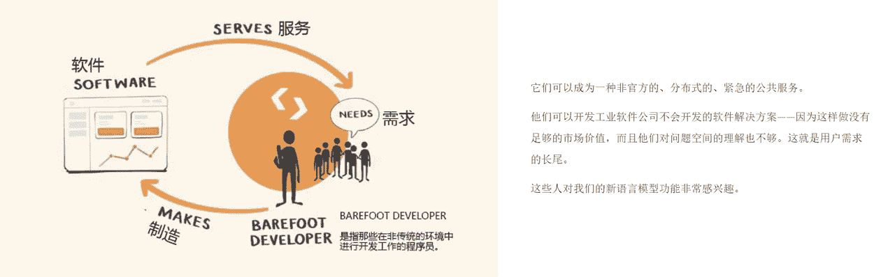
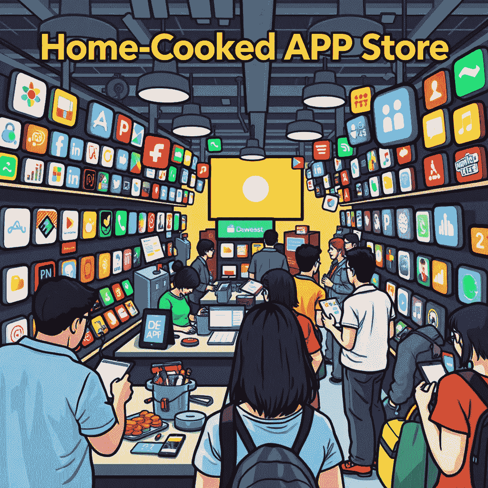

# 奖金池1500元：Mixlab AI编程挑战赛第一季

> 来源：[https://now.feishu.cn/docx/VHZGdfXVoo7UrrxOFvRc9uDbnNh](https://now.feishu.cn/docx/VHZGdfXVoo7UrrxOFvRc9uDbnNh)

# 长尾需求 Long-Tail Needs

G**oogle 工程师 Kas**ey K**lime**s 在《When to Design for Emergence》一文中指出：“当前软件开发聚焦于满足大多数用户的普遍需求”。但是！我们不能忽视用户的长尾需求 (Long-Tail Needs) 。这些需求虽然小众但种类繁多，而且可以说是无穷无尽。

他以 Google Map 为例，指出这款应用的核心功能是 **帮助用户从A****点到达B点 。但**是，对于某些小众用户群体也非常重要的功能，例如潮汐模式，往往不被纳入考量，就像上图被粉色区域覆盖的 超出范围 (Out of scope) 。

**大型科技公**司开发的工业软件，受**到商业模式的约**束**，必然要考虑收益**和成本**。最理想的状态就是，**锁定最大的市场，解决最共性的问题，满足最有支付力的用户群体。

**为小众人群开发新功能****，意味着昂贵的员工成**本、推广成本、服务器成本等等，极有可能都收不回成本。这种提案甚至过不了内部讨论和审核。但现在这些都是新的机会：满足长尾需求的自制软件。这类软件不需要创造巨额利润，只要能够低成本运营，甚至长期来看有小幅盈利就足够了。

# **赤脚开发者 **Barefoot Developer

是指介于终端用户和专业开发者之间的一类开发者群体。他们对编程有一定的兴趣和能力，但不像专业开发者那样痴迷于编程。他们更贴近真实且零散的需求，靠近用户所在社区，技术应用方式更加灵活。

# 自制软件的便利店 Home-Cooked APP Store

**Home C**ooked APP Store 是一个专门收集和展示由 赤脚开发者 使用AI编程工具开发的“便利店”。这些应用致力于解决各种实际问题，便利店不仅集中展示这些应用，还负责推广和分享，帮助开发者获得更多曝光和用户。

供货商HappyEater：推出了一款AI饭搭子应用，根据用户的饮食习惯和健康目标，自动推荐每日餐单并提供营养分析。

供货商Sleep：开发了一款AI哄睡助手，使用舒缓的音乐、白噪音和个性化的睡眠建议，帮助用户改善睡眠质量。

供货商Lucky：推出一款求好运应用，利用AI分析用户的星座、生肖等信息，提供每日运势分析。

供货商Reminder：创建了一款AI提醒助手，能够根据用户的日程安排和偏好，智能提醒重要事项和待办任务。

**生成式人工智能（大模型）**，加速了满足长尾需求的自制软件市场的到来，在这些时代背景下，我们发起了：

# **MiX AI编程挑战赛****相关规则**

如果你热衷于创新和解决问题，为自己、身边的朋友甚至小众人群开发新功能，欢迎参加MiX AI编程挑战赛。

### **奖金池：****1500****元**

目前奖金池已经有**1****5****00**元，30人报名。随着越来越用户报名，这个奖金池会逐渐加大。

**挑战赛时间（为期两周）**

+   2024 年 10 月 28 日 - 2024 年 11 月 10 日

### **挑战赛规则**

+   每周用AI编程做一个项目，坚持 2 周。

+   每个AI编程项目必须在周五前完成，发布形式请以1-2分钟视频进行介绍

+   周六晚上成员之间互相介绍自己的项目并投票。

+   周日晚上众号会公布大家的项目，并进行投票。

+   票数累加，最终决定获奖名单

### **挑战赛支付费用**

+   **99 **元门票（其中50元成为奖金池的一部分）

### **挑战赛奖励**

+   赛季第一名：**奖金池的50%**，或者价值 1398 元奖品（MiX Copilot、人机交互设计知识库、AIGC 知识库年度订阅，3选2）

+   赛季第二名：**奖金池的30%**，或者价值 699 元的奖品（MiX Copilot、人机交互设计知识库、AIGC 知识库年度订阅，3选1）

+   赛季第三名：**奖金池的20%**，或者价值 399 元的奖品（AI建站工具包）

### **除了奖励以外，你还将获得**

+   Mixlab联合合作伙伴为你的自制软件进行推广和种子用户获取

+   通过自学，掌握AI编程技能并实现2个项目

+   社群：志同道合的小伙伴

+   MiX Copilot 一个月会员

+   84 元 LLM Token（硅基流动新用户赠送）

**挑战赛报名通道**

