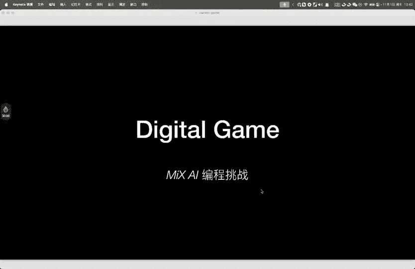
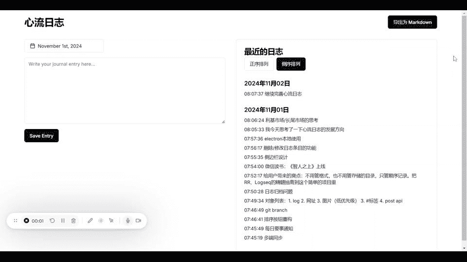
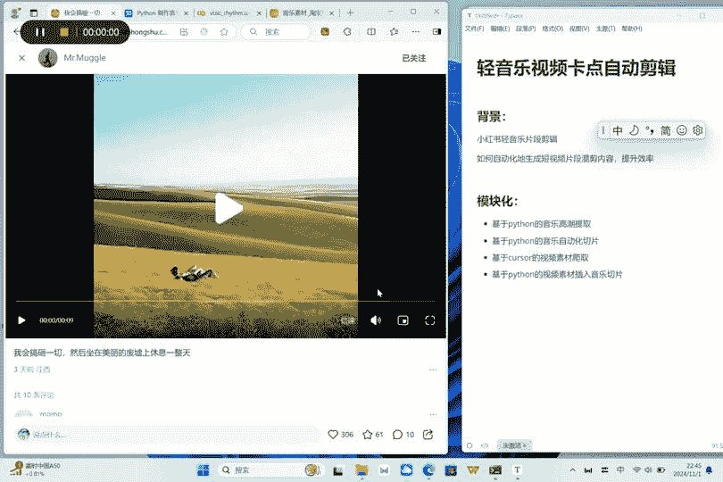
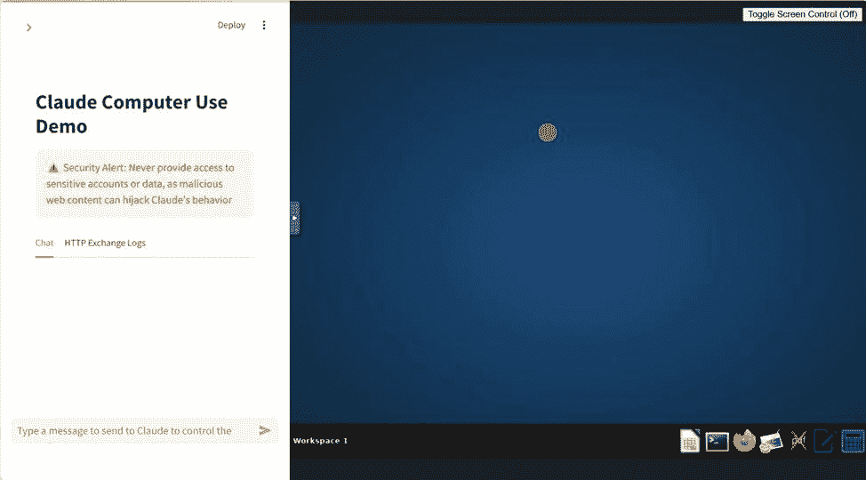
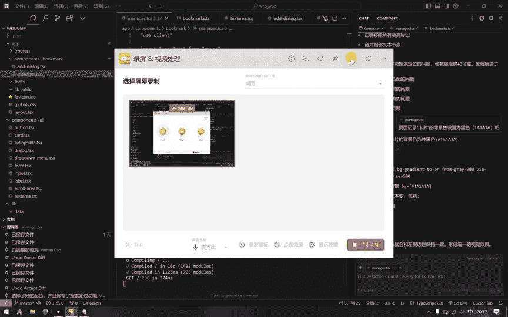

# Mixlab AI编程挑战赛第一期作品

> 来源：[https://now.feishu.cn/docx/QEtHdcrAWo52rvxPoakcWntQn0b](https://now.feishu.cn/docx/QEtHdcrAWo52rvxPoakcWntQn0b)

## Mixlab AI编程挑战赛第一期作品投票

请在以下6个项目中选择你最喜欢的项目

比赛相关介绍：[奖金池1500元：Mixlab AI编程挑战赛第一季](https://qwyofiv4bd3.feishu.cn/wiki/NPkywCwxSizCt9k8CBlcQ3KxnKE)

直播回放链接：[Mixlab AI编程挑战赛第一期作品直播交流](https://qwyofiv4bd3.feishu.cn/wiki/MKN8wF4Rxi9zxzkV5Iycsa7WnEb)

## 1- 游戏倒计时轻应用

作者：亮亮



[mix AI 编程挑战.mp4](https://internal-api-drive-stream.feishu.cn/space/api/box/stream/download/all/KfyvbTRpWobnAqxc8oBcEyQOndd)

**

主要介**绍

这是一款专为桌游“以色列麻将”设计的倒计时应用，支持竖横屏切换、音效提醒，并通过AI生成代码实现极简、高效的游戏时间管理体验。

**主要功能**

+   支持竖屏/横屏切换，随时加减时间，后台快速重启。

+   倒计时带专属音效：前45秒普通音效，最后15秒加速提醒，适配游戏紧张节奏。

+   一键“Next”自动重置，无需手动设置，流畅操作。

**应用场景**

+   多玩家桌游**。**适用于其他限时回合桌游，音效提醒增强游戏氛围。

+   团队活动/训练**。**控制时间，提升活动紧凑感，适合快速思考和执行的场景。

+   健身/HIIT训练**。**定时提醒训练节奏，无需手动计时，提高专注度。

+   演讲/会议管理。倒计时控制发言时长，音效提示保持节奏。

+   考试/学习**。**模拟考试、番茄工作法，定时提醒避免疲劳，提升效率。

**开发特色**

+   99%的代码由AI工具“cursor”自动生成，极简HTML结构，无需人工代码干预。

+   音效通过MP3文件路径调整，自定义倒计时氛围，提升用户体验。

**体验亮点**

+   “一键接受AI代码”模式：实现全程无人工干预的高效开发体验，数分钟内满足游戏需求。

**创新意义**

+   极客式AI编程尝试，探索自动化编程的边界，为桌游玩家提供极致体验。

## 2- flow-log 心流日志

作者：Neonity



[WeChat_20241101144828.mp4](https://internal-api-drive-stream.feishu.cn/space/api/box/stream/download/all/VdbDbQXLRoD0QrxeNEccyHdXn0e)

**主要介绍**

这是一款解决用户无压记录需求的小工具。

在今天，各种笔记软件层出不穷的情况下，我反而想做一款更简单纯粹的软件，只解决一个记录场景的需求——即时间戳顺序笔记的需求

**主要特色**

+   解决用户无压记录的需求

+   做到对用户无干扰，从而更容易获得“心流状态”

+   笔记可以导出为Markdown文本文件

**下一步的开发计划**

+   支持更多渲染，如url，#标签等……

+   打包本地端软件

+   注册、登录，数据库支持等

## 3- 轻音乐短视频自动化混剪

作者：范YX



[b4357477576e5300fe116384f99afb38_raw.mp4](https://internal-api-drive-stream.feishu.cn/space/api/box/stream/download/all/Inp3bOVNfo9tdYxWj7bcy6cGnWb)

**主要介绍**

轻音乐短视频自动化混剪

**主要功能**

能基于视频素材、音乐素材自动化生成音乐卡点混剪短视频。

**主要逻辑**

+   音乐高潮提取：pychorus开源程序

逻辑：

大部分时候，歌曲的高潮部分通常是重复次数最多的部分，基于片段相似度去找到重复最多的部分作为高潮片段

+   音乐自动化切片：一个基于音乐beats的卡点去切片

+   视频素材爬取：自己刷的收藏的摄影博主的素材

## 4- Fit Coach - 智能健身助手

作者：大春


[mmexport1730504200519.mp4](https://internal-api-drive-stream.feishu.cn/space/api/box/stream/download/all/UVBCbGONZoeNKCxAEeec05f4nib)

在当今快节奏的生活中，越来越多的人开始关注健康生活方式，但面临着几个主要问题：

1.  专业健身教练费用昂贵，无法实现持续指导

1.  健身计划和饮食建议缺乏个性化定制

1.  健康数据难以持续追踪和分析

**主要功能**

首先是智能对话系统。通过集成 GPT-4 模型，用户可以随时与 AI 教练进行专业交流，获取运动建议和健康指导。系统会保存历史对话记录，确保建议的连续性和个性化。

其次是精准的饮食管理。系统提供每周详细的膳食计划，包括三餐搭配、营养成分分析和卡路里计算。用户可以根据个人口味和目标灵活调整，既确保营养均衡，又满足个性化需求。

第三是数据可视化追踪。通过直观的图表展示体重变化趋势，帮助用户清晰了解自己的健康进展。系统会自动计算关键指标，如总体减重量，让用户随时掌握训练成效。

展望未来，我们计划进一步扩展功能，包括：

1.  引入更多运动数据追踪

1.  添加社区互动功能

1.  开发运动视频指导系统

Fit Coach 项目致力于让每个人都能享受到专业、便捷、个性化的健康管理服务，帮助用户建立健康的生活方式，实现自己的健身目标。

## 5- 利用Computer use开发ToDoList

作者：刘东君

应用地址：https://llamacoder.together.ai/share/cFVDS



[调整大小.mp4](https://internal-api-drive-stream.feishu.cn/space/api/box/stream/download/all/Gtl3bWU3aoafjcxkhxAck6w7nsc)

**项目背景**

前段时间看到Claude推出可以控制电脑的api后，我便跃跃欲试，计划用 Computer use 来进行一次AI编程实验。其实这个想法最早源于 MixCursor 社群讨论过的 关于OpenAI开源的实验性多智能体编排框架 Swarm。虽然目前我对这些技术理论一窍不通，但我的初衷就是让智能体去驱动另一个智能体干活。作为一名编程小白用户，我为了快速做出一个demo，于是想到了这个懒人大法。

**项目介绍**

平时上班工作杂事太多，如何在有限的摸鱼时间内学习AI知识？于是我就想到给自己做一款 “待办清单” 网页应用，只有适合自己的才是最好的。其实本来我想让应用具备排序、置顶、归档的功能，但一想到computer use demo还处于初级阶段，官方文档也说过成功率比人类低很多，一定会出bug，所以就放弃了这个想法，先做一款最简单的应用练练手。

**项目实施**

具体的实施步骤，主要由提示词指令构成：

```
你是一位资深的web app开发者，尤其善于开发 To do list
你需要在 &quot;llama coder&quot; 开发一款名为 &quot;刘傻子待办清单&quot; 的web app
请按照如下步骤执行：
1. 在搜索引擎搜索 &quot;llama coder&quot; 并点击进入这个ai代码生成平台，在写有 &quot;Build me a calculator app...&quot; 的输入框内撰写开发所需的 prompt. 是否有必要点击页面右下角 &quot;shadcn/ui:&quot; 按钮，将它变为蓝色开启状态？由你来决定，但需要告诉我你的决定理由。
2. &quot;刘傻子待办清单&quot; 要具备基础的&#x27;划线&#x27;和&#x27;删除&#x27;功能
3. 观察 &quot;Building your app...&quot; 窗口最终呈现的效果，如果报错，记得再次点击prompt输入框旁边的箭头发送按钮，
4. 测试应用，如果效果不满意，请在 &quot;Make changes to your app here&quot; 输入框中撰写prompt，并点击输入框旁边的箭头发送来修正应用。
5. 效果满意后，点击 &quot;Publish app&quot; 按钮发布该应用,在浏览器输入发布的url并打开应用。
6. 重新开始，再更换 Tailwind UI 试一次。
```

## 6 - WebJump（网址导航）

作者：hang



[hang.mp4](https://internal-api-drive-stream.feishu.cn/space/api/box/stream/download/all/SBYpb2w28owjrUxpoUEcBsvcnhc)

**idea背景**：

我们时长看到喜欢、有用的网页，这也许能在关键时候提供我们帮助，但是浏览器顶部的空间是有限的，当收藏网址的数量非常多，这种方式难免显得无力且冗余。于是这个idea应运而生（其实是为了交作业hhh）

**产品介绍：**

产品是一个管理网址的网页，是经典的信息管理系统。基于Next.js14架构，适用Cursor+V0工具构建。

具备管理信息的基础功能，

1.增加页面记录

2.删除页面记录

3.修改页面记录

4.查找页面记录内容

**产品特点：**

1.AI提供网页的简介，从功能、优点、缺点三个层面帮助你更好选择网页（尚在规划）。

2.实现强大浏览器 Ctrl + F 功能，能够检索网页记录中的任何Text（包括网页简介）