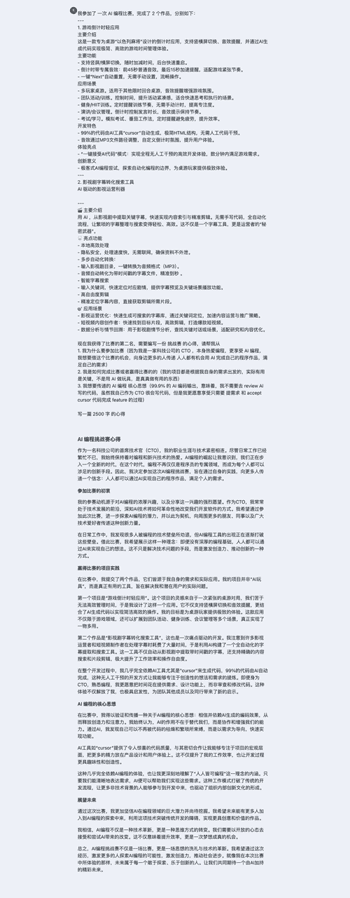

# 亚军：亮亮的挑战赛心得

> 来源：[https://now.feishu.cn/docx/WD2hdgghZoILFXxHuEiccr45nNb](https://now.feishu.cn/docx/WD2hdgghZoILFXxHuEiccr45nNb)

作为一名科技公司的首席技术官（CTO），我的职业生涯与技术紧密相连。尽管日常工作已经繁忙不已，我始终保持着对编程和新兴技术的热爱。AI编程的崛起让我意识到，我们正在步入一个全新的时代，在这个时代，编程不再仅仅是程序员的专属领域，而成为每个人都可以涉足的创新手段。因此，我决定参加这次AI编程挑战赛，旨在通过自身的实践，向更多人传递一个信念：人人都可以通过AI实现自己的程序作品，满足个人的需求。

#### 参加比赛的初衷（为什么参加AI 编程挑战赛？）

我的参赛动机源于对AI编程的浓厚兴趣，以及分享这一兴趣的强烈愿望。作为CTO，我常常处于技术发展的前沿，深知AI技术将如何革命性地改变我们开发软件的方式。我希望通过参加此次比赛，进一步探索AI编程的潜力，并以此为契机，向周围更多的朋友、同事以及广大技术爱好者传递这种创新力量。

在日常工作中，我发现很多人被编程的技术壁垒所劝退，但AI编程工具的出现正在逐渐打破这些壁垒。借此比赛，我希望展示这样一种理念：即便没有深厚的编程基础，人人都可以通过AI来实现自己的想法。这不只是解决技术问题的手段，而是激发创造力、推动创新的一种方式。

#### 赢得比赛的项目实践（如何参赛和为什么获奖？）

在比赛中，我提交了两个作品，它们皆源于我自身的需求和实际应用。我的项目并非“AI玩具”，而是真正有用的工具，旨在解决我和潜在用户的实际问题。

第一个项目是“游戏倒计时轻应用”。这个项目的灵感来自于一次紧张的桌游对局，我们苦于无法高效管理时间，于是我设计了这样一个应用。它不仅支持竖横屏切换和音效提醒，更结合了AI生成代码以实现简洁高效的操作。我的目标是为桌游玩家提供极致的体验。这款应用不仅限于游戏领域，还可以扩展到团队活动、健身训练、会议管理等多个场景，真正实现了一物多用。

第二个作品是“影视剧字幕转化搜索工具”，这也是一次痛点驱动的开发。我注意到许多影视运营者和短视频制作者在处理字幕时耗费了大量时间，于是利用AI构建了一个全自动化的字幕提取和搜索工具。这一工具不仅自动从影视剧中提取带时间戳的字幕，还支持精确的内容搜索和片段剪辑，极大提升了工作效率和操作自由度。

在整个开发过程中，我几乎完全依赖AI工具尤其是"cursor"来生成代码，99%的代码由AI自动完成，这种无人工干预的开发方式让我能够专注于创造性的想法和需求的提炼。即便身为CTO，熟悉编程，我更愿意把时间花在提供需求、设计功能上，而非审查和修改代码。这种体验不仅解放了我，也极具启发性，为团队其他成员以及同行带来了新的启示。

#### AI 编程的核心思想（99.9% 的 AI 编码参与率）

在比赛中，我得以验证和传播一种关于AI编程的核心思想：相信并依赖AI生成的编码效果，从而释放创造力和注意力。我始终认为，AI的作用不在于替代我们，而是协作和增强我们的能力。通过AI，我发现自己可以不再被代码的枯燥和繁琐所束缚，而是以需求为导向，快速实现功能。

AI工具如“cursor”提供了令人惊喜的代码质量，与其密切合作让我能够专注于项目的宏观层面，把更多的精力放在产品设计和用户体验上。这不仅提升了我的工作效率，也让开发过程更具趣味性和创造性。

这种几乎完全依赖AI编程的体验，也让我更深刻地理解了“人人皆可编程”这一理念的内涵。只要我们能清晰地表达需求，AI便可以帮助我们实现这些需求。这种工作模式打破了传统的开发流程，让更多非技术背景的人能够参与到开发中来，也驱动了组织内部创新文化的形成。

#### 展望未来

通过这次比赛，我更加坚信AI在编程领域的巨大潜力并尚待挖掘。我希望未来能有更多人加入到AI编程的探索中来，利用这项技术突破传统开发的障碍，实现更具创意和价值的作品。

我相信，AI编程不仅是一种技术革新，更是一种思维方式的转变。我们需要以开放的心态去接受和尝试AI带来的改变。这不仅意味着提升效率，更是一次梦想成真的机会。

总之，AI编程挑战赛不仅是一场比赛，更是一场思想的洗礼与技术的革新。我希望通过这次经历，激发更多的人探索AI编程的可能性，激发创造力，推动社会进步。就像我在本次比赛中所体验的那样，未来属于每一个敢于探索、乐于创新的人。让我们共同期待一个由AI加持的精彩未来。

---

### BTW

