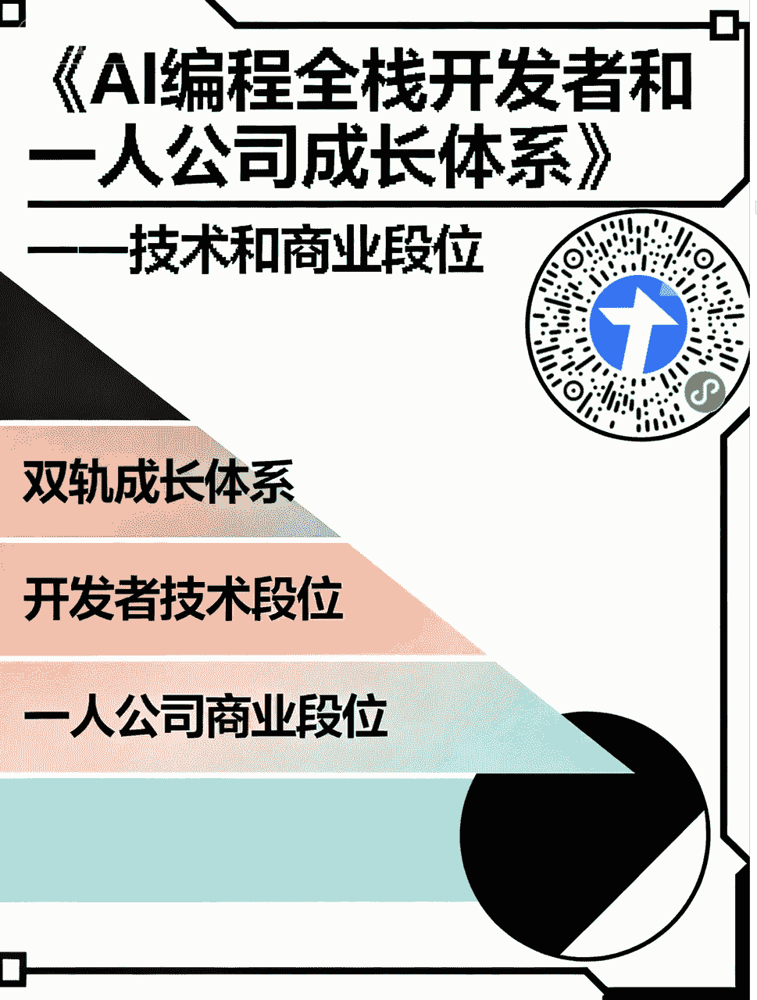

# 领取白皮书PDF《AI编程全栈开发者和一人公司成长体系》

> 来源：[https://now.feishu.cn/docx/OeeId0lH2o1eS7xOmGvcm7P2n0x](https://now.feishu.cn/docx/OeeId0lH2o1eS7xOmGvcm7P2n0x)

# 《AI编程全栈开发者和一人公司成长体系》

——技术和商业段位

AI编程让非技术人员为全栈开发者，一个人可以完成从产品、设计、开发、商业的闭环。

新的、最小可行的科技公司在这个时代诞生。

如果你想发布自己的独立产品，或者是成为全栈开发者，甚至创建自己的科技公司，不妨参考下这份成长“地图”，找准前进方向。

