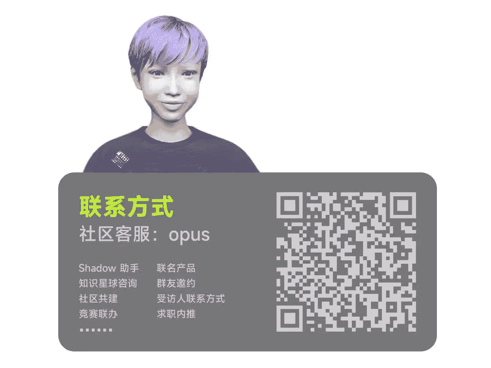
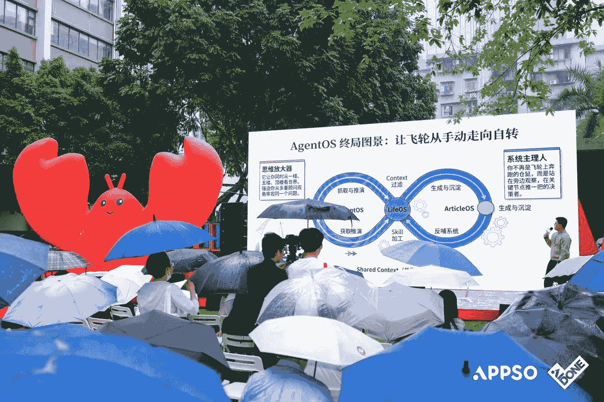
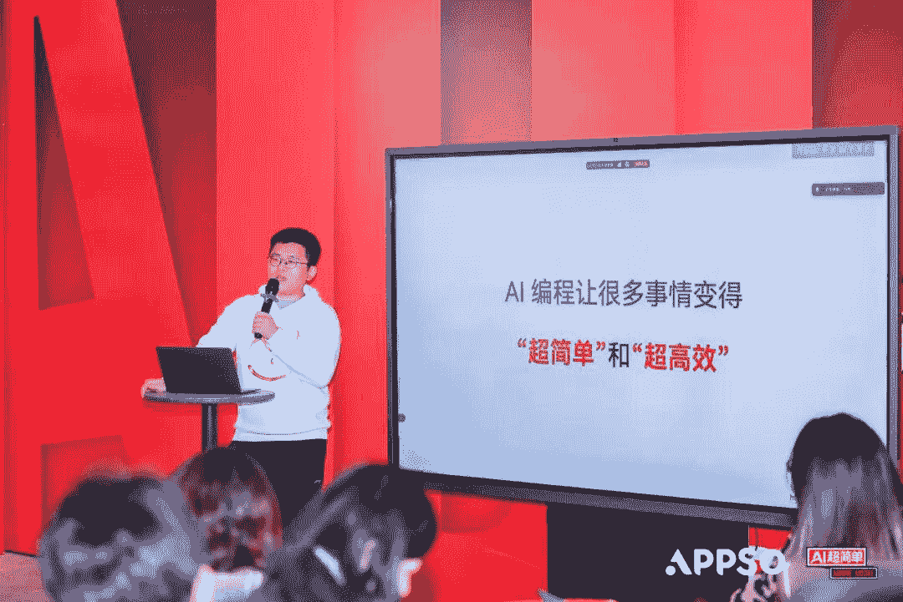
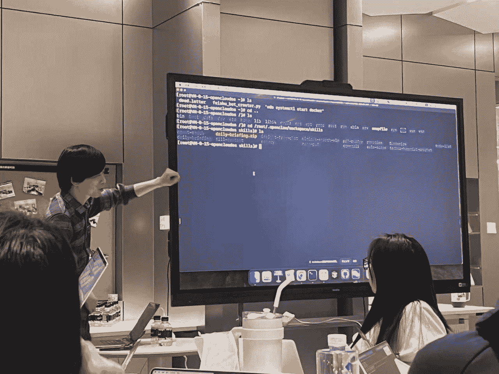
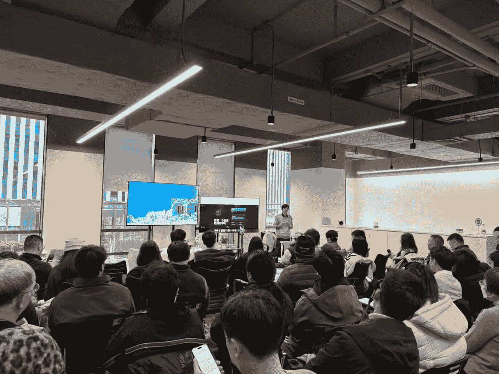
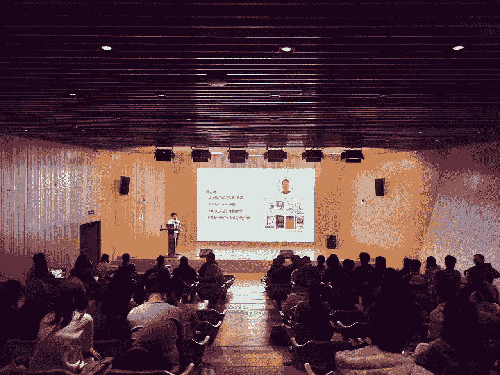
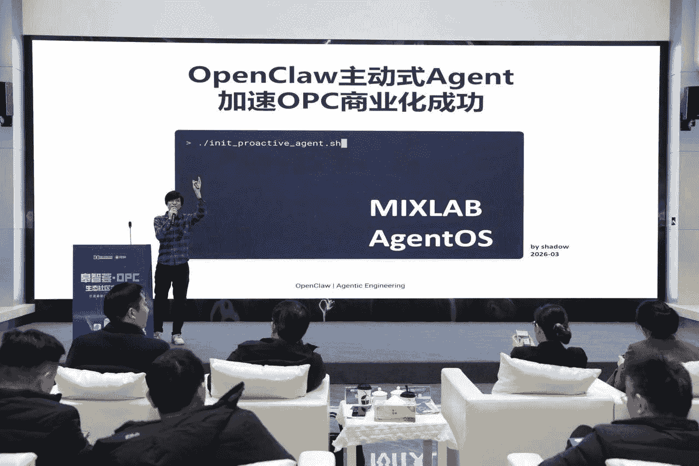
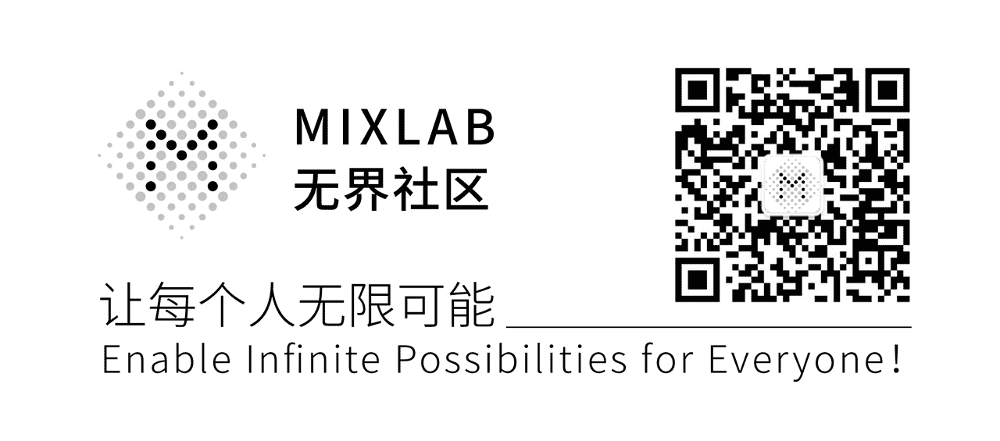

# CodeNow AI编程社区

> 来源：[https://now.feishu.cn/docx/GYyCdKF0Jov4nqx2sXkc6MY4naf](https://now.feishu.cn/docx/GYyCdKF0Jov4nqx2sXkc6MY4naf)

网址：https://codenow.wiki

## AI编程课程

[两天AI编程，他们最大的收获不是学会写代码](https://qwyofiv4bd3.feishu.cn/wiki/QJhYwZqOSiR4GwkBuVbctK3pnSd)

#### [AgentOS 2026课程](https://qwyofiv4bd3.feishu.cn/wiki/SeUAwKKZ3iCFmRkLbCncHspanVc)

#### [AI 编程录播课程 2026](https://qwyofiv4bd3.feishu.cn/wiki/EYrIwgZlriIy8hkX73dcSPumnuc)

#### [情报分析的基础：数据爬取和分析](https://qwyofiv4bd3.feishu.cn/wiki/PtFzwjF8AikFeikjLKAcQroFneD)

#### [使用OpenClaw构建属于你自己的24小时个人助理](https://qwyofiv4bd3.feishu.cn/wiki/Vqitw2ZxtiOtStkpFxgcCgJxnFh)

#### [使用Skills把你的工作流变成可复用的AI能力单元](https://qwyofiv4bd3.feishu.cn/wiki/Fd7JwrflwiXC9pksKHfcVg58nJe)

**训练营小助手🛰️**

#### [0基础2天成为全栈开发者#AI编程线下训练营，N27上海场报名🔥 （4.18-4.19）](https://qwyofiv4bd3.feishu.cn/wiki/XxgqwY5Kdi2BPdkTHJ3cIaounhe)

# 优秀学员项目展示

[学员优秀作品摘选](https://qwyofiv4bd3.feishu.cn/wiki/JM4Kwxixsi5IzlktTkwclNs8nyg)

[智能选址报告生成器](https://qwyofiv4bd3.feishu.cn/wiki/CbfTwXvzDiiWLUkeKerc31Wgnkc)

[个人能量管理系统](https://qwyofiv4bd3.feishu.cn/wiki/BlePwxmiPirzSRkSi7CciNUPn8e)

[讲个故事](https://qwyofiv4bd3.feishu.cn/wiki/JT9Awoo2OifQrxkucorcFCZenIe)

[口译练习工具](https://qwyofiv4bd3.feishu.cn/wiki/HneXwvEZpiYaWokr2dJcJwGZnpc)

[AI 记忆助手](https://qwyofiv4bd3.feishu.cn/wiki/Vyl4wXWzeiRUfIkYMdkcYqqnnTd)

[奥特曼战斗](https://qwyofiv4bd3.feishu.cn/wiki/Fw18wga5oid0sEkNnxocgitFnQg)

[星相](https://qwyofiv4bd3.feishu.cn/wiki/Qr44wrhh4iHJMXk9xE6cCEDJnBg)

# 学员课后回访

[探索的真正意义在于超越自己的能力边界：AI编程线下训练营 - 程序员回访](https://qwyofiv4bd3.feishu.cn/wiki/GsU9wbgNGiSEiZk7RIwch7ZKn6k)

[从0代码基础到简历加分：面试官问她是不是请了程序员开发](https://qwyofiv4bd3.feishu.cn/wiki/CR1hw8QoMivDWekAwmOceayGnrR)

[0基础设计师如何用AI编程改变跨部门沟通？](https://qwyofiv4bd3.feishu.cn/wiki/NsC6w6cikif9lUko8hCcJHWln6g)

[M4 mini Pro + AI编程：自媒体人的内容生产革命](https://qwyofiv4bd3.feishu.cn/wiki/MbKEwWJ7jij98xkiJ5ocaduunxe)

[不想被AI替代，这个VC居然跑来学编程了](https://qwyofiv4bd3.feishu.cn/wiki/TXW7wIDQ7inNrukR9GWcwDE9nrg)

[零基础学生的知识管理之旅](https://qwyofiv4bd3.feishu.cn/wiki/G3Jcw5QcMiigp9kTw8ncrezBnkd)

[更多内容](https://qwyofiv4bd3.feishu.cn/wiki/Wx5uwd9xOiyNdRkl3NBczWcDnjf)

# 过去培训和活动现场

[过往公开活动现场](https://qwyofiv4bd3.feishu.cn/wiki/HXX3w6LZriDE2skkWmRcZ0bUnCe)

[过往内部培训现场](https://qwyofiv4bd3.feishu.cn/wiki/Bs1bw9pZdiRVAZk69MdcB1Ginfb)

**相关合作请联系：**xuezhirong233

# 我们出版的AI编程书籍

[《驾驭 Gemini 3 与 Nano Banana》](https://qwyofiv4bd3.feishu.cn/wiki/EVwXwaeZWigvatkB4C1cW2XpnLe)

[购买链接](https://item.jd.com/15295954.html)

[《人人皆可Vibe编程：玩转氛围编程》](https://qwyofiv4bd3.feishu.cn/wiki/LDsjwAikaiF7Z6kj1EHcCN7onwe)

[购买链接](https://item.jd.com/15093632.html)

[《零基础AI编程：Cursor助力Vibe Coding实践》](https://qwyofiv4bd3.feishu.cn/wiki/GHfzwm49mikXWukMFzVcHj8dnaf)

[购买链接](https://item.jd.com/15121058.html)

# [公开教程](https://qwyofiv4bd3.feishu.cn/wiki/RHTowkVRzi2T5okDwYXc3cV8nYf)

[进化的门票：为什么AI编程将重塑我们的工作、学习与生活](https://qwyofiv4bd3.feishu.cn/wiki/A9cqw8LOZiWP1dk8BpecN1nPngg)

[Vibe Coding解决了哪些人的核心需求——基于150名学员的实践观察](https://qwyofiv4bd3.feishu.cn/wiki/XtRgwRfEiidYfEkD0RIcZc0tnye)

[Vibe Coding：从入门到掌握的真实差距](https://qwyofiv4bd3.feishu.cn/wiki/VnqDwYikRiwcnVk5z8IcZUfNnhb)

[编程小白在学习Vibe Coding常见的问题有哪些](https://qwyofiv4bd3.feishu.cn/wiki/UtJCwuAmUiXBl4kOOgNcGk84n2d)

[Mixlab AI编程视频公开课：设计师和产品经理如何在Demo环节引入数据分析？](https://qwyofiv4bd3.feishu.cn/wiki/OsAmwN9bci9fKDkoI4lc2HV7nzh)

[AI编程小白想进阶时会陷入哪些误区](https://qwyofiv4bd3.feishu.cn/wiki/LL02wXFKXisTn8kp0uvcKnEKnKb)

[适合普通人的AI提问框架](https://qwyofiv4bd3.feishu.cn/wiki/PRQpwx3VzieXj6kEYpRcjccOnCZ)

[阅读更多](https://qwyofiv4bd3.feishu.cn/wiki/RHTowkVRzi2T5okDwYXc3cV8nYf)

近期活动

[AI编程教育工具分享闭门会议](https://qwyofiv4bd3.feishu.cn/wiki/WpXYw5PMtiCZcxkKinOcw5TCnVg)

[AgentOS闭门会议](https://qwyofiv4bd3.feishu.cn/wiki/RjfHwfttGiZkrVkhYTvcHO8Mntd)

[领取白皮书PDF《AI编程全栈开发者和一人公司成长体系》](https://qwyofiv4bd3.feishu.cn/wiki/ASVCwySfmiaaWSkxnlbcgQBTnEf)

# 关于CodeNow** **AI编程社区

自2024年9月23号，薛志**荣**和shadow发起CodeNow AI编程社区，目前社群成员正在增长，飞书知识库开始建设，累计训练营学员300+人。

**关于薛志荣**

官网：https://xuezhirong.com

3本AI编程 +4 本HCI书籍作者。

MiX Copilot 联合创始人

复旦大学技术顾问

前华为人机交互实验室高级工程师、小鹏资深交互设计师、百度高级交互设计师。

👸号：

📕：@薛志荣

🛰️：

**关于Shadow**

MiX Copilot 联合创始人

复旦大学技术顾问

程序员、设计师、连续创业者

毕业于上海交通大学、同济大学，蚂蚁集团高级前端架构师，负责服务日活上亿用户的支付宝智能UI引擎，数字人创新项目

📕：@shadow带你做实验

👸号：

## CodeNow 👸号

支持AI机器人回答AI编程问题

## CodeNow 交流群

## CodeNow 会员群

[codenow会员#专注，才能走得更远｜CodeNow 社区会员限时开启#Mixlab OpenClaw 付费社群](https://qwyofiv4bd3.feishu.cn/wiki/Hn9Ow61dNiAbaYkaaQ2crA6znrW)