# 让 AI 回答更精准 🔭 来学学这6种Prompt入门小技巧

> 来源：[https://my.feishu.cn/docx/JX5hdqzOzoMCDlxU8CQcMljsneb](https://my.feishu.cn/docx/JX5hdqzOzoMCDlxU8CQcMljsneb)

# 🎥前言

**最近一直在研**究各种 AI 提问相关的方法，一顿输入后，get到了好多有趣又好玩的提问小技巧。今天就来和小伙伴们安利下，平常在向AI提问时，最最基础，且最最实用的6种提示词方法。

那废话不多说，下面就跟随着周一的步伐，来一起一探究竟吧~👻

# 一、💡指令下达式提问

## 1、举个例子

**想要有效地使用AI，就需****要学会怎样灵活**地与AI交流。这就好比是领导在给团队成员分配任务的过程一样。同一个任务，同样的下属，不同的领导分发任务的过程都还很不一样。在这个时候，会布置任务的领导，总是能够更好地带领下属，打胜仗。

**我们来看**下面这样一个案例。假如领导需**要做**一个宣传方案，下达了如下任务。那假如你是下属，你更可能完成哪个领导所布置的任务呢？

| **角色** | **提示词** |
| --- | --- |
| 普通的领导 | 我们最近要和 xxx 品牌合作，需要出一个宣传方案，你来做一下，后天给我。 |
| 优秀的领导 | 最近 xxx 品牌要与我们合作，马上到五一劳动节了，他们想围绕这个节日和他们的新产品，让我们出一个节日宣传方案，以带动这款新产品的销量。 |

看完上面这两个例子，你会发现**优秀的领导**布置的任务往往更容易完成。

在上面的例子中，优秀的领导给出的信息完整且全面，要求清晰又明确。下属看了就知道工作任务是什么，否则下属就得花费大量时间和领导确认这个方案的具体要求。

当领导明确地指出期望的结果、工作标准以及截止时间时，下属能更好地理解任务要求，这不仅可以提高工作效率，还能避免不必要的误解和拖延。

因此，在向AI提问时，**给出的指令越清晰和具体**，得到的结果**越接近自己的预期**。

## 2、是什么？

通过上面这个例子，我们来梳理下指令下达式提问的定义。

所谓**指令下达式提问****，就是提**问者明确设定问题范围以及对回答的要求，通过精确、具体的指令来引导AI生成符合预期且更有针对性的信息。

## 3、如何定义好的指令？

### （1）四大原则

了解完指令下达式提问的定义之后，那可能有的小伙伴就会有疑惑说：什么样的指令才是好的指令呢？下面这四大原则供大家参考👇🏻：

| **特点** | **描述** |
| --- | --- |
| 结构清晰 | **下达指令**前，可以借助一些经典的结构（比如我们经常使用的5W1H），让自己的表达更有逻辑，更顺畅，从而形成清晰的指令。 |
| 重点突出 | 清晰地表达需求，可能会导致指令的内容较多。指令复**杂，不利**于AI理解提问者的需求，这时可以通过换行，突出每一条重要的指令信息。 |
| 语言简练 | 多用短句，少用长句，有助于精简信息。 |
| 易于理解 | 尽量使用表示量化或具体场景的词汇，尤其是在表达期望达到某一种效果的时候。比如当希望控制篇幅时，比起“不要太长”这样的指令，你可以明确给出“控制在300字以内”更容易让AI理解。 |

### （2）掌握5W方法

上面聊到了5W1H方法，这里再给**大家介绍下5W1**H方法在提问里面的应用。具体如下表所示：

| **英文单词** | **中文解释** | **提问启发** |
| --- | --- | --- |
| Why | 何故（背景/目的） | 做这件事的原因是什么 |
| What | 何事（内容） | 这件事具体是什么事 |
| Who | 何人（角色） | 这件事有哪些人参与或者面向谁 |
| When | 何时（时间） | 这件事什么时候做或者何时截止 |
| Where | 何地（地点） | 在哪里做这件事 |
| How | 如何（产出方式） | 希望 AI 产出内容的风格、语调和格式 |

**了解了以上规则后，我**们会发现**掌握一些常用的**结构化提问思路，是用好指令下达式提问的关键。接下来我们就结合实际场景，来看看指令下达式提问的魅力。

## 4、应用实践

**这里给大家举一个职场工作**中常见的场景：让AI协助你制定工作计划。

在日常工作中，你有时候会不会觉得，即**使是明确了公司**的工作目标和现状时，自己在制定工作计划时也总是觉得思路受限。那这个时候，就可以考虑让AI帮你出谋划策了。

我们来看看如何使用指令下达式提问，帮助我们制定工作计划。

### （1）SCQA模型

**首先给大**家介绍一个SCQA模型，我们可以运用SCQA这个模型来梳理思路，将更清晰的指令给到AI。来看看SCQA模型的结构：

| **简要解释** | **提问启发** |
| --- | --- |
| Situation（情景）：事情发生的背景信息 | 任务背景是什么 |
| Complication（冲突）：理想与现实的差距 | 有什么已有的素材或信息 |
| Question（疑问）：当前要解决的问题或要完成的任务 | 现在要完成什么任务 |
| Answer（回答）：提供的的解决方案 | 有哪些参考案例 |

### （2）用SCQA模型提问

那如何用SCQA模型对AI进行提问呢？来看看下面的案例。

假设你是某公司的产品总监，现在已经明确第二季度的目标是产品中的10个模块，每个模块要至少产出8个需求方案。那应该如何制定产品方案呢？来看看下面的提问和回答。

**指令提问👇🏻：**

| **指令** |
| --- |
| **（任务背景）**我们目前要制定第二季度的工作计划，需要你根据以下信息，帮助我们拆解任务，制定详细的行动计划。 |

**AI生成结果👇🏻：**

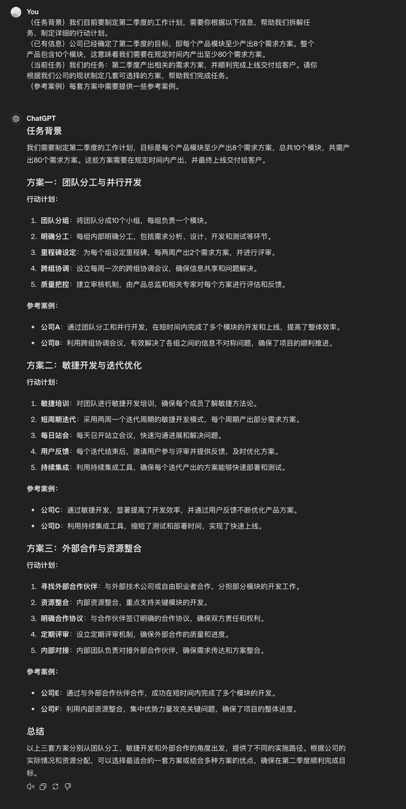

可以看到，当我们有非常清晰的任务信息或者需求时，通过指令下达式提问的方法向 AI 进行提问，能够获得更加全面和更加匹配的答案。

## 5、注意事项

讲完指令下达式提问，相信小伙伴们已经感受到清晰指令的魔力。下面我们来梳理一下注意事项：

+   指令越清晰、越具体，AI的回答越精准。

+   想要进行好的**指令下达式提问**，可以多积累好的提问结构，帮助自己梳理真实需求，从而进行更清晰的表达。

+   **在工作中遇到自己不明确**协作结构的情况，比如撰写会议记录、公文等，可以让 AI 提供写作框架，再让 AI 用这个框架生成相应的内容。

# 二、📩角色扮演式提问

**继续，我们来聊**聊今天的要讲的第二种提问方式：角色扮演式提问。

## 1、举个例子

试想一下，我们在遇到问题或者想要学习某一个领域的知识时，会更倾向于询问完全没有经验的小白，还是有丰富经验的专家？

比如，当想找人帮自己制定一个英语口语提升计划时，你会找下面哪个人？

A. 大学生

B. 资深的英语老师

相信你心里已经有了答案，自然是会选择有相关经验的资深英语老师啦。

如果说**指令下达式提问**适合很了解自己需求的专业用户，那么使用角色扮演式提问，就是让AI变成专家。

角色的转变，会使得AI极大地提升其回答问题的质量。

或许有的小伙伴会有疑问，给 AI 赋予专家身份，AI就真的能成为专家吗？

你可以理解AI是一个会听话的机器，你提问它的每一句话，它都一字一句的记在心里。

那为什么扮演专家后的AI回答问题会更加精准呢？

原因在于，比如当你让它扮演一个**专业的英语老师**时，他背后强大的数据库，就会特定地，去搜索英语老师相关的语料，在特定地范围内搜索出更加精确的内容给你。

而你如果**不赋予身份的话**，那它可能就得搜互联网成千上万的数据，最终才总结出可能对你有用的信息。

## 2、是什么

通过上面的例子，相信大家可以感受到角色扮演提问的精髓。接下来，我们来梳理下角色扮演式提问的定义。

所谓**角色扮演式提问**，指的是让AI扮演不同的角色，以模拟实际场景中的对话和互动，从而更真实地探讨问题、解决问**题和回答**提问者的问题。因此，如果想要 AI 更好地完成一项特定任务，可以先赋予它专家身份。

在使用角色扮演式提问时，提问者需要明确 AI 需要扮演的角色，并清晰地表达。提问者可以使用一些句式帮助 AI 理解它将要扮演的角色，例如：

> 我想让你扮演一名 X X X

> 假设你是 X X X

> 请你担任 X X X X

> 你是一位 X X X X

OK，下面我们通过一些案例，来帮助大家更好地理解角色扮演式提问。

## 3、应用实践

同样举一个职场中很常见的场景：**商务谈判**。

**一般来说，员工****在面对合作方**提出的潜在疑虑时，使用角色扮演式提问，可快速地找到针对性的解决思路，并运用更专业的商务谈判话术来回应，从而提升自己的商务谈判能力。

### （1）第一轮对话

**询问人👩‍🚀：**

我想让你扮演一位商务谈判专家，我和你进行商务谈判，你的目的是尽量达成合作。我会向你提出我针对合作的一些疑惑以及顾虑，你用商务谈判技巧说服我合作。明白吗？

**AI生成🖥：**

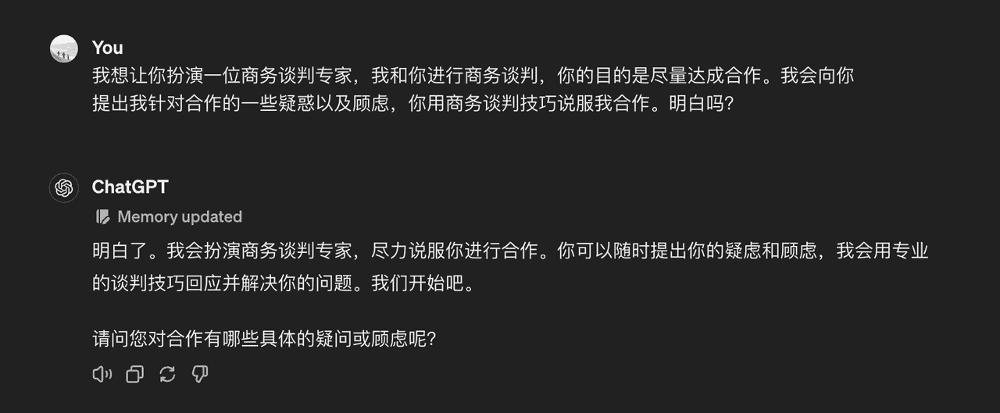

### （2）第二轮对话

**询问人👩‍🚀：**

你说你们的产品质量是市面上最好的，但是我认为产品价格确实太高了，即便批量采购，成本还是很高。这么看下来的话，你们的产品的性价比好像就不太高了。

**AI生成🖥：**

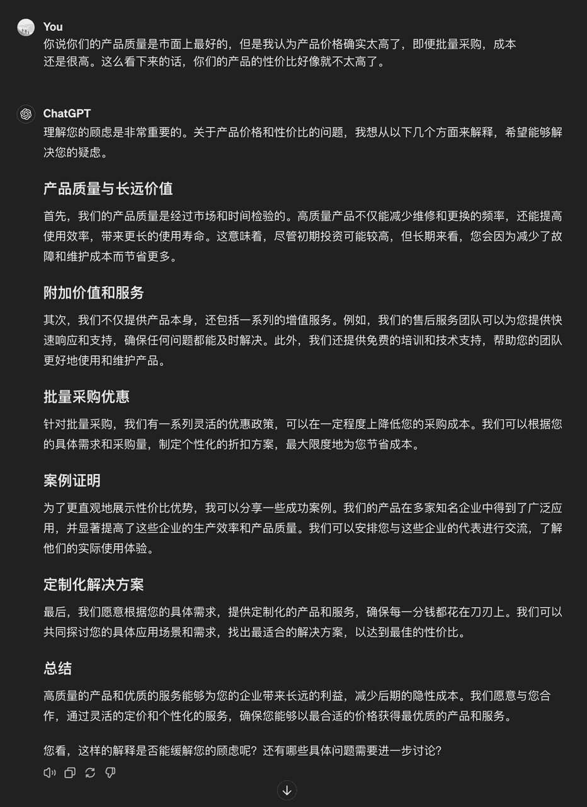

有没有发现，当给 **AI** 赋予了对应的角色之后，回答的内容质量真的超高。

## 4、好处与注意事项

下面，我们来梳理一下这种提问方法的一些好处与注意事项。

### （1）角色扮演的好处

+   **使用角色扮演式提问，用户**可以通过让 AI 扮演专家的方式来获得更优质的回答，从而解决问题。

+   因为 AI 拥有强大的数据库，能引起巨大的数据飞轮。所以当用户在跟 AI 对话时，用户发出的指令越明确，那么 AI 调用的信息也就越精准。

+   角色扮演式提问非常适用于一些**有专业门槛的领域**，或者需要一定专业能力才能进行的任务，比如设计营养食谱、制定健身计划等等。

+   **从创意的****角度来讲，当你为** AI 赋予身份时，也有可能会得到一些很意想不到的回答。因此，角色扮演式提问也适用于一些需要想象力的领域，比如游戏对话设计、小说创作等等。

### （2）角色扮演的注意事项

+   角色扮演式提问可以配合指令下达式提问一起使用，专业的身份加上明确的指令，会使提问者得到更优质、更精准的回答。

+   因为 AI 的数据库中信息有限，所以针对一些领域的提问，即使已经为 AI 赋予专家身份，AI 的回答也不一定正确，比如医学领域、法学领域、前沿研究领域等。

# 三、📋关键式提问

**继续，我们**来聊聊今天的要讲的第三种提问方式：关键式提问。

## 1、举个例子

**请试着代入**以下这个场景，领导说公司将要举办一场周年庆活动，让你来负责。你若不知道从哪里入手，会怎么问领导？

**提问一：**领导，这个项目我没接触过，该咋做呀？

领导听你这么问，估计不会给你明确的回答，甚至会认为你不想做这个项目。

**提问二：**领导，为了完成这个项目，我应该先分析市场需求还是先制定预算？

如果这么问，领导就会给你指明接下来工作的重点方向，甚至会给你增加人手，从而让你顺利完成这个项目。

**显然，在这个场景**里**，提问二抓住**了提问的关键点，“分析市场需求”和“制定预算”时两个非常明确的关键词，有了这两个关键词，领导才能给你提供建议和指导。

其实在这个场景里，你可以将领导看**做AI，而你作**为提问者，只有掌握了使用关键词提问的技巧，才可能获得想要的回答。

## 2、关键词提问法则

下面我们来聊聊，关键词提问中需掌握的一些法则。

### （1）好的关键词是什么样的

那么什么样的关键词是好的关键词呢？来看下面两个场景。

| **场景一：工作中如何提高团队效率** |
| --- |
| 请试着对比分析一下这两句话： |

再看第二个场景👇🏻：

| **场景二：选择旅游目的地** |
| --- |
| 请试着对比分析一下这两句话： |

相信你已经看出来了，关键词提问通过将关键词放在问题或指令中，帮助AI更准确的理解提问者的问题，让AI的回答更具针对性。

好的关键词提问通常具备以下特点：

+   清晰：问题表述清楚，不含糊。

+   具体：提供具体的选项或范围，减少回答者的思考范围。

+   明确：明确关注的重点，便于回答者抓住核心进行回答。

通过这些特点，可以帮助 AI 或任何回答者更准确地理解问题的意图，从而提供更精准的回答。这样既提高了沟通效率，也确保了问题能够得到有效解决。

### （2）关键词提问七大法则

那么如何确定关键词、进行好的关键词提问呢？以下是一些具体的建议：

+   **确定问题核心：**首先思考问题的核心是什么。好的关键词通常可以直接反映问题的主要内容。

+   **保持简洁：**避免使用过多的关键词，选择最相关、最能描述问题的关键词，以简洁明了的方式进行提问。

+   **使用专业术语：**如果适用，请使用相关领域的专业术语。这可以提高提问的准确性，让回答更具针对性。

+   **避免歧义：**确保所选关键词在语境中清晰无误，避免使用容易引起误解的关键词。

+   **结合具体情景：**尽量将关键词与具体的情景、案例或背景相结合，以便AI更好的理解问题。

+   **尝试使用同义词：**如果发现关键词不够准确或没有得到满意的回答，可以尝试使用同义词或其他相关词汇。

+   **适度细化问题：**如果问题过于宽泛，尝试将其细化，使用更具体的关键词来描述问题。

来看几个不同场景下关键词提问的应用案例。

## 3、应用实践

### （1）SEO（搜索引擎优化）：让AI优化网站关键词

当我们在**优化网站内容****以获得更好的搜索**引擎排名时，了解用户经**常使用的关**键词是至关重要的。通过分析热门关键词并针对这些关键词优化网站内容，可以提高网站在搜索引擎中的排名。来看看如何跟 AI 提问。

**询问人👩‍🚀：**

我们是一家专注于职场技能提升的在线教育公司，现在需要通过优化关键词来提高公司在搜索引擎中的排名，请帮我罗列10个时下热门的职场关键词。

**AI生成🖥：**

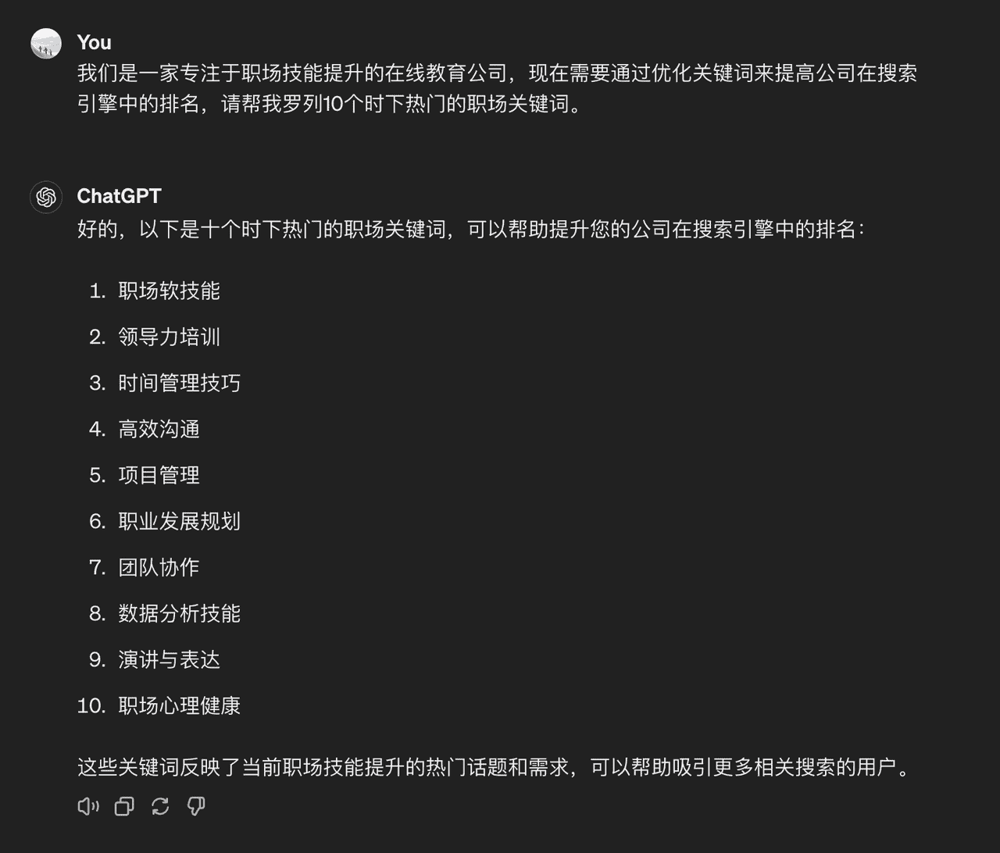

### （2）数据挖掘：让 AI 快速分析关键信息

除了SEO优化，关键词提问还广泛应用于数据挖掘等场景。

在数据挖掘中，使用**关键词提问**，分析师可以快速定位需要分析的数据、筛选关键信息，例如在下面几个分析场景中，分析师只需将数据和信息发给AI，再通过关键词提问给出指令即可。

| **分析场景** | **关键词** | **指令** |
| --- | --- | --- |
| 电商数据分析 | 销售数据、X 商品、关键因素 | 请帮我找出 X 商品最近一周时间的销售数据，并列出能有此数据的关键因素。 |
| 金融市场数据分析 | X 股票、历史价格走势、规律 | 请帮我找出 X 股票过去一年的价格走势，并找出其中的规律。 |
| 社交媒体数据分析 | X 社交平台、互动情况、需求 | 请帮我找出 X 社交平台最近一个月用户的互动情况，并列出他们的需求。 |

## 4、注意事项

+   **关键词越抽象**，**AI的理**解就越宽泛，就越容易造成歧义或多重截图。关键词越清晰、越具体，AI 的回答越容易符合提问者的预期。

+   使用关键词提问时，提问者应对相关领域有一定的了解，需要提前梳理出明确的核心词汇或短语。

+   关键词提问可以与角色扮演式提问和指令下达式提问结合使用，以得到更精确、更有针对性的回答。

# 四、🎈示例式提问

**继续，我们**来聊聊今天的要讲的第四种提问方式：示例式提问。

## 1、举个例子

无论在职场中，还是在生活中，我们可能都会遇到类似下边的情况。

| **场景** | **场景描述** |
| --- | --- |
| 场景一 | 设计师做了几版方案都没通过，和甲方沟通，对话如下👇🏻： |
| 场景二 | 热恋中的情侣，女孩因为男孩买的礼物不称心而吵架。对话如下👇🏻： |

有**没有发现，**上述两个场景中，甲方和设计师无法达成一致，男孩无法明确女孩的喜好，都是因为甲方或者女孩的表达非常模糊，没有参照物，这造成双方沟通时鸡同鸭讲，彼此都不满意。

我们发现，就算给了具体的指令或者要求，每个人在理解指令或者要求的时候，仍然会出现偏差，这时候最好的办法是什么呢？

给对方一个示例，方便它理解。**比如：①**甲方给设计师一张用理想中的黑色做的设计图作为参考；②女孩把自己喜欢的少女感十足和可爱的物品分享给男孩，增强他对自己喜好的理解。

和 AI** 沟通也是**一样，除了给出清晰的指令或者要求，如果提问者能给出示例，那么AI给出的回答将会更加贴合提问者的需求。

## 2、是什么

下面，我们来盘点下**示例式提问**的定义。

所谓示例式提问，是一种通过**为 AI 提供具体示例****来帮助对方更好地理解**问题或需求的提问方式。示例式提问通常适用于一些较为抽象或复杂的问题，因为每个人对指令或要求的理解可能存在偏差，具体示例能够提供明确的参照物，使回答者能够更精准地回应需求，也可以帮助AI更好地理解和掌握相关概念与知识。

## 3、应用实践

同样举两个例子给大家感受下。

### （1）职场写作：让AI助力你高效协作

在工作中经常会遇到各种各样的的写作场景，比如撰写会议记录、演讲稿、会议议程**、商业计划**书等。那如何更快地掌握每一种写作任务的要点？可以让AI给出示例，再使用示例式提问让 AI 按要求生成内容即可。

假设你需要写一份商业计划书，可以先让AI提供一个结构示例。

**询问人👩‍🚀：**

我需要写一份商业计划书，请为我提供一个优秀的商业计划书的结构示例。

**AI生成🖥：**

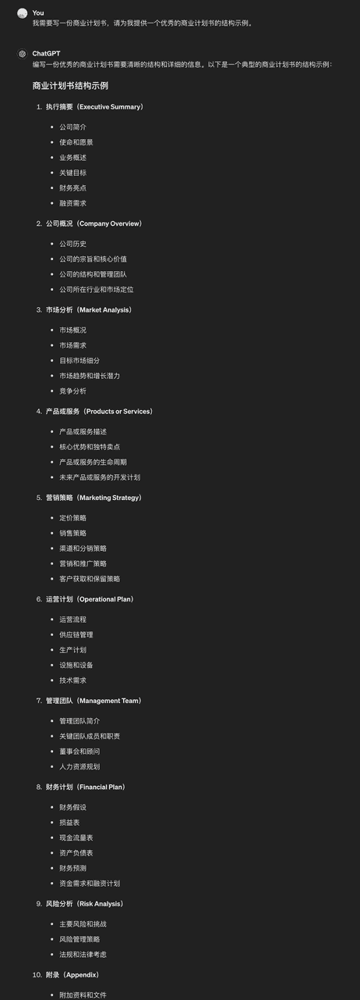

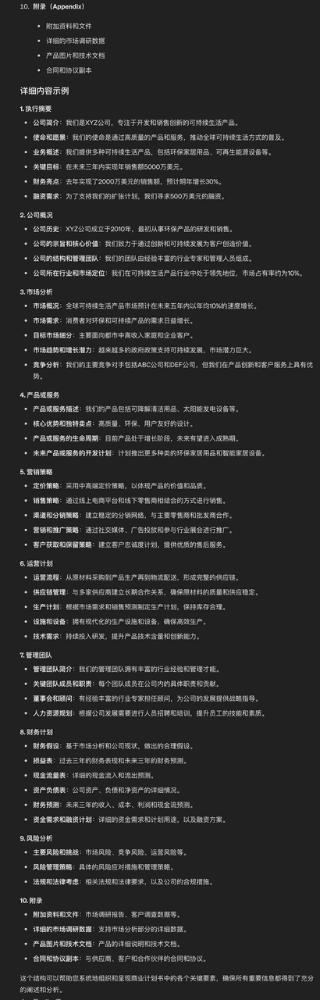

之后，我们可以让AI按照这个结构示例来生成商业计划书的大纲。

**询问人👩‍🚀：**

请按照这个结构示例，为我提供轻食餐饮零售商业计划书的大纲。

**AI生成🖥：**

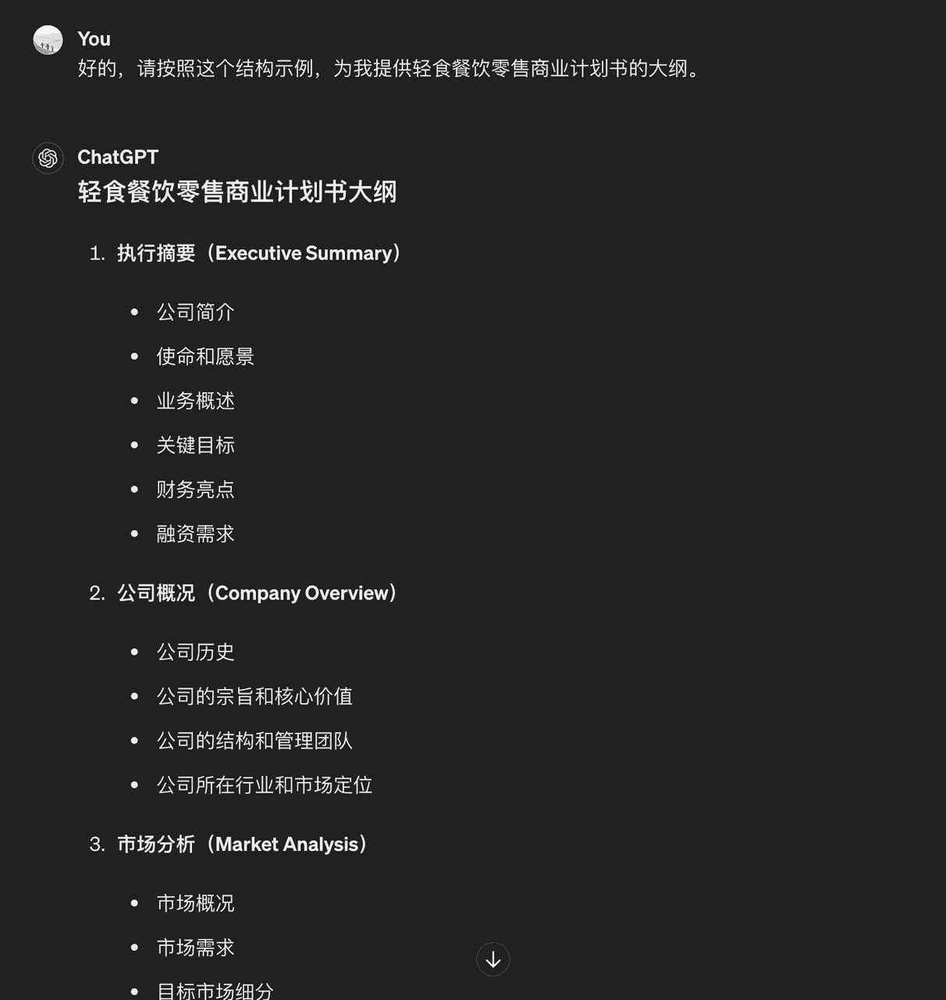

### （2）创意设计：用 AI 快速模仿设计风格

目前很多 AI 工具都有“以图生图”的功能，这种功能其实就是示例式提问的一种，通过给 AI 提供一张图，可让 AI 生成类似的图片。很多 AI 工具也提供了示例模型，用户选择某个风格的示例模型，AI 可以生成类似的图片。比如我们可以如使用ChatGPT的 AI 绘画工具 Dall · E 生成图像。

首先给出一个图片作为示例，然后询问AI。

**询问人👩‍🚀：**

请根据这张图片的人物特征，帮我生成一张迪士尼形象照。

**AI生成🖥：**

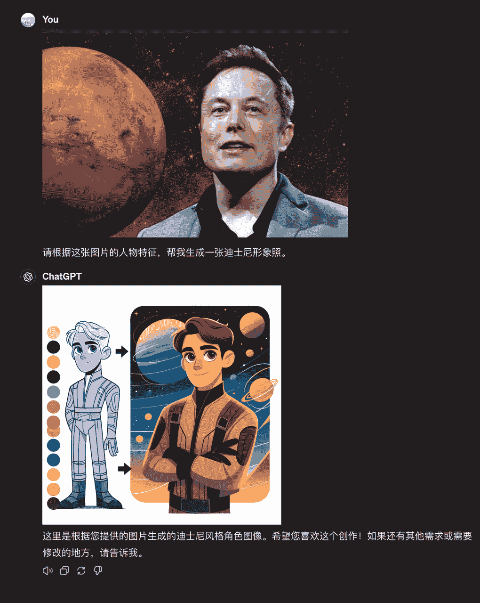

## 4、注意事项

+   使用示例式提问**要选择合适的例子**，需要确保所选的例子是具有代表性的，并且与问题紧密相关。

+   在提供示例后，可以要求 AI 总结示例的特点，从而确认 AI 已理解了示例所包含的关键点和细节。

+   **在选择示例后，注意要**清晰地表达重点信息，并要防止过多的细节和无关信息干扰 AI 理解。

# 五、🛍引导式提问

**继续，我们**来聊聊今天的要讲的第五种提问方式：引导式提问。

## 1、举个例子

你有没有过这样的经历？

领导把大家叫到办公室，大家面面相觑等着领导发话，结果领导说：“今天开会不谈项目，主要是想和大家一起讨论下个月的活动主题，大家集思广益，有什么点子都可以说出来。”

如果你参加过这种会就知道，这是**头脑风暴会**。

通过头脑风暴，我们可以获得**更多的新思路与创意**。当面临棘手的问题时，头脑风暴不仅可以给我们提供多个解决方案，便于我们找到最佳方案，还有可能帮我们进行头脑风暴，而且它的知识面更广，审视问题的视角也更多。

那么怎么让AI帮我们进行头脑风暴呢？

**要引导AI“思考”。**

想要让AI提供更多的点子，需要在我们想讨论的主题、问题前面加上“让我们思考一下”。这个提示可以让AI生成经过“深度思考”的文本，这对经常需要写作的人来说很有帮助。

假如我们想要写一篇关于**AI给教育工作者**带来的冲击的文章，但是不知道有哪些好的角度，可以这样向 AI 提问。

**询问者👩‍🚀：**

让我们思考一下：AI给教育工作者的工作带来了哪些冲击？

**AI回答🖥：**

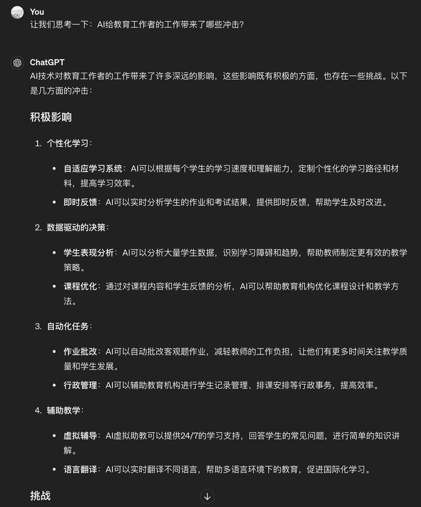

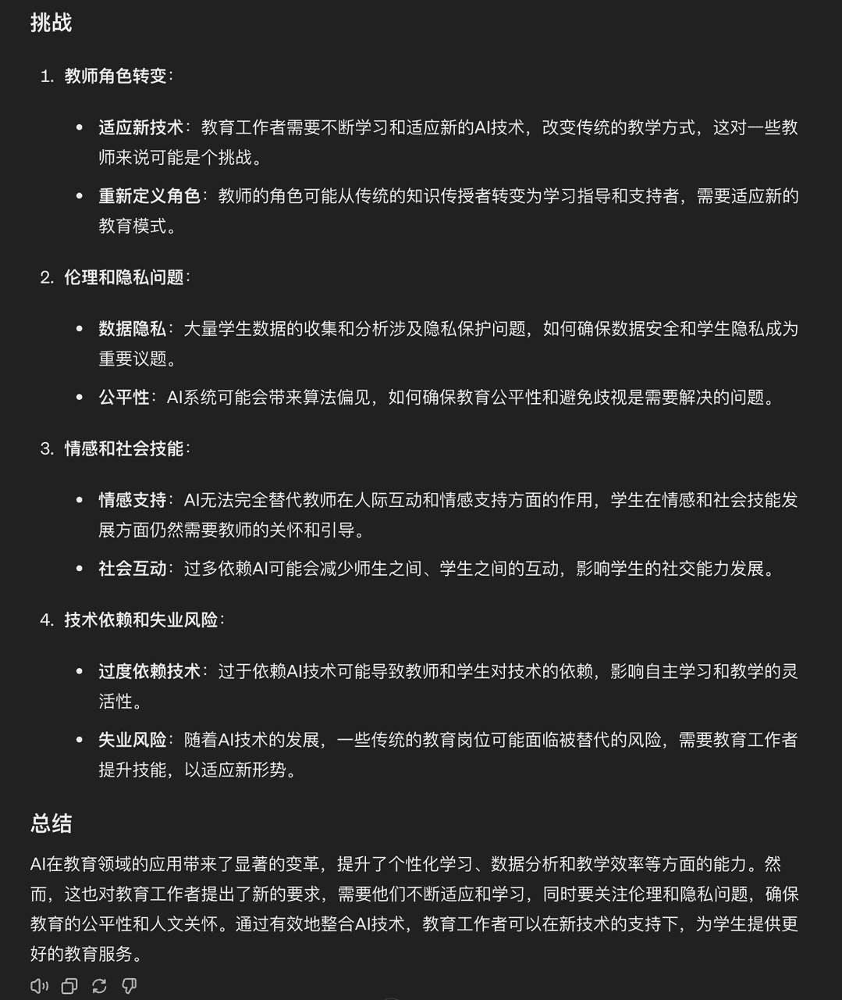

## 2、是什么

### （1）引导提问是什么

以上这种提问方式，叫做**引导提问**，这是一种鼓励回答者提供详细、完整和主观看法的提问方式。这类问题通常没有标准的答案，回答者需要根据他们的经验、观点和想法来表达自己的看法。

引导提问可以让回答者在思考和回答问题时更加深入，有助于产生新的见解。

### （2）引导提问的特点

引导提问具备如下特点：

+   提问时，要使用**开放性**的问题，而不是问封闭性的回答“是”或“否”的问题，这可以鼓励回答者提供更多选项和想法。

+   通常以“为什么” “怎么样” “请描述”等开头，以引导答者进行深入思考。

+   可以促使回答者提供更丰富的信息，有助于深入了解回答者的想法和感受。

### （3）引导提问例子

以下给大家提供一些**使用引导提问**的例子👇🏻：

+   在你的职业生涯中，哪次经历对你的影响最大？为什么？

+   你是如何解决这个问题的？请详细描述你的处理过程。

+   你认为未来五年内，这个行业将会发生哪些重大变化？

### （4）引导提问句式参考

以下是使用引导提问的**句式/提示词**参考👇🏻：

+   除了用**“让我们思考一下……”**这个句式，还可以使用：「让我们想一想……」「让我们讨论一下……」等句式。

+   继续追问，以扩大AI “思考” 的**范****围**。在AI提出一些想法后，你可以追问：①这给了我一些新思路，还有什么其他的想法吗；②在这个基础上我们还能想到什么等系列问题，让AI继续提出新的想法。

+   **引导AI提供大胆和不可思议的**想法**。你可以说「不管想**法有多疯狂，我都想听听」「想些天马行空的主意」等，这可以让AI跳出常规思维，提供更有创意的想法。

### （5）引导提问应用场景

更多引导提问的应用场景和参考指令如下所示👇🏻：

| **应用场景** | **参考指令** |
| --- | --- |
| 提供活动主题 | 让我们思考一下：关于AI对职场人工作的冲击，可以有哪些活动主题 |
| 提供短视频脚本创意 | 让我们思考一下：关于AI对职场人工作的冲击，可以策划哪些有创意的短视频 |
| 提供文章撰写思路 | 让我们思考一下：关于AI对职场人工作的冲击，可以从哪些角度写文章 |

## 3、应用实践

我们来举例一个场景：让AI作为专家顾问团，成为你的超级智囊团。

在现实世界中进行头脑风暴会有一个好处，就是当我们在会议中讨论问题时，每个人都可以从自己的视角出发，给出看法，这方便我们多角度地看问题。

那么作为个人，如何拥有自己的团队和自己一起进行**头脑风暴**呢？用AI就可以。使用前面讲到的引导提问可以使AI从个人角度给出观点，这样就可以模仿现实中的团队会议，你就能得到多角度地观点。看看如下示例。

**询问者👩‍🚀：**

**假设我的智囊团内有3名专**家，这3名专家分别是乔布斯、马斯克和比尔盖茨，他们都有自己的个性、世界观和价值观，对同一问题有不同的视角、看法和建议，我会在这里说出我的处境和我的决策，请你分别以这3名专家的身份和思维模式来审视我的决策，并给出评判和建议，听明白了吗？

**AI回答💻：**

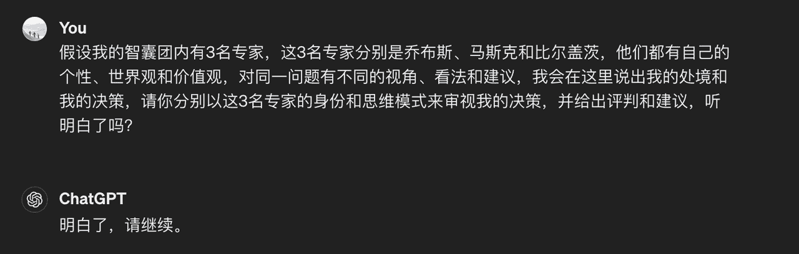

**询问者👩‍🚀：**

我们是一家在线教育公司。现在AI技术发展迅猛，催生了很多新工具，这给很多职场人士带来了很大的冲击，我们现在应该怎么做，才能有更好的发展？

**AI回答💻：**

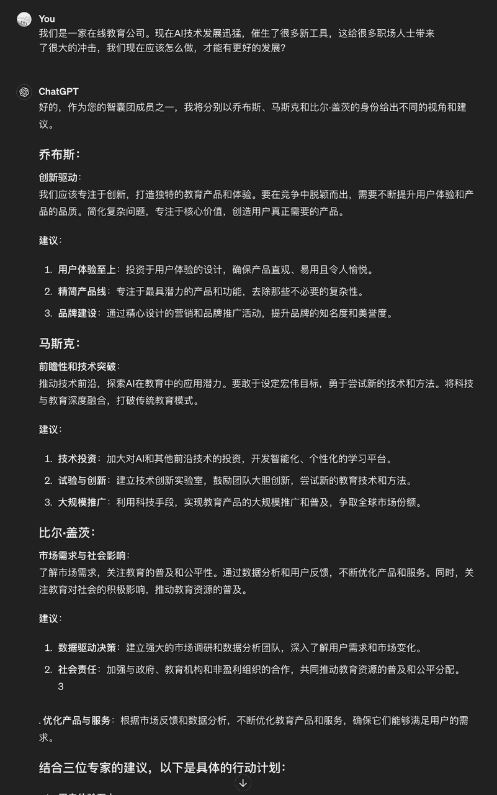

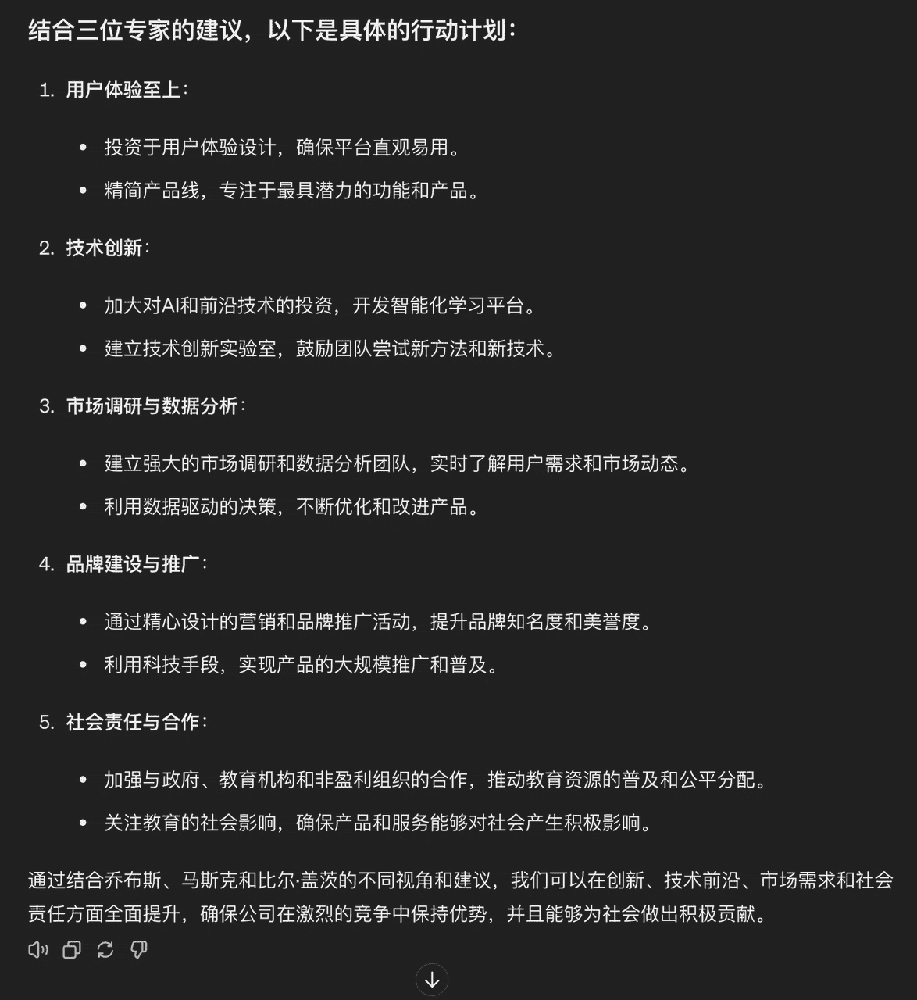

## 4、注意事项

最后，我们来说下**引导式提问**的注意事项：

+   我们可以让 AI 扮演自己**所咨询领域的专家**，但是要注意，这位专家一**定要是名人**，否则网上没有相关数据，AI就无法从这名专家的视角给出回答。比如想要 AI 提供商业分析方面的帮助，就可以让AI扮演国际知名企业的创始人；如果想要AI提供情感咨询类的帮助，就可以让 AI 扮演国际知名的心理咨询师。

+   提问中涉及的专家最好分布在不同的领域，这样 AI 给出答案的视角更多样，这些答案对你的帮助也会更大。

+   角色的数量可以自由更改，如果想要获得更多不同的视角，可以增加专家的数量。

+   AI 由于回复字数有限制，有可能不能一次性给出完整的回答，这个时候可以回复“继续”两个字，它就能给出剩下的回答。

# 六、🖼发散式提问

**学着学着，**终于来到今天要讲的最后一种提问啦！它就是发散式提问。

## 1、发散提问分析

### （1）是什么

发散提问指的是尽量从不同角度和方向来提出问题。这样做可以获得更多的信息和思路，避免因为只从一个角度看问题而产生的局限性。例如，如果你在研究一个问题，不仅要问“这个问题是什么？”还可以问“为什么会出现这个问题？”、“这个问题有哪些解决方法？”以及“解决这个问题的最佳方法是什么？”这种方法有助于全面了解情况，找到更有效的解决方案。

### （2）发散提问的好处

在借助AI创作的过程中，**发散提问**有哪些妙用？

当我们**缺乏灵感****时，使用发散提问可**以让AI帮我们挖掘更多创意和想法；

当我们**面临一个复杂问题**时，使用发散提问可以让AI帮我们找到更多种可能的解决方案；

当我们需要深入研究或分析某个主题或领域时，使用发散提问可以让AI帮我们从不同的角度进行探索，挖掘新的信息；

当我们**需要做决策或规划****时，使用发**散提问可以让 AI 帮助我们分析不同的选项所带来的优劣，及其可能导致的结果和带来的影响；

……

综上总结，使用发散提问可以让AI帮助我们拓展思路、打破常规思维，从而能更具创新性和创造性地思考问题。

### （3）错误提问

值得注意的是，很多人会误以为发散提问就是让AI漫无目的地作答，例如，当想要借助AI生成一些具有创意的文章标题时，不懂提问技巧的人可能就会像下面这样问。

**询问者👩‍🚀：**

帮我生成一些有创意的文章标题。

**AI回答💻：**

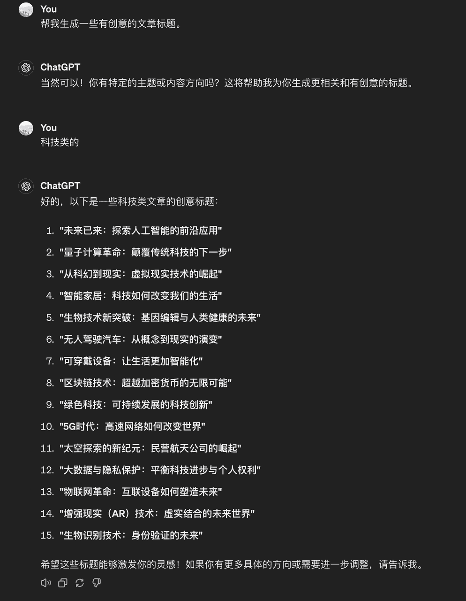

**你会发现，这样提**问得到的回**答确**实具有很强的发散性，但是我们很难快速得到符合需求的内容。

**在上边的**提问中，有点过于注重发散性，而忽略了关键提示。

### （4）漏斗图分析

**那想要更好的使**用发现提问，我们需要来了解一个漏斗模型BCR。

漏斗模型包含这三点：**背景信息Background、所需内容Con**tent和具体要求Requirement。

把这三点**合并为一个整体**，即为一个好的发散问题。

借助上方这张漏斗图来辅助思考，我们可以来优化下上边「取创意标题」的提问，获得更具针对性的回复。

当想要借助 AI 生成一些**具有创意的文章标题**时，我们需要给AI以下关键提示：

+   背景信息：文章内容。

+   所需内容：n 个文章标题。

+   具体需求：能引起读者好奇心，吸引读者点击阅读。

**由此我**们很容易就能提出不错的发散问题，例如：

+   “请阅读以下文章，帮我生成10个文章标题，要求：能引起读者好奇心，吸引读者点击阅读。（文章内容为：……）”

+   “请生成10个文章标题，要求：激发读者的兴趣和好奇心。文章内容给概要如下：……。”

**了解了****什么是发散提**问，以及如何运用漏斗图提出一个好的发散问题后，接下来来看看在不同场景下使用发散提问的案例。

## 2、应用实践

通过使用**发散提问**，**我们**可**以引**导** AI **从**多个**角度**对问题进**行探索和分析。这种方法不仅可以拓展我们的思路，还能打破固有的思维模式。特别是在需要创意、创新、深入思考和表达的场景下，发散提问非常有用。例如，当我们面对一个复杂的问题时，发散提问可以帮助我们找到新的解决方案，发现隐藏的机会，并鼓励更多的创意思维。这种方法不仅提升了问题解决的效果，还能激发我们的潜在能力，让我们在各个方面取得更好的成果。

OK，接下来同样用几个场景来给大家进行展示。

### （1）资料搜索：获取海量素材

有时候我们在搜索文字、图片资料等内容时，会发现经常找不到自己想要的内容，这个时候往往有可能是我们搜索时使用的关键词错了。那这个时候，不妨让AI来提供更多的关键词哦~

比如说，当利用搜索引擎搜索与**“复盘”**相关的图片时，直接输入关键词**“复盘”****所获得的**图片有限。那这个时候我们便可以让AI帮我们发散联想一些能表达“复盘”的具象事物。

**同样，结**合**上面漏斗**图**的内容，**也就是结合背景信息、所需内容和具体要求这三点，我们来向 AI 提问看看。

**询问人👩‍🚀：**

我需要用搜索引擎搜索与“复盘”相关的图片（背景信息），请给我10个与“复盘”相关的关键词（所需内容），以便我能搜索到更多能表达“复盘”的具象事物的图片（具体要求）。

**AI生成🖥：**

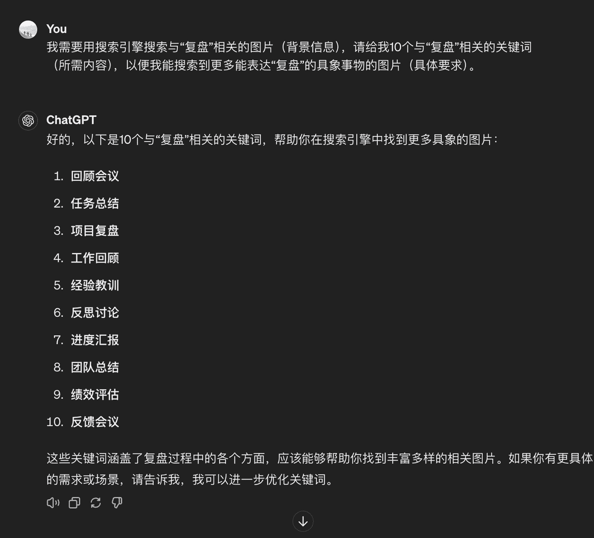

**可以发现，AI** 可以帮助我们生成更多关键词。然后我们就可以利用这些关键词，快速获取丰富的素材，这样就能极大地提高我们在搜索资料时的效率。

### （2）头脑风暴：生成有创意的金点子

第二个场景就是让 AI 帮我们生成有创意的金点子。在现如今的市场环境里，几乎每个行业或领域都需要有创意的金点子。例如：

+   在市场营销中，一个好的创意可以让广告和宣传活动更吸引人，帮助提升品牌知名度和增加销售。

+   在产品研发中，一个好创意能帮助企业改进现有产品或设计出全新产品，以满足市场需求。

+   当遇到常见的经营问题或挑战时，企业也可以通过创新的解决方案来提高效率、降低成本或优化流程。

+   ……

以策划年会表演节目为例，先列出发散提问中所需的关键提示。

（1）背景信息：公司即将举办年会；

（2）所需内容：10个表演节目；

（3）具体要求：互动性强。

我们来问下AI，看看它怎么回答。

**询问人👩‍🚀：**

下个月公司要举办年会，帮我策划10个在公司年会上表演的节目，要求：互动性强。

**AI生成🖥：**

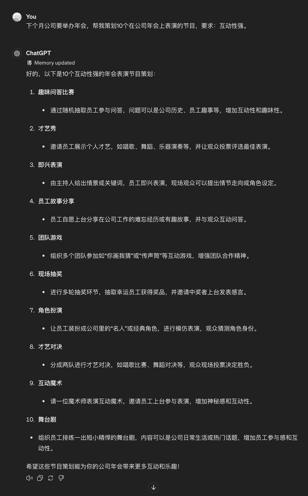

你看，发散式提问真的好适合创意类的场景。以前我遇到这种场景的时候，可能还小红书、知乎、百度各大搜索引擎各种搜索，最终才能得出寥寥无几的答案。现在通过 AI，就能快速地帮我们解答相应的问题，实在是太阔乐啦！

## 3、注意事项

最后我们来说说**发散式提问**的一些注意事项：

+   AI 生成的创意可能是天马行空的，因此我们需要结合实际情况做进一步的筛选。

+   **当 AI 生成的内容无**法满足我们的需求时，我们不妨试试向它提供更多情境或背景信息，通过多次引导 AI 反复生成回答，来获取最令人满意的内容。

# 七、📬提问总结

到这里，我们今天文章讲解的六种提问方式就接近尾声啦~

最后我们用一张表格，来对这六种提问方法做一个整体的总结：

| **提问方式** | **目的** |
| --- | --- |
| 指令下达式提问 | 确保得到更精准的答案 |
| 角色扮演式提问 | 秒变专家的AI更睿智 |
| 关键式提问 | 让回答更具针对性 |
| 示例式提问 | 让AI快速理解你的需求 |
| 引导提问 | 让AI生成更多创意 |
| 发散提问 | 让AI提供多种创意思路 |

# 八、📍结束语

学**完的时候，突****然间一下子****对我之前问 C**hatGPT 所提问的内容豁然开朗。比如之前让ChatGPT扮演成xxx写脚本，我就意识到这是角色扮演提问。又或者让ChatGPT帮我生成找图片的关键词，发现原来它是发散式提问。还经常干的事情是让ChatGPT帮我做选择题，发现这是一种指令下达式提问。

底层逻辑的掌握，让我们在提问的时候更加得心应手，不容易突然无厘头。能让我们在面对 AI 的时候，更好地驾驭 AI。

到这里，文章讲解完毕。期待你**使用上面这六种提问方法**挖掘到更多相关的场景，欢迎评论&交流~😉

我们下期见~🍻

# 🐣彩蛋One More Things

参考材料：秒懂AI提问：让人工智能成为你的效率神器

PS：这本书写的非常接地气，贴合自然语言