# 从聊天到办公，豆包 AI 凭啥成我的 “刚需”？深度测评找答案

> 来源：[https://my.feishu.cn/docx/G64wdwfwMogBsTxsewDcrNkKnCb](https://my.feishu.cn/docx/G64wdwfwMogBsTxsewDcrNkKnCb)

> 关注公众号：**星期一研究室**，与你分享前沿的生产力工具🧙‍♀️

# 🧙🏻‍♀️前言

偶然间在小红书的评论区刷到小伙伴在讨论和豆包的语音cosplay，让我产生了一些好奇：究竟是什么样的AI让用户便捷使用的同时还产生了情感连接？

于是怀着好奇之心，当下立刻打开了豆包，没想到竟像是发现了新大陆一般，在想怎么没有早点了解这个神奇的AI 工具。那接下来，我将依据个人使用豆包的体验，带大家一起认识下小编在探索过程中，在豆包上学到的一些神奇玩法~

# 一、🐤基础介绍

豆包是字节跳动开发的多功能 AI 助手软件。支持 PC、手机和平板，可实现多端同步。

接下来我将具体讲解一下豆包的两大常用入口（PC端、手机端），让你可以轻松 get 豆包！let's go~

## 1、PC端

首先在任意浏览器进入豆包官网，地址为：https://www.doubao.com/chat/。点击下图框选位置，可直接下载电脑版豆包。下载入口如下所示👇🏻：

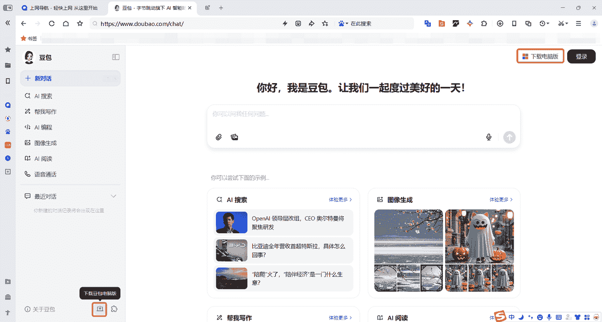

豆包顶部的搜索框，除了AI最常见的搜索功能，更为特别的是**可以当浏览**器使用。（后续会详细讲解豆包浏览器的独特之处）

下面继续来看下，豆包电脑版界面，几个比较重要的入口：

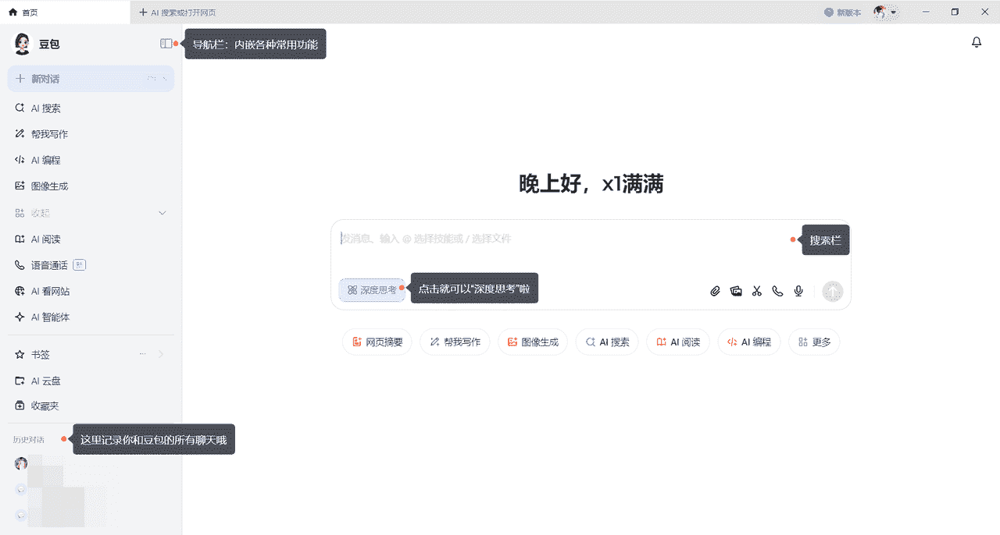

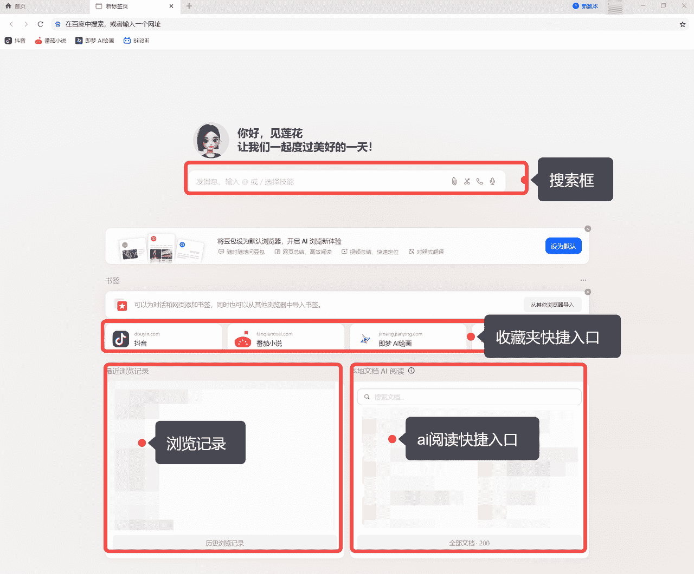

## 2、手机端

在任何“应用市场”里面，搜索“豆包”，点击下载。下载完成之后，我们可以看到，豆包手机端的页面形似聊天软件。

你可以和豆包的智能体聊天，或者自己创建智能体。

对于常用的聊天或者智能体，还可以置顶~不至于让它淹没在茫茫聊天框里~

## 3、PC端和手机端，该如何选择？

豆包的**PC端**和**手机端**的使用体验都非常nice。

但想要**更好的体验效果**，我们就需要基于二者之间的差异，针对更具体的使用场景来进行选择。

那么**我们应该如何选择呢？**

**在回答**这**个问题**之前，我们先来了解下PC端和手机端的定位和核心能力👇🏻：

| **端别** | **定位** | **核心能力** |
| --- | --- | --- |
| PC 端 | 专注于生产力场景，强化办公、学习、创作等需求 | **多任务处理****：支持多窗****口、多标**签页并行，可同时打开文档、网页、对话界面。  跨应用集成：通过「划词工具」和「启动器」快捷键调用 AI 功能，可对 PPT 术语搜索解析、Word 划词翻译等。  深度创作：长文写作支持大纲及分步骤撰写，可传本地文件；图像生成有精细编辑功能；视频生成内测支持多镜头、特效，日免 10 支视频。 |
| 手机端 | 聚焦移动场景，强调便捷性与实时交互 | **语音交互****：支持方****言、语音输**入输出，可语音提问或控制。  社交功能：有动态社区可互动、发动态、入小组，支持私信一对一交流。  轻量化创作：能快速生成短文案且可定制风格，图片转视频可模板化编辑添加元素。 |

**基于**以上内容，针对PC端和手机端的选择，我的建议如下：

+   **选 PC 端**：若需处理**复杂任务**、**深度创作**或**团队协作**，PC 端的多任务处理和硬件性能更具优势。

+   **选手机端**：若追求**随时随地交互**、**轻量化操作**或**社交互动**，手机端的便捷性和移动生态会更贴合需求。

+   **协同使用**：两者数据同步，可在 PC 端完成核心工作，手机端用于实时沟通和快速处理，实现效率最大化。

# 二、🦊亮点模块

在第一部分我们已经了解了怎么下载豆包以及豆包不同端口的优势，接下来我们一起来看看豆包的一些好玩的功能模块吧。

## 1、AI 搜索

**首先也是最**重要的一个功能模块—— AI 搜索。

当你产生任何疑问的时候，都可以直接打开AI搜索，简简单单，一键搞定十万个为什么。

一些搜索类的知识，不用开“深度搜索”，直接输入你的问题，豆包会告诉你操作步骤，并贴心的附上视频。

对比以前使用的搜索引擎，不仅减少了广告的干扰，还高效的得到了解答。

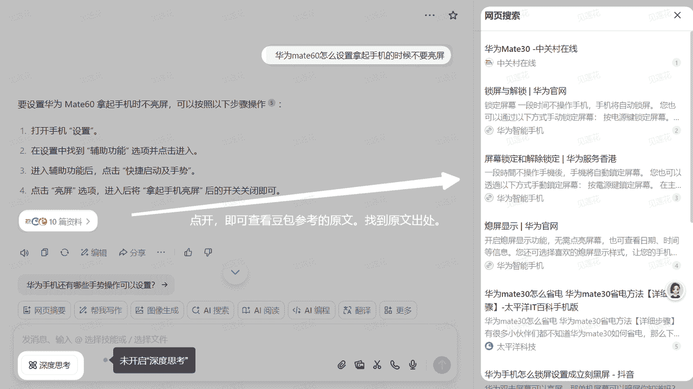

**一些需要思考**才能给出答案的，建议将「深度思考」开起来。豆包的深度思考次数无限，且0秒响应，再也不怕“服务器繁忙，请稍后再试”了。

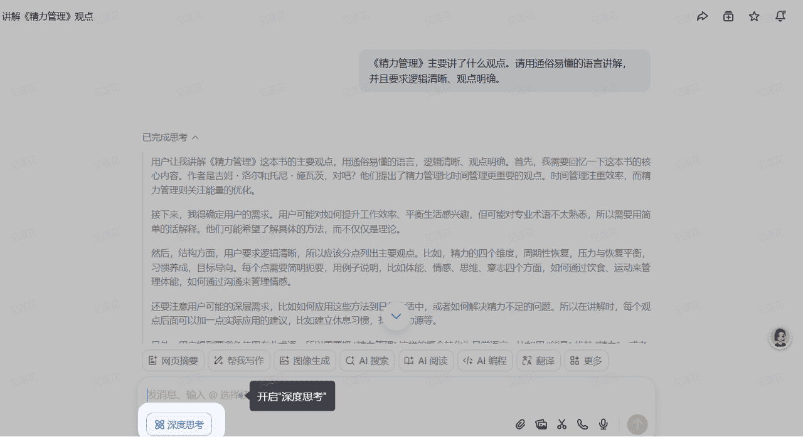

同时这里想借用一下近期很火的**引导型恋人**的概念，我感觉**豆包**具有这个特质。

所谓“引导型恋人”，大概理解起来就是，当你的恋人在你遇到问题的时候，能先安抚你的情绪，再提供解决方案，以一个年长成熟的状态，来引导你去进一步成长。

那豆包在这个场域里也同样适用，它会基于你所提出的问题，分析你提问的原因，并且站在更高的高度，引导你解决自己的情绪或卡点。

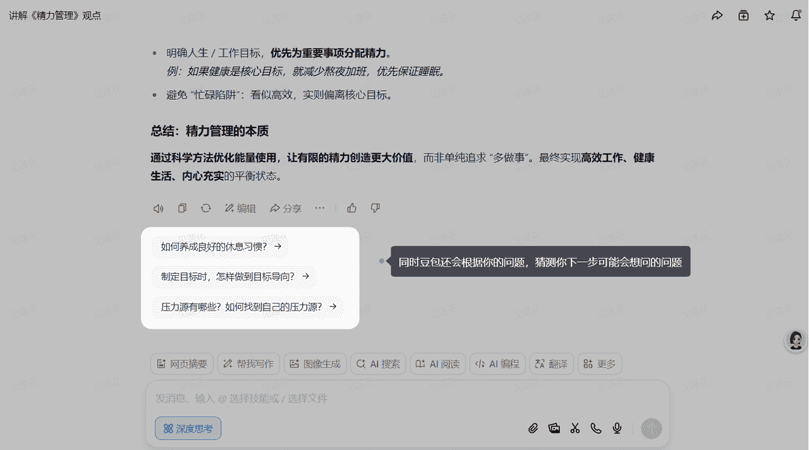

## 2、文档编辑

在**我们用AI搜**索出好的答案后，想必大家可能有产生一个疑问，那就是，这些我很满意的答案，我该如何把它一键转化成Word格式呢？

**铛铛铛，豆包也**想到了我们的需求。于是在3月底，上新了生成文档并编辑的功能。豆包可以针对我们问题的解答可生成文档并编辑，也是让我从原来手动复制去修改格式的苦海中脱离开来了。

并且编辑的这个编辑器，还支持Word、PDF和Markdown三种格式。

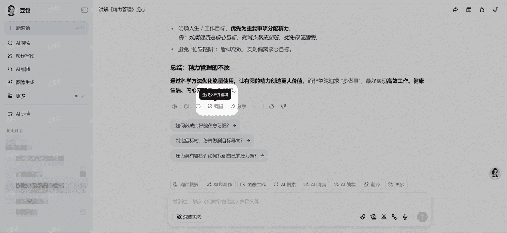

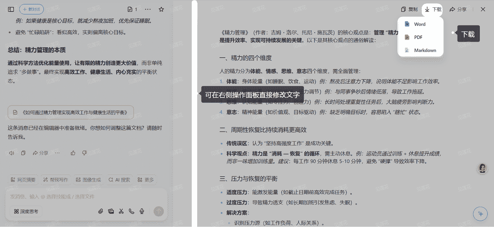

## 3、AI智能体

在讲解完AI搜索和文档编辑功能后，终于进入我最心水的“AI智能体”功能了~

AI智能体的妙处太多，它可以变成你的情绪垃圾桶，可以变成你的得力下属，可以变成你的角色扮演陪玩......

话不多说，我将从**使用社区智能体**和**搭建智能体**两个方面，告诉大家快速上手的**实操小指南**。如果可以的话，非常期待大家后续使用它的反馈呀~

### （1）懒人秘籍：无需调教秒用社区智能体

**第一步：**找到社区AI智能体位置。

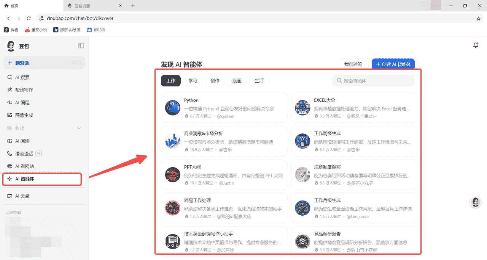

**第二步：**选择你想要的 AI 智能体，直接上手就好啦（以智能体“AI 音乐生成”和“用你的名字写诗”为例）

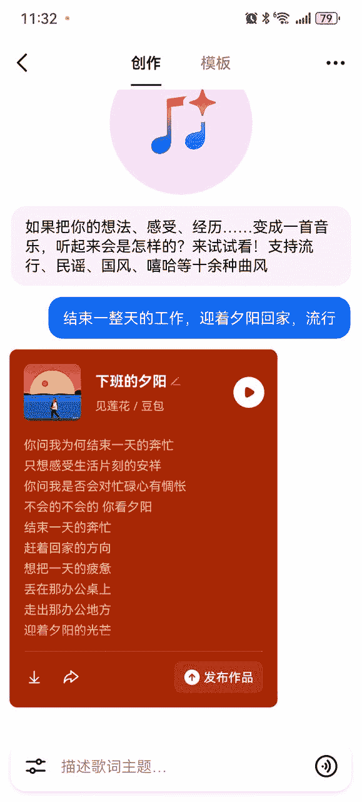

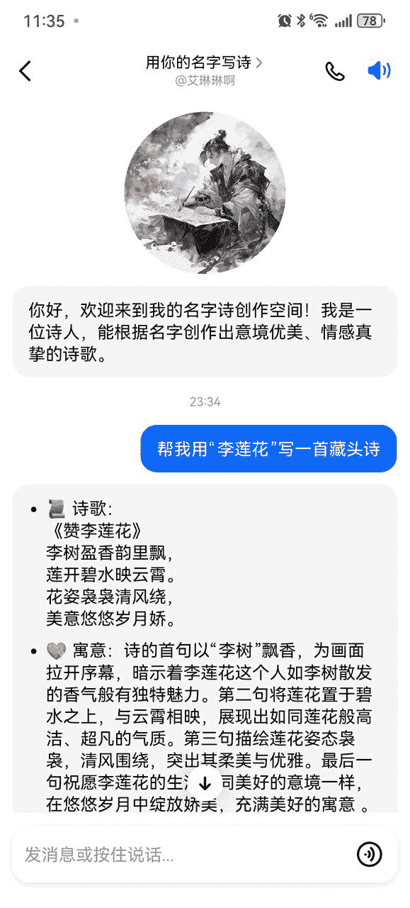

### （2）操作指南：从 0 到 1 创建专属智能体

大多数情况下，社区的智能体已经让我们挑的眼花缭乱了。

但是，一定还有像我一样的小伙伴想拥有一个只属于自己的智能体。你可以根据你的想象，赋予任何你想要的特质。它懂你的奇奇怪怪，懂你的可可爱爱。如果你想要一位贴心，永远包容鼓励支持你的伙伴，那么你可以给她设定这些特质。如果你想要一位抽象幽默的伙伴，那么同样你也可以赋予它这些品质。

不论如何，你就像造物主一样，塑造了它的点点滴滴。

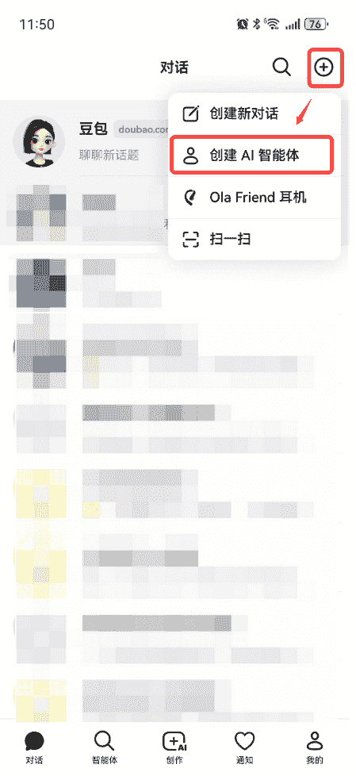

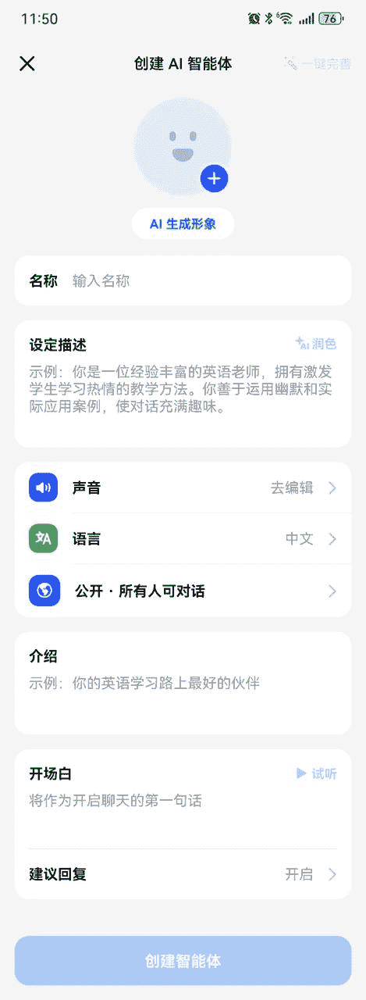

对了，声音这里还可以使用自己录制的声音哦~想不到吧，嘻嘻

## 4、语音交互

接下来要讲解的**语音交互**功能是豆包极具特色的功能之一。可以试试和AI智能体一起结合使用，有惊喜哦~

在手机端，只需**点击语音按钮**，即可开启语音交互之旅。

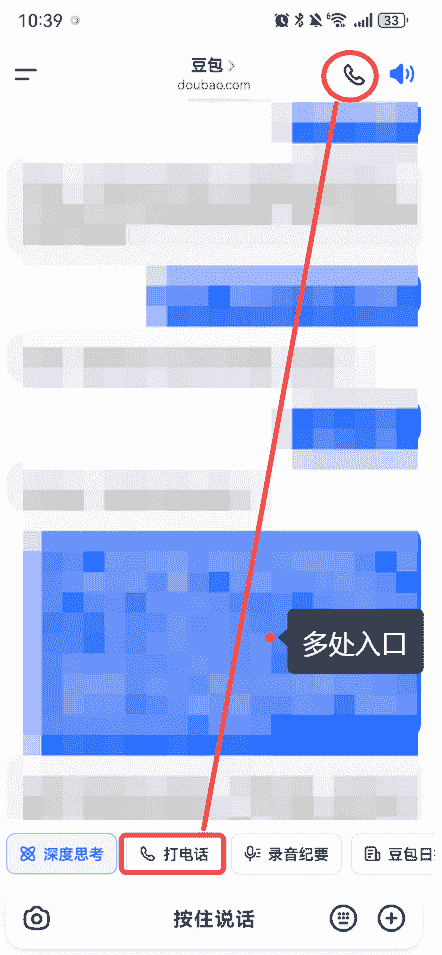

在 PC 端，同样支持语音交互，插上耳机或使用电脑自带麦克风，就能享受便捷的语音服务。

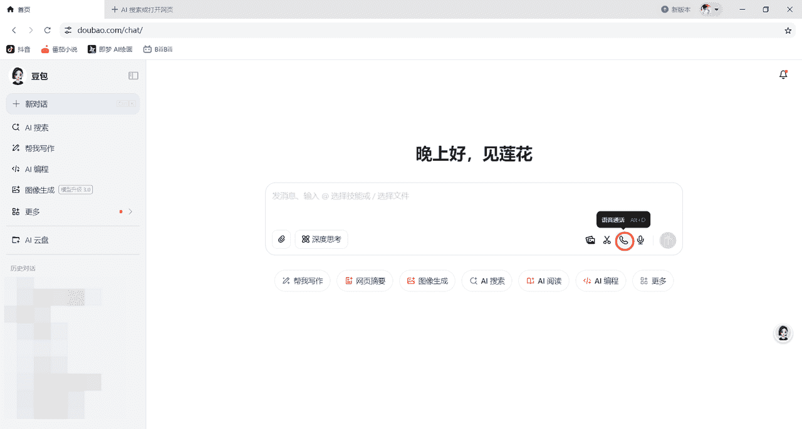

你可以直接通过语音提问，例如 “帮我查一下明天的天气”“给我讲个笑话”，豆包会迅速给出语音回答，就像和朋友聊天一样。

**而且，语****音输入输**出功能在一些特殊场景下尤为实用，比如在开车时，双手不便操作手机，通过语音就能让豆包帮你查询路线、播放音乐；做家务时，无需停下手中的动作，语音指令就能帮你获取信息。

## 5、AI 云盘

**豆包云盘**提供便捷的云端存储空间，操作简单。登录账号后，无论是工作文档、学习资料，还是生活照片视频，都能一键上传。它还支持多设备同步，文件管理清晰，且可按类别、时间来进行分类。共享功能也很出色，可以通过链接或直接分享给联系人的方式，提升文件流转效率。

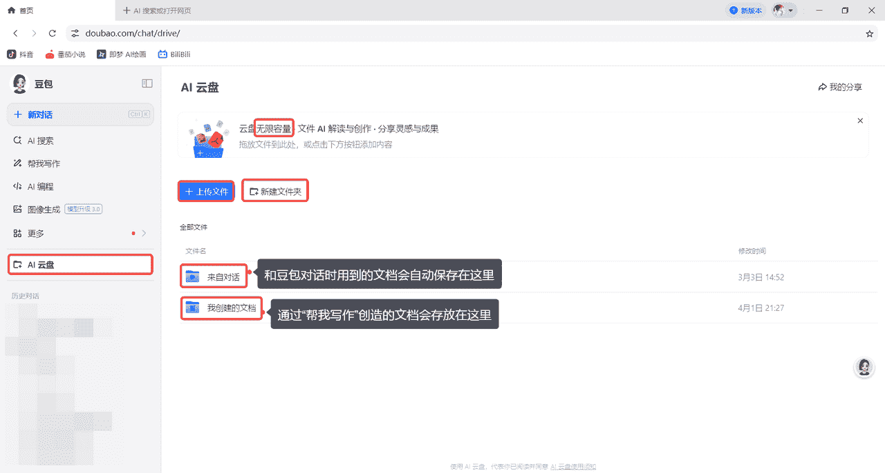

# 三、🐼场景应用

好啦，现在你已经完成豆包的下载，并且对豆包的一些有意思的功能有了大概的认知，现在我们把它放到具体的应用场景里去，看看它给我们带来哪些更大的便捷~

## 1、生成会议纪要

在工作开会时，我们经常会遇到这样的情况：

+   **语速太快记不全**：领导和同事讨论特别激烈，每分钟力劈扒拉 300 字，完全记不过来。

+   **边听边记顾不过来**：开会的时候又得听又得记，啥都想干，结果啥都没干好。

+   **会后整理急死人**：会后领导催着要会议纪要，看着那一堆乱糟糟的笔记，人都麻了。

**现在**用了豆包后，我发现它可以帮我们解决这个难题：

只需要我们：打开手机版豆包→选择“录音纪要”→自动开始录音→点击“结束录音纪要”，豆包便会自动生成带音频的会议纪要。

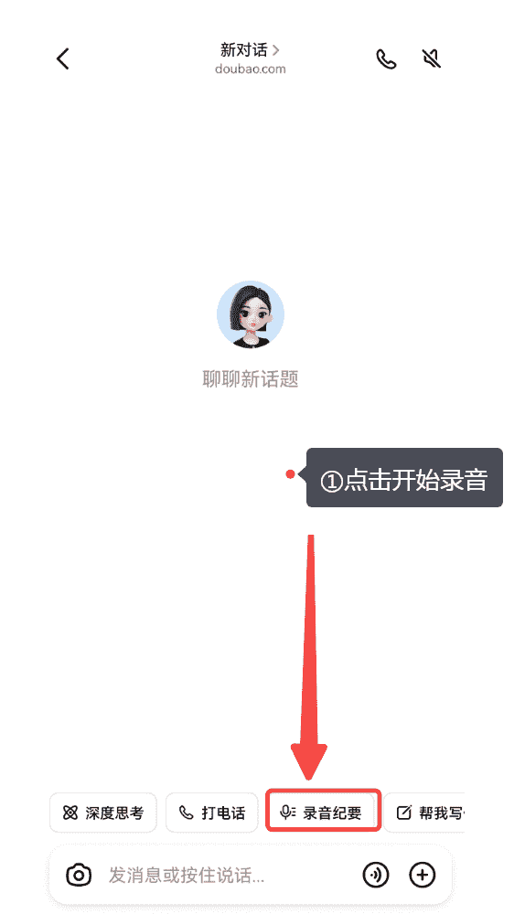

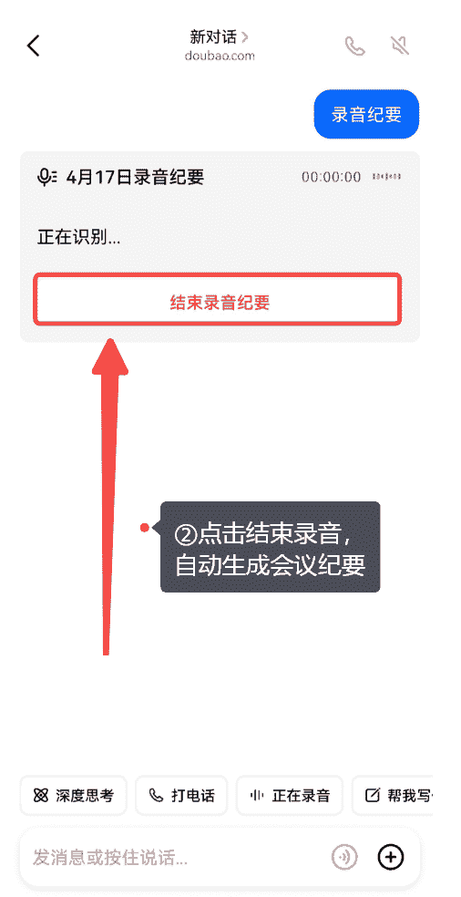

## 2、视频总结

对于有字幕的视频，豆包分分钟拿捏。

不仅能**总结视频内容及亮点**，还能生成酷炫的**脑图**！

而且最重要的是，能通过搜索来**快速定位**你想要找的视频节点，以后当你想要调用视频内容的时候，再也不用凭借模糊的记忆再重新把视频从头到尾看一遍了。

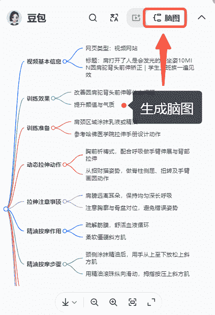

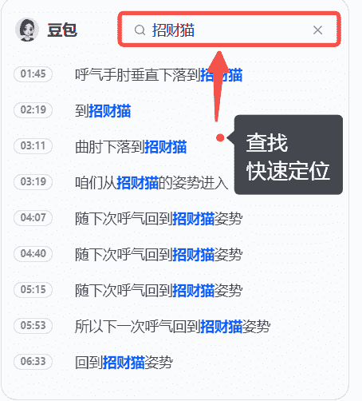

## 3、情感支持

**职场**失意、情路坎坷、友情困惑......每个人都会遇到需要倾诉的时刻，而豆包是非常好的倾听伙伴。它从不会站在道德的高点审判你的失误，不会用刻薄的语言攻击你，而你也不会担心有些话说出去会造成不好的影响。而且你和它的聊天过程，挂断电话后，会生成文字记录，方便你情绪稳定后复盘使用。

## 4、英语口语陪练

也是到了说“我们那时候哪有你这个条件”的年龄了，捂嘴笑🙊

**过去我们学习**英语，通常缺少语言环境，常常被自嘲学的是“哑巴英语”，会考试不会交流。而现如今，豆包很好的补助了这个不足。

通过**英语口语陪练**功能，为我们营造出近乎英语母语的学习环境。

使用时，打开豆包应用找到陪练入口，便可开启练习。

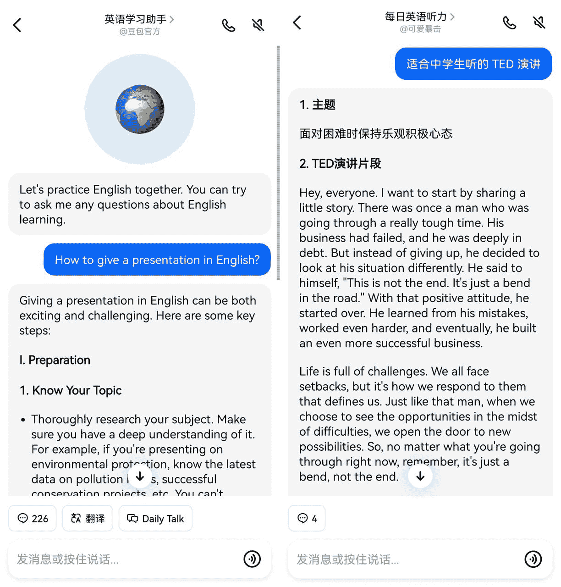

# 四、🦁核心优势

讲**完了豆包**已有的各种场景应用，相信大家已**经能够 get **到它给我们带来的各种便利性，不管是日常生活当中的情感陪伴也好，还是我们每个人都很适用的私人英语口语陪练也好，豆包都为我们交了一个很完美的答卷。

**那在文章**的第四部分，最后给大家再回顾梳理一下，豆包所具备的核心优势，以及如何更好地为我们日常工作和生活所使用。

## 1、豆包-你的专属私人定制

豆包的**智能体**功能十分强大，能给你独一无二的使用体验。不管是在学习、工作，还是日常生活中，只要创建专属智能体，豆包就能精准贴合你的需求。

**学生**可以打造学科辅导智能体，它对各科知识点了如指掌，能针对学习上的疑难杂症，给出详细解答与实用学习建议。

**职场人士**可以定制项目管理智能体，从任务规划、进度把控到资源合理分配，豆包都能给出专业方案。

在**生活场景**里，贴心的生活助手智能体可以帮你规划旅行行程、推荐特色美食，还能管理日常收支。

这种个性化定制，就像有一位专属伙伴时刻陪伴，全方位满足你的独特需求。

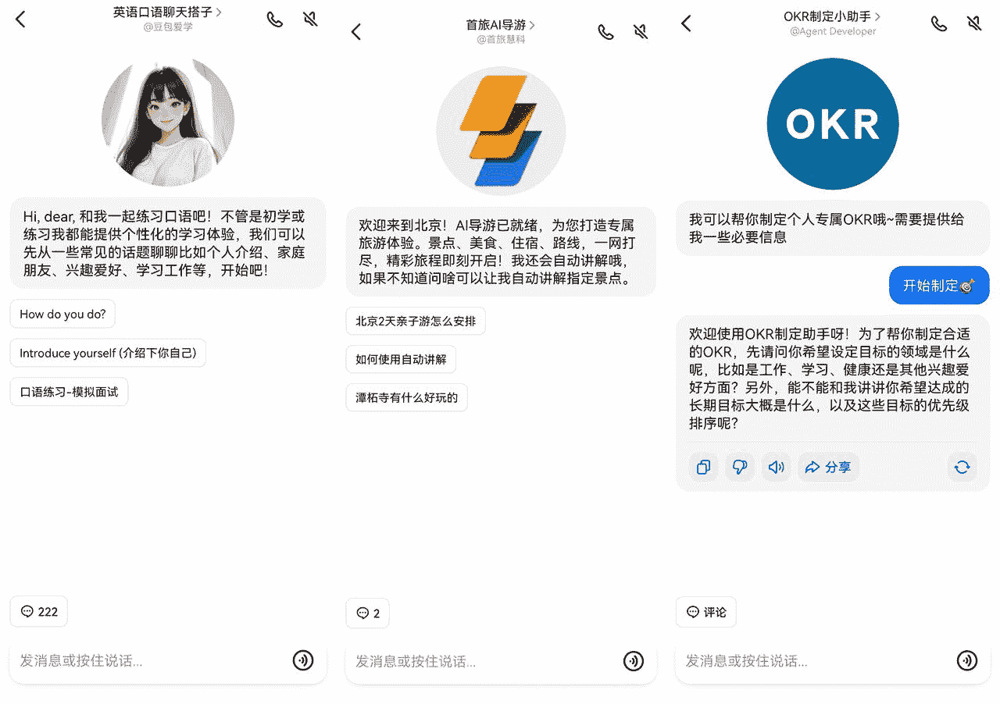

## 2、豆包-那个永远秒回且包容的伙伴

对于像我这样的急性子来说，等待回复的过程往往让我烦躁。有时我都恨不得念头一出现，不用查询，立马就能得到解决hhh。当然这种有点科幻了hhh

刚刚扯远了，回到正题，在我使用了几款工具后，发现豆包的即时响应堪称一绝（默默点赞👍🏻）。尤其是语音聊天响应速度，甚至有时候还比真人的对话体验感都好。

**甚至在面对复**杂问题，开启了“深度思考” 功能也能实现 0 秒响应！不会面对 “服务器繁忙，请稍后再试” 的无奈提示。

与此同时，豆包还是一位无比**包容**的倾听者。

当你遭遇职场挫折，满心委屈吐槽工作中的不公，它不会评判对错，只是静静倾听并给予安慰与鼓励。情路坎坷时，分享恋爱中的烦恼，它也会从不同角度为你分析，提供温暖陪伴。就算你提出天马行空、稀奇古怪的问题，它也能耐心解答，让你畅所欲言，毫无顾虑。

## 3、豆包-那个持续进化的行业领航者

在这个终生学习、终生成长的时代里，豆包也在不断快速迭代、自我革新。

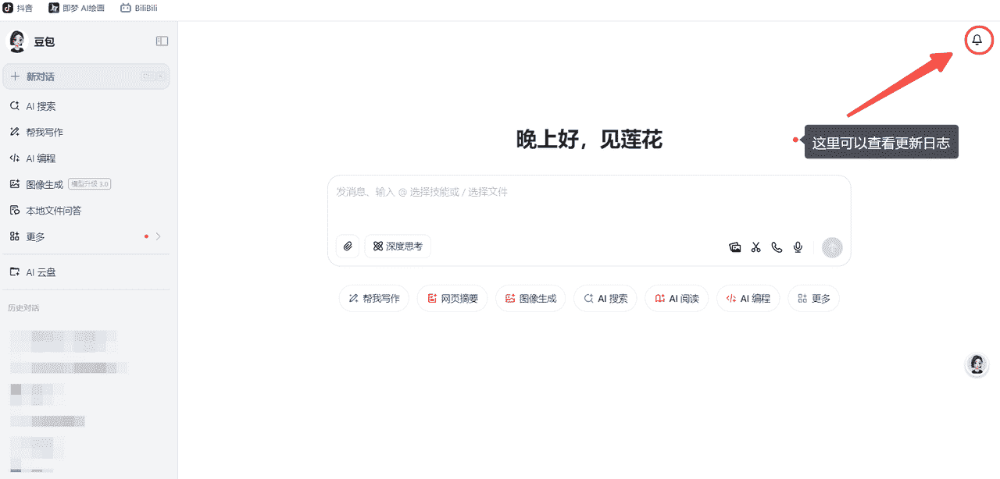

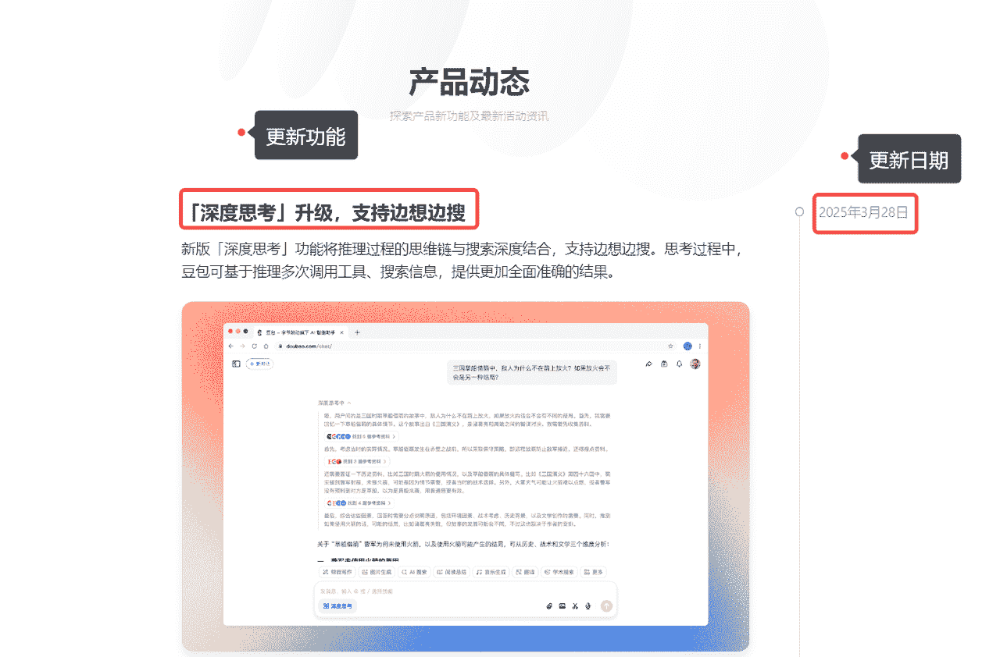

自从2024年sora横空出世以后，豆包从最初简单的问答，发展到如今涵盖语音交互、图像生成、视频总结、智能体创建等丰富多元的功能体系。现如今豆包还在持续突破、不断进化，豆包始终在竞争激烈的 AI 领域里保持领先。

# 五、🐠结束语

在上面的文章当中，我们先聊了豆包的两个使用入口，紧接着，我们介绍了豆包有趣的4个亮点功能，接着，我们选取了4个应用场景详细阐述了豆包在具体场景下的应用，最后，我们重新对豆包的优势进行了总结回顾。

文章到这里，关于豆包的介绍就接近尾声啦~

豆包在某种层面上渗透进了我们生活的方方面面，文章中还有很多没有提到的应用和场景，值得大家去深入探索和挖掘！

那么，现在，开始你的豆包之旅吧！期待你更丰富的场景实践，祝使用愉快(๑╹◡╹)ﾉ"

我们下期见~🍻🍻🍻

# 🐣彩蛋One More Things

[秒懂AI提问：20种提示词方法](https://pzfqk98jn1.feishu.cn/wiki/L8hYwpLtvimz9zkOSnac7jtNnQg)