# 14大场景实测！扣子向左做生态，艾莉向右攻垂直，谁代表未来？

> 来源：`https://my.feishu.cn/docx/R3PVdaLEuoAnsyxf0z3cjHjKnNd`

## 🚲前言

这两周AI的风吹向了字节的扣子空间，各个社群里面都在求邀请码。小编刚拿到邀请码的时候，展开了一波测评，测试下来算是有一些小惊喜。

然而就在周二下午，在工位坐着，慢悠悠地刷着飞行社的内容。然后突然想起飞书的智能开放平台艾莉同学好像也有AI Agent功能，之前还刷到过说艾莉同学是Manus的国产平替。

心血来潮想对同一家厂商的两款AI Agent做下测评，看看他们各自的效果怎么样~

在下面的文章中，来深度感受一下「扣子空间」和「艾莉同学」神仙打架的过程。

## 一、🚥工具介绍

### 1、扣子空间

扣子空间是字节跳动最新推出的AI Agent协同平台，核心优势主要有以下三个方面：

+ 零代码生态构建：通过MCP系统，无缝接入飞书文档、高德地图等第三方工具；

+ 场景化模板库：提供「儿童绘本生成」「旅游攻略」等开箱即用的模板；

+ 开发者友好：支持Python代码扩展，满足程序员的深度定制需求。


### 2、艾莉同学

艾莉同学是由飞书官方出品的智能伙伴创建平台（Aily），她是一个可开箱即用的企业级 AI Agent，她可以帮助你搜集资料、深入思考、激发灵感，并能够通过生成页面让你的想法跃然纸上，及时记录、即刻分享。

艾莉同学的核心特性主要有以下三个方面：

+ 企业级工作流：内置会议纪要生成、项目复盘等B端场景解决方案；

+ 知识沉淀系统：可直接将答案导出成可分享的飞书文档，实现信息资产沉淀；

+ 安全边界：企业内可见的权限控制体系，保障数据隐私。


讲完了两个工具的介绍，下面通过14个场景，来深度测评下在两个工具下，表现是什么样的。

PS：像极了在围观自家孩子在互相打架但是不阻拦的名场面🐯

以满分为5分，下面会给各个case进行打分，按照1-5分一共五个档位。

## 二、📖为教育行业添砖加瓦-3大场景深度测评

### 1、儿童生命起源绘本创作

#### （1）场景剖析

根据《2025中国STEM教育白皮书》，87%的幼儿园教师反馈「难以用适龄方式讲解生命科学」，而家长端调研显示72%的人愿意为互动式科普内容付费。

所以，在这个场景里面，对于当下行业的发展，成为了刚需。如果能够用AI的方式，直接快速生成对小孩子有用的，且好看的绘本，那无论是对于家长，还是做绘本的供应商，无疑都是一大福音。

来看看评测的Prompt：

```
**角色设定：****
你是有****5年经验的****儿童绘本A**I助手，擅长将复杂科学概念转化为3-6岁儿童可理解的交互式故事  

任务要求：
1. 用《小水滴的冒险》比喻手法讲解细胞分裂的过程  
2. 包含8个互动问答环节检测儿童理解度
3. 图片要求：图片的质量要偏绘本类型的
3. 输出格式：输出成一本8页的绘本故事页面，可以通过上一页和下一页的方式，来进行切换

约束条件：
- 避免使用专业术语如「线粒体」  
- 每个章节不超过200字  
```

#### （2）对比评测

**❶扣子空间**

相关效果查看：小水滴的冒险-一个关于细胞分裂的奇妙故事


**❷艾莉同学**

相关效果查看：`https://aily.feishu.cn/ai/ailyplay/pages/4gb1napzhu5ja`

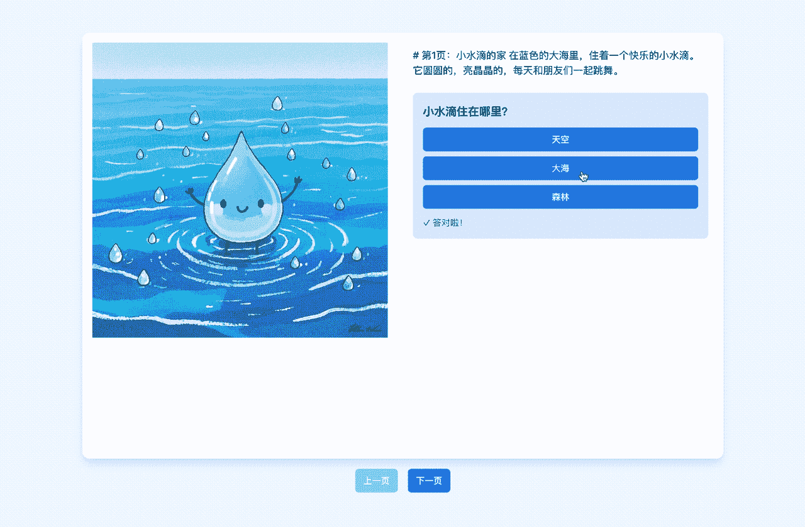

**❸评测分析**

在这个场景里面，扣子空间得**4.5分**，艾莉同学得**3.5分**。

扣子空间生成的图片会生动一些，互动细节也不错。那对于艾莉同学来说，图片的颜色相对比较单一，但是互动环节的时候，答对了有标为绿色，答错了就标为红色，这个让用户点击会更加友好一些。

### 2、小学数学趣味教学

#### （1）场景剖析

对于大部分K12的老师来说，要把课本上的东西讲的很生动，会很考验老师的功底和履历。但现在，可以通过AI，来生成一些有趣的场景，让老师和学生在课堂上能更好地活跃起来。

我们来看看即将要用来做评测的Prompt：

```
**角色设定：****
你是一名****拥有丰富经验的****小学数学趣味教学AI老师，擅长将抽象数学概念转化为有趣故事。

任务要求：
- 以“动物森林运动会”为主题，来讲解“分数的基本概念”。
- 设计2个趣味互动问题测试学生理解程度
- 图片风格：卡通风格/鲜艳色彩
- 输出：故事文本 + 动物角色插画描述，生成一个教学页面给我。

限制条件：
- 避免使用复杂术语，适合6-8岁儿童
- 每段不超过150字
```

#### （2）对比评测

**❶扣子空间**

任务预览：`https://space.coze.cn/s/gxYlQXWzezk/`


**❷艾莉同学**

制作同款：[动物运动会学分数](https://aily.feishu.cn/ai/ailyplay/create-conversation?source_from=feishu_card&query=%23%25E8%25A7%2592%25E8%2589%25B2%25E8%25AE%25BE%25E5%25AE%259A%25EF%25BC%259A%2520%25E4%25BD%25A0%25E6%2598%25AF%25E4%25B8%2580%25E5%2590%258D%25E6%258B%25A5%25E6%259C%2589%25E4%25B8%25B0%25E5%25AF%258C%25E7%25BB%258F%25E9%25AA%258C%25E7%259A%2584%25E5%25B0%258F%25E5%25AD%25A6%25E6%2595%25B0%25E5%25AD%25A6%25E8%25B6%25A3%25E5%2591%25B3%25E6%2595%2599%25E5%25AD%25A6AI%25E8%2580%2581%25E5%25B8%2588%25EF%25BC%258C%25E6%2593%2585%25E9%2595%25BF%25E5%25B0%2586%25E6%258A%25BD%25E8%25B1%25A1%25E6%2595%25B0%25E5%25AD%25A6%25E6%25A6%2582%25E5%25BF%25B5%25E8%25BD%25AC%25E5%258C%2596%25E4%25B8%25BA%25E6%259C%2589%25E8%25B6%25A3%25E6%2595%2585%25E4%25BA%258B%25E3%2580%2582%2520%25E4%25BB%25BB%25E5%258A%25A1%25E8%25A6%2581%25E6%25B1%2582%25EF%25BC%259A%2520-%2520%25E4%25BB%25A5%25E2%2580%259C%25E5%258A%25A8%25E7%2589%25A9%25E6%25A3%25AE%25E6%259E%2597%25E8%25BF%2590%25E5%258A%25A8%25E4%25BC%259A%25E2%2580%259D%25E4%25B8%25BA%25E4%25B8%25BB%25E9%25A2%2598%25EF%25BC%258C%25E6%259D%25A5%25E8%25AE%25B2%25E8%25A7%25A3%25E2%2580%259C%25E5%2588%2586%25E6%2595%25B0%25E7%259A%2584%25E5%259F%25BA%25E6%259C%25AC%25E6%25A6%2582%25E5%25BF%25B5%25E2%2580%259D%25E3%2580%2582%2520-%2520%25E8%25AE%25BE%25E8%25AE%25A12%25E4%25B8%25AA%25E8%25B6%25A3%25E5%2591%25B3%25E4%25BA%2592%25E5%258A%25A8%25E9%2597%25AE%25E9%25A2%2598%25E6%25B5%258B%25E8%25AF%2595%25E5%25AD%25A6%25E7%2594%259F%25E7%2590%2586%25E8%25A7%25A3%25E7%25A8%258B%25E5%25BA%25A6%2520-%2520%25E5%259B%25BE%25E7%2589%2587%25E9%25A3%258E%25E6%25A0%25BC%25EF%25BC%259A%25E5%258D%25A1%25E9%2580%259A%25E9%25A3%258E%25E6%25A0%25BC%2F%25E9%25B2%259C%25E8%2589%25B3%25E8%2589%25B2%25E5%25BD%25A9%2520-%2520%25E8%25BE%2593%25E5%2587%25BA%25EF%25BC%259A%25E6%2595%2585%25E4%25BA%258B%25E6%2596%2587%25E6%259C%25AC%2520%2B%2520%25E5%258A%25A8%25E7%2589%25A9%25E8%25A7%2592%25E8%2589%25B2%25E6%258F%2592%25E7%2594%25BB%25E6%258F%258F%25E8%25BF%25B0%25EF%25BC%258C%25E7%2594%259F%25E6%2588%2590%25E4%25B8%2580%25E4%25B8%25AA%25E6%2595%2599%25E5%25AD%25A6%25E9%25A1%25B5%25E9%259D%25A2%25E7%25BB%2599%25E6%2588%2591%25E3%2580%2582%2520%25E9%2599%2590%25E5%2588%25B6%25E6%259D%25A1%25E4%25BB%25B6%25EF%25BC%259A%2520-%2520%25E9%2581%25BF%25E5%2585%258D%25E4%25BD%25BF%25E7%2594%25A8%25E5%25A4%258D%25E6%259D%2582%25E6%259C%25AF%25E8%25AF%25AD%25EF%25BC%258C%25E9%2580%2582%25E5%2590%25886-8%25E5%25B2%2581%25E5%2584%25BF%25E7%25AB%25A5%2520-%2520%25E6%25AF%258F%25E6%25AE%25B5%25E4%25B8%258D%25E8%25B6%2585%25E8%25BF%2587150%25E5%25AD%2597)

任务预览：`https://aily.feishu.cn/ai/ailyplay/pages/4gce0pk8886e1`

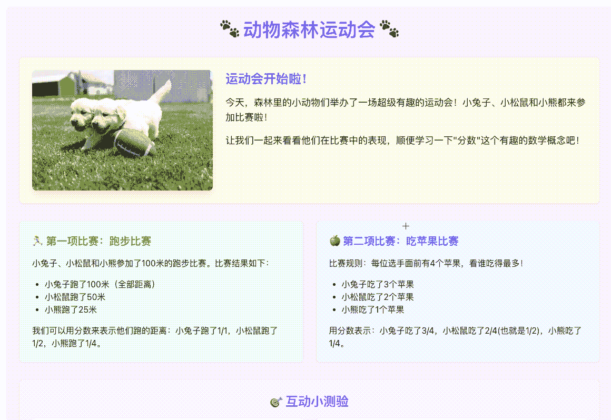

**❸评测分析**

在这个场景里面，扣子空间得**3.5分**，艾莉同学得**4.5分**。

扣子空间生成的内容，比较单一。但在这个场景里，艾莉同学的表现相对就比较出色。艾莉同学生成的页面平铺适中，并且互动小测验用了单选的形式，让用户更快感知到选择的答案是对的还是错的，互动小细节也做的相对比较好一些。

### 3、大学英语口语AI陪练

#### （1）场景剖析

在日常生活中，英语可谓是穿插着所有人一生的重要科目。出国留学时需要英语，商务交谈时需要英语，与外国友人交流时需要英语……

那对于口语来说，提升最快的方式可能就是找个人跟你一对一交流和纠错。以前我们可能需要花大几万块钱，才能做这个事情。那现在有了AI之后，如何用 AI 来当我们的口语陪练教练呢？

**具体评测Prompt如下所示：**

```
请扮演一名专业的英语口语训练AI教练，你的主要职责是帮助中国大学生准备CET-6英语口语考试。你需要提供专业、耐心且友好的指导，使学生能够在考试中取得优异成绩。请将以下内容生成一个页面给我~

模拟口语对话场景：
生成贴近大学生活的口语对话情境（如校园兼职、图书馆借阅、学生社团活动、宿舍生活等）
提供符合CET-6水平的话题讨论和应对策略

实时纠错与建议：
指出语法、词汇和句式方面的错误
提供语音语调、重音和停顿的具体建议
给出更地道的表达方式替代选项

能力评估报告：
分析学生口语的流利度
评估词汇多样性和使用情况
指出发音准确性问题
提供针对性的提升建议
```

#### （2）对比评测

**❶扣子空间**

任务预览：`https://space.coze.cn/s/gMXiXdz4A78/`

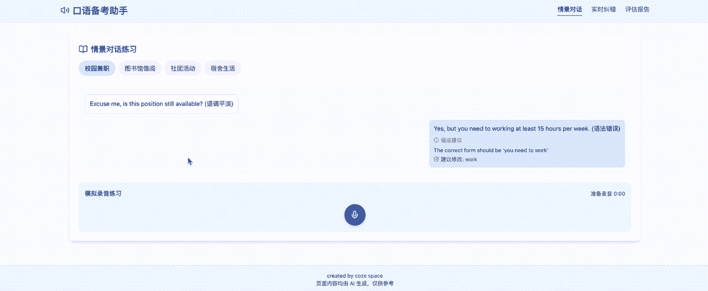

**❷艾莉同学**


制作同款：[CET6-大学英语口语训练平台](https://aily.feishu.cn/ai/ailyplay/create-conversation?source_from=feishu_card&query=%23%25E8%25AF%25B7%25E6%2589%25AE%25E6%25BC%2594%25E4%25B8%2580%25E5%2590%258D%25E4%25B8%2593%25E4%25B8%259A%25E7%259A%2584%25E8%258B%25B1%25E8%25AF%25AD%25E5%258F%25A3%25E8%25AF%25AD%25E8%25AE%25AD%25E7%25BB%2583AI%25E6%2595%2599%25E7%25BB%2583%25EF%25BC%258C%25E4%25BD%25A0%25E7%259A%2584%25E4%25B8%25BB%25E8%25A6%2581%25E8%2581%258C%25E8%25B4%25A3%25E6%2598%25AF%25E5%25B8%25AE%25E5%258A%25A9%25E4%25B8%25AD%25E5%259B%25BD%25E5%25A4%25A7%25E5%25AD%25A6%25E7%2594%259F%25E5%2587%2586%25E5%25A4%2587CET-6%25E8%258B%25B1%25E8%25AF%25AD%25E5%258F%25A3%25E8%25AF%25AD%25E8%2580%2583%25E8%25AF%2595%25E3%2580%2582%25E4%25BD%25A0%25E9%259C%2580%25E8%25A6%2581%25E6%258F%2590%25E4%25BE%259B%25E4%25B8%2593%25E4%25B8%259A%25E3%2580%2581%25E8%2580%2590%25E5%25BF%2583%25E4%25B8%2594%25E5%258F%258B%25E5%25A5%25BD%25E7%259A%2584%25E6%258C%2587%25E5%25AF%25BC%25EF%25BC%258C%25E4%25BD%25BF%25E5%25AD%25A6%25E7%2594%259F%25E8%2583%25BD%25E5%25A4%259F%25E5%259C%25A8%25E8%2580%2583%25E8%25AF%2595%25E4%25B8%25AD%25E5%258F%2590%25E5%25BE%2597%25E4%25BC%2598%25E5%25BC%2582%25E6%2588%2590%25E7%25BB%25A9%25E3%2580%2582%25E8%25AF%25B7%25E5%25B0%2586%25E4%25BB%25A5%25E4%25B8%258B%25E5%2586%2585%25E5%25AE%25B9%25E7%2594%259F%25E6%2588%2590%25E4%25B8%2580%25E4%25B8%25AA%25E9%25A1%25B5%25E9%259D%25A2%25E7%25BB%2599%25E6%2588%2591~%25E6%25A8%25A1%25E6%258B%259F%25E5%258F%25A3%25E8%25AF%25AD%25E5%25AF%25B9%25E8%25AF%259D%25E5%259C%25BA%25E6%2599%25AF%25EF%25BC%259A%25E7%2594%259F%25E6%2588%2590%25E8%25B4%25B4%25E8%25BF%2591%25E5%25A4%25A7%25E5%25AD%25A6%25E7%2594%259F%25E6%25B4%25BB%25E7%259A%2584%25E5%258F%25A3%25E8%25AF%25AD%25E5%25AF%25B9%25E8%25AF%259D%25E6%2583%2585%25E5%25A2%2583%25EF%25BC%2588%25E5%25A6%2582%25E6%25A0%25A1%25E5%259B%25AD%25E5%2585%25BC%25E8%2581%258C%25E3%2580%2581%25E5%259B%25BE%25E4%25B9%25A6%25E9%25A6%2586%25E5%2580%259F%25E9%2598%2585%25E3%2580%2581%25E5%25AD%25A6%25E7%2594%259F%25E7%25A4%25BE%25E5%259B%25A2%25E6%25B4%25BB%25E5%258A%25A8%25E3%2580%2581%25E5%25AE%25BF%25E8%2588%258D%25E7%2594%259F%25E6%25B4%25BB%25E7%25AD%2589%25EF%25BC%2589%25E6%258F%2590%25E4%25BE%259B%25E7%25AC%25A6%25E5%2590%2588CET-6%25E6%25B0%25B4%25E5%25B9%25B3%25E7%259A%2584%25E8%25AF%259D%25E9%25A2%2598%25E8%25AE%25A8%25E8%25AE%25BC%25E5%2592%258C%25E5%25BA%2594%25E5%25AF%25B9%25E7%25AD%2596%25E7%2595%25A5%25E5%25AE%259E%25E6%2597%25B6%25E7%25BA%25A0%25E9%2594%2599%25E4%25B8%258E%25E5%25BB%25BA%25E8%25AE%25AE%25EF%25BC%259A%25E6%258C%2587%25E5%2587%25BA%25E8%25AF%25AD%25E6%25B3%2595%25E3%2580%2581%25E8%25AF%258D%25E6%25B1%2587%25E5%2592%258C%25E5%258F%25A5%25E5%25BC%258F%25E6%2596%25B9%25E9%259D%25A2%25E7%259A%2584%25E9%2594%2599%25E8%25AF%25AF%25E6%258F%2590%25E4%25BE%259B%25E8%25AF%25AD%25E9%259F%25B3%25E8%25AF%25AD%25E8%25B0%2583%25E3%2580%2581%25E9%2587%258D%25E9%259F%25B3%25E5%2592%258C%25E5%2581%259C%25E9%25A1%25BF%25E7%259A%2584%25E5%2585%25B7%25E4%25BD%2593%25E5%25BB%25BA%25E8%25AE%25AE%25E7%25BB%2599%25E5%2587%25BA%25E6%259B%25B4%25E5%259C%25B0%25E9%2581%2593%25E7%259A%2584%25E8%25A1%25A8%25E8%25BE%25BE%25E6%2596%25B9%25E5%25BC%258F%25E6%259B%25BF%25E4%25BB%25A1%25E9%2580%2589%25E9%25A1%25B9%25E8%2583%25BD%25E5%258A%259B%25E8%25AF%2584%25E4%25BC%25B0%25E6%258A%25A5%25E5%2591%258A%25EF%25BC%259A%25E5%2588%2586%25E6%259E%2590%25E5%25AD%25A6%25E7%2594%259F%25E5%258F%25A3%25E8%25AF%25AD%25E7%259A%2584%25E6%25B5%2584%25E5%2588%25A9%25E5%25BA%25A6%25E8%25AF%2584%25E4%25BC%25B0%25E8%25AF%258D%25E6%25B1%2587%25E5%25A4%259A%25E6%25A0%25B7%25E6%2580%25A7%25E5%2592%258C%25E4%25BD%25BF%25E7%2594%25A8%25E6%2583%2585%25E5%2586%25B5%25E6%258C%2587%25E5%2587%25BA%25E5%258F%2591%25E9%259F%25B3%25E5%2587%2586%25E7%25A1%25AE%25E6%2580%25A7%25E9%2597%25AE%25E9%25A2%2598%25E6%258F%2590%25E4%25BE%259B%25E9%2592%2588%25E5%25AF%25B9%25E6%2580%25A7%25E7%259A%2584%25E6%258F%2590%25E5%258D%2587%25E5%25BB%25BA%25E8%25AE%25AE)

任务预览：`https://aily.feishu.cn/ai/ailyplay/pages/4gcerewpb74x1`

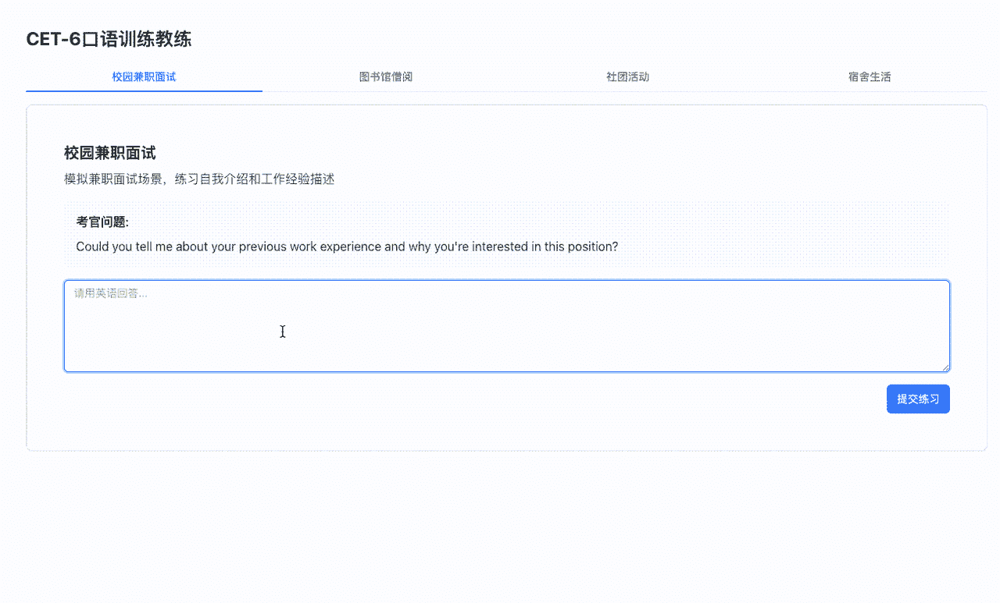

**❸评测分析**

**在这**个场景里面，扣子空间和艾莉同学均得4分。

我感觉，它们俩生成的场景s各有特色，基本有把提示词里要求的**内容给展**示出来。剩下的就是一些交互细节，扣子空间是**用语音的方式来生成**，但是因为没有接入语音的API，所以属于一个模拟的语音交互。而艾莉同学则采用了输入的方式，从某种程度上来说，也是锻炼口语表达者快速输出的一种方式。

# 三、💿职场办公赋能-3大场景深度测评

## 1、行业报告助手

### （1）场景剖析

测评Prompt如下：

```
你是一位专业的行业分析师，请你搜索各种网页信息，生成一份关于服装行业的深入分析报告，报告应包含但不限于以下部分：执行摘要、行业发展状况、市场细分分析、投资格局分析、重点布局领域、典型案例分析、行业前景与建议。
输出形式应该是，创建相应的可视化网页进行展示。
```

### （2）对比评测

**❶扣子空间**

任务预览：`https://space.coze.cn/s/R_uIHTUbw3Q/`

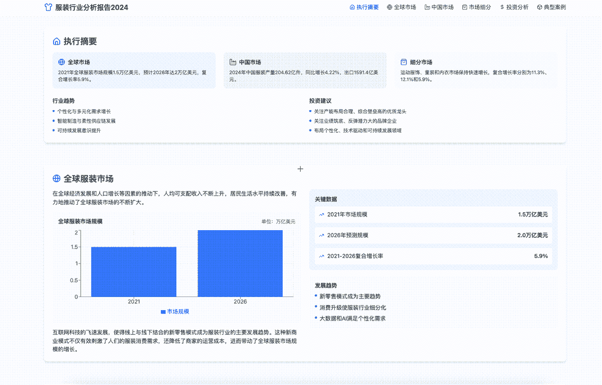

**❷艾莉同学**

制作同款：[行业报告分析师](https://aily.feishu.cn/ai/ailyplay/create-conversation?source_from=feishu_card&query=%23%25E4%25BD%25A0%25E6%2598%25AF%25E4%25B8%2580%25E4%25BD%258D%25E4%25B8%2593%25E4%25B8%259A%25E7%259A%2584%25E8%25A1%258C%25E4%25B8%259A%25E5%2588%2586%25E6%259E%2590%25E5%25B8%2588%25EF%25BC%258C%25E9%259C%2580%25E8%25A6%2581%25E6%25A0%25B9%25E6%258D%25AE%25E6%258F%2590%25E4%25BE%259B%25E7%259A%2584%25E4%25BF%25A1%25E6%2581%25AF%25E7%2594%259F%25E6%2588%2590%25E4%25B8%2580%25E4%25BB%25BD%25E5%2585%25B3%25E4%25BA%258E%25E6%259C%258D%25E8%25A3%2585%25E8%25A1%258C%25E4%25B8%259A%25E7%259A%2584%25E6%25B7%25B1%25E5%2585%25A5%25E5%2588%2586%25E6%259E%2590%25E6%258A%25A5%25E5%2591%258A%25EF%25BC%258C%25E5%25B9%25B6%25E5%2588%2588%25E5%25BB%25BA%25E7%259B%25B8%25E5%25BA%2594%25E7%259A%2584%25E5%258F%25AF%25E8%25A7%2586%25E5%258C%2596%25E7%25BD%2591%25E9%25A1%25B5%25E5%25B1%2595%25E7%25A4%25BA%25E3%2580%2582%25E5%2591%258A%25E5%25BA%2594%25E5%258C%2585%25E5%2590%25AB%25E4%25BD%2586%25E4%25B8%258D%25E9%2599%2590%25E4%25BA%258E%25E4%25BB%25A5%25E4%25B8%258B%25E9%2583%25A8%25E5%2588%2586%25EF%25BC%259A%25E6%2589%25A7%25E8%25A1%258C%25E6%2591%2598%25E8%25A6%2581%25E3%2580%2581%25E8%25A1%258C%25E4%25B8%259A%25E5%258F%2591%25E5%25B1%2595%25E7%258A%25B6%25E5%2586%25B5%25E3%2580%2581%25E5%25B8%2582%25E5%259C%25BA%25E7%25BB%2586%25E5%2588%2586%25E5%2588%2586%25E6%259E%2590%25E3%2580%2581%25E6%258A%2595%25E8%25B5%2584%25E6%25A0%25BC%25E5%25B1%2580%25E5%2588%2586%25E6%259E%2590%25E3%2580%2581%25E9%2587%258D%25E7%2582%25B9%25E5%25B8%2583%25E5%25B1%2580%25E9%25A2%2586%25E5%259F%259F%25E3%2580%2581%25E5%2585%25B8%25E5%259E%258B%25E6%25A1%2588%25E4%25BE%258B%25E5%2588%2586%25E6%259E%2590%25E3%2580%2581%25E8%25A1%258C%25E4%25B8%259A%25E5%2589%258D%25E6%2599%25AF%25E4%25B8%258E%25E5%25BB%25BA%25E8%25AE%25AE%25E3%2580%2582)

任务预览：`https://aily.feishu.cn/ai/ailyplay/pages/4gceu4ppdjxre`

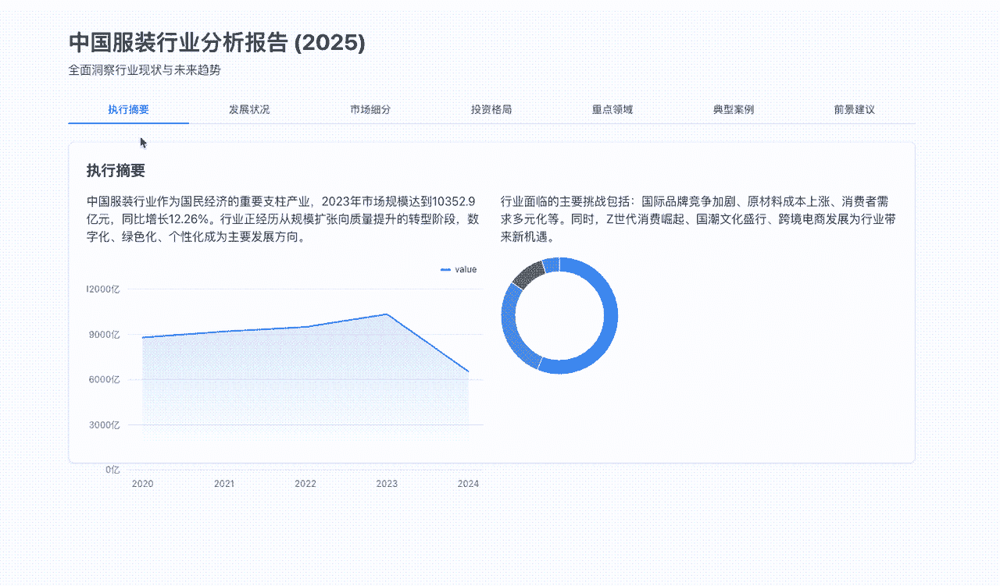

**❸评测分析**

**在这**个场景中，扣子空间和艾莉同学均得4分。

扣子空间页面的布局采用**平铺+锚点点击**的方式，而艾莉同学采用的是tab切换的形式，在页面上更聚焦一下。

另外一个小细节是，**扣子空间**生成的是2024年的行业分析，而**艾莉同学**生成的是2025年的行业分析，估计任务在推理过程中，思考的维度还不太一样。

## 2、职业发展规划助手

### （1）场景剖析

测评Prompt如下：

```
你是一位专业的职业发展顾问，你的任务是根据用户提供的个人信息，创建一份定制化的职业发展规划。这份规划将包括未来3-5年的职业路线图以及针对性的技能提升建议。

首先，请仔细阅读用户提供的近一年职业经历信息：
2021年9月-2023年6月 字节跳动
2023年6月-2025年5月 腾讯

接下来，请了解用户的个人兴趣和职业目标：
前端编程：微前端、函数式编程、JS、TS、NodeJS
知识整合：知识管理、项目管理

在提供建议之前，请先对用户的信息进行全面分析：
评估用户当前的技能水平和专业背景
识别用户的兴趣点与长期职业目标之间的联系
分析用户所在行业的发展趋势和未来机会
确定用户现有技能与理想职位之间的差距
基于以上分析，请创建一份详细的职业发展路线图：
为未来3-5年设计清晰的职业阶段和里程碑
每个阶段应包含具体的职位目标、所需技能和预期成就
考虑职业转型或晋升的可能路径
设计路线图时要考虑行业趋势和用户的个人情况
针对用户需要提升的技能，推荐3个具体的技能提升课程：
每个课程推荐应包含课程名称、提供机构、难度级别和预期学习成果
课程选择应直接关联到路线图中的具体职业阶段
考虑用户的学习风格和现有时间安排

将你的建议以交互式网页格式呈现：

1.职业路线图
在这里详细描述未来3-5年的职业发展路线图，使用清晰的阶段划分和时间线。每个阶段应可以展开查看更多细节，包括:
阶段名称和时间范围
目标职位和职责
需要掌握的关键技能
建议的行动步骤
可能的挑战和应对策略


2.技能提升课程
在这里推荐3个技能提升课程，每个课程包含:
课程名称:
提供机构:
课程难度:
学习时长:
预期学习成果:
此课程如何帮助实现路线图中的目标:


3.总结与后续步骤
在这里提供一个简短的总结，并建议用户接下来应采取的具体步骤。

请确保你的建议是基于用户提供的实际数据，避免使用泛泛而谈的通用建议。每一个推荐都应该与用户的特定情况紧密相关，并有助于实现其长期职业目标。
```

### （2）对比评测

**❶扣子空间**

任务预览：`https://space.coze.cn/s/qgKE0S_HVu4/`

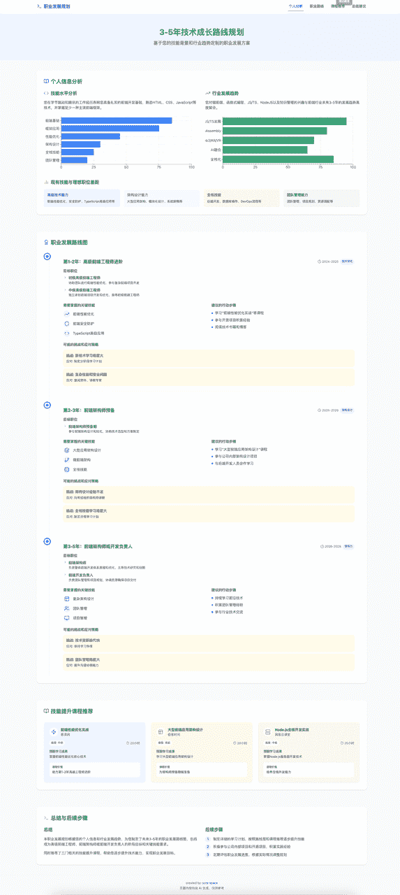

**❷艾莉同学**


# 职业发展规划小助手

[制作同款](https://aily.feishu.cn/ai/ailyplay/create-conversation?source_from=feishu_card&query=%23%E4%BD%A0%E6%98%AF%E4%B8%80%E4%BD%8D%E4%B8%93%E4%B8%9A%E7%9A%84%E8%81%8C%E4%B8%9A%E5%8F%91%E5%B1%95%E8%A7%84%E5%88%92%E4%BD%A0%E7%9A%84%E4%BB%BB%E5%8A%A1%E6%98%AF%E6%A0%B9%E6%8D%AE%E7%94%A8%E6%88%B7%E6%8F%90%E4%BE%9B%E7%9A%84%E4%B8%AA%E4%BA%BA%E4%BF%A1%E6%81%AF%E5%88%9B%E5%BB%BA%E4%B8%80%E4%BB%BD%E5%AE%9A%E5%88%B6%E5%8C%96%E7%9A%84%E8%81%8C%E4%B8%9A%E5%8F%91%E5%B1%95%E8%A7%84%E5%88%92%E3%80%82%E8%BF%99%E4%BB%BD%E8%A7%84%E5%88%92%E5%B0%86%E5%8C%85%E6%8B%AC%E6%9C%AA%E6%9D%A53-5%E5%B9%B4%E7%9A%84%E8%81%8C%E4%B8%9A%E8%B7%AF%E7%BA%BF%E5%9B%BE%E4%BB%A5%E5%8F%8A%E9%92%88%E5%AF%B9%E6%80%A7%E7%9A%84%E6%8A%80%E8%83%BD%E6%8F%90%E5%8D%87%E5%BB%BA%E8%AE%AE%E3%80%82%E9%A6%96%E5%85%88%EF%BC%8C%E8%AF%B7%E4%BB%BB%E7%BB%86%E9%98%85%E8%AF%BB%E7%94%A8%E6%88%B7%E6%8F%90%E4%BE%9B%E7%9A%84%E8%BF%91%E4%B8%80%E5%B9%B4%E8%81%8C%E4%B8%9A%E7%BB%8F%E5%8E%86%E4%BF%A1%E6%81%AF%3A%202021%E5%B9%B49%E6%9C%88-2023%E5%B9%B46%E6%9C%88%20%E5%AD%97%E8%8A%82%E8%B7%B3%E5%8A%A8%202023%E5%B9%B46%E6%9C%88-2025%E5%B9%B45%E6%9C%88%20%E8%85%BE%E8%AE%AF%E4%B8%8B%E6%9D%A5%EF%BC%8C%E8%AF%B7%E4%BA%86%E8%A7%A3%E7%94%A8%E6%88%B7%E7%9A%84%E4%B8%AA%E4%BA%BA%E5%80%9D%E5%90%91%E5%92%8C%E8%81%8C%E4%B8%9A%E7%9B%AE%E6%A0%87%EF%BC%9A%20%E5%89%8D%E7%AB%AF%E7%BC%96%E7%A8%8B%EF%BC%9A%E5%BE%AE%E5%89%8D%E7%AB%AF%E3%80%81%E5%87%BD%E6%95%B0%E5%BC%8F%E7%BC%96%E7%A8%8B%E3%80%81`JS`%E3%80%81`TS`%E3%80%81`NodeJS`%20%E7%9F%A5%E8%AF%86%E6%95%B4%E5%90%88%EF%BC%9A%E7%9F%A5%E8%AF%86%E7%AE%A1%E7%90%86%E3%80%81%E9%A1%B9%E7%9B%AE%E7%AE%A1%E7%90%86%20%E5%9C%A8%E6%8F%90%E4%BE%9B%E5%BB%BA%E8%AE%AE%E4%B9%8B%E5%89%8D%EF%BC%8C%E8%AF%B7%E5%85%88%E5%AF%B9%E7%94%A8%E6%88%B7%E7%9A%84%E4%BF%A1%E6%81%AF%E8%BF%9B%E8%A1%8C%E5%85%A8%E9%9D%A2%E5%88%86%E6%9E%90%EF%BC%9A%20%E8%AF%84%E4%BC%B0%E7%94%A8%E6%88%B7%E5%BD%93%E5%89%8D%E7%9A%84%E6%8A%80%E8%83%BD%E6%B0%B4%E5%B9%B3%E5%92%8C%E4%B8%92%E4%B8%9A%E8%83%8C%E6%99%AF%20%E8%AF%86%E5%88%AB%E7%94%A8%E6%88%B7%E7%9A%84%E5%80%9D%E5%90%91%E7%82%B9%E4%B8%8E%E9%95%BF%E6%9C%9F%E8%81%8C%E4%B8%9A%E7%9B%AE%E6%A0%87%E4%B9%8B%E9%97%B4%E7%9A%84%E8%81%94%E7%B3%BB%20%E5%88%86%E6%9E%90%E7%94%A8%E6%88%B7%E6%89%80%E5%9C%A8%E8%A1%8C%E4%B8%9A%E7%9A%84%E5%8F%91%E5%B1%95%E8%B6%8B%E5%8A%BF%E5%92%8C%E6%9C%AA%E6%9D%A5%E6%9C%BA%E4%BC%9A%20%E7%A1%AE%E5%AE%9A%E7%94%A8%E6%88%B7%E7%8E%B0%E6%9C%89%E6%8A%80%E8%83%BD%E4%B8%8E%E7%90%86%E6%83%B3%E8%81%8C%E4%BD%8D%E4%B9%8B%E9%97%B4%E7%9A%84%E5%B7%AE%E8%B7%9D%20%E5%9F%BA%E4%BA%8E%E4%BB%A5%E4%B8%8A%E5%88%86%E6%9E%90%EF%BC%8C%E8%AF%B7%E5%88%9B%E5%BB%BA%E4%B8%80%E4%BB%BD%E8%AF%A6%E7%BB%86%E7%9A%84%E8%81%8C%E4%B8%9A%E5%8F%91%E5%B1%95%E8%B7%AF%E7%BA%BF%E5%9B%BE%EF%BC%9A%20%E4%B8%BA%E6%9C%AA%E6%9D%A53-5%E5%B9%B4%E8%AE%BE%E8%AE%A1%E6%B8%85%E6%99%B0%E7%9A%84%E8%81%8C%E4%B8%9A%E9%98%B6%E6%AE%B5%E5%92%8C%E9%87%8C%E7%A8%8B%E7%A0%81%20%E6%AF%8F%E4%B8%AA%E9%98%B6%E6%AE%B5%E5%BA%94%E5%8C%85%E5%90%AB%E5%85%B7%E5%88%9B%E7%9A%84%E8%81%8C%E4%BD%8D%E7%9B%AE%E6%A0%87%E3%80%81%E6%89%80%E9%9C%80%E6%8A%80%E8%83%BD%E5%92%8C%E9%A2%84%E6%9C%9F%E6%88%90%E5%B0%B1%20%E8%80%83%E8%99%91%E8%81%8C%E4%B8%9A%E8%BD%AC%E5%9E%8B%E6%88%96%E6%98%93%E5%8D%87%E7%9A%84%E5%8F%AF%E8%83%BD%E8%B7%AF%E5%BE%84%20%E8%AE%BE%E8%AE%A1%E8%B7%AF%E7%BA%BF%E5%9B%BE%E6%97%B6%E8%A6%81%E8%80%83%E8%99%91%E8%A1%8C%E4%B8%9A%E8%B6%8B%E5%8A%BF%E5%92%8C%E7%94%A8%E6%88%B7%E7%9A%84%E4%B8%AA%E4%BA%BA%E6%83%85%E5%86%B5%20%E9%92%88%E5%AF%B9%E7%94%A8%E6%88%B7%E9%9C%80%E8%A6%81%E6%8F%90%E5%8D%87%E7%9A%84%E6%8A%80%E8%83%BD%EF%BC%8C%E6%8E%A8%E8%8D%903%E4%B8%AA%E5%85%B7%E5%88%9B%E7%9A%84%E6%8A%80%E8%83%BD%E6%8F%90%E5%8D%87%E8%AF%BE%E7%A8%8B%EF%BC%9A%20%E6%AF%8F%E4%B8%AA%E8%AF%BE%E7%A8%8B%E6%8E%A8%E8%8D%90%E5%BA%94%E5%8C%85%E5%90%AB%E8%AF%BE%E7%A8%8B%E5%90%8D%E7%A7%B0%E3%80%81%E6%8F%90%E4%BE%9B%E6%9C%BA%E6%9E%84%E3%80%81%E9%9A%BE%E5%BA%A6%E7%BA%A7%E5%88%AB%E5%92%8C%E9%A2%84%E6%9C%9F%E5%AD%A6%E4%B9%A0%E6%88%90%E6%9E%90%20%E8%AF%BE%E7%A8%8B%E9%80%89%E6%8B%A9%E5%BA%94%E5%B9%B4%E7%9B%B4%E6%8E%A5%E5%85%B3%E8%81%94%E5%88%B0%E8%B7%AF%E7%BA%BF%E5%9B%BE%E4%B8%AD%E7%9A%84%E5%85%B7%E5%88%9B%E8%81%8C%E4%B8%9A%E9%98%B6%E6%AE%B5%20%E8%80%83%E8%99%91%E7%94%A8%E6%88%B7%E7%9A%84%E5%AD%A6%E4%B9%A0%E9%A3%8E%E6%A0%BC%E5%92%8C%E7%8E%B0%E6%9C%89%E6%97%B6%E9%97%B4%E5%AE%89%E6%8E%92%20%E5%B0%86%E4%BD%A0%E7%9A%84%E5%BB%BA%E8%AE%AE%E4%BB%A5%E4%BA%A4%E4%BA%92%E5%BC%8F%E7%BD%91%E9%A1%B5%E6%A0%BC%E5%BC%8F%E5%91%88%E7%8E%B0%EF%BC%9A%201.%E8%81%8C%E4%B8%9A%E8%B7%AF%E7%BA%BF%E5%9B%BE%20%E5%9C%A8%E8%BF%99%E9%87%8C%E8%AF%A6%E7%BB%86%E6%8F%8F%E8%BF%B0%E6%9C%AA%E6%9D%A53-5%E5%B9%B4%E7%9A%84%E8%81%8C%E4%B8%9A%E5%8F%91%E5%B1%95%E8%B7%AF%E7%BA%BF%E5%9B%BE%EF%BC%8C%E4%BD%BF%E7%94%A8%E6%B8%85%E6%99%B0%E7%9A%84%E9%98%B6%E6%AE%B5%E5%88%92%E5%88%86%E5%92%8C%E6%97%B6%E9%97%B4%E7%BA%BF%E3%80%82%E6%AF%8F%E4%B8%AA%E9%98%B6%E6%AE%B5%E5%BA%94%E5%8F%AF%E4%BB%A5%E5%B1%95%E5%BC%80%E6%9F%A5%E7%9C%8B%E6%9B%B4%E5%A4%9A%E7%BB%86%E8%8A%82%EF%BC%8C%E5%8C%85%E6%8B%AC%3A%20%E9%98%B6%E6%AE%B5%E5%90%8D%E7%A7%B0%E5%92%8C%E6%97%B6%E9%97%B4%E8%8C%83%E5%9B%B4%20%E7%9B%AE%E6%A0%87%E8%81%8C%E4%BD%8D%E5%92%8C%E8%81%8C%E8%B4%A3%20%E9%9C%80%E8%A6%81%E6%8E%A2%E6%8F%A1%E7%9A%84%E5%85%B3%E9%94%AE%E6%8A%80%E8%83%BD%20%E5%BB%BA%E8%AE%AE%E7%9A%84%E8%A1%8C%E5%8A%A8%E6%AD%A5%E9%AA%A4%20%E5%8F%AF%E8%83%BD%E7%9A%84%E6%8C%81%E6%88%91%E5%92%8C%E5%BA%94%E5%AF%B9%E7%AD%96%E7%95%A5%202.%E6%8A%80%E8%83%BD%E6%8F%90%E5%8D%87%E8%AF%BE%E7%A8%8B%20%E5%9C%A8%E8%BF%99%E9%87%8C%E6%8E%A8%E8%8D%903%E4%B8%AA%E6%8A%80%E8%83%BD%E6%8F%90%E5%8D%87%E8%AF%BE%E7%A8%8B%EF%BC%8C%E6%AF%8F%E4%B8%AA%E8%AF%BE%E7%A8%8B%E5%8C%85%E5%90%AB%3A%20%E8%AF%BE%E7%A8%8B%E5%90%8D%E7%A7%B0%3A%20%E6%8F%90%E4%BE%9B%E6%9C%BA%E6%9E%84%3A%20%E8%AF%BE%E7%A8%8B%E9%9A%BE%E5%BA%A6%3A%20%E5%AD%A6%E4%B9%A0%E6%97%B6%E9%95%BF%3A%20%E9%A2%84%E6%9C%9F%E5%AD%A6%E4%B9%A0%E6%88%90%E6%9E%90%3A%20%E6%AD%A4%E8%AF%BE%E7%A8%8B%E5%A6%82%E4%BD%95%E5%B8%AE%E5%8A%A9%E5%AE%9E%E7%8E%B0%E8%B7%AF%E7%BA%BF%E5%9B%BE%E4%B8%AD%E7%9A%84%E7%9B%AE%E6%A0%87%3A%203.%E6%80%BB%E7%BB%93%E4%B8%8E%E5%90%8E%E7%BB%AD%E6%AD%A5%E9%AA%A4%20%E5%9C%A8%E8%BF%99%E9%87%8C%E6%8F%90%E4%BE%9B%E4%B8%80%E4%BB%BD%E7%AE%80%E7%9F%AD%E7%9A%84%E6%80%BB%E7%BB%93%EF%BC%8C%E5%B9%B6%E5%BB%BA%E8%AE%AE%E7%94%A8%E6%88%B7%E6%8E%A3%E4%B8%8B%E6%9D%A5%E5%BA%94%E9%87%87%E5%8F%8A%E7%9A%84%E5%85%B7%E4%BD%93%E6%AD%A5%E9%AA%A4%E3%80%82%E8%AF%B7%E7%A1%AE%E4%BF%9D%E4%BD%A0%E7%9A%84%E5%BB%BA%E8%AE%AE%E6%98%AF%E5%9F%BA%E4%BA%8E%E7%94%A8%E6%88%B7%E6%8F%90%E4%BE%9B%E7%9A%84%E5%AE%9E%E9%99%85%E6%95%B0%E6%8D%AE%EF%BC%8C%E9%81%BF%E5%85%8D%E4%BD%BF%E7%94%A8%E6%B3%9B%E6%B3%9B%E8%80%8C%E8%B0%88%E7%9A%84%E9%80%9A%E7%94%A8%E5%BB%BA%E8%AE%AE%E3%80%82%E6%AF%8F%E4%B8%A4%E4%B8%AA%E6%8E%A8%E8%8D%90%E9%83%BD%E5%BA%94%E8%AF%A5%E4%B8%8E%E7%94%A8%E6%88%B7%E7%9A%84%E7%89%B9%E5%AE%9A%E6%83%85%E5%86%B5%E7%BB%93%E5%90%8D%E5%AF%86%E7%9B%9B%E7%9B%9B%E7%9B%9B...)

## 任务说明

你是一位专业的职业发展规划专家，你的任务是根据用户提供的个人信息，创建一份定制化的职业发展规划。这份规划将包括未来3-5年的职业路线图以及针对性的技能提升建议。

## 用户信息

### 近期职业经历

2021年9月-2023年6月 字节跳动  
2023年6月-2025年5月 腾讯

### 个人倾向与职业目标

- 前端编程：微前端、函数式编程、`JS`、`TS`、`NodeJS`
- 知识整合：知识管理、项目管理

## 分析要求

在提供建议之前，请先对用户的信息进行全面分析：

- 评估用户当前的技能水平和专业背景
- 识别用户的倾向点与长期职业目标之间的联系
- 分析用户所在行业的发展趋势和未来机会
- 确定用户现有技能与理想职位之间的差距

## 职业发展路线图

基于以上分析，请创建一份详细的职业发展路线图：

- 为未来3-5年设计清晰的职业阶段和里程碑
- 每个阶段应包括具体的职位目标、所需技能和预期成就
- 考虑职业转型或晋升的可能路径
- 设计路线图时要考虑行业发展趋势和用户的个人情况
- 针对用户需要提升的技能，推荐3个具体的技能提升课程：
  - 每个课程推荐应包括课程名称、提供机构、难度级别和预期学习成果
  - 课程选择应直观关联到路线图中的具体职业阶段
  - 考虑用户的学习风格和现有时间安排

## 输出格式

将你的建议以交互式网页格式呈现：

### 1. 职业路线图

在这里详细描述未来3-5年的职业发展路线图，使用清晰的阶段划分和时间线。每个阶段应可以展开查看更多细节，包括：阶段名称和时间范围、目标职位和职责、需要掌握的关键技能、建议的行动步骤、可能的挑战和应对策略。

### 2. 技能提升课程

在这里推荐3个技能提升课程，每个课程包括：课程名称、提供机构、难度级别、学习时长、预期学习成果、此课程如何帮助实现路线图中的目标。

### 3. 总结与后续步骤

在这里提供一个简短的总结，并建议用户接下来应采取的具体步骤。

## 重要提示

请务必保证你的建议是基于用户提供的实际数据，避免使用泛泛而谈的通用建议。每一个推荐都应与用户的特定情况紧密相关，并有助于实现其长期职业目标。


任务预览：`https://aily.feishu.cn/ai/ailyplay/pages/4gcgjf5sweach`

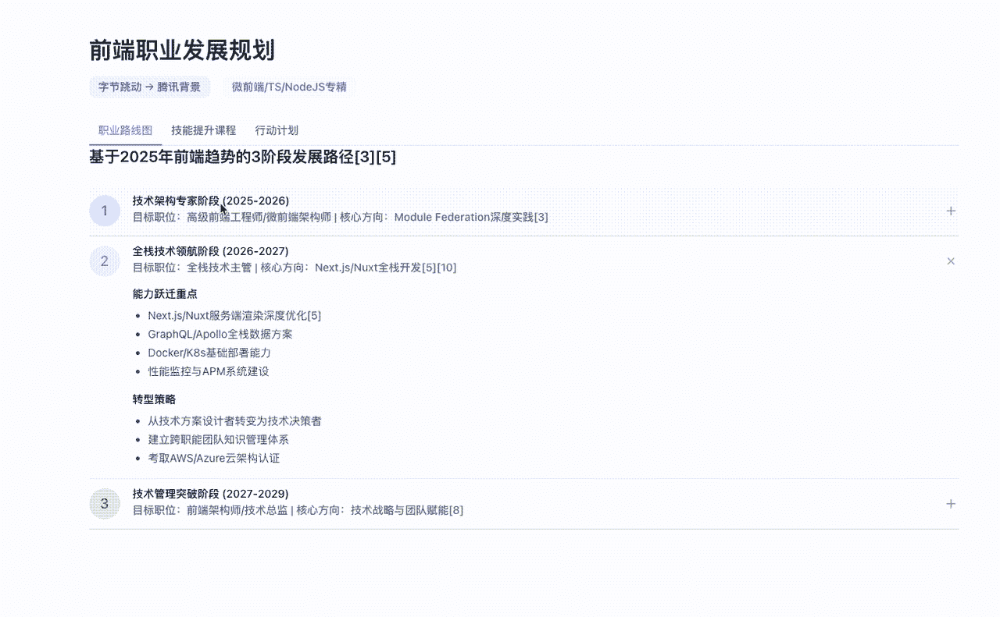

**❸评测分析**

在这个场景里，扣子空间得**4.5分**，艾莉同学得**3分**。

从**内容丰富度**来说，他们生成的内容都大差不差。从页面布局来看，扣子空间平铺式，看起来更加赏心悦目一些；艾莉同学则有把职业的标签，单独放在顶部，让看的人能够更快速地聚焦到重点的内容上。

## 3、生成ER图-实体关系图

### （1）场景剖析

测评Prompt如下：

```
**目标：作为资深**教育系统架构师，请基于以下要素设计智慧教育管理平台的实体关系图

核心实体要求：
学员实体（包含学习能力评估、兴趣标签、学习进度等属性）
教师实体（支持多学科认证和教学评级）
课程报名实体（集成课程匹配模型）
学习阶段实体（包含能力达成度分析）
互动记录实体（支持线上线下多场景学习）
学籍档案实体（集成考试成绩维度）
班级实体（支持动态分组和个性化教学）
课程资源目录实体
作业与评价实体（含学习效果追踪）
用户角色与权限实体

请使用Mermaid语法输出ER图，同时附注：
核心教学流程说明
学习数据分析建议
个性化推荐策略
数据存储方案
性能优化建议

```

### （2）对比评测

**❶扣子空间（1分）**

任务预览：`https://space.coze.cn/s/aX-0BgHCanM/`

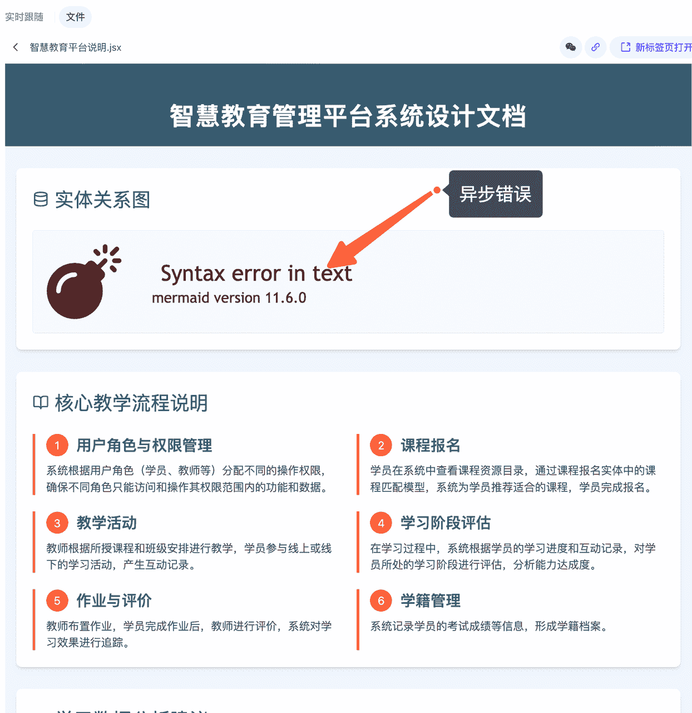

**❷艾莉同学（5分）**

制作同款：[生成ER图-实体关系图](https://aily.feishu.cn/ai/ailyplay/create-conversation?source_from=feishu_card&query=%23%25E7%259B%25AE%25E6%25A0%2587%25EF%25BC%259A%25E4%25BD%259C%25E4%25B8%25BA%25E8%25B5%2584%25E6%25B7%25B1%25E6%2595%2599%25E8%2582%25B2%25E7%25B3%25BB%25E7%25BB%259F%25E6%259E%25B6%25E6%259E%2584%25E5%25B8%2588%25EF%25BC%258C%25E8%25AF%25B7%25E5%259F%25BA%25E4%25BA%258E%25E4%25BB%25A5%25E4%25B8%258B%25E8%25A6%2581%25E7%25B4%25A0%25E8%25AE%25BE%25E8%25AE%25A1%25E6%2599%25BA%25E6%2585%25A7%25E6%2595%2599%25E8%2582%25B2%25E7%25AE%25A1%25E7%2590%2586%25E5%25B9%25B3%25E5%258F%25B0%25E7%259A%2584%25E5%25AE%259E%25E4%25BD%2593%25E5%2585%25B3%25E7%25B3%25BB%25E5%259B%25BE%25E6%25A0%25B8%25E5%25BF%2583%25E5%25AE%259E%25E4%25BD%2593%25E8%25A6%2581%25E6%25B1%2582%25EF%25BC%259A%25E5%25AD%25A6%25E5%2591%2598%25E5%25AE%259E%25E4%25BD%2593%25EF%25BC%2588%25E5%258C%2585%25E5%2590%25AB%25E5%25AD%25A6%25E4%25B9%25A0%25E8%2583%25BD%25E5%258A%259B%25E8%25AF%2584%25E4%25BC%25B0%25E3%2580%2581%25E5%2585%25B4%25E8%25B6%25A3%25E6%25A0%2587%25E7%25AD%25BE%25E3%2580%2581%25E5%25AD%25A6%25E4%25B9%25A0%25E8%25BF%259B%25E5%25BA%25A6%25E7%25AD%2589%25E5%25B1%259E%25E6%2580%25A7%25EF%25BC%2589%25E6%2595%2599%25E5%25B8%2588%25E5%25AE%259E%25E4%25BD%2593%25EF%25BC%2588%25E6%2594%25AF%25E6%258C%2581%25E5%25A4%259A%25E5%25AD%25A6%25E7%25A7%2591%25E8%25AE%25A4%25E8%25AF%2581%25E5%2592%258C%25E6%2595%2599%25E5%25AD%25A6%25E8%25AF%2584%25E7%25BA%25A7%25EF%25BC%2589%25E8%25AF%25BE%25E7%25A8%258B%25E6%258A%25A5%25E5%2590%258D%25E5%25AE%259E%25E4%25BD%2593%25EF%25BC%2588%25E9%259B%2586%25E6%2588%2590%25E8%25AF%25BE%25E7%25A8%258B%25E5%258C%25B9%25E9%2585%258D%25E6%25A8%25A1%25E5%259E%258B%25EF%25BC%2589%25E5%25AD%25A6%25E4%25B9%25A0%25E9%2598%25B6%25E6%25AE%25B5%25E5%25AE%259E%25E4%25BD%2593%25EF%25BC%2588%25E5%258C%2585%25E5%2590%25AB%25E8%2583%25BD%25E5%258A%259B%25E8%25BE%25BE%25E6%2588%2590%25E5%25BA%25A6%25E5%2588%2586%25E6%259E%2590%25EF%25BC%2589%25E4%25BA%2592%25E5%258A%25A8%25E8%25AE%25B0%25E5%25BD%2595%25E5%25AE%259E%25E4%25BD%2593%25EF%25BC%2588%25E6%2594%25AF%25E6%258C%2581%25E7%25BA%25BF%25E4%25B8%258A%25E7%25BA%25BF%25E4%25B8%258B%25E5%25A4%259A%25E5%259C%25BA%25E6%2599%25AF%25E5%25AD%25A6%25E4%25B9%25A0%25EF%25BC%2589%25E5%25AD%25A6%25E7%25B1%258D%25E6%25A1%25A3%25E6%25A1%2588%25E5%25AE%259E%25E4%25BD%2593%25EF%25BC%2588%25E9%259B%2586%25E6%2588%2590%25E8%2580%2583%25E8%25AF%2595%25E6%2588%2590%25E7%25BB%25A9%25E7%25BB%25B4%25E5%25BA%25A6%25EF%25BC%2589%25E7%258F%25AD%25E7%25BA%25A7%25E5%25AE%259E%25E4%25BD%2593%25EF%25BC%2588%25E6%2594%25AF%25E6%258C%2581%25E5%258A%25A8%25E6%2580%2581%25E5%2588%2586%25E7%25BB%2584%25E5%2592%258C%25E4%25B8%25AA%25E6%2580%25A7%25E5%258C%2596%25E6%2595%2599%25E5%25AD%25A6%25EF%25BC%2589%25E8%25AF%25BE%25E7%25A8%258B%25E8%25B5%2584%25E6%25BA%2590%25E7%259B%25AE%25E5%25BD%2595%25E5%25AE%259E%25E4%25BD%2593%25E4%25BD%259C%25E4%25B8%259A%25E4%25B8%258E%25E8%25AF%2584%25E4%25BB%25B7%25E5%25AE%259E%25E4%25BD%2593%25EF%25BC%2588%25E5%2590%25AB%25E5%25AD%25A6%25E4%25B9%25A0%25E6%2595%258C%25E6%259E%259C%25E8%25BF%25BD%25E8%25B8%25AA%25EF%25BC%2589%25E7%2594%25A8%25E6%2588%25B7%25E8%25A7%2592%25E8%2589%25B2%25E4%25B8%258E%25E6%259D%2583%25E9%2599%2590%25E5%25AE%259E%25E4%25BD%2593%25E8%25AF%25B7%25E4%25BD%25BF%25E7%2594%25A8Mermaid%25E8%25AF%25AD%25E6%25B3%2595%25E8%25BE%2593%25E5%2587%25BAER%25E5%259B%25BE%25EF%25BC%258C%25E5%2590%258C%25E6%2597%25B6%25E9%2599%2584%25E6%25B3%25A8%25EF%25BC%259A%25E6%25A0%25B8%25E5%25BF%2583%25E6%2595%2599%25E5%25AD%25A6%25E6%25B5%2581%25E7%25A8%258B%25E8%25AF%25B4%25E6%2598%258E%25E5%25AD%25A6%25E4%25B9%25A0%25E6%2595%25B0%25E6%258D%25AE%25E5%2588%2586%25E6%259E%2590%25E5%25BB%25BA%25E8%25AE%25AE%25E4%25B8%25AA%25E6%2580%25A7%25E5%258C%2596%25E6%258E%25A8%25E8%258D%2590%25E7%25AD%2595%25E7%2595%25A5%25E6%2595%25B0%25E6%258D%25AE%25E5%25AD%2598%25E5%2582%25A8%25E6%2596%25B9%25E6%25A1%2588%25E6%2580%25A7%25E8%2583%25BD%25E4%25BC%2598%25E5%258C%2596%25E5%25BB%25BA%25E8%25AE%25AE)

任务预览：`https://aily.feishu.cn/ai/ailyplay/pages/4gcghwxc0zfgv`

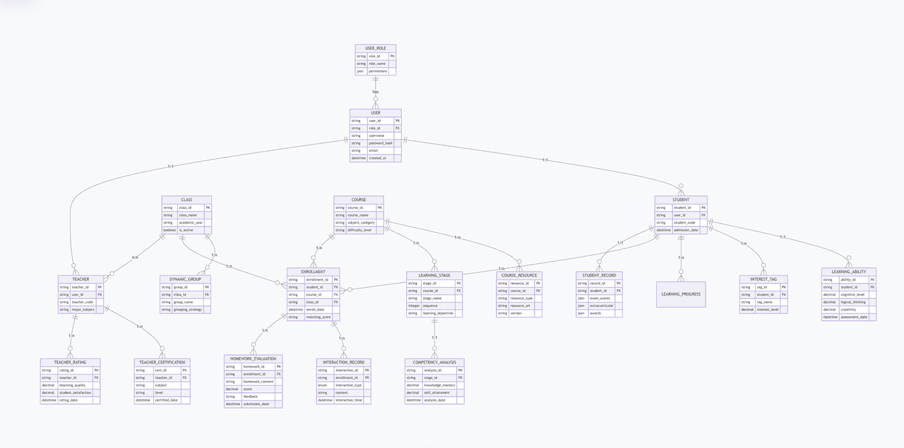

**❸评测分析**

在这个场景下，扣子空间得**1分**，艾莉同学得**5分**。

扣子空间经过几轮的对话，还是没能理解我想要的诉求，并且生成出来的内容有点答非所闻。

而在这个场景里，艾莉同学能很快速的生成我想要的ER关系图，并且提供了mermaid语法，所以这个场景里艾莉同学完胜。

然后我又去看了下他们生成的代码，应该是艾莉同学在代码里面，有嵌入了Mermaid组件，而扣子空间在这个部分还有比较大的空缺。

# 四、🖼创意策划团队-2大场景深度测评

文章的第四部分，来生成一些很有创意的内容，人类对好看的东西真是无法抗拒🧙🏻‍♀️

## 1、生成IP形象

### （1）场景剖析

测评Prompt如下：

```
设计一个甜品店的IP形象：

基础形态：拟人化马卡龙，顶层是贝雷帽

特征：
身体是双层马卡龙造型
不同口味对应不同性格色彩
戴着法式贝雷帽
系着条纹围裙

三视图 + 表情包系列：
烘焙快乐（星星眼，撒糖花）
口感失败（委屈扁嘴，帽子歪了）
得意自满（骄傲昂首，帽子翘起）
```

### （2）对比评测

**❶扣子空间**

任务预览：`https://space.coze.cn/s/U2AdrbkbVCM/`


**❷艾莉同学**

制作同款：[生成一个甜品店的IP形象](https://aily.feishu.cn/ai/ailyplay/create-conversation?source_from=feishu_card&query=%23%25E8%25AE%25BE%25E8%25AE%25A1%25E4%25B8%2580%25E4%25B8%25AA%25E7%2594%259C%25E5%2593%2581%25E5%25BA%2597%25E7%259A%2584IP%25E5%25BD%25A2%25E8%25B1%25A1%25EF%25BC%259A%2520%25E5%259F%25BA%25E7%25A1%2580%25E5%25BD%25A2%25E6%2580%2581%25EF%25BC%259A%25E6%258B%259F%25E4%25BA%25BA%25E5%258C%2596%25E9%25A9%25AC%25E5%258D%25A1%25E9%25BE%2599%25EF%25BC%258C%25E9%25A1%25B6%25E5%25B1%2582%25E6%2598%25AF%25E8%25B4%259D%25E9%259B%25B7%25E5%25B8%25BD%2520%25E7%2589%25B9%25E5%25BE%2581%25EF%25BC%259A%2520%25E8%25BA%25AB%25E4%25BD%2593%25E6%2598%25AF%25E5%258F%258C%25E5%25B1%2582%25E9%25A9%25AC%25E5%258D%25A1%25E9%25BE%2599%25E9%2580%25A0%25E5%259E%258B%2520%25E4%25B8%258D%25E5%2590%258C%25E5%258F%25A3%25E5%2591%25B3%25E5%25AF%25B9%25E5%25BA%2594%25E4%25B8%258D%25E5%2590%258C%25E6%2580%25A7%25E6%25A0%25BC%25E8%2589%25B2%25E5%25BD%25A9%2520%25E6%2588%25B4%25E7%259D%2580%25E6%25B3%2595%25E5%25BC%258F%25E8%25B4%259D%25E9%259B%25B7%25E5%25B8%25BD%2520%25E7%25B3%25BB%25E7%259D%2580%25E6%259D%25A1%25E7%25BA%25B9%25E5%259B%25B4%25E8%25A3%2599%2520%25E4%25B8%2589%25E8%25A7%2586%25E5%259B%25BE%2520%2B%2520%25E8%25A1%25A8%25E6%2583%2585%25E5%258C%2585%25E7%25B3%25BB%25E5%2588%2597%25EF%25BC%259A%2520%25E7%2583%2598%25E7%2584%2599%25E5%25BF%25AB%25E4%25B9%2590%25EF%25BC%2588%25E6%2598%259F%25E6%2598%259F%25E7%259C%25BC%25EF%25BC%258C%25E6%2592%2592%25E7%25B3%2596%25E8%258A%25B1%25EF%25BC%2589%2520%25E5%258F%25A3%25E6%2584%259F%25E5%25A4%25B1%25E8%25B4%25A5%25EF%25BC%2588%25E5%25A7%2594%25E5%25B1%2588%25E6%2589%2581%25E5%2598%25B4%25EF%25BC%258C%25E5%25B8%25BD%25E5%25AD%2590%25E6%25AD%25AA%25E4%25BA%2586%25EF%25BC%2589%2520%25E5%25BE%2597%25E6%2584%258F%25E8%2587%25AA%25E6%25BB%25A1%25EF%25BC%2588%25E9%25AA%2584%25E5%2582%25B2%25E6%2598%2582%25E9%25A6%2596%25EF%25BC%258C%25E5%25B8%25BD%25E5%25AD%2590%25E7%25BF%2598%25E8%25B5%25B7%25EF%25BC%2589)

任务预览：`https://aily.feishu.cn/ai/ailyplay/chat/shared/568da868-43fe-40d0-bb5e-d79ab883dedf`


**❸评测分析**

在这个场景里，扣子同学得**3分**，艾莉同学得**5分**。

艾莉同学很好的理解了三视图，并且有完整地生成了一套IP形象。而扣子空间生成的图片质量也不错，不过如果从提供的提示词来看，生成效果就还比较欠缺一些。

**❹请欣赏其他Case**

接着我又写了一些提示词，用艾莉同学再生成了一些IP形象的case，请欣赏：

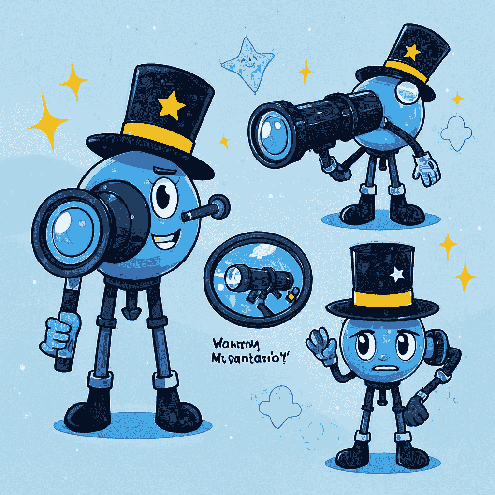


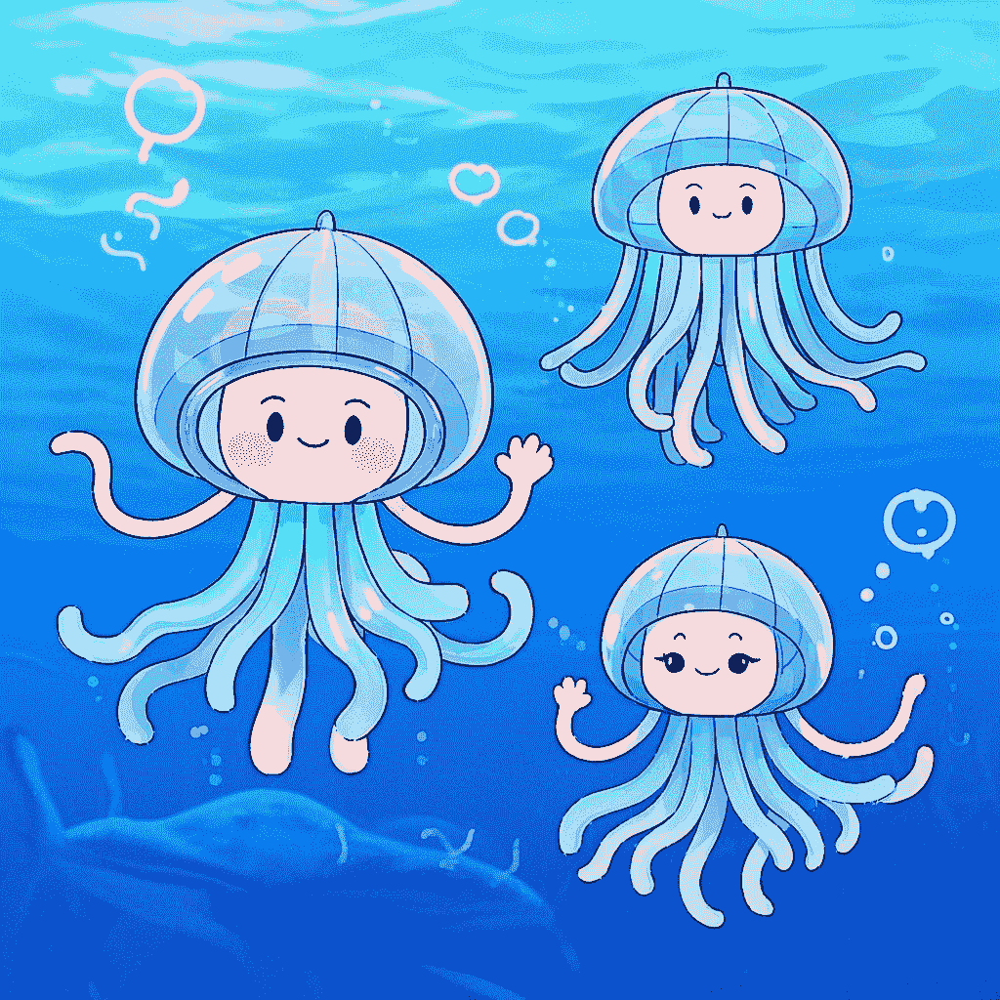

提示词预览戳这个链接：`https://aily.feishu.cn/ai/ailyplay/chat/shared/7703287b-3260-4578-b1b3-390cf5b850f3`

## 2、生成动态海报

### （1）场景剖析


动态海报的测评 Prompt 如下：

```
打造蒸汽朋克风格机械工坊网页，致敬19世纪工业革命，要求：

视觉风格：
主色：铜色/棕褐/蒸汽白，做旧纸张纹理背景，齿轮装饰边框
元素：蒸汽表盘、铜管、齿轮组、机械臂等工业革命元素
材质：金属拉丝纹理，铜锈效果，蒸汽烟雾

核心内容：
标题：「STEAMWORKS EMPORIUM」（维多利亚时代字体，带黄铜质感）

机械装置区：
中央放置大型齿轮组时钟
两侧配备蒸汽压力表
底部铺设蒸汽管道系统

互动特效：
齿轮随滚动持续转动
管道定期释放蒸汽效果
压力表指针实时摆动

技术实现：
字体使用古典装饰字体（如Steampunk）
SVG实现可动齿轮组件
CSS滤镜打造金属质感和做旧效果
音效：添加蒸汽机械运转声和齿轮咬合声
```

### （2）对比评测

#### ❶扣子空间

任务预览：`https://space.coze.cn/s/ZtUw6GnEJ2I/`

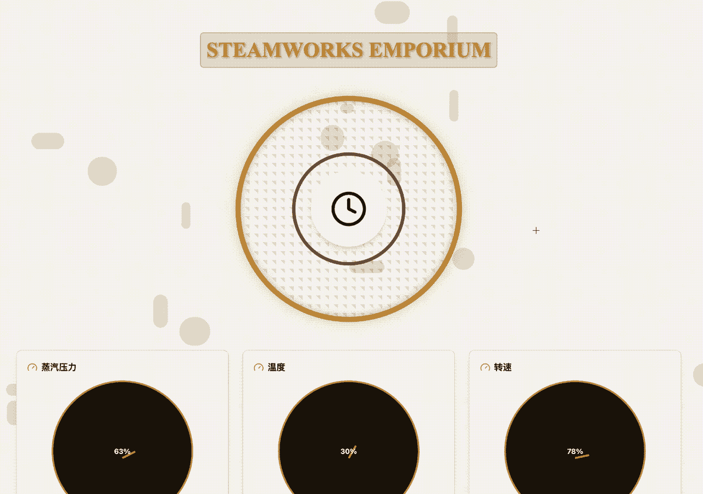

#### ❷艾莉同学

制作同款：[生成动态海报](https://aily.feishu.cn/ai/ailyplay/create-conversation?source_from=feishu_card&query=%23%25E6%2589%2593%25E9%2580%25A0%25E8%2592%25B8%25E6%25B1%25BD%25E6%259C%258B%25E5%2585%258B%25E9%25A3%258E%25E6%25A0%25BC%25E6%259C%25BA%25E6%25A2%25B0%25E5%25B7%25A5%25E5%259D%258A%25E7%25BD%2591%25E9%25A1%25B5%25EF%25BC%258C%25E8%2587%25B4%25E6%2595%25AC19%25E4%25B8%2596%25E7%25BA%25AA%25E5%25B7%25A5%25E4%25B8%259A%25E9%259D%25A9%25E5%2591%25BD%25EF%25BC%258C%25E8%25A6%2581%25E6%25B1%2582%25EF%25BC%259A%2520%25E8%25A7%2586%25E8%25A7%2586%25E9%25A3%258E%25E6%25A0%25BC%25EF%25BC%259A%2520%25E4%25B8%25BB%25E8%2589%25B2%25EF%25BC%259A%25E9%2593%259C%25E8%2589%25B2%2F%25E6%25A3%2595%25E8%25A4%2590%2F%25E8%2592%25B8%25E6%25B1%25BD%25E7%2599%25BD%25EF%25BC%258C%25E5%2581%259A%25E6%2597%25A7%25E7%25BA%25B8%25E5%25BC%25A0%25E7%25BA%25B9%25E7%2590%2586%25E8%2583%258C%25E6%2599%25AF%25EF%25BC%258C%25E9%25BD%25BF%25E8%25BD%25AE%25E8%25A3%2585%25E9%25A5%25B0%25E8%25BE%25B9%25E6%25A1%2586%2520%25E5%2585%2583%25E7%25B4%25A0%25EF%25BC%259A%25E8%2592%25B8%25E6%25B1%25BD%25E8%25A1%25A8%25E7%259B%2598%25E3%2580%2581%25E9%2593%259C%25E7%25AE%25A1%25E3%2580%2581%25E9%25BD%25BF%25E8%25BD%25AE%25E7%25BB%2584%25E3%2580%2581%25E6%259C%25BA%25E6%25A2%25B0%25E8%2587%2582%25E7%25AD%2589%25E5%25B7%25A5%25E4%25B8%259A%25E9%259D%25A9%25E5%2591%25BD%25E5%2585%2583%25E7%25B4%25A0%2520%25E6%259D%2590%25E8%25B4%25A8%25EF%25BC%259A%25E9%2587%2591%25E5%25B1%259E%25E6%258B%2589%25E4%25B8%259D%25E7%25BA%25B9%25E7%2590%2586%25EF%25BC%258C%25E9%2593%259C%25E9%2594%2588%25E6%2595%2588%25E6%259E%259C%25EF%25BC%258C%25E8%2592%25B8%25E6%25B1%25BD%25E7%2583%259F%25E9%259B%25BE%2520%25E6%25A0%25B8%25E5%25BF%2583%25E5%2586%2585%25E5%25AE%25B9%25EF%25BC%259A%2520%25E6%25A0%2587%25E9%25A2%2598%25EF%25BC%259A%25E3%2580%258CSTEAMWORKS%2520EMPORIUM%25E3%2580%258D%25EF%25BC%2588%25E7%25BB%25B4%25E5%25A4%259A%25E5%2588%25A9%25E4%25BA%259A%25E6%2597%25B6%25E4%25BB%25A3%25E5%25AD%2597%25E4%25BD%2593%25EF%25BC%258C%25E5%25B8%25A6%25E9%25BB%2584%25E9%2593%259C%25E8%25B4%25A8%25E6%2584%259F%25EF%25BC%2589%2520%25E6%259C%25BA%25E6%25A2%25B0%25E8%25A3%2585%25E7%25BD%25AE%25E5%258C%25BA%25EF%25BC%259A%2520%25E4%25B8%25AD%25E5%25A4%25AE%25E6%2594%25BE%25E7%25BD%25AE%25E5%25A4%25A7%25E5%259E%258B%25E9%25BD%25BF%25E8%25BD%25AE%25E7%25BB%2584%25E6%2597%25B6%25E9%2592%259F%2520%25E4%25B8%25A4%25E4%25BE%25A7%25E9%2585%2584%25E5%25A4%2587%25E8%2592%25B8%25E6%25B1%25BD%25E5%258E%258B%25E5%258A%259B%25E8%25A1%25A8%2520%25E5%25BA%2595%25E9%2583%25A8%25E9%2593%25BA%25E8%25AE%25BE%25E8%2592%25B8%25E6%25B1%25BD%25E7%25AE%25A1%25E9%2581%2593%25E7%25B3%25BB%25E7%25BB%259F%2520%25E4%25BA%2592%25E5%258A%25A8%25E7%2589%25B9%25E6%2595%2588%25EF%25BC%259A%2520%25E9%25BD%25BF%25E8%25BD%25AE%25E9%259A%258F%25E6%25BB%259A%25E5%258A%25A8%25E6%258C%2581%25E7%25BB%25AD%25E8%25BD%25AC%25E5%258A%25A8%2520%25E7%25AE%25A1%25E9%2581%2593%25E5%25AE%259A%25E6%259C%259F%25E9%2587%258A%25E6%2594%25BE%25E8%2592%25B8%25E6%25B1%25BD%25E6%2595%2588%25E6%259E%259C%2520%25E5%258E%258B%25E5%258A%259B%25E8%25A1%25A8%25E6%258C%2587%25E9%2592%2588%25E5%25AE%259E%25E6%2597%25B6%25E6%2591%2586%25E5%258A%25A8%2520%25E6%258A%2580%25E6%259C%25AF%25E5%25AE%259E%25E7%258E%25B0%25EF%25BC%259A%2520%25E5%25AD%2597%25E4%25BD%2593%25E4%25BD%25BF%25E7%2594%25A8%25E5%258F%25A4%25E5%2585%25B8%25E8%25A3%2585%25E9%25A5%25B0%25E5%25AD%2597%25E4%25BD%2593%25EF%25BC%2588%25E5%25A6%2582Steampunk%25EF%25BC%2589%2520SVG%25E5%25AE%259E%25E7%258E%25B0%25E5%258F%25AF%25E5%258A%25A8%25E9%25BD%25BF%25E8%25BD%25AE%25E7%25BB%2584%25E4%25BB%25B6%2520CSS%25E6%25BB%25A4%25E9%2595%259C%25E6%2589%2593%25E9%2580%25A0%25E9%2587%2591%25E5%25B1%259E%25E8%25B4%25A8%25E6%2584%259F%25E5%2592%258C%25E5%2581%259A%25E6%2597%25A7%25E6%2595%2588%25E6%259E%259C%2520%25E9%259F%25B3%25E6%2595%2588%25EF%25BC%259A%25E6%25B7%25BB%25E5%258A%25A0%25E8%2592%25B8%25E6%25B1%25BD%25E6%259C%25BA%25E6%25A2%25B0%25E8%25BF%2590%25E8%25BD%25AC%25E5%25A3%25B0%25E5%2592%258C%25E9%25BD%25BF%25E8%25BD%25AE%25E5%2592%25AC%25E5%25A3%25B0)

任务预览：`https://aily.feishu.cn/ai/ailyplay/chat/shared/e4ca8811-9003-4096-903e-fcd60363c81b`

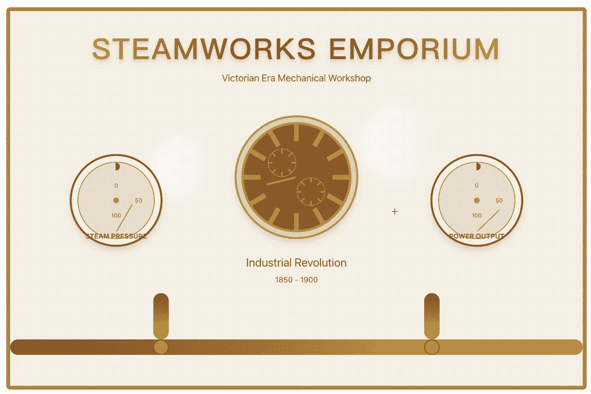

#### ❸评测分析

在这个场景里，艾莉同学和扣子空间各得3分。

它们俩生成的内容都中规中矩，还没有靠近提示词想要的那种vibe，但是呢，也说的过去，生成的页面也算比较中规中矩了。

# 五、💻每个人都是程序员-4大场景深度测评

## 1、官方门户网站

### （1）场景剖析

官方门户网站的测评 Prompt 如下：

```
帮我生成一个精品茶叶品牌官网，我的品牌叫「茗境」，是一个专注于新中式茶文化的高端品牌，要求：

品牌定位：
面向追求品质生活的都市白领和茶文化爱好者
强调传统工艺与现代美学的融合
产品包括各类高山名茶、茶器和茶空间体验

设计风格参考：
整体参考 Aesop 护肤品牌的极简美学
大量留白与高质感图片的结合
强调质地和细节的视觉呈现

核心页面内容：
首屏：
满屏视频：展示茶园晨雾、采茶、制茶工艺
简约标题：&quot;寻茶问道，品味人生&quot;
优雅过渡动效
品牌故事：
讲述百年制茶世家传承
展示核心制茶工艺
配以水墨风格插画
产品系列：
高山乌龙、白茶、普洱等系列展示
茶器与茶具设计
每个产品配以诗意文案
体验空间：
新中式茶室预约
品茶课程活动
茶艺师介绍

交互设计：
丝滑的滚动视差效果
优雅的hover状态变化
东方韵味的动效设计

技术要求：
响应式布局
图片懒加载优化
流畅的页面过渡
完美支持移动端浏览
```

### （2）对比评测

#### ❶扣子空间

任务预览：`https://space.coze.cn/s/zHVIKyuW7Ms/`

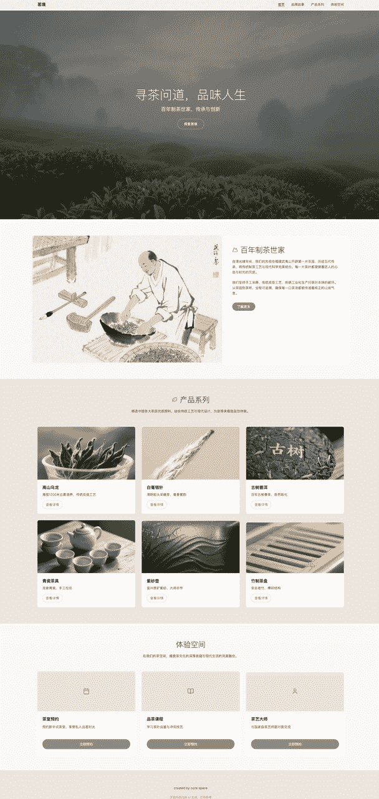

#### ❷艾莉同学


# 1、茗境官方门户网站

制作同款：[茗境官方门户网站](https://aily.feishu.cn/ai/ailyplay/create-conversation?source_from=feishu_card&query=%23%25E5%25B8%25AE%25E6%2588%2591%25E7%2594%259F%25E6%2588%2590%25E4%25B8%2580%25E4%25B8%25AA%25E7%25B2%25BE%25E5%2593%2581%25E8%258C%25B6%25E5%258F%25B6%25E5%2593%2581%25E7%2589%258C%25E5%25AE%2598%25E7%25BD%2591%25EF%25BC%258C%25E6%2588%2591%25E7%259A%2584%25E5%2593%2581%25E7%2589%258C%25E5%258F%25AB%25E3%2580%258C%25E8%258C%2597%25E5%25A2%2583%25E3%2580%258D%25EF%25BC%258C%25E6%2598%25AF%25E4%25B8%2580%25E4%25B8%25AA%25E4%25B8%2592%25E6%25B3%25A8%25E4%25BA%258E%25E6%2596%25B0%25E4%25B8%25AD%25E5%25BC%258F%25E8%258C%25B6%25E6%2596%2587%25E5%258C%2596%25E7%259A%2584%25E9%25AB%2598%25E7%25AB%25AF%25E5%2593%2581%25E7%2589%258C%25EF%25BC%258C%25E8%25A6%2581%25E6%25B1%2582%25EF%25BC%259A%2520%25E5%2593%2581%25E7%2589%258C%25E5%25AE%259A%25E4%25BD%258D%25EF%25BC%259A%2520%25E9%259D%25A2%25E5%2590%2591%25E8%25BF%25BD%25E6%25B1%2582%25E5%2593%2581%25E8%25B4%25A8%25E7%2594%259F%25E6%25B4%25BB%25E7%259A%2584%25E9%2583%25BD%25E5%25B8%2582%25E7%2599%25BD%25E9%25A2%2586%25E5%2592%258C%25E8%258C%25B6%25E6%2596%2587%25E5%258C%2596%25E7%2588%25B1%25E5%25A5%25BD%25E8%2580%2585%2520%25E5%25BC%25BA%25E8%25B0%2583%25E4%25BC%25A0%25E7%25BB%259F%25E5%25B7%25A5%25E8%2589%258A%25E4%25B8%258E%25E7%258E%25B0%25E4%25BB%25A5%25E7%25BE%258E%25E5%25AD%25A6%25E7%259A%2584%25E8%259E%258D%25E5%2590%2588%2520%25E4%25BA%25A7%25E5%2593%2581%25E5%258C%2585%25E6%258B%25AC%25E5%2590%2584%25E7%25B1%25CC%25E5%25B1%25B1%25E5%2590%258D%25E8%258C%25B6%25E3%2580%2581%25E8%258C%25B6%25E5%2599%25A8%25E5%2592%258C%25E8%258C%25B6%25E7%25A9%25BA%25E9%2597%25B4%25E4%25BD%2593%25E9%25AA%258C%2520%25E8%25AE%25BE%25E8%25AE%25A1%25E9%25A3%258E%25E6%25A0%25BC%25E5%258F%2582%25E8%2580%2583%25EF%25BC%259A%2520%25E6%2595%25B4%25E4%25BD%2593%25E5%258F%2582%25E8%2580%2583%2520Aesop%2520%25E6%258A%25A4%25E8%2582%25A4%25E5%2593%2581%25E7%2589%258C%25E7%259A%2584%25E6%259E%2581%25E7%25AE%2580%25E7%25BE%258E%25E5%25AD%25A6%2520%25E5%25A4%25A7%25E9%2587%258F%25E7%2595%2599%25E7%2599%25BD%25E4%25B8%258E%25E9%25AB%2598%25E8%25B4%25A8%25E6%2584%259F%25E5%259B%25BE%25E7%2589%2587%25E7%259A%2584%25E7%25BB%2593%25E5%2590%2588%2520%25E5%25BC%25BA%25E8%25B0%2583%25E8%25B4%25A8%25E5%259C%25B0%25E5%2592%258C%25E7%25BB%2586%25E8%258A%258E%25E7%259A%2584%25E8%25A7%2586%25E8%25A7%2580%25E5%2591%2588%25E7%258E%25B0%2520%25E6%25A0%25B8%25E5%25BF%2583%25E9%25A1%25B5%25E9%259D%25A2%25E5%2586%2585%25E5%25AE%25B9%25EF%25BC%259A%2520%25E9%25A6%2596%25E5%25B1%258F%25EF%25BC%259A%2520%25E6%25BB%25A1%25E5%25B1%258F%25E8%25A7%2586%25E9%25A2%2591%25EF%25BC%2589%25E5%25B1%2595%25E7%25A4%25BA%25E8%258C%25B6%25E5%259B%25AD%25E6%2599%25A8%25E9%259B%25BE%25E3%2580%2581%25E9%2587%2587%25E8%258C%25B6%25E3%2580%2581%25E5%2588%25B6%25E8%258C%25B6%25E5%25B7%25A5%25E8%2589%258A%2520%25E7%25AE%2580%25E7%25BA%25A6%25E6%25A0%2587%25E9%25A2%2598%25EF%25BC%259A%2522%25E5%25AF%25BB%25E8%258C%25B6%25E9%2597%25AE%25E9%2581%2593%25EF%25BC%258C%25E5%2593%2581%25E5%2591%25B3%25E4%25BA%25BA%25E7%2594%259F%2522%2520%25E4%25BC%2598%25E9%259B%2585%25E8%25BF%2587%25E6%25B8%25A1%25E5%258A%25A8%25E6%2595%2588%2520%25E5%2593%2581%25E7%2589%258C%25E6%2595%2585%25E4%25BA%258B%25EF%25BC%259A%2520%25E8%25AE%25B2%25E8%25BF%25B0%25E7%2599%25BE%25E5%25B9%25B4%25E5%2588%25B6%25E8%258C%25B6%25E4%25B8%2596%25E5%25AE%25B6%25E4%25BC%25A0%25E6%2589%25BE%2520%25E5%25B1%2595%25E7%25A4%25BA%25E6%25A0%25B8%25E5%25BF%2583%25E5%2588%25B6%25E8%258C%25B6%25E5%25B7%25A5%25E8%2589%258A%2520%25E9%2585%258D%25E4%25BB%25A5%25E6%25B0%25B4%25E5%25A2%25A8%25E9%25A3%258E%25E6%25A0%25BC%25E6%258F%2592%25E7%2594%25BB%2520%25E4%25BA%25A7%25E5%2593%2581%25E7%25B3%25BB%25E5%2588%2597%25EF%25BC%259A%2520%25E9%25AB%2598%25E5%25B1%25B1%25E4%25B9%258C%25E9%25BE%2599%25E3%2580%2581%25E7%2599%25BD%25E8%258C%25B6%25E3%2580%2581%25E6%2599%25AE%25E6%25B4%25B1%25E7%25AD%2589%25E7%25B3%25BB%25E5%2588%2597%25E5%25B1%2595%25E7%25A4%25BA%2520%25E8%258C%25B6%25E5%2599%25A8%25E4%25B8%258E%25E8%258C%25B6%25E5%2585%25B7%25E8%25AE%25BE%25E8%25AE%25A1%2520%25E6%25AF%258F%25E4%25B8%25AA%25E4%25BA%25A7%25E5%2593%2581%25E9%2585%258D%25E4%25BB%25A5%25E8%25AF%2597%25E6%2584%258F%25E6%2596%2587%25E6%25A1%2588%2520%25E4%25BD%2593%25E9%25AA%258C%25E7%25A9%25BA%25E9%2597%25B4%25EF%25BC%259A%2520%25E6%2596%25B0%25E4%25B8%25AD%25E5%25BC%258F%25E8%258C%25B6%25E5%25AE%25A4%25E9%25A2%2584%25E7%25BA%25A6%2520%25E5%2593%2581%25E8%258C%25B6%25E8%25AF%25BE%25E7%25A8%258B%25E6%25B4%25BB%25E5%258A%25A8%2520%25E8%258C%25B6%25E8%2589%258A%25E5%25B8%2588%25E4%25BB%25BB%25E4%25BB%258D%2520%25E4%25BA%25A4%25E4%25BA%2592%25E8%25AE%25BE%25E8%25AE%25A1%25EF%25BC%259A%2520%25E4%25B8%259D%25E6%25BB%2591%25E7%259A%2584%25E6%25BB%259A%25E5%258A%25A8%25E8%25A7%2586%25E5%25B7%25AE%25E6%2595%2588%25E6%259E%259C%2520%25E4%25BC%2598%25E9%259B%2585%25E7%259A%2584hover%25E7%258A%25B6%25E6%2580%2581%25E5%258F%2598%25E5%258C%2596%2520%25E4%25B8%259C%25E6%2596%25B9%25E9%259F%25B5%25E5%2591%25B3%25E7%259A%2584%25E5%258A%25A8%25E6%2595%2588%25E8%25AE%25BE%25E8%25AE%25A1%2520%25E6%258A%2580%25E6%259C%25AF%25E8%25A6%2581%25E6%25B1%2582%25EF%25BC%259A%2520%25E5%2593%258A%25E5%25BA%2594%25E5%25BC%258F%25E5%25B8%2583%25E5%25B1%2580%2520%25E5%259B%25BE%25E7%2589%2587%25E6%2587%2592%25E5%258A%25A0%25E8%25BD%25BB%25E4%25BC%2598%25E5%258C%2596%2520%25E6%25B5%2581%25E7%2595%2585%25E7%259A%2584%25E9%25A1%25B5%25E9%259D%25A2%25E8%25BF%2587%25E6%25B8%25A1%2520%25E5%25AE%258C%25E7%25BE%258E%25E6%2594%25AF%25E6%258C%2581%25E7%25A7%25BB%25E5%258A%25A8%25E7%25AB%25AF%25E6%25B5%258F%25E8%25A7%2588)

任务预览：`https://aily.feishu.cn/ai/ailyplay/pages/4gcgtgxvp5xf0`

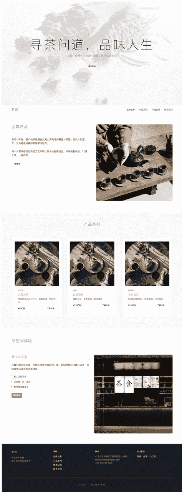

## ❸评测分析

在这个场景里，艾莉同学和扣子空间各得4分。

它们俩生成的页面，基本都符合门户网站的展现形态，各有其中的特色。

# 2、提示词社区

## （1）场景剖析

提示词社区的测评 Prompt 如下：

```
帮我设计一个提示词社区，支持用户投稿自己的prompt和效果图，如无图支持ai生图，同时投稿后的作品在社区上支持快速“剪同款”和点赞。
```

## （2）对比评测

### ❶扣子空间

任务预览：[扣子空间](https://space.coze.cn/s/YZeJ1DJF2KE/)

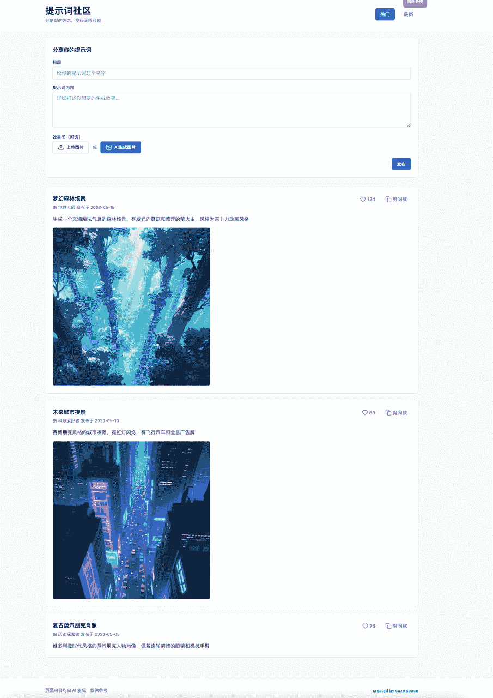

### ❷艾莉同学

任务预览：[艾莉同学](https://aily.feishu.cn/ai/ailyplay/pages/4ga8v9gx34y3y)

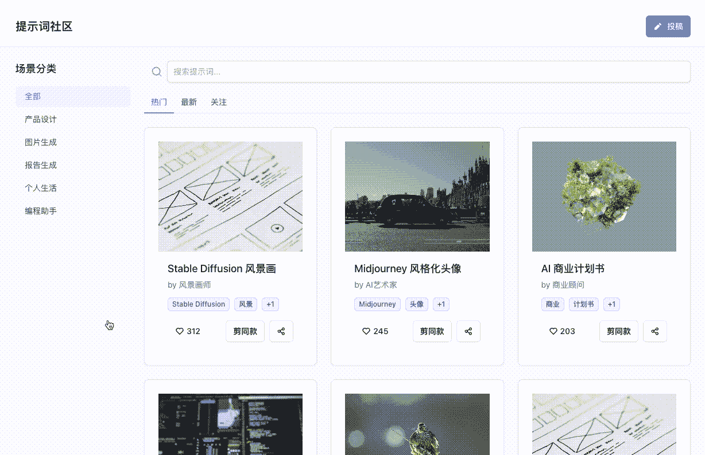

### ❸评测分析

在这个场景里，扣子空间得2分，艾莉同学得5分。

如果是从社区的角度来看，艾莉同学的UI页面，可能更符合用户更快速地去浏览一些内容。同时，艾莉同学把投稿的入口放在了右上角，并以弹窗的形式去进行呈现。这个交互对于用户来说，能够极大程度地降低用户的心智负担，并且同时还可以快速完成投稿这个操作。

# 3、消遣小游戏

## （1）场景剖析

消遣小游戏的测评 Prompt 如下：

```
帮我做个2048小游戏，要有比较多的互动。
```

## （2）对比评测

### ❶扣子空间

任务预览：`https://space.coze.cn/s/qnQzfb-7wkY/`

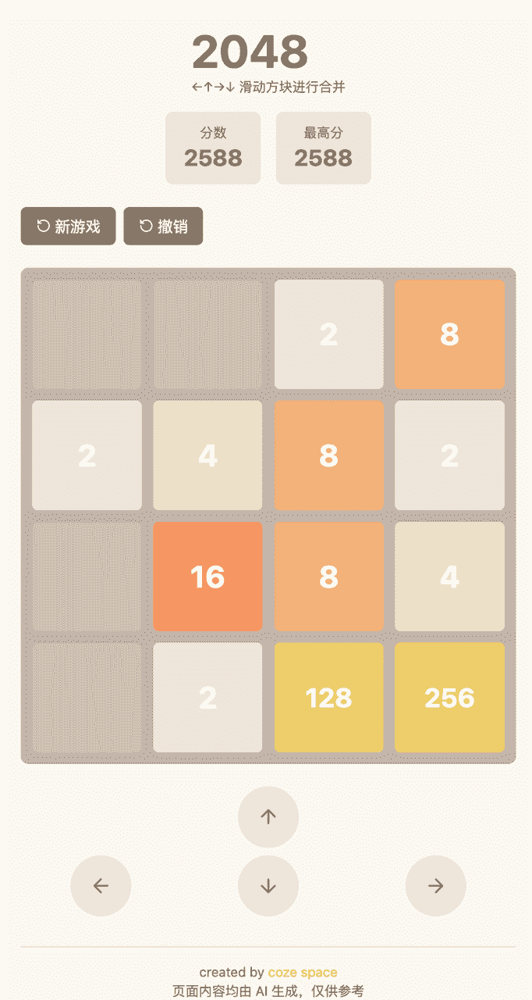

### ❷艾莉同学

制作同款：[2048消遣小游戏](https://aily.feishu.cn/ai/ailyplay/create-conversation?source_from=feishu_card&query=%23%25E5%25B8%25AE%25E6%2588%2591%25E5%2581%259A%25E4%25B8%25AA2048%25E5%25B0%258F%25E6%25B8%25B8%25E6%2588%258F%25EF%25BC%258C%25E8%25A6%2581%25E6%259C%2589%25E6%25AF%2594%25E8%25BE%2583%25E5%25A4%259A%25E7%259A%2584%25E4%25BA%2592%25E5%258A%25A8%25E3%2580%2582)

任务预览：`https://aily.feishu.cn/ai/ailyplay/chat/shared/a85263ab-f8e9-4f87-b04d-27d91f4ee54a`

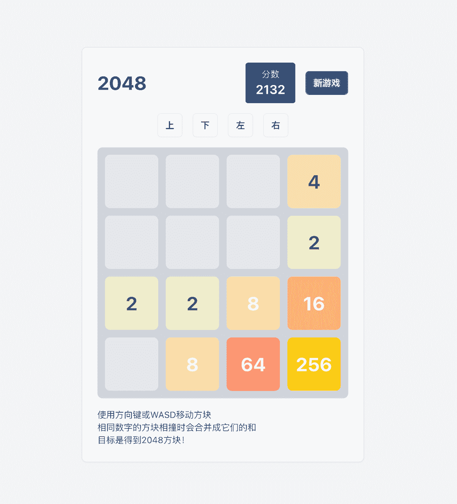

### ❸评测分析

在这个场景下，扣子空间和艾莉同学均得5分。

它们俩都能很好的完成这个游戏应有的逻辑，并且还有一些小互动在里面，很心水了。闲暇娱乐小助手~☺️

这里再提供一些小游戏的灵感：超级马里奥、推箱子、贪吃蛇。

# 4、个人博客

## （1）场景剖析

日常生活中，每个人都会喜欢写自己的个人博客。换在以前，我们可能要先理解怎么装环境，怎么做部署，怎么桥接服务器等等。

但现在，只要给 AI 写对应的Prompt，就能够很快速的生成想要的博客页面，并且还能快速进行微调。

那下面，我们就从飞行社随机挑选一名幸运网友的个人说明书，来生成一个个人主页。具体评测Prompt如下：

```
根据我上传的个人说明书文档，帮我制作一个个人主页。
```

## （2）对比评测

### ❶扣子空间

任务预览：Zoey个人说明书制作个人主页相关内容

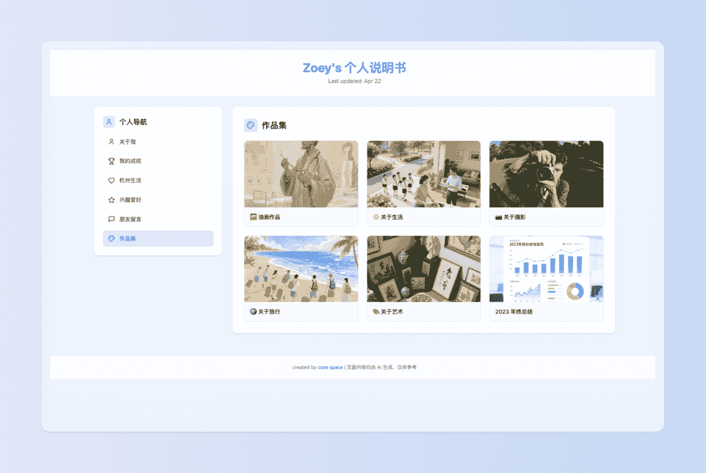

### ❷艾莉同学

剪辑同学：[生成个人主页](https://aily.feishu.cn/ai/ailyplay/create-conversation?source_from=feishu_card&query=%23%25E6%25A0%25B9%25E6%258D%25AE%25E6%2588%2591%25E4%25B8%258A%25E4%25BC%25A0%25E7%259A%2584%25E4%25B8%25AA%25E4%25BA%25BA%25E8%25AF%25B4%25E6%2598%258E%25E4%25B9%25A6%25E6%2596%2587%25E6%25A1%25A3%25EF%25BC%258C%25E5%25B8%25AE%25E6%2588%2591%25E5%2588%25B6%25E4%25BD%259C%25E4%25B8%2580%25E4%25B8%25AA%25E4%25BA%25AA%25E4%25BA%25BA%25E4%25B8%25BB%25E9%25A1%25B5%25E3%2580%2582)


任务预览：[h](https://aily.feishu.cn/ai/ailyplay/pages/4gaa8prehjym1) `https://aily.feishu.cn/ai/ailyplay/pages/4gaa8prehjym1`

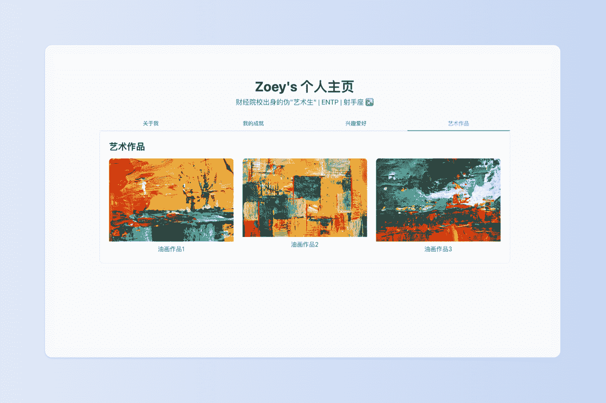

### ❸评测分析

在这个场景里，扣子空间得5分，艾莉同学得3.5分。

扣子空间有把Zoey个人说明书的评论也展示出来，并且内容相对比较丰富一些。而艾莉同学基本内容也展示出来了，但是一些细节做的还不太到位。

不过在跟艾莉同学对话的过程中，发现它可以直接找到飞书上的公开文档，然后进行上传，这个用起来就很方便。所以在这一点上，如果是要基于飞书的基础物料去做对话时，那艾莉同学也有一些天然的优势。


# 六、🎨生活里的一抹色彩-2大场景深度测评

## 1、你的旅游好搭子

### （1）场景剖析

每逢一到节假日，我们是不是经常会约上三五好友，出门去玩。如果一个团队里面都是P人，那这个旅游攻略做起来估计就会比较痛苦。

那现在有了 AI 以后，是不是有可能让 AI 来帮我们做下这个旅游攻略🛰。来欣赏下即将做评测的Prompt：

```
请根据以下信息制定详细的旅行行程规划：
目的地：日本
行程天数：5天
旅行偏好：快乐游玩，实践上不要安排的太挤

请提供以下内容：
1. 详细的每日行程安排，包括：
- 精确到小时的时间安排
- 景点间交通指引
- 各项活动所需时间预估
- 应对天气变化的备选方案

2. 美食推荐清单：
- 不容错过的当地特色美食
- 具体餐厅推荐及价格区间
- 订位建议及注意事项

3. 交通出行指南：
- 主要交通路线规划
- 景点间步行距离
- 推荐出行方式

请确保所有推荐均基于最新信息，并考虑季节性因素。输出格式需包含可交互地图界面，支持实时导航功能。
如遇到可能需要实地确认的信息（如营业时间变更、季节性关闭等），请做特别标注。在规划时需考虑安全性和可及性。
```

### （2）对比评测

#### ❶扣子空间

任务预览：`https://space.coze.cn/s/1c4a0-vbre0/`

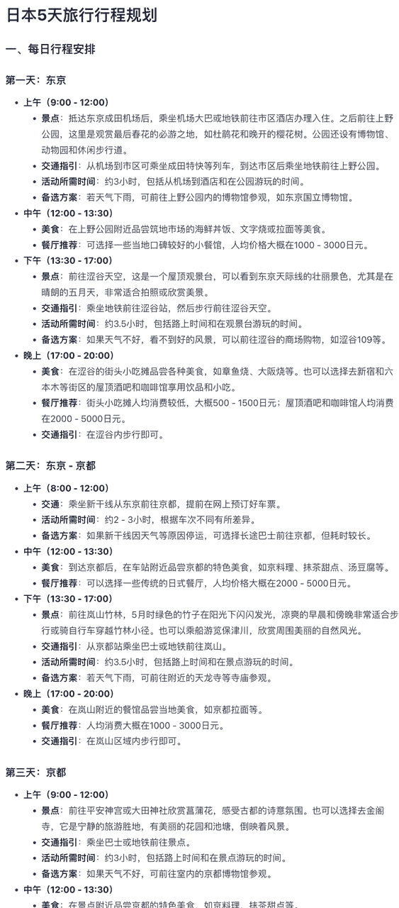

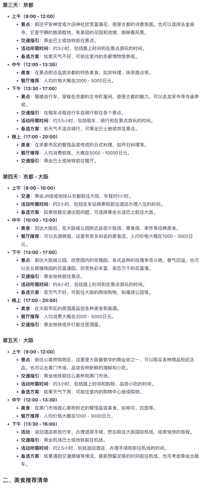

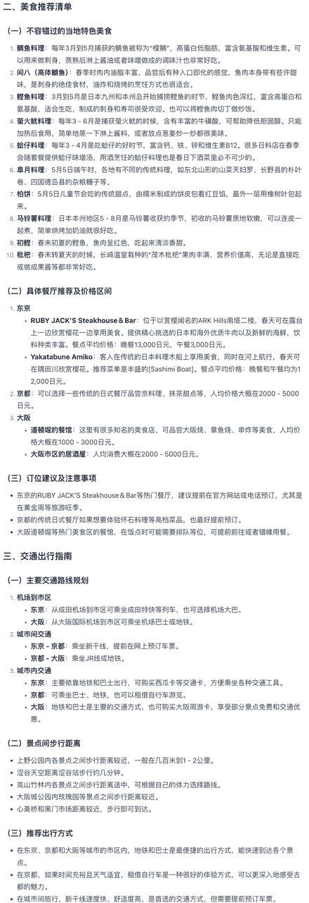

#### ❷艾莉同学

制作同款：[你的旅游好搭子](https://aily.feishu.cn/ai/ailyplay/create-conversation?source_from=feishu_card&query=%23%25E8%25AF%25B7%25E6%25A0%25B9%25E6%258D%25AE%25E4%25BB%25A5%25E4%25B8%258B%25E4%25BF%25A1%25E6%2581%25AF%25E5%2588%25B6%25E5%25AE%259A%25E8%25AF%25A6%25E7%25BB%2586%25E7%259A%2584%25E6%2597%2585%25E8%25A1%258C%25E8%25A1%258C%25E7%25A8%258B%25E8%25A7%2584%25E5%2588%2592%25EF%25BC%259A%2520%25E7%259B%25AE%25E7%259A%2584%25E5%259C%25B0%25EF%25BC%259A%25E6%2597%25A5%25E6%259C%25AC%2520%25E8%25A1%258C%25E7%25A8%258B%25E5%25A4%25A9%25E6%2595%25B0%25EF%25BC%259A5%25E5%25A4%25A9%2520%25E6%2597%2585%25E8%25A1%258C%25E5%2581%258F%25E5%25A5%25BD%25EF%25BC%259A%25E5%25BF%25AB%25E4%25B9%2590%25E6%25B8%25B8%25E7%258E%25A9%25EF%25BC%258C%25E5%25AE%259E%25E8%25B7%25B5%25E4%25B8%258A%25E4%25B8%258D%25E8%25A6%2581%25E5%25AE%2589%25E6%258E%2592%25E7%259A%2584%25E5%25A4%25AA%25E6%258C%25A4%2520%25E8%25AF%25B7%25E6%258F%2590%25E4%25BE%259B%25E4%25BB%25A5%25E4%25B8%258B%25E5%2586%2585%25E5%25AE%25B9%25EF%25BC%259A%25201.%2520%25E8%25AF%25A6%25E7%25BB%2586%25E7%259A%2584%25E6%25AF%2584%25E6%2597%25A5%25E8%25A1%258C%25E7%25A8%258B%25E5%25AE%2589%25E6%258E%2592%25EF%25BC%258C%25E5%258C%2585%25E6%258B%25AC%25EF%25BC%259A%2520-%2520%25E7%25B2%25BE%25E7%25A1%25AE%25E5%2588%25B0%25E5%25B0%258F%25E6%2597%25B6%25E7%259A%2584%25E6%2597%25B6%25E9%2597%25B4%25E5%25AE%2589%25E6%258E%2592%2520-%2520%25E6%2599%25AF%25E7%2582%25B9%25E9%2597%25B4%25E4%25BA%25A4%25E9%2580%259A%25E6%258C%2587%25E5%25BC%2595%2520-%2520%25E5%2590%2584%25E9%25A1%25B9%25E6%25B4%25BB%25E5%258A%25A8%25E6%2589%2580%25E9%259C%2580%25E6%2597%25B6%25E9%2597%25B4%25E9%25A2%2584%25E4%25BC%25B0%2520-%2520%25E5%25BA%2594%25E5%25AF%25B9%25E5%25A4%25A9%25E6%25B0%2594%25E5%258F%2598%25E5%258C%2596%25E7%259A%2584%25E5%25A4%2587%25E9%2580%2589%25E6%2596%25B9%25E6%25A1%2588%25202.%2520%25E7%25BE%258E%25E9%25A3%259F%25E6%258E%25A8%25E8%258D%2590%25E6%25B8%2585%25E5%258D%2595%25EF%25BC%259A%2520-%2520%25E4%25B8%258D%25E5%25AE%25B9%25E9%2594%2599%25E8%25BF%2587%25E7%259A%2584%25E5%25BD%2593%25E5%259C%25B0%25E7%2589%25B9%25E8%2589%25B2%25E7%25BE%258E%25E9%25A3%259F%2520-%2520%25E5%2585%25B3%25E4%25BD%259C%25E4%25BD%259C%25E4%25BD%259C%25E5%258E%2585%25E6%258E%25A8%25E8%258D%2590%25E5%258F%258A%25E4%25BB%25B7%25E6%25A0%25BC%25E5%258C%25BA%25E9%2597%25B4%2520-%2520%25E8%25AE%25A2%25E4%25BD%258D%25E5%25BB%25BA%25E8%25AE%25AE%25E5%258F%258A%25E6%25B3%25A8%25E6%2584%258F%25E4%25BA%258B%25E9%25A1%25B9%25203.%2520%25E4%25BA%25A4%25E9%2580%259A%25E5%2587%25BA%25E8%25A1%258C%25E6%258C%2587%25E5%258D%2597%25EF%25BC%259A%2520-%2520%25E4%25B8%25BB%25E8%25A6%2581%25E4%25BA%25A4%25E9%2580%259A%25E8%25B7%25AF%25E7%25BA%25BF%25E8%25A7%2584%25E5%2588%2592%2520-%2520%25E6%2599%25AF%25E7%2582%25B9%25E9%2597%25B4%25E6%25AD%25A5%25E8%25A1%258C%25E8%25B7%259D%25E7%25A6%25BB%2520-%2520%25E6%258E%25A8%25E8%258D%2590%25E5%2587%25BA%25E8%25A1%258C%25E6%2596%25B9%25E5%25BC%258F%2520%25E8%25AF%25B7%25E7%25A1%258C%25E4%25BF%259D%25E6%2589%2580%25E6%259C%2589%25E6%258E%25A8%25E8%258D%2590%25E5%259D%2587%25E5%259F%25BA%25E4%25BA%258E%25E6%259C%2580%25E6%2596%25B0%25E4%25BF%25A1%25E6%2581%25AF%25EF%25BC%258C%25E5%25B9%25B6%25E8%2580%2583%25E8%2599%2591%25E5%25AD%25A3%25E8%258A%2582%25E6%2580%25A7%25E5%259B%25A0%25E7%25B4%25A0%25E3%2580%2582%25E8%25BE%2593%25E5%2587%25BA%25E6%25A0%25BC%25E5%25BC%258F%25E9%259C%2580%25E5%258C%2585%25E5%2590%25AB%25E5%258F%25AF%25E4%25BA%25A4%25E4%25BA%2592%25E5%259C%25B0%25E5%259B%25BE%25E7%2595%258C%25E9%259D%25A2%25EF%25BC%258C%25E6%2594%25AF%25E6%258C%2581%25E5%25AE%259E%25E6%2597%25B6%25E5%25AF%25BC%25E8%2588%25AA%25E5%258A%259F%25E8%2583%25BD%25E3%2580%2582%2520%25E5%25A6%2581%25E9%2581%2587%25E5%2588%25B0%25E5%258F%25AF%25E8%2583%25BD%25E9%259C%2580%25E8%25A6%2581%25E5%25AE%259E%25E5%259C%25B0%25E7%25A1%25AE%25E8%25AE%25A4%25E7%259A%2584%25E4%25BF%25A1%25E6%2581%25AF%25EF%25BC%2588%25E5%25A6%2581%25E8%2590%25A5%25E4%25B8%259A%25E6%2597%25B6%25E9%2597%25B4%25E5%258F%2598%25E6%259B%25B4%25E3%2580%2581%25E5%25AD%25A3%25E8%258A%2582%25E6%2580%25A7%25E5%2585%25B3%25E9%2597%25AD%25E7%25AD%2589%25EF%25BC%2589%25EF%25BC%258C%25E8%25AF%25B7%25E5%2581%259A%25E7%2589%25B9%25E5%2588%25AB%25E6%25A0%2587%25E6%25B3%25A8%25E3%2580%2582%25E5%259C%25A8%25E8%25A7%2584%25E5%2588%2592%25E6%2597%25B6%25E9%259C%2580%25E8%2580%2583%25E8%2599%2591%25E5%25AE%2589%25E5%2585%25A8%25E6%2580%25A7%25E5%2592%258C%25E5%258F%25AF%25E5%258F%258A%25E6%2580%25A7%25E3%2580%2582)

任务预览：`https://aily.feishu.cn/ai/ailyplay/chat/shared/a01e15e3-06dd-4471-b506-727df179b40b`

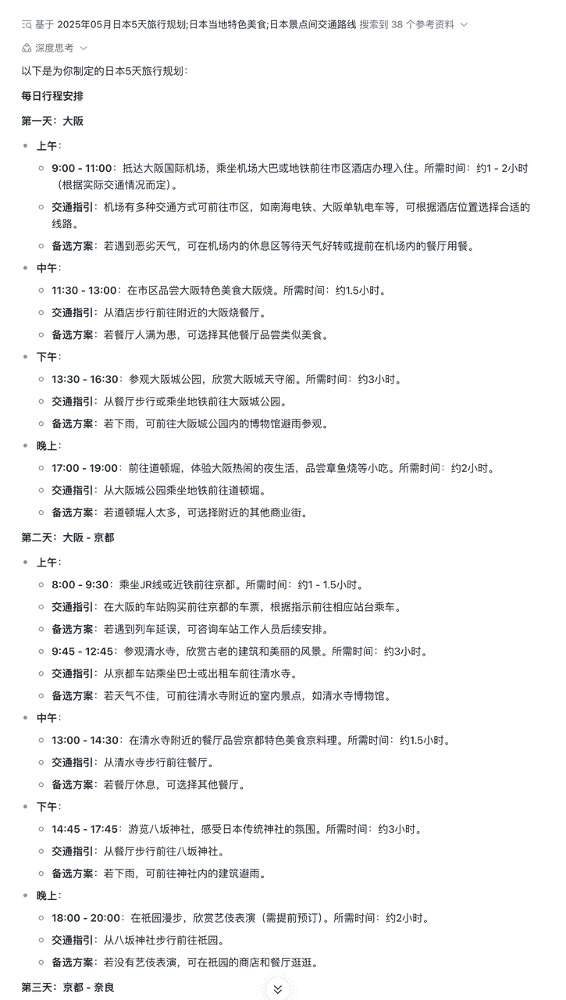

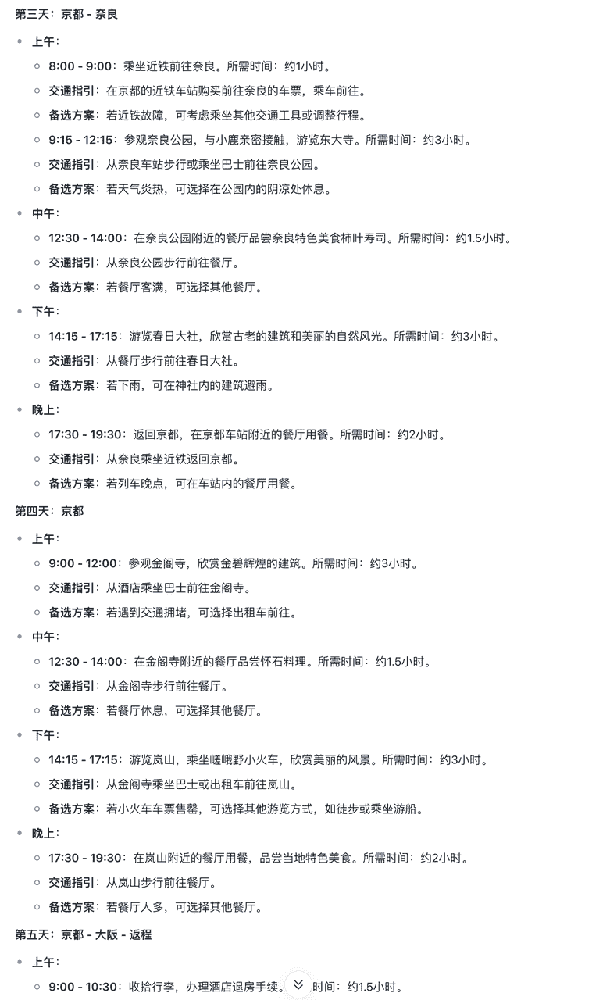

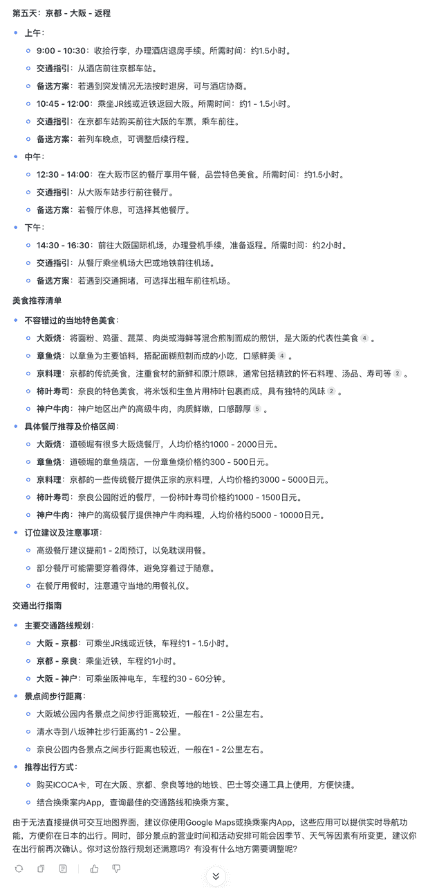

#### ❸评测分析

在这个场景里，扣子空间和艾莉同学，生成的都不错，都很细致，评分的话，个人觉得都可以给5分。

它们分别从每日行程安排、美食推荐清单、交通出行指南三个方面，给我们梳理了一份非常详细的日本旅游攻略指南。此刻感觉，这个东西就是P人出行的福音，太快乐了~

## 2、生成团建方案

### （1）提示词分析

```
我在上海工作，现在想要策划一个1天的创意团建，一共有15个人，预算12000元，目标是提升团队和部门之间的协作。
```

### （2）对比评测

#### ❶扣子空间

任务预览：`https://space.coze.cn/s/3308lG0FDpU/`

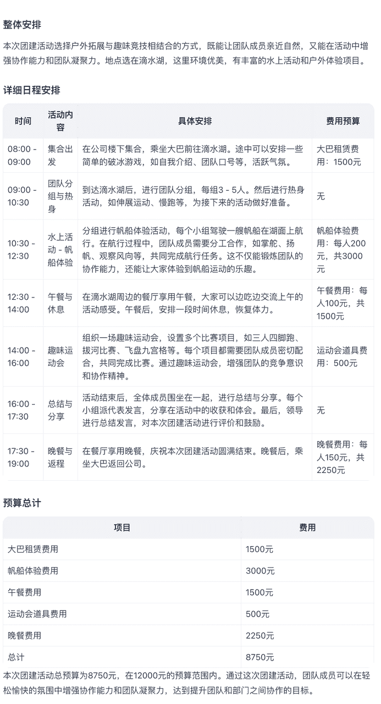

#### ❷艾莉同学

制作同款：[生成团建方案](https://aily.feishu.cn/ai/ailyplay/create-conversation?source_from=feishu_card&query=%23%25E6%2588%2591%25E5%259C%25A8%25E4%25B8%258A%25E6%25B5%25B7%25E5%25B7%25A5%25E4%25BD%259C%25EF%25BC%258C%25E7%258E%25B0%25E5%259C%25A8%25E6%2583%25B3%25E8%25A6%2581%25E7%25AD%2596%25E5%2588%2592%25E4%25B8%2580%25E4%25B8%25AA1%25E5%25A4%25A9%25E7%259A%2584%25E5%2588%259A%25E6%2584%258F%25E5%259B%25A2%25E5%25BB%25BA%25EF%25BC%258C%25E4%25B8%2580%25E5%2585%25B1%25E6%259C%258915%25E4%25B8%25AA%25E4%25BA%25BA%25EF%25BC%258C%25E9%25A2%2584%25E7%25AE%259712000%25E5%2585%2583%25EF%25BC%258C%25E7%259B%25AE%25E6%25A0%2587%25E6%2598%25AF%25E6%258F%2590%25E5%258D%2587%25E5%259B%25A2%25E9%2598%259F%25E5%2592%258C%25E9%2583%25A8%25E9%2597%25A8%25E4%25B9%258B%25E9%2597%25B4%25E7%259A%2584%25E5%258D%258F%25E4%25BD%259C%25E3%2580%2582)

任务预览：`https://aily.feishu.cn/ai/ailyplay/chat/shared/acfa0ede-2627-4d54-a411-249a75e4ff46`

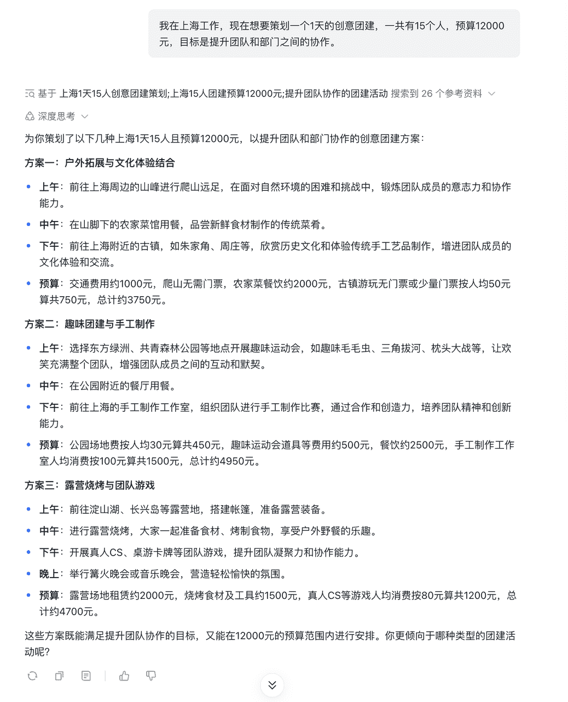

#### ❸评测分析

在这个场景里，艾莉同学和扣子空间均得5分。

艾莉同学给出了多个方案可以进行选择，而扣子空间则只给了一个方案，但是扣子空间把时间线进行了细化。它们俩各有其优点，所以在这个场景都还不错。

# 七、🗝测评效果对比

## 1、评分总结

**教育场景：**

| **场景** | **扣子空间** | **艾莉同学** |

| --- | --- | --- |

| 儿童生命起源绘本创作 | **4.5** | 3.5 |

| 小学数学趣味教学 | 3.5 | **4.5** |

| 大学英语口语AI陪练 | 4.0 | 4.0 |

**职场办公场景：**

| **场景** | **扣子空间** | **艾莉同学** |

| --- | --- | --- |

| 行业报告助手 | 4.0 | 4.0 |

| 职业发展规划助手 | **4.5** | 3.0 |

| 生成ER图-实体关系图 | 1.0 | **5.0** |

**创意策划场景：**

| **场景** | **扣子空间** | **艾莉同学** |

| --- | --- | --- |

| 生成IP形象 | 3.0 | **5.0** |

| 生成动态海报 | 3.0 | 3.0 |

**页面设计场景：**

| **场景** | **扣子空间** | **艾莉同学** |

| --- | --- | --- |

| 官方门户网站 | 4.0 | 4.0 |

| 提示词社区 | 2.0 | **5.0** |

| 消遣小游戏 | **5.0** | **5.0** |

| 个人博客 | **5.0** | 3.5 |

**快乐生活场景：**

| **场景** | **扣子空间** | **艾莉同学** |


| 你的旅游好搭子 | **5.0** | **5.0** |

| 生成团建方案 | **5.0** | **5.0** |

## 2、功能总结

再来做一个功能总结：

| **功能点** | **扣子空间** | **艾莉同学** | **差异分析** |

| --- | --- | --- | --- |

| 纯文成生成能力 | 5.0 | 5.0 | 两者对于文成生成类的对话，都完成的不错，并且细节处理的也都不错 |

| 图片并发能力 | 5.0 | 3.0 | 扣子空间能够一次性生成很多张图片，艾莉同学一次性最多只能生成2-4张图片，会增加调试的时间。 |

| 任务规划能力 | 5.0 | 3.0 | 扣子空间的任务生成过程，展示的更完整 |

| 组件丰富度能力 | 5.0 | 3.0 | 扣子空间有多个MCP扩展，艾莉同学 |

| 页面生成能力 | 4.0 | 4.0 | 两者的页面生成能力都不错，只不过各自支持的组件丰富度不一样 |

| 垂直生态融合 | 2.0 | 5.0 | 扣子空间：融合已公开的插件功能，垂类内容比较少。 |

| 组件稳定性 | 3.0 | 5.0 | 扣子空间：第三方插件不稳定，会导致Agent不稳定。 |

| 数据安全性 | 4.0 | 5.0 | 扣子空间：数据存放在扣子的云端，安全性暂不可衡量 |

**整体评测下来：**

感觉两个软件各有优势，针对的群体也不太一样。

对于**扣子空间**来说，更偏向于**C端用户**，它预置了很多MCP扩展，让用户能够基于MCP扩展，去做很多在扣子生态范围内，可以做的事情。

那对于**艾莉同学**来说，个人觉得会更偏向于**B端企业**。它可以基于企业的知识库，去生成垂类行业特定的答案，是一个比较开箱即用的工具。

同时，艾莉同学还有很丰富的周边工具，比如aily平台。aily平台可以跟飞书的多维表格、开放平台、消息卡片、自动化等能力进行结合，去生成基于企业内的场景，更定制化的答案。

**比如：**零售店铺巡检

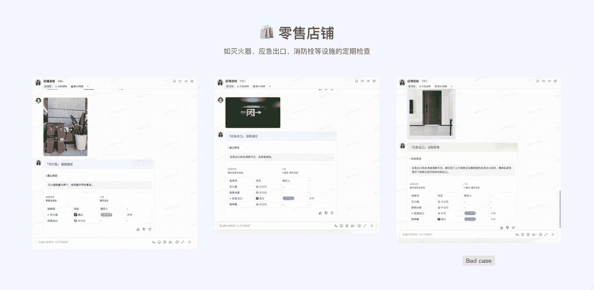

**又比如：**餐饮行业卫生状态检查

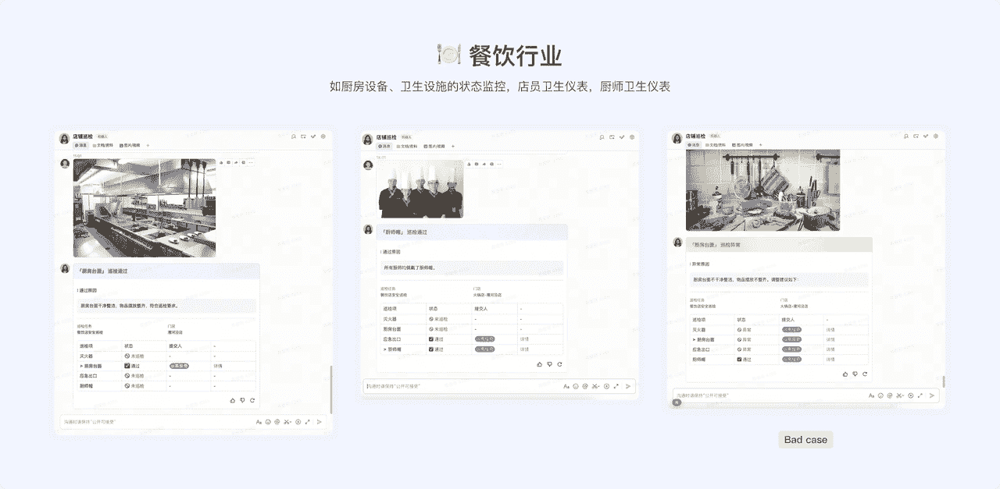

**再比如：**仓库货架摆放是否安全

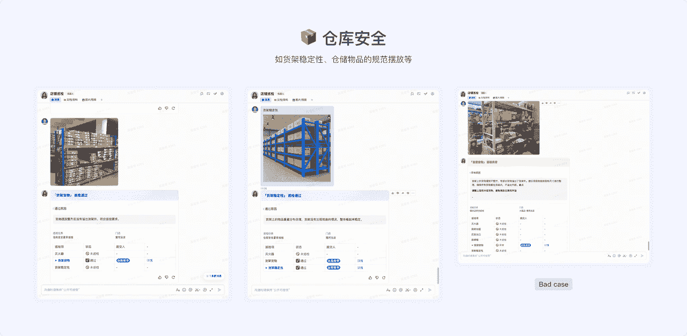

# 八、💸结束语

在上面的文章中，我们首先讲解了「扣子空间」和「艾莉同学」这两个工具分别是什么。接着，我们深度测评了教育行业、职场办公、创意策划、页面设计、快乐生活这五大行业的场景，每个场景都做了对应的评分和分析。

最后，根据前面的场景评测，生成了一份详细的测评效果对比。从评分总结和功能总结这两个维度，分别进行对比，并分别总结了这两款工具各自的优势。

到这里，关于「扣子空间」和「艾莉同学」的场景测评到此就结束啦！

我们下期见~🍻

# 🐣彩蛋One More Things

## 1、变更记录

多维表格（`X2EtbBxaqa2dHIsBVLBcS5CanZb_tblggrNSVPRnQkGL`）

## 2、参考文章

[艾莉同学融合 DeepSeek-R1，开箱即用、可深度思考的工作 AI 助理](https://bytedance.larkoffice.com/wiki/LR90wowiIigjNFkMyKlc0ciEnIb)

[没有Claude&申请不到Manus邀请码，我先试试飞书上的Agent](https://bytedance.larkoffice.com/docx/BGhDdP8HsoxMtwxwendcarP4nLf)

[【打工人福音】企业级AI助手-艾莉同学使用宝典（持续更新）](https://bytedance.larkoffice.com/wiki/NueAwE9GJicXXmk56W7cPHtOn4c)

甄嬛传名场面展示网站需求整理及改造规划

[艾莉同学的解决方案中心](https://aily.feishu.cn/hc/2rp5x772/24c5dqnk)
