# 在“艾莉同学”上，一次性把三视图玩个尽兴

> 来源：[https://my.feishu.cn/docx/IBLmddP41oeC8jx28MJcQ6Zbnxz](https://my.feishu.cn/docx/IBLmddP41oeC8jx28MJcQ6Zbnxz)

> **原文地址：**在“艾莉同学”上，一次性把三视图玩个尽兴

> 每个人都可以是天才小画家，在『艾莉』上把AI绘画弹跳起来

# 🛒 前言

近一**段时间**在给一个品牌搭建品牌物料体系，其中一个环节涉及到品牌的周边，然后我就想到了三视图的扩展。于是乎找了很多不同类别的主题，写了写Prompt，然后用 AI 给我生成各种类型的IP形象。玩的有点意犹未尽，来一起体验下~😉

# 📚 教育与文化

## 01 「音乐学院」IP形象

Prompt如下：

```
设计音乐学院的IP形象：

基础形态：拟人化音符，音符旗帜是围巾

特征：
身体是一个圆润的音符主体
音符旗帜可以随心情飘动，像围巾一样
戴着一副复古圆框眼镜
脚下踩着小乐谱
要有色彩一点

三视图 + 表情包系列：
陶醉演奏（闭眼陶醉，围巾随节奏飘动）
创作灵感（灯泡点亮，围巾兴奋翘起）
演出紧张（冒汗表情，围巾纠结成团）
```

生成效果如下：

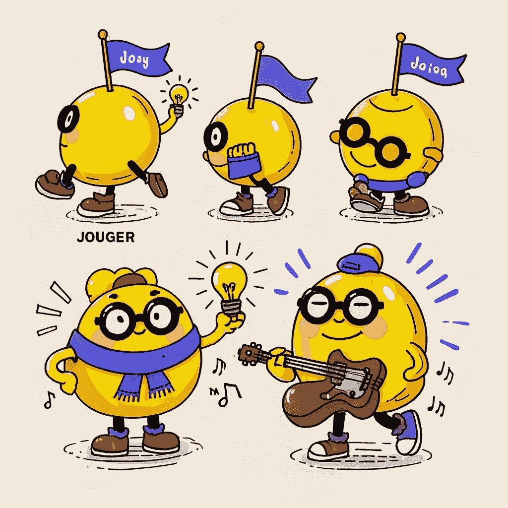

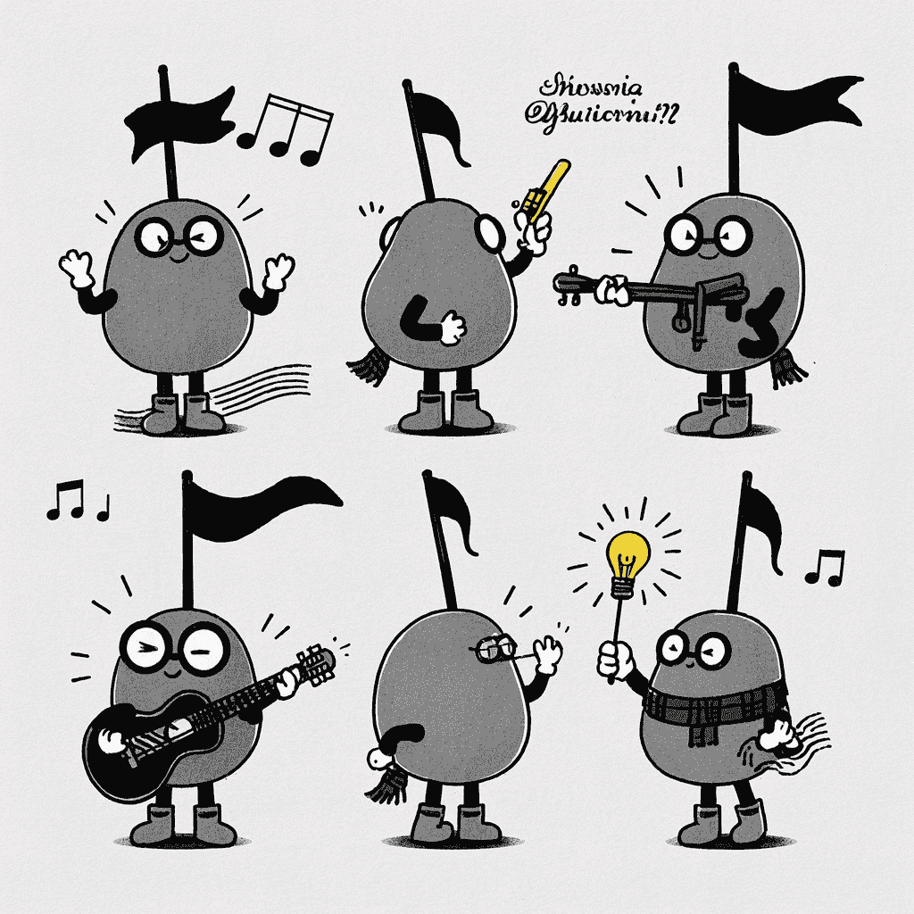

## 02 「天文台」IP形象

Prompt如下：

```
设计一个天文台的IP形象：

基础形态：拟人化望远镜，镜筒是身体

特征：
可伸缩的镜筒身体
戴着星星装饰的魔法帽
脚下踩着星图
镜片会反射星光

三视图 + 表情包系列：
发现新星（兴奋放大镜片，身体伸长）
阴天失落（镜片蒙雾，身体缩短）
观测专注（镜片闪光，正经表情）
```

生成效果如下：

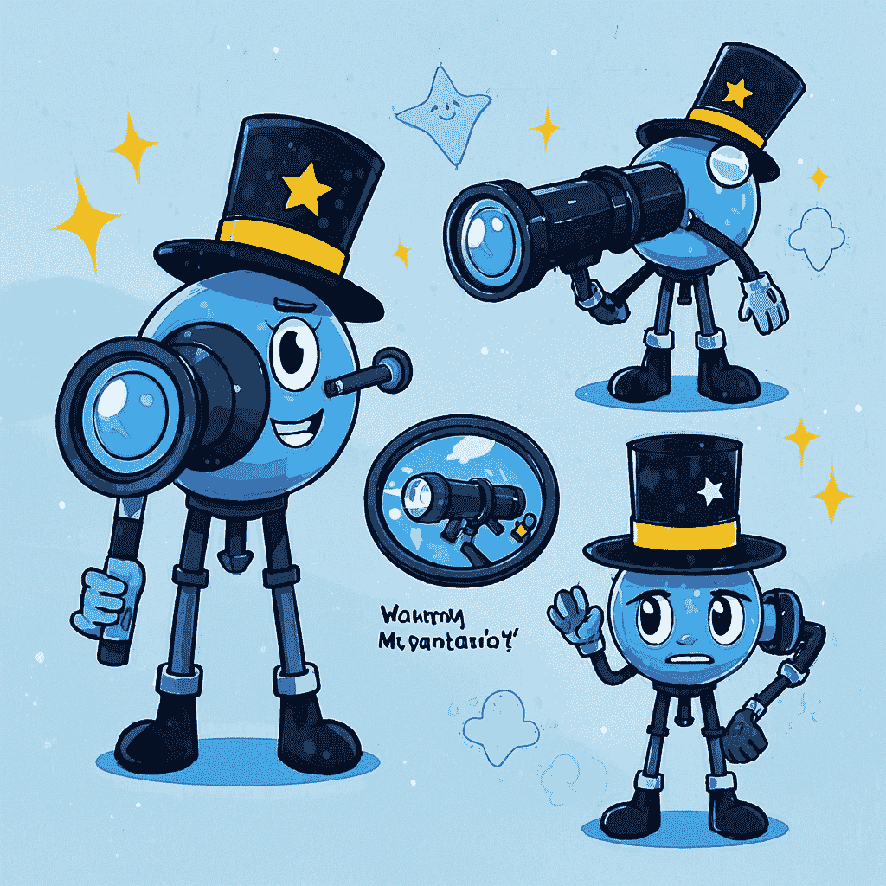

## 03 「图书馆」IP形象

Prompt如下：

```
设计一个图书馆的IP形象：

基础形态：拟人化书签，丝带是围巾

特征：
身体是典雅的书签造型
飘带可以变化成不同形状
戴着小巧的读书眼镜
怀抱一本迷你书

三视图 + 表情包系列：
读书入迷（沉醉表情，飘带卷成爱心）
知识分享（温暖微笑，飘带展开成翅膀）
困倦打盹（呼呼大睡，飘带当枕头）
```

生成效果如下：


# 🧭 商业服务行业

## 01 「餐厅」IP形象

Prompt如下：

```
设计一个餐厅的IP形象：
基础形态：拟人化厨师帽，帽身是身体

特征：
可膨胀的蓬松帽身
围着彩色围裙
手持金色锅铲
帽顶会冒出香气云朵

三视图 + 表情包系列：
创意灵感（帽身膨胀，眼睛闪光）
品尝美食（帽身微倾，满足表情）
烹饪专注（帽身挺直，认真表情）

```

生成效果如下：


## 02 「甜品店」IP形象

Prompt如下：

```
设计一个甜品店的IP形象：
基础形态：拟人化马卡龙，顶层是贝雷帽

特征：
身体是双层马卡龙造型
不同口味对应不同性格色彩
戴着法式贝雷帽
系着条纹围裙

三视图 + 表情包系列：
烘焙快乐（星星眼，撒糖花）
口感失败（委屈扁嘴，帽子歪了）
得意自满（骄傲昂首，帽子翘起）
```

生成了两个版本，效果都不错。生成效果如下：

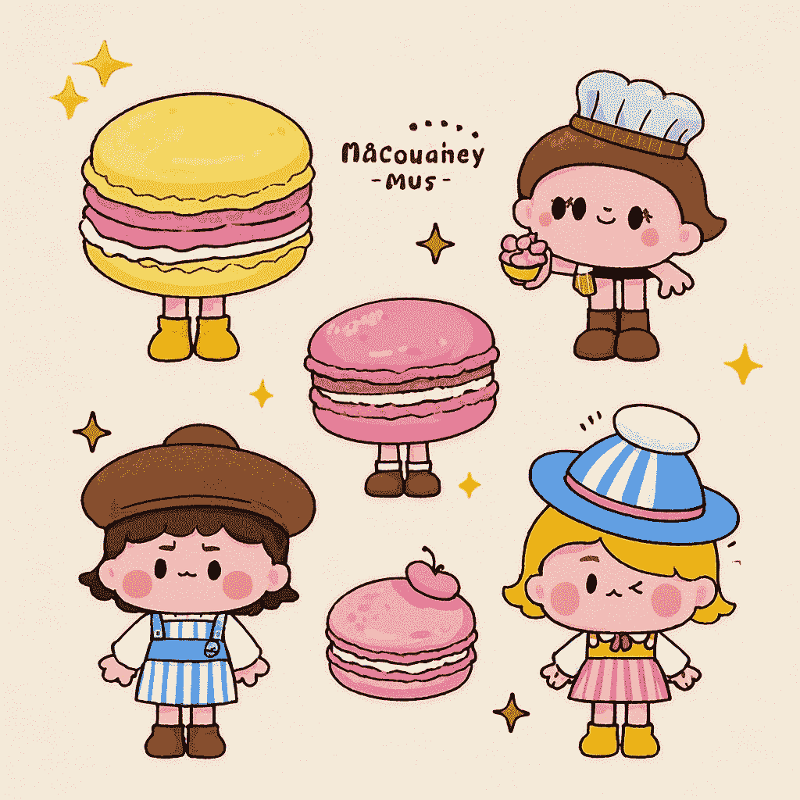

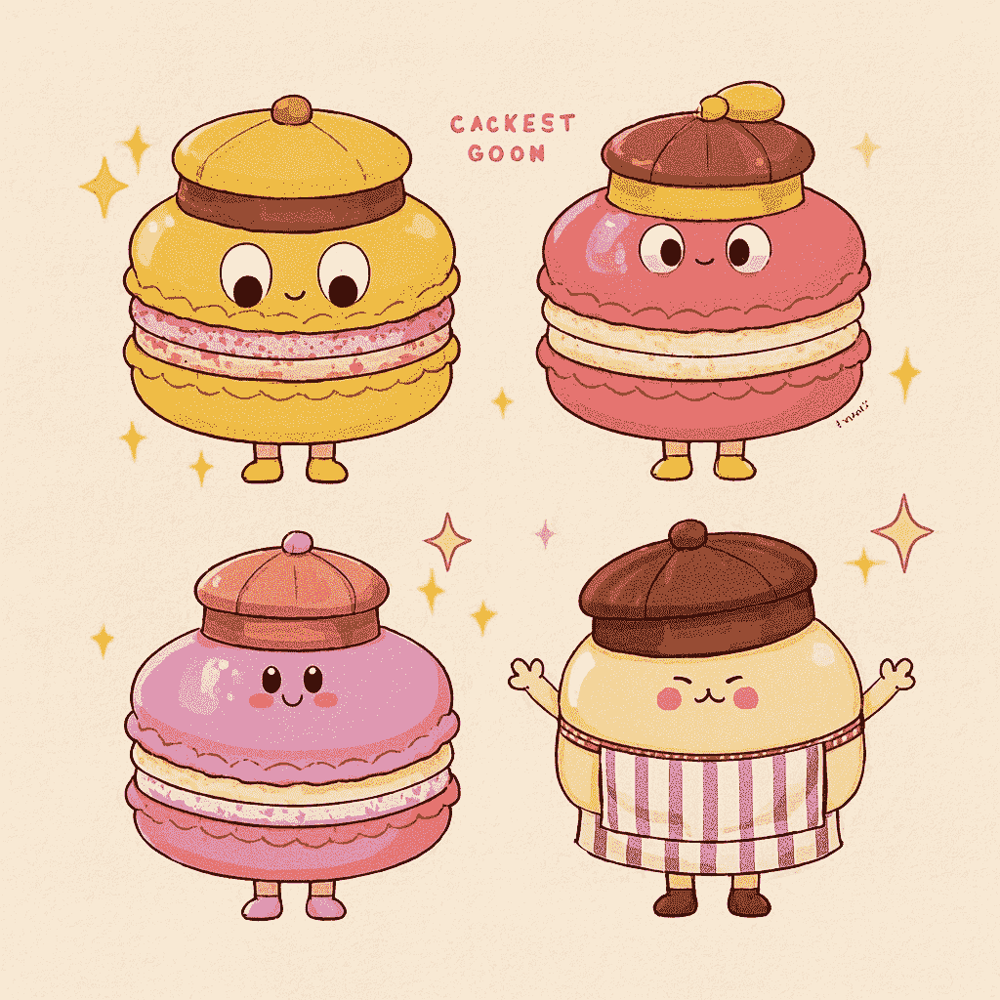

## 03 「旅游行业」IP形象

Prompt如下：

```
设计一个旅行社的IP形象：

基础形态：拟人化行李箱，箱体是身体

特征：
可伸缩的拉杆脖子
戴着环球探险帽
贴满世界各地贴纸
轮子会留下足迹地图

三视图 + 表情包系列：
探索新地点（拉杆伸长，兴奋表情）
迷路困惑（箱体转圈，疑惑表情）
度假放松（箱体打开，满足表情）
```

生成效果如下：

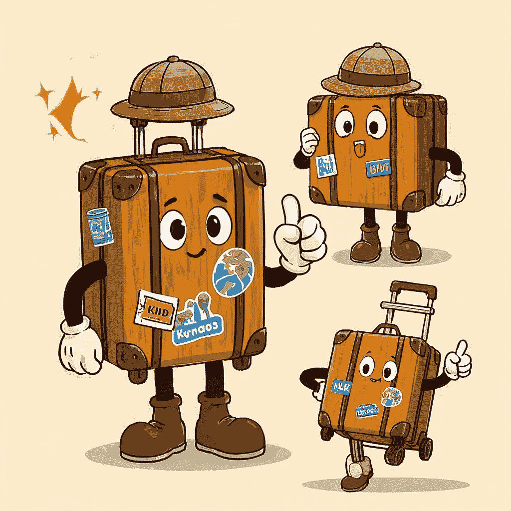

PS：感觉是今日生成的图片中最佳IP形象！！

然后发到飞行社的提示词社区，大家纷纷用这个提示词在不同的工具上，生成了各种各样的版本。来再欣赏一组很可爱的IP：

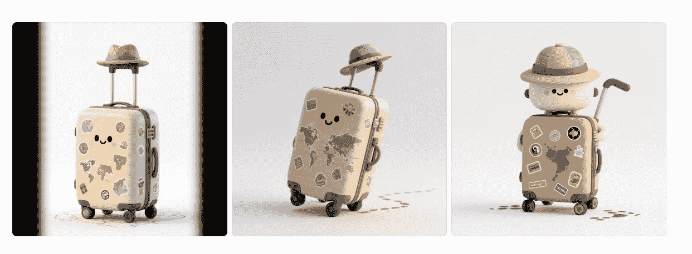

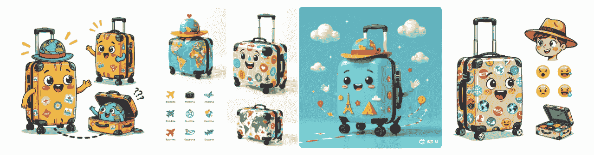

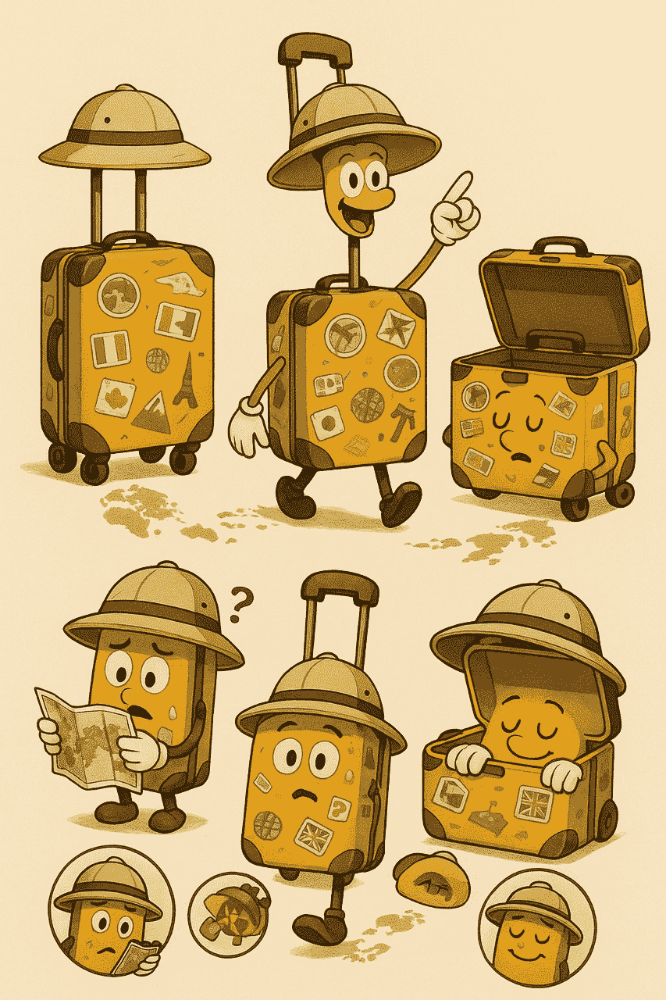

# 💸 金融与专业服务

## 01 「医疗行业」IP形象

Prompt如下：

```
设计一个医院的IP形象：

基础形态：拟人化听诊器，听诊头是脑袋

特征：
可伸缩的听诊管身体
戴着白色医生帽
脚下踩着医学图谱
听诊头会闪烁温暖的光

三视图 + 表情包系列：
诊断成功（听诊头放大，身体挺直）
安慰病人（听诊头温柔倾斜，身体弯曲）
紧急抢救（听诊头闪红光，专注表情）
```

生成效果如下：

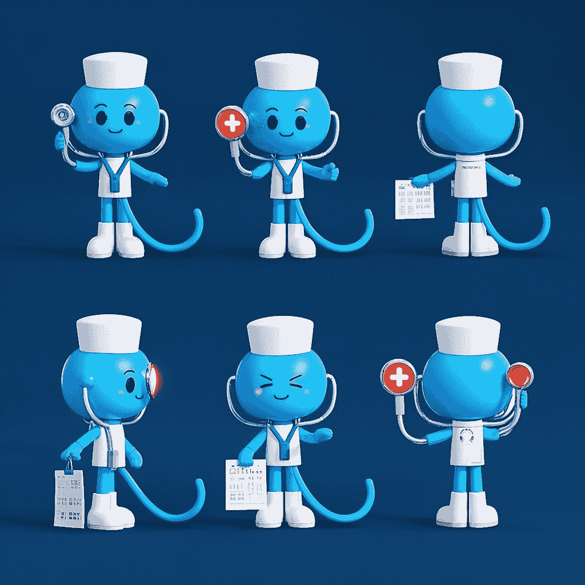

后来我又用flux模型去生成了一张👇🏻，有点小惊喜。是另一种很轻便又高雅的质感~

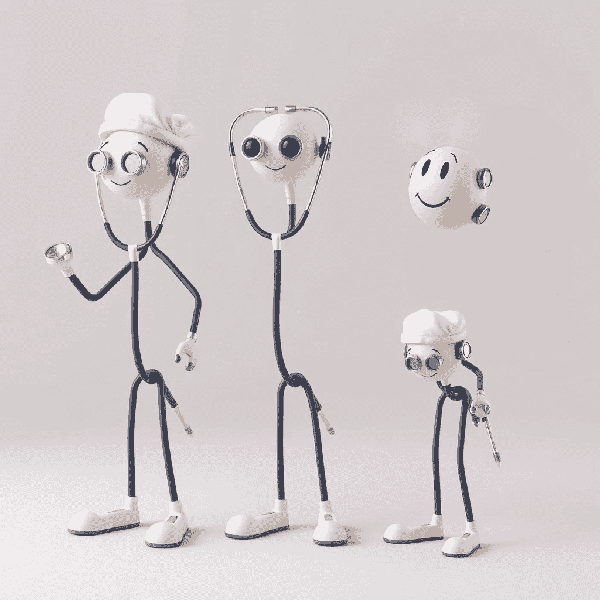

## 02 「金融行业」IP形象

Prompt如下：

```
**设计一个银行的IP形象：**

基础形态：拟人化保险箱，箱体是身体

特征：
可开合的金库门面部
戴着商务小礼帽
站在金币堆上
显示屏会闪烁数字

三视图 + 表情包系列：
投资成功（门开启，金光闪耀）
市场波动（显示屏闪烁，紧张表情）
理财规划（门半开，思考表情）
```

生成效果如下：


# 🎀 休闲与生活方式

## 01 「水族馆」IP形象

Prompt如下：

```
设计一个水族馆的IP形象

基础形态：拟人化水母，伞部是帽子

特征：
透明感的水母伞状身体
触手可以灵活变化姿态
身体会发出柔和荧光
戴着潜水镜

三视图 + 表情包系列：
优雅漂浮（放松微笑，触手舞动）
遇到朋友（开心招手，触手欢快摆动）
害羞躲藏（红晕脸颊，触手卷曲遮面）
```

生成效果如下：

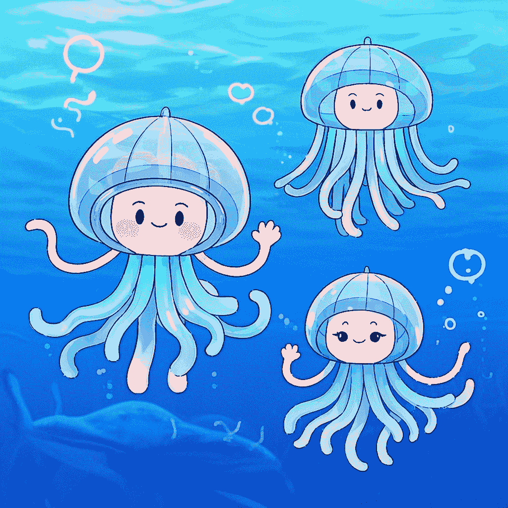

## 02 「健身房」IP形象

Prompt如下：

```
设计一个健身房的IP形象：

基础形态：拟人化哑铃，铃头是双手

特征：
可调节的哑铃重量身体
戴着运动头带
脚踩在计步器上
身体会显示健康数据

三视图 + 表情包系列：
突破极限（哑铃变重，奋力表情）
休息补给（哑铃放松，喝水姿势）
训练指导（哑铃挺直，专业表情）
```

生成效果如下：

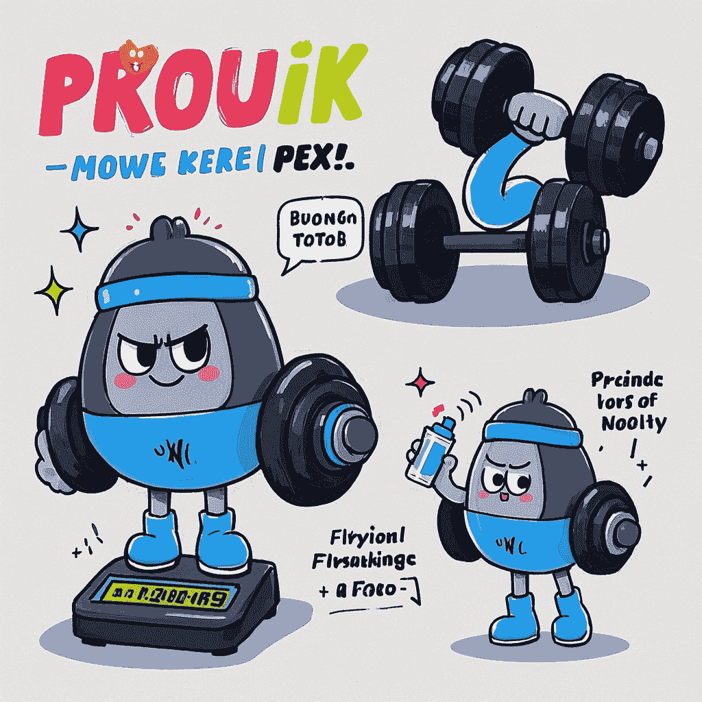

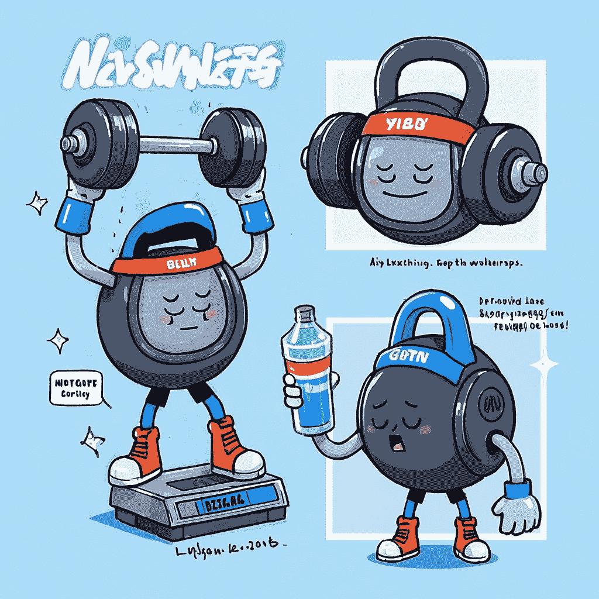

# 🌱 科技与可持续发展

## 01 「科技行业」IP形象

Prompt如下：

```
**设计一个科技公司的IP形象：**

基础形态：拟人化机器人，显示屏是脸

特征：
可升级的模块化身体
头顶天线接收信号
站在电路板地面上
显示屏会切换表情和数据

三视图 + 表情包系列：
创新突破（显示屏闪光，身体升级）
系统故障（显示屏花屏，身体倾斜）
数据分析（显示屏滚动代码，专注表情）
```

生成效果如下：


## 02 「环保组织」IP形象

Prompt如下：

```
设计一个环保组织的IP形象：

基础形态：拟人化树苗，树干是身体

特征：
可生长的枝叶手臂
头顶小鸟巢
脚下扎根土壤
树叶会随季节变色

三视图 + 表情包系列：
净化空气（枝叶伸展，深呼吸姿势）
应对污染（枝叶低垂，担忧表情）
生态恢复（树干挺立，欣慰表情）
```

生成效果如下：

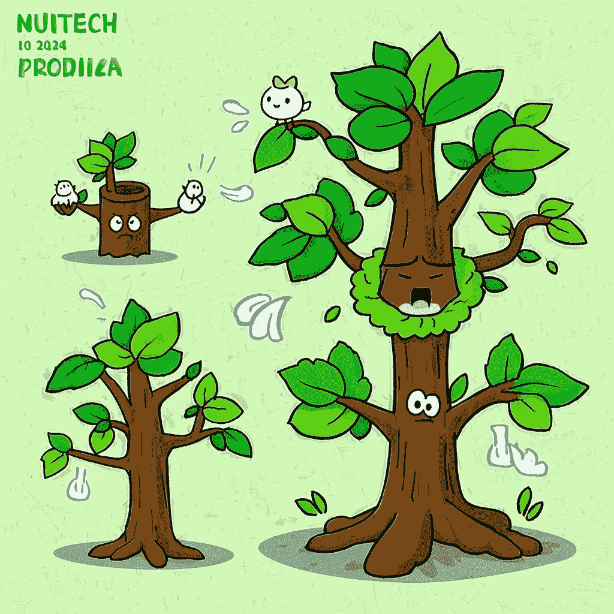

接着我又找它生成一个新的风格，Prompt如下：

> 这个不错，你可以再帮我生成一个新的风格吗

生成效果如下：

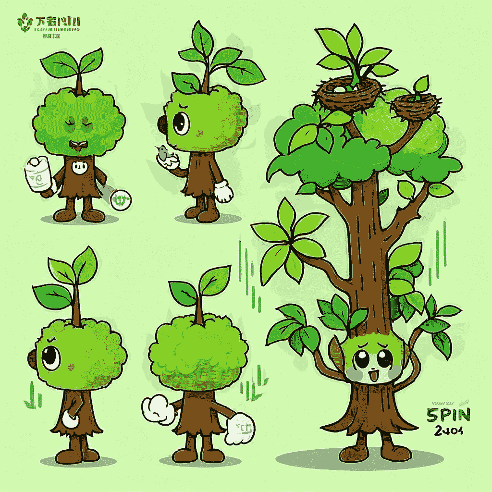

生成的不错，也算中规中矩了。

# 🐲 结束语

在上面的文章中，我们分别对**教育与文化**、**商业服务行业**、**金融与专业服务**、**休闲与生活方式**、**科技与可持续发展**这五大类别，分别进行了三视图的输出。期待大家用相应的 Prompt ，去尝试输出对应的三视图，以及看看对比效果😉

今天的文章到这里结束啦！我们下期见🍻

# 🐣 近期好文推荐

【飞行社】 ima 知识库，重新定义你的「成长加速器」

【飞行社】Flowith AI，解锁下一代「知识交易市场」

[【飞行社】从聊天到办公，豆包 A](https://www.feishu.cn/community/article?id=7498923721327902723)I 凭啥成我的 “刚需”？深度测评找答案

[【飞行社】14大场景实测！扣子向左做生态](https://www.feishu.cn/community/article?id=7501525504252444675)，飞书 aily向右攻垂直，谁代表未来？