# Trae AI，帮助你落地每一个有创意的想法🧩

> 来源：[https://my.feishu.cn/docx/RaFydqfEfo8wkrxRJGqcuIjVnNg](https://my.feishu.cn/docx/RaFydqfEfo8wkrxRJGqcuIjVnNg)

> 关注👸号：**星期一研究室**，与你分享前沿的生产力工具🧙‍♀️

# 📰前言

最近一段时间一直在探索AI编程，自己也苦于同时接手了好几个项目忙不过来，刚好最近trae自从2月27日上线了 Claude **Sonnet 3.**7 模型，加上强大的 Builder模式，  在3月份和4月份真的解放了我~

可能大家对AI编程还停留在**chat模式**，只能进行单纯简单的对话，并不能主动修改你的文件，但是 Builder模式，它真的做到了更智能~

那在下面的文章中，就来从 0 到  1一起了解下，如何让Trae AI，帮助我们落地每一个有创意的想法~

# 一、📒Trae介绍

工具在真正使用之前，我们还是先来聊聊 Trae AI 最基础的内容。

## 1、Trae AI 是什么？

Trae AI是由字节跳动 IDE 团队研发的国产智能编程工具，基于 VSCode 内核深度改造，集成自研 AI 引擎。作为首款面向中文开发者的 AI 原生 IDE，它通过自然语言交互、智能代码生成与精准问题诊断，实现开发效率的跨越式升级。

## 2、Trae安装

### （1）基础指南

国内版本：https://www.trae.com.cn/

海外版本：https://www.trae.ai/

建立有条件的小伙伴，可以考虑用海外版本，支持的模型更多一些，功能也更加强大一些。

### （2）安装指南

**第一步：**下载Trae。下面我们以**海外版**为例，给大家介绍Trae的安装指南。

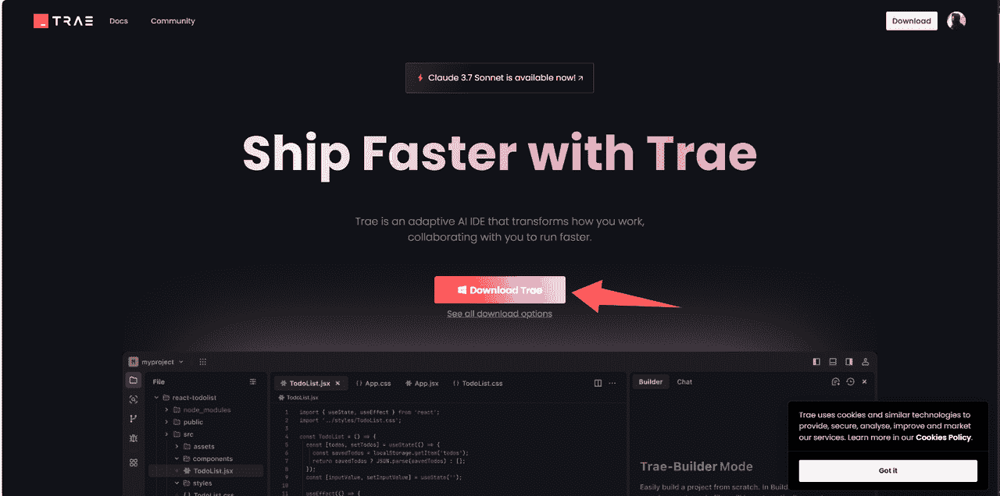

**第二步：**勾选同意。


**第三步：**选择安装位置。


**第****四****步：**建议勾选桌面快捷。


**第****五****步**：点击「安装」按钮，完成Trae的安装。


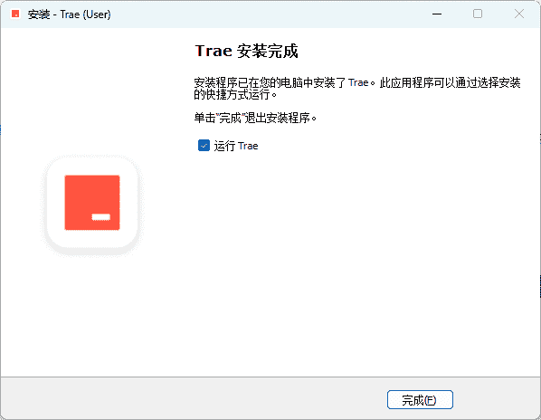

## 3、Trae登录

在安装完成之后，下一步就是进入**Trae软件**里的界面👇🏻：

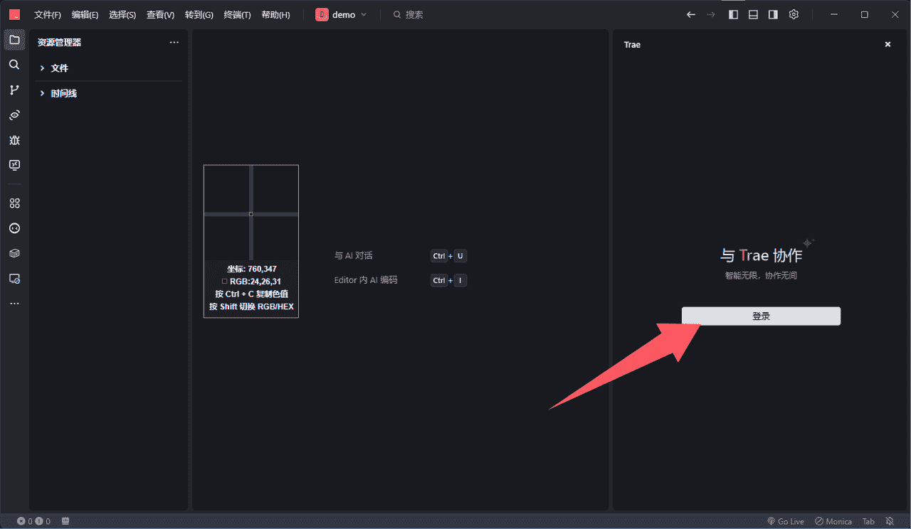

点击「登录」按钮，跳转到浏览器页面。我们可以选择Github或者Google邮箱的方式进行登录。

**注意，这**里用的是海外版本进行登录。如果你安装的是国内版本，则按需选择对应的方式进行登录就可以。


点击登录和打开Trae ：

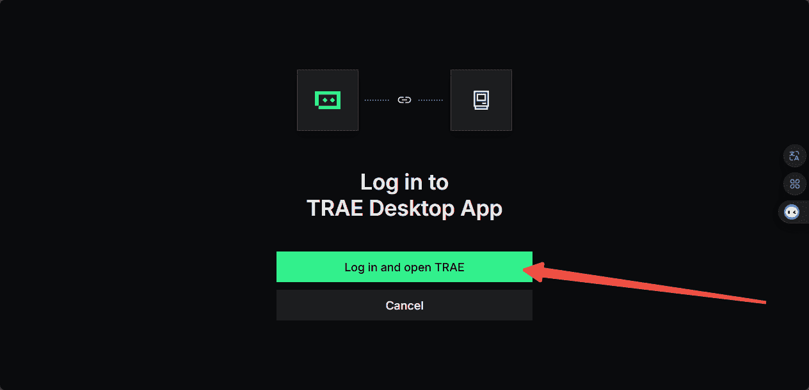

登录成功以后，在Trae界面的右上角，就可以查看我们个人账户的基本情况了。

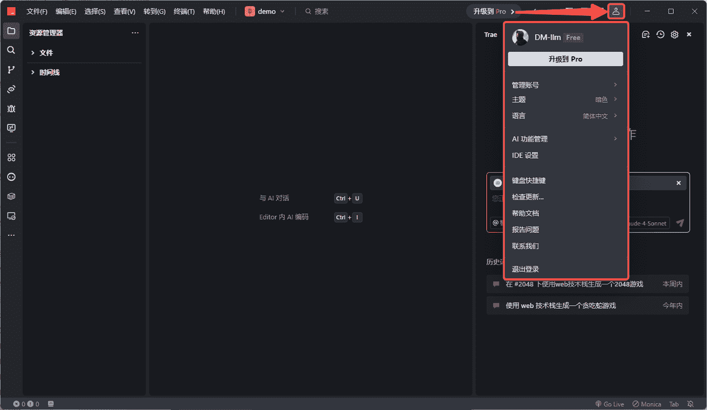

## 4、更多设置

**海外**版安装完成后，进来是英文模式的，这个时候估计有很多小伙伴想要修改语言。那么可以到设置里面，把语言默认选成中文。如果有插件也可以导入，一般第一次打开会有导入操作，具体根据trae的提示进行操作即可。

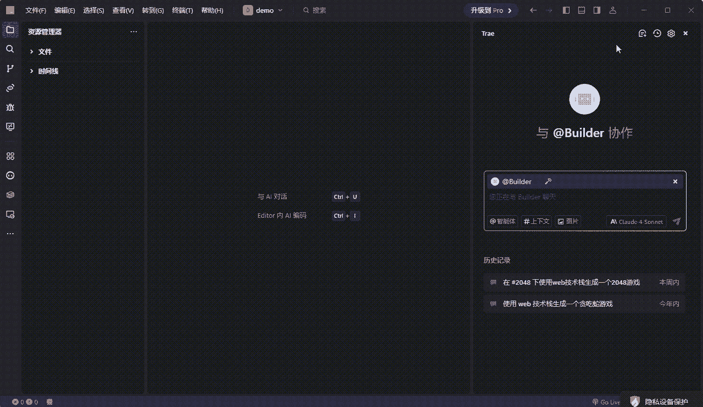

到此，我们就安装完成啦！

# 二、📘Trae模型选择

## 1、安装环境

**把软件安**装完成之后，我们下一步可能是想要直接去生成页面了。那在真正去写Prompt之前，我们还需要先做一些预置操作。

也就是说，我们需要先配置好所需要项目的环境，比如**前端**需要安装npm，**后端****需要**java、python等环境，这个根据自己项目的特色，自行先进行安装即可。同时，如果你是手动导入项目的话，记得要配置项目的环境哦。如下图所示：

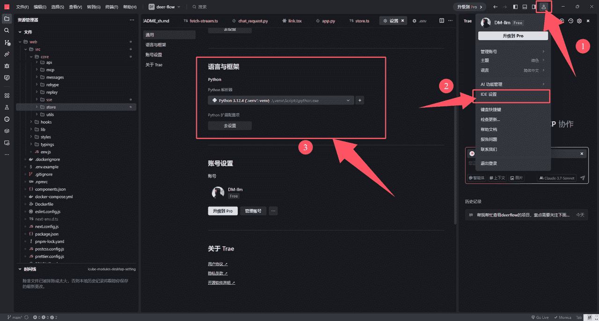

安装完成之后，我们就会基于我们已经安装的环境，来开始在Trae里面写Prompt啦~

对于Trae来说，有**build模式**和**Chat模式**，那在文章的后半部分，我们都会用到Build模式，来进行讲解。

**Chat模式****主要是基于用户**的Prompt，去一对一生成对应的答案。而Build模式，则可以做更多复杂的操作，它可以查看你的项目文件，并且还可以帮你直接修改代码。

## 2、关于官方模型选择

继续，我们在开始对话之前，要先选择模型：


不同的模型会让生成的结果不同，那对于目前Trae支持的模型来说，不同的模型主要区别如下：

| **模型** | **优点** | **缺点** | **开发者评价** |
| --- | --- | --- | --- |
| Claude-3.5/3.7/4.0-Sonnet | +   代码解释能力极强，能详细讲解复杂算法和逻辑。 | +   代码生成的创新性一般，偏向稳妥实现。 | 适合需要详细解释和高可读性代码的场景，被广泛用于代码教学和审查 |
| Gemini-2.5-Pro | +   代码生成能力强，尤其在Python、JavaScript等主流语言中表现突出。 | +   代码解释和优化建议不如Claude细致。 | 适合大规模项目和多模态场景，代码生成速度快，适合批量处理 |
| GPT-4.1 / GPT-4o | +   代码生成与调试能力业界领先，支持绝大多数主流和冷门编程语言。 | +   资源消耗较大，响应速度略慢。 | 综合能力最强，适合高要求开发和复杂项目实现 |
| DeepSeek-V3 系列 | +   对中文代码环境支持好，适合中文开发者。 | +   代码创新性和复杂性处理能力弱于前三者。 | 适合中文场景和批量代码生成，性价比高，但不适合高难度算法或大型项目 |

经过多轮对话的使用和对比，总结如下：

**超级模型**：

+   Claude-4.0-Sonnot——国外代码方面最好的模型，但是排队时间长

+   Claude-3.7-Sonnot——国外代码方面出众的模型，除Claude-4.0-Sonnot的最优选

+   Claude-3.5-Sonnot——Claude3.7如果排队时间长，且需要的任务不多，就选择这个模型

+   Gemini-2.5-Pro——代码性能不错，但是有bug问题，可能会卡在排队一名，或者需要重试

+   **GPT-4o——**综合能力较强，和Claude-3.5-Sonnot差不多，但是不能识别图片

+   **GPT-4.1——**openAI新的模型，代码能力也是名列前茅，不过会出现当前访问量过大，需要重试

+   **Deep seek-R1**——长思考模型，但无法识别图片

+   Deep seek-V3-0324——代码性能和Claude和3.7不相上下，但是可能无法理解你的意思，会出现没有修改代码的情况

**高级模型：**

+   Gemini-2.5-Flash-Preview(0520)——快，但是质量堪忧，适合小问题

其实选择哪种模型都有各自的优缺点，所以在合适的场景下，去调用合适的模型，让模型生成最终能帮你解决问题的答案即可。

## 3、添加自定义模型

那如果有的小伙伴说，官方预置的模型，不够我使用，想要添加自定义的模型，又该如何处理呢？这一部分我们来解决这个问题。

### （1）选择添加模型

在选择模型的最下方，点击「添加模型」：


### （2）选择服务商

不同的服务商，模型肯定不一样，不过如果你是想添加DeepSeek，我觉得没有必要，因为官方的ds就很好用了，且不用排队。


### （3）选择模型

选择对应的服务商和对应的模型：


### （4）输入API密钥

选择完模型之后，输入API密钥。每一个厂商的密钥不一样，如果不清楚可以点击旁边的获取API密钥链接，查看具体获取的方式。

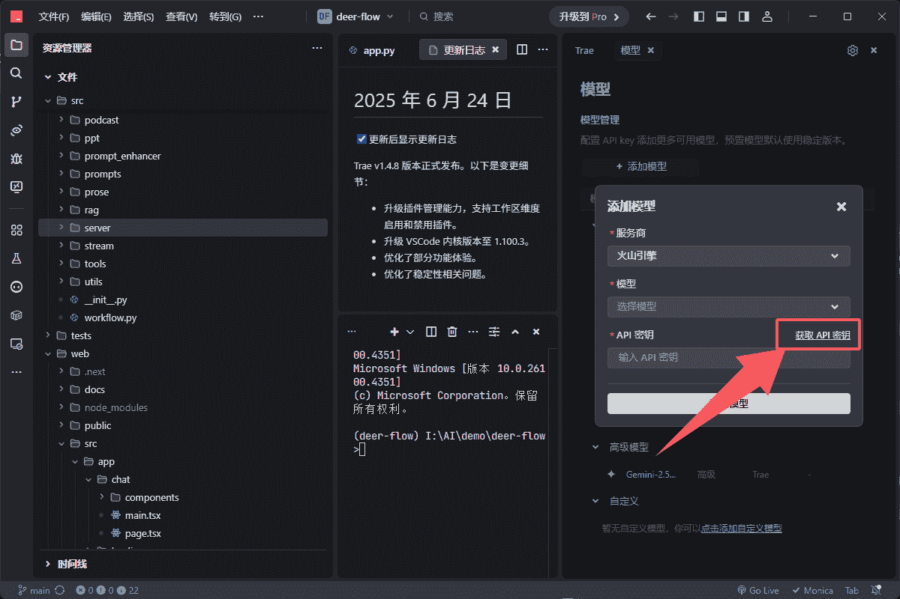

# 三、📗Trae 进阶操作

上面我们先聊了Trae最基础的模型选择部分的操作，接下来聊聊，Trae的一些进阶操作。

就在今年的4月22日，Trae迎来了重大的更新，发布了 Trae v1.3.1 版本。更新功能分别是：

+   合并 Chat 与 Builder 面板；

+   升级智能体（Agent）能力；

+   支持将文档内容和网页内容作为上下文，支持模型上下文协议（MCP）；

+   支持通过配置规则来规范 AI 的行为。


接下来，我们就分别一一来讲解下，上面提到的这四大更新的功能。

## 1、合并 Chat 与 Builder 面板

大部分情况下，我们用的最频繁的是Chat和Builder模式来与trae对话。换在以前，Trae的Chat和Builder模式是分开操作的，在这个版本更新后，我们的输入框变成了以下这样：

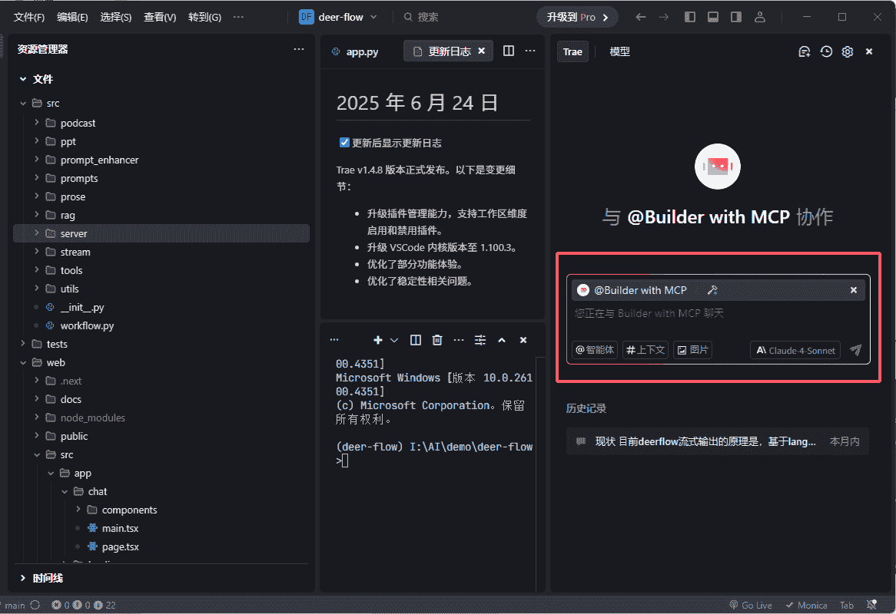

上面这种模式，属于最普通的** Chat**** **模式。如果此时你要选择**Builder模式，**就需要左下角点击「@智能体」，然后选择「Builder」模式，进入智能体模式。如下图所示：


## 2、升级智能体（Agent）能力

大部分情况下**Trae内置**的智能体已经够用了，不过当你需要加入mcp时也可以创建一个新的带有mcp的智能体。

### （1）内置智能体

Trae IDE 提供以下两种内置智能体：

+   **Builder**：Buil**der 可以帮助**你从 0 到 1 开发一个完整的项目。根据你的需求，Builder 会调用不同的工具，包括但不限于分析代码文件的工具、编辑代码文件的工具、运行命令的工具等等，从而更加精确且有效地处理你的需求。

+   Builder with MCP：在 Builder 的基础上，你还可以配置MCP服务。一般来说，你配置的所有 MCP Server， 都会默认添加至 Builder with MCP这个智能体下，且不可编辑。


### （2）创建智能体入口1

在上面这张图里，细心的小伙伴会发现，下方有个「+创建智能体」按钮。我们现在来讲下，里面有什么东西。点击进入，如下图所示：


在上面这张图中，我们可以看到，有名称、提示词和工具，具体填写形式如下：

| **配置项** | **说明** |
| --- | --- |
| 名称 | 输入智能体的名称。 |
| 提示词 | 输入智能体的提示词（Prompt），用于规范和指导智能体完成任务的方式。你可以规定智能体的人设、回答口吻、工作流程、使用工具的时机和需要遵守的规范等。 |
| 工具 | 配置智能体处理需求时可以调用的工具，包括： |

> PS：以上表格内容来源于官方文档

其中工具类的使用，可以在后面看「三 4、」的MCP部分。

### （3）创建智能体入口2

继续，我们讲打开智能体的第二种方式。

如果有同学想要用更统一的方式，我们也可以通过右上角的设置打开。如下图所示：

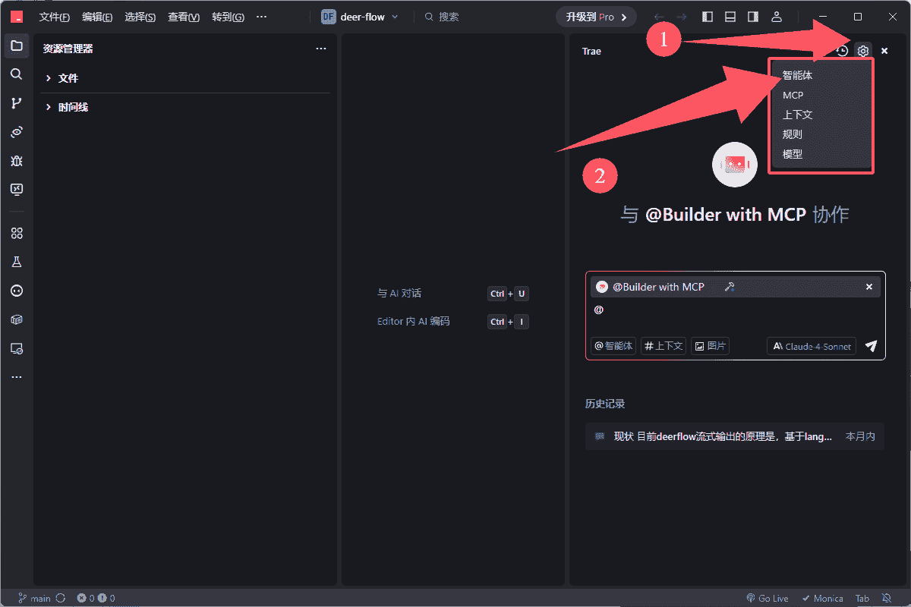

### （4）使用智能体

在 AI 对话输入框中，输入 **@** 或者点击 **@智能体**，然后在智能体列表中，选择你对应想使用的智能体。


### （5）管理智能体

当我们添加完智能体以后，发现还想对**它进**行更新，那么我们就可以再次对这个智能体进行编辑。

在**智能体**窗口中，你可以修改或删除自定义智能体。


编**辑的页面是和**之前的创建智能体时的页面一样。如下图所示：


## 3、**支持将6种方式作为上下文**

**什么是上下文呢****？**上下文是指**AI****模型**在处理当前输入时可以访问的信息范围，包括：

+   对话历史：之前的问答交流内容

+   提示词（Prompt）：用户当前的指令或问题

+   系统指令：定义模型行为和角色的基础指令

+   知识库：模型训练中获得的知识

**对于****Trae AI来说，**当你的模型无法主动去识别你的代码时，或者当我们需要选定某个代码文件进行提醒，以及我们需要补充网络中的文档时，我们就可以用到上下文功能去补充它的知识，可以理解为当你需要向某人提出问题时的背景补充，此时的背景补充就是我们的上下文。

### （1）入口

在新的这个版本中，Trae AI还增加了web和doc来作为上下文，加上原有的功能，一共6种上下文文档的提供方式，我们将会来一一介绍，对应的这6种方式，如下图所示：

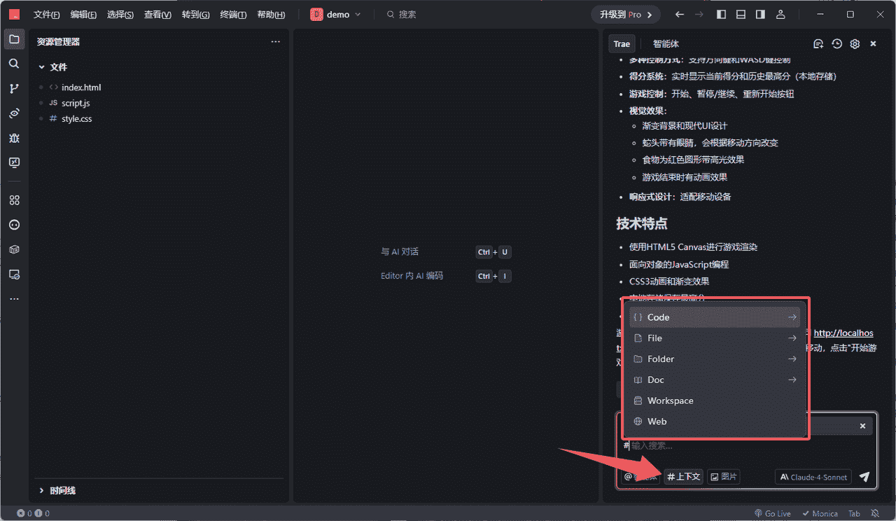

### （2）Code

现在我们先来介绍第一种上下文方式：code。

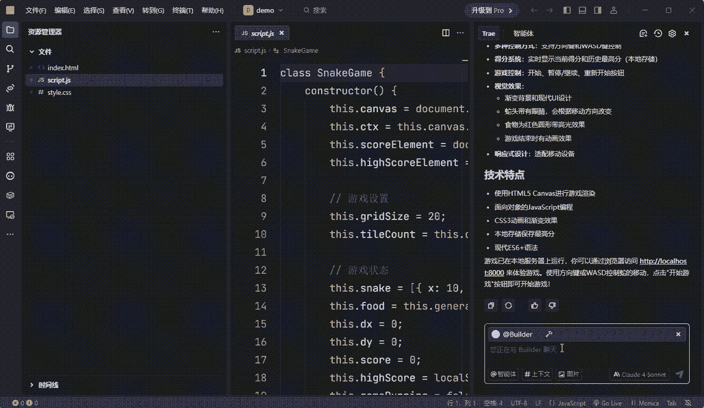

对于**Code****方式的上下文**来说，**它****会****显示**你现在正在浏览的代码**文****件****（中**间区域展示的代码文件，如下图一）中的函数或者方法（如下图二），你可以选择或者搜索对应的函数或者方法来告诉Trae AI。

这种方式说明上下文的方式是最详细的一种方式，但每次如果我要修改多段的函数，我难道要一个一个方法选择吗？答案是有更方便的引用方式，接下去让我们来介绍file方式的上下文。


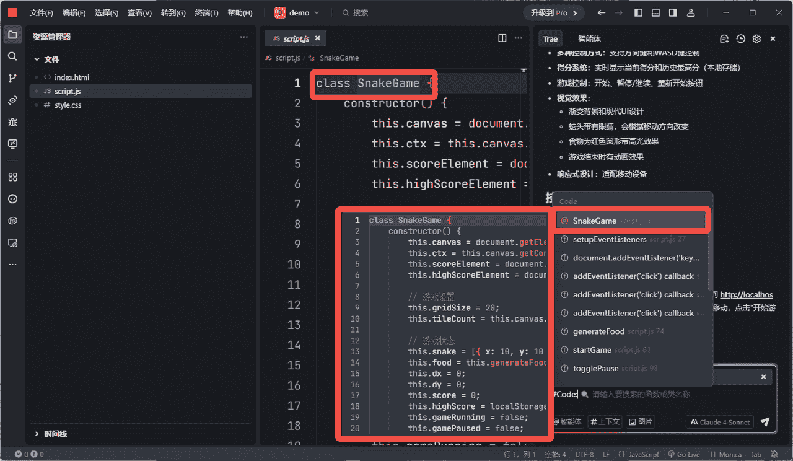

### （3）File

看完code 方式的上下文，现在我们来介绍第二种上下文方式：file。

### 输入API密钥

**对于File方式的上下文来说**，在选择时，file 方式不像code方式，选择的是函数和方法，file选择的是整个代码文件，一般是比较常用的引用方式，因为大模型现在对整个大模型的上下文是非常连续的，大模型是能够识别更多的文字和代码的，所以一般情况下选择file方式的上下文而不是code方式的上下文，这样也比较省心省力。

### （4）Folder

看完了前面的code和file两种方式以后，我们可能还是会觉得不够方便，因为如果有多个代码文件也要改动呢，那么现在就来介绍folder方式。


**对于Folder方式来说**，意思就是文件夹方式。从code到file，最后到folder方式，就是对代码文件选择引用的范围的扩大，从一块砖到一个面墙，最后到一个房间。那么引用上下文的方式还能再简单点吗？请接着往下看。

### （5）Workspace

看完前面**3种**代码引用的方式，请问还有没有更偷懒的上下文方式呢，有的有的，那就是workspace。

**对于Workspace方式来说****，**工作台空间，就是你整个代码的空间了，但是如果你的项目很大的话，这种上下文方式就会太过于庞大，效果也不是很精准，一般用在查找代码的大体框架上，用之前的比喻来说，此时的workspace就是一间屋子了。


### （6）Doc

讲完项目内的代码文件**上下文引用方式，接****下**来我们来讲讲doc方式的上下文。对于Doc方式来说，doc上下文意思就是文档上下文，当你需要参考别的项目代码文档时，你可以选择复制对应的文档，也可以通过网站url的方式来添加文档，如下面gif的演示一样👇🏻：


**那如果****我也**找不到对应的代码文档网址怎么办呢，那么来看看接下来的Web方式。

### （7）Web

**对于Web方式来说，**web上下文的方式就是web浏览器搜索，可以直接查找浏览器上的信息，当你有什么不懂时，也能将Trae AI当成搜索引擎去使用。

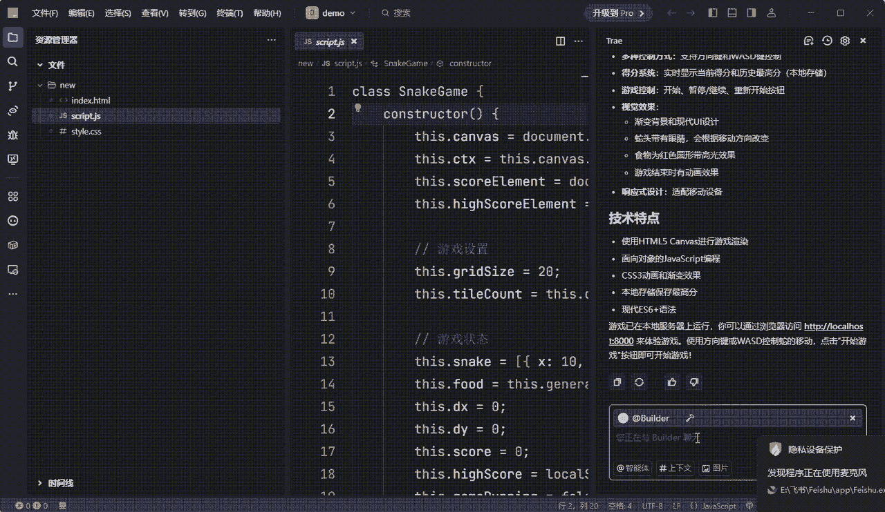

## 4、支持模型上下文协议（MCP）

最近mcp的概念非常火热，现在Trae AI也支持加入**MCP Servers**了，当你有想添加到Trae AI的mcp服务，你也可以通过接下去介绍的方式来进行添加

### **（1）**打开**MCP **窗口

**在 AI 对话窗口的右**上角，点击**设置按**钮（像齿轮一样），然后找到MCP点击它。


### **（2）**选择**MCP Servers**添加方式

点击 **+添加 **按钮。 会出现从市场添加和手动添加两个选项，一般**从市场添加**就是大家比较常见的MCP Serv**ers，手动添加就是自己**想添加的MCP Servers。

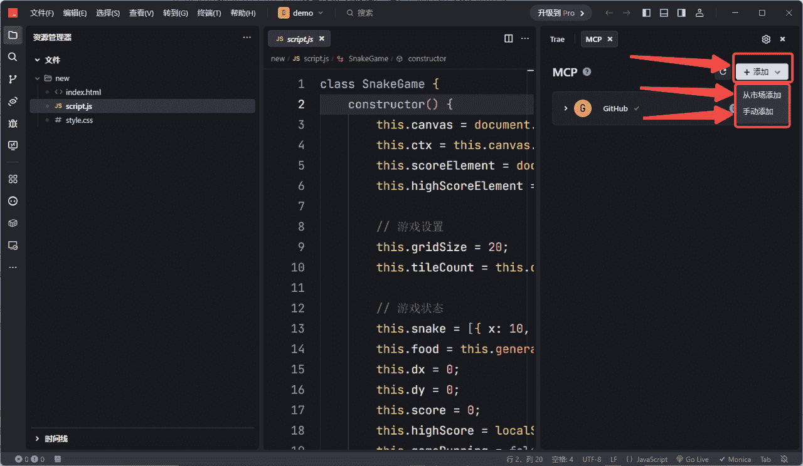

### **（3）**填入**MCP Servers配置**

如果是**从市场添加，**一般就是要填入对于token密钥，可以去对应的官网获取，或**者是填入对应的mcp配**置代码，一般对应的MCP Servers会提供对应的参考配置代码，如下图所示：

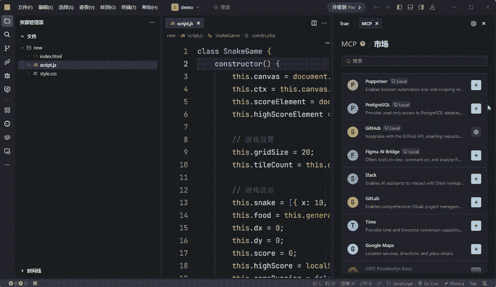

如果是**手动添加**方式，就是以**mcp配置代码**填入即可。对于MCP有不清楚的小伙伴，可参考这篇文章：

MCP（模型上下文协议）：https://j1mbx7va0zr.feishu.cn/wiki/A9ilwrMALiF2ZmkoFB5cAHk8nIb


### （4）点击「**确认****」**按钮

最后点击确认按钮，**MCP Servers**就添加成功了。如下图所示：

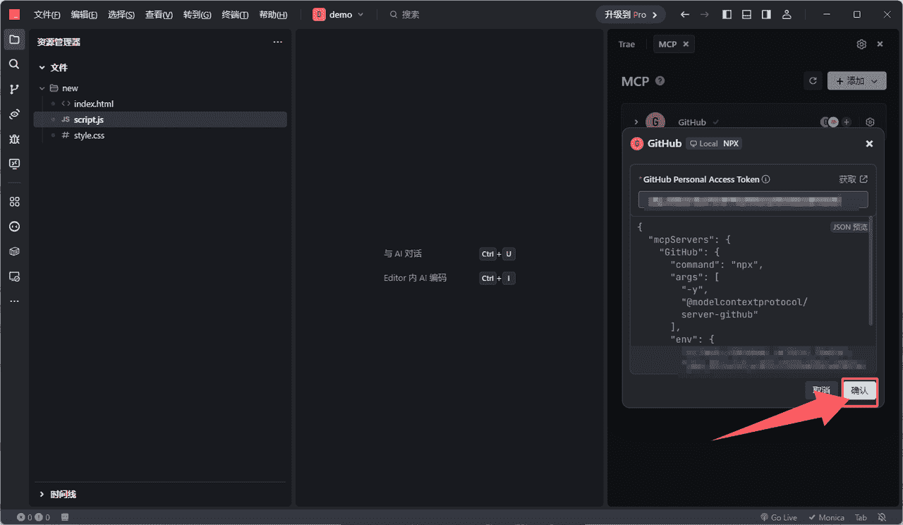

### （5）管理MCP Server

你可以在MCP的窗口中，来管理你的**MCP Servers**。当添加完**MCP Servers****时，****也可以刷新一下，如果你**想再次修改也能点击对应的编辑按钮，最后配置到你的智能体上就完成智能体的MCP Servers的配置了。如下图所示：


## 5、支持通过配置规则来规范 AI 的行为

当你在**ai对话**时有更多要求时，比如希望它可以**中文**回复你的对话，或者一些你个性化的要求，基于项目的要求，都可以写在配置中。

在设置页面打开规则，如下图所示：

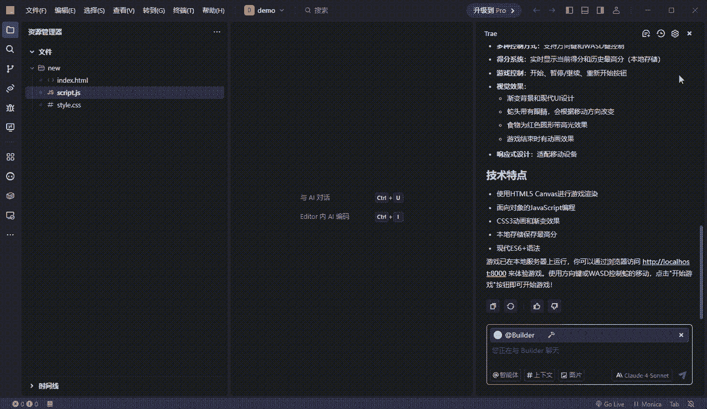

**我们可以**发**现，在规**则的设置里，包含两种方式：个人规则和项目规则。

对于**个人规则**来说，我们可以充分在这个条目下去定义我们平常的开发习惯，并要求Trae严格遵循。

而对于**项目规则**来说，我们可以基于项目的结构逻辑去定义规则，比如在写接口时，统一在xx文件下声明。

举个小例子🌰：针对Deep **s**eek-V3-0324这个模型，模型只会给出你当下所问问题的原因，但不会去主动帮你修改代码像Claude模型。此时你就可以在个人规则的配置下去进行配置**，然后引导模**型来帮助你修改代码。如下图所示：

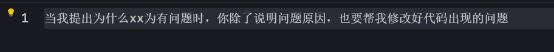

讲到这里，关于Trae AI的进阶操作就告一段落啦~

接下来，我们继续讲解Trae AI的**实践场景**。

# 四、📙Trae实践场景

## 1、贪吃蛇小游戏

**现在我们通过**一句话的方式生成一个贪吃蛇小游戏：


对文件的位置进行保存，如果你已经创建好文件夹则跳过下面这一步：


保存以后会发现Builder智能体开始运行了，稍等排队，如果觉得模型排队久，也可以换个模型：

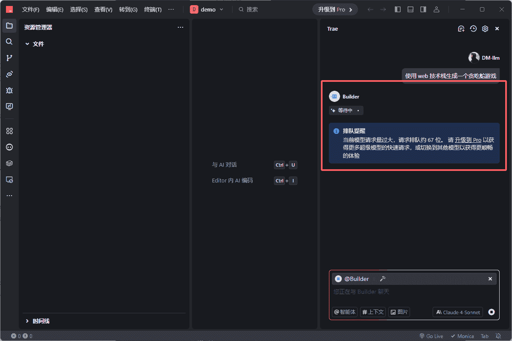

**下图是我****们运行结束**的结果，可以看到在对话框上方有3个文件需要审查，如果你是小白，也不太懂前端代码，那么我建议你可以直接点全部接受，如果你是有一定基础的同学，也可以看看对应的文件增加了什么。如下图所示：


之后我们可以来点击一下**预览**按钮，就会在trae内出现网页。如下图所示：


如果你想要复制到浏览器上打开也是可以的，在预览页面的上方找到复制浏览器链接按钮或者手动选取复制。如下图所示：


然后点击开始游戏就可以进行游戏👇🏻：

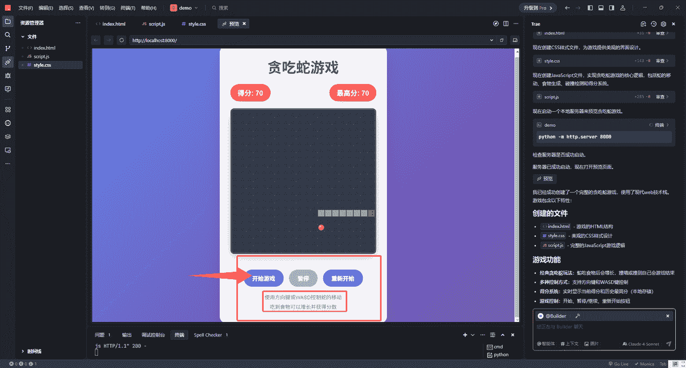

## 2、2048小游戏

生成完贪吃蛇小游戏，现在我们再来换个益智类小游戏玩玩：**2048****。**

使用刚才的提示词，这次我们先手动添加一个2048的文件夹，在对话中加入它，指定我们2048的创建位置。

提示词如下：

```
在 【2048文件夹】 下使用web技术栈生成一个2048游戏
```


然后就是模型选择问题，如果你想效果好，就选择Claude4，但是如果你觉得排队时间非常长，可以选择Claude3.7或者其他模型。


等到对话完成，我们可以像第一个场景一样，**对编写完**的代码进行审查。这边我们直接点击全部接受按钮就可以了。


然后点击**预览**按钮，我们就可以开始游玩了

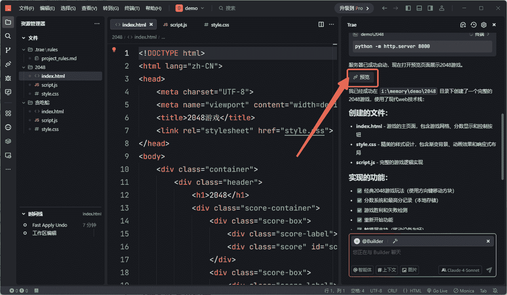

最终效果如下：

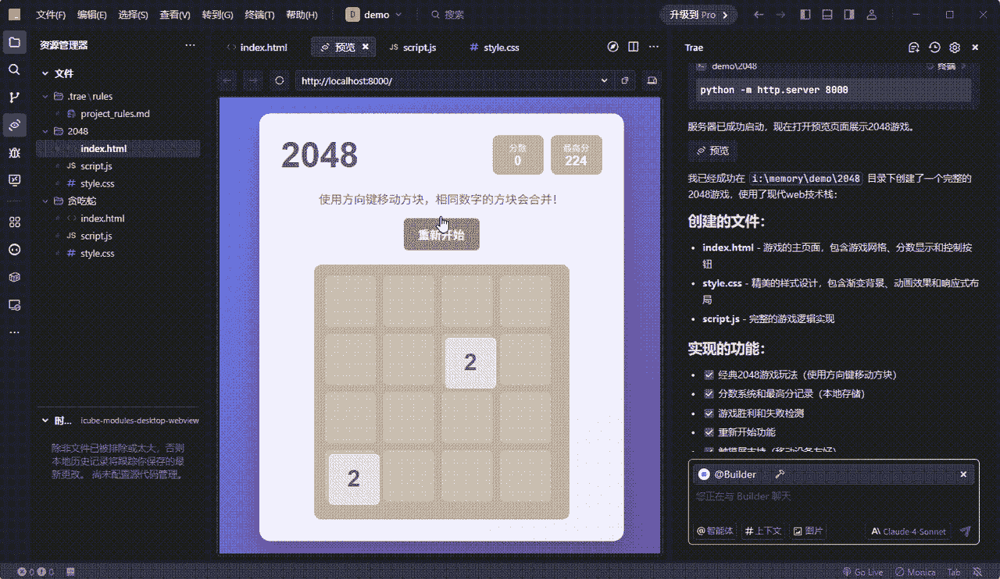

我们可以通过方向键进行移动，可以看到如果游戏结束了，会有再来一次的功能，还有重新开始和记录分数的功能，这和我们日常见到的2048游戏基本一致。

**当然**，如果你还想给这个游戏添加一些更好玩的小互动，那么可以继续输入指令，让Trae给你生成更多好玩的交互。

接下来到本文的最后一部分，还为大家准备了一些使用Trae的小锦囊，带上这些小锦囊，可以有效的提升我们在使用Trae时的**操作**效率。😉

# 五、📕Trae 必备小锦囊

**在前面的**第四部分，我们讲解了对应的两个实践场景，最后这部分，再来给大家倾囊相授一些，非常有用的小锦囊。

## 1、开启项目中的多个项目窗口

经常有小伙伴说，trae排队需要好久，那么我在这边教大家一个小妙招，可以在当前项目的子目录，或者在根目录上面再包一层文件夹，这样我们就可以在不同的文件夹，开启多个项目窗口。

需要注意的是，如果有相同系列的模型在运行，那么另一个窗口对应的模型是会消失的。

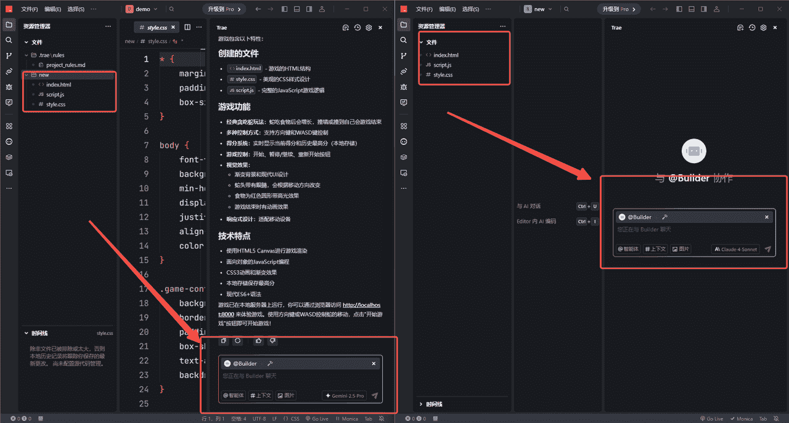

## 2、添加页面代码

我们可以右键代码文件，点击**添加到对话**，或者直接拖动**项目文件**到ai聊天窗口，这样都会使得添加上下文的方式更方便。

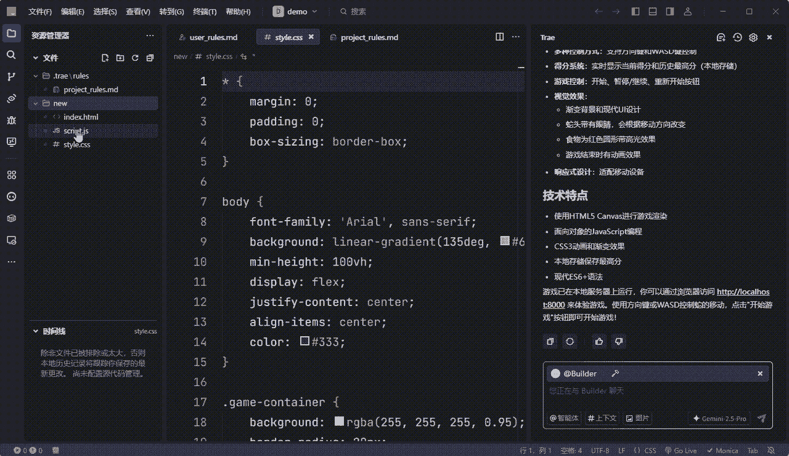

## 3、切换模型

切换模型时，尽可能在同一个系列或者厂家的模型切换，不然容易出现报错导致对话无法进行。

比如之前都是**Claude-3.5-Sonnot对话，之后切换到D****e**epSeek-V3后，对话就会出现报错。

## 4、在对话时加入图片

在对话时，如果我们是页面设计，想要让Trae AI更**好理解时，我们就可以**加入图**片的方式，但是d**eepseek系列的模型没有图片识别功能，其他的模型都有图片识别功能。

**加入**图片的方式我们可以在对话框中选择，也可以直接拖动图片到对话框中，二者的方式都很方便。

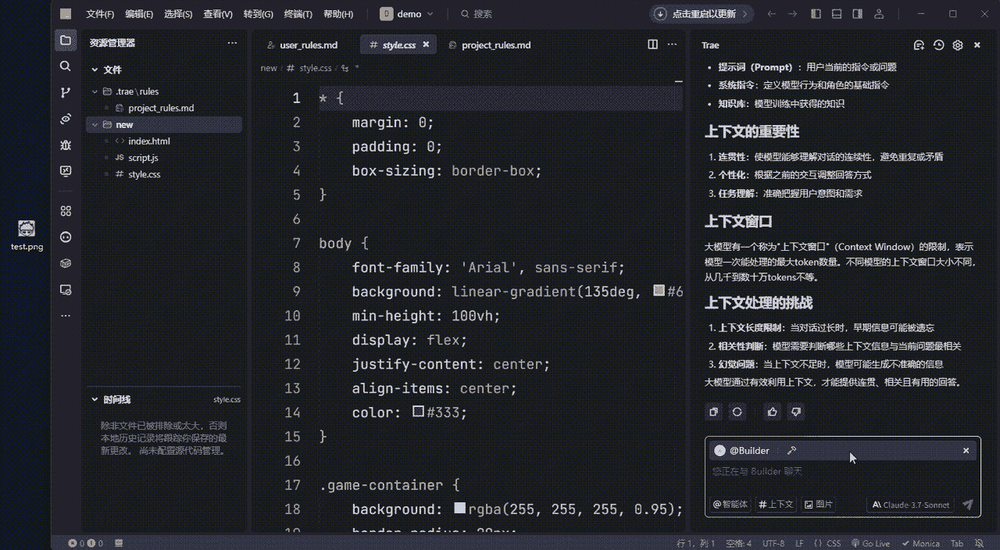

## 5、 键盘快捷键

快捷键非常非常重要，**工欲善其事必先利其器**，**快捷键**能够帮我们和别人快速拉开效率差距，我们可以通过手动打开快捷文档进行查看，如下图，也能通过快捷键Ctrl+k+Ctrl+s，先按下Ctrl+k 再按下Ctrl+s，就打开快捷键的文档

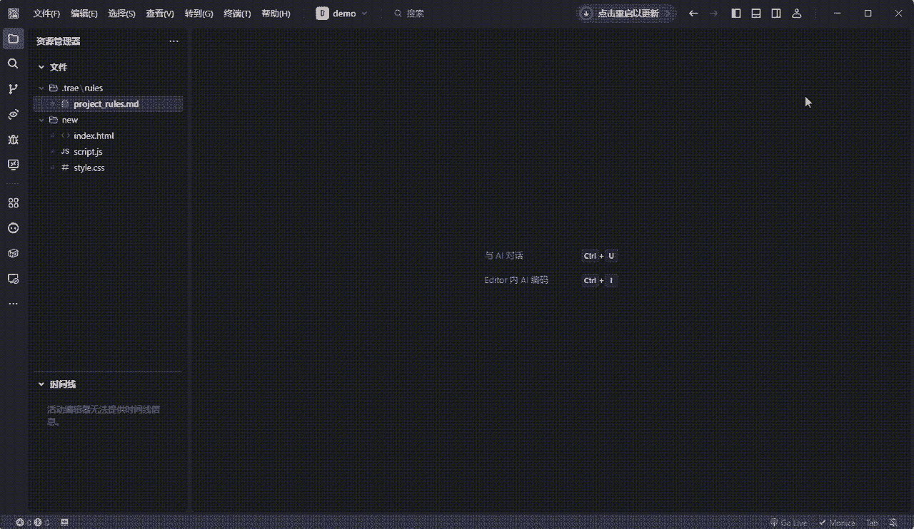

# 六、📔结尾

在上面的文章中，我们首先对Trae进行了基础的介绍，接着，我们给大家展示了如何在Trae上进行模型选择，让大家在正确的场景下，选出最合适的模型。

在文章的第三部分，我**们对Trae的**进阶操**作进行更多的讲**解，如何使用**build**模式，如何**升级智能体**能力，怎么**样添加6种上下文，**怎么添加MCP服务，以及配置个人规则和项目规则

本篇文章将[会](https://pzfqk98jn1.feishu.cn/docx/RaFydqfEfo8wkrxRJGqcuIjVnNg)持续不断地更新，后续更新内容可随时点击左下角「阅读全文」进行访问，或者点击飞书链接进行访问👉🏻：https://pzfqk98jn1.feishu.cn/docx/RaFydqfEfo8wkrxRJGqcuIjVnNg

到这里，关于 Trae AI 这个工具的介绍讲解到此结束，期待大家用Trae玩出更多有趣的场景。我们下期见~🍻

# 🐣彩蛋One More Things

## 变更记录

多维表格（Yb7fbu5gxax2zUselsycvBOUnrg_tblF3eKb6OSdFQtC）