# Fellou AI，解锁下一代「行动型」浏览器

> 来源：[https://my.feishu.cn/docx/SfewdOYTyov2ERx7y9EcysEcnxd](https://my.feishu.cn/docx/SfewdOYTyov2ERx7y9EcysEcnxd)

# 前言

[6月份的时候听了商业漫谈的这期播客：34](https://www.xiaoyuzhoufm.com/episode/680b04ea7a449ae85895ba00?s=eyJ1IjogIjYyNmYyNWFiZWRjZTY3MTA0YWM0MGMwOSJ9).与Fellou创始人谢扬的3小时访**谈：孤独、**95后、牌桌与生产力的完美创业。刚听完的时候，对Fellou AI这款产品表示非常好奇。在听播客的过程中，有深深地感觉到AI浏览器会有很新的交互形态出现。

于是先去Fellou AI的Discord**蹲到了一个**邀请码，然后开启了一波AI浏览器的探索之旅。

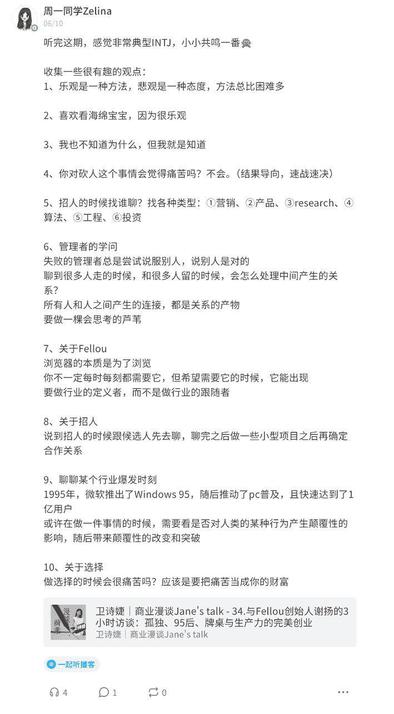

# 一、基础信息

开门见山，先来盘盘Fellou AI的基本盘。

## 1、权限开启

当你拿到邀请码之后，先把**邀请码**填写到对应的框框里。

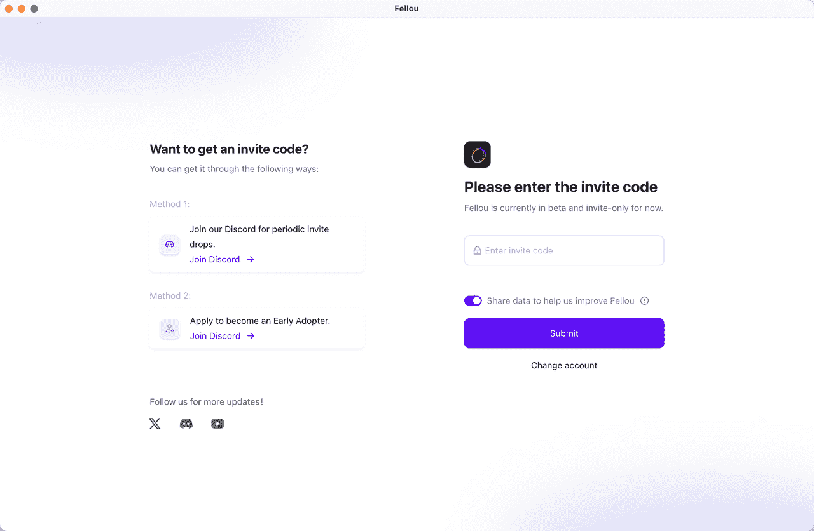

填写完成之后，再点击Enable Permissio**ns，允**许Fellou对你电脑主机的部分权限进行控制。

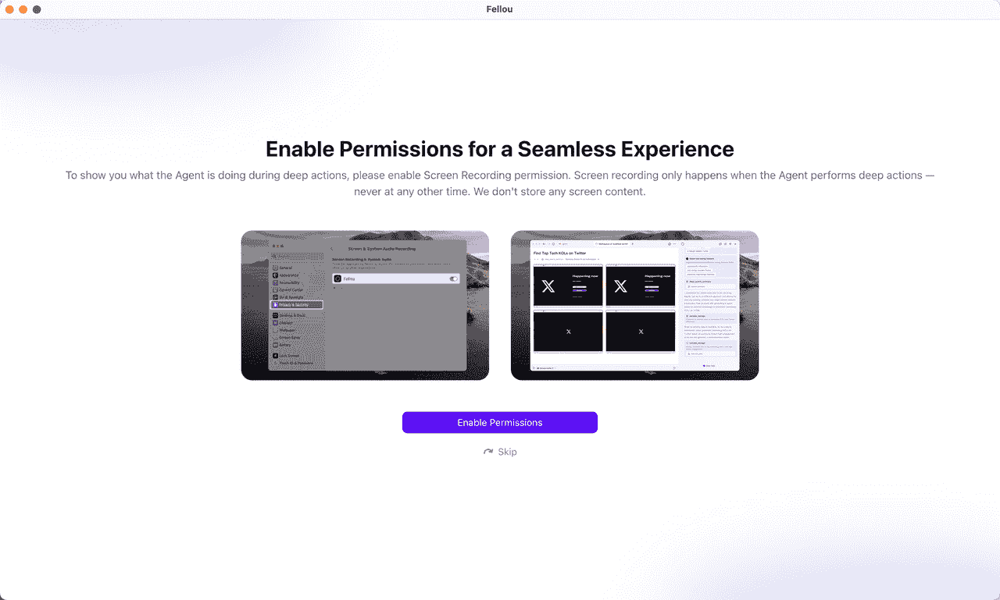

## 2、社媒盘点

| **基本信息** | **相关链接** |
| --- | --- |
| 官方公众号 | 公众号搜索：FellouAI |
| 官网 | https://fellou.ai/ |
| 下载地址 | https://fellou.ai/download |
| 产品文档 | https://fellou.ai/blog/category/product/1/ |
| 技术文档 | https://fellou.ai/eko/docs/getting-started/quickstart/ |

## 3、FellouAI是什么

Fellou AI 于今年**05月11日**正式发布，号称为是全球首个Agentic行动型浏览器，以其强大的AI自动化能力引发了行业热议。

它能帮你把复杂的任务进行拆解，并分为多个步骤，逐步地帮你执行，最终达到对应的结果。比如在boss直聘上，帮你一次性给各大boss发招聘消息；又或者替你发送邮件，发送twitter等社媒帖子等等。

这在某种程度上，为营销人员、内容创作者、研究人员等群体，提供了前所未有的生产力提升。

## 4、核心功能

Fellou拥有以下几大核心功能：

| **核心功能** | **功能信息** |
| --- | --- |
| 多步网页任务自动化 | **可以把**「检索→打**开页面→**筛选→填写/提交/记录」等步骤串成执行链，突破传统单一查询的边界模式。 |
| 自主行动与策略决策 | **在页面中去决**定下一步点击、继续检索或切换站点的方式，体现Agent式的操作。 |
| 上下文与状态保持 | 强调利用**用户**的完整上下文，减少重复输入，保证后续动作基于已有信息连续执行。 |
| 信息检索与结构化整理 | 对**多来源内容****进行收集、**去重、归类、提炼，输出结构化结果（表格/摘要/要点）。 |
| 一句话自然语言指令触发 | 用户只需要以**简单指令****来描**述目标，Fellou系统便会解析并生成行动计划。 |
| 结果导向输出 | 强调「交付可执行成果」（如已填写、已提交、已汇总的成品），而不只是单一的文本说明。 |

了解了FellouAI**是什么，接下**来跟大家来一起，挖掘一些好玩的场景，更进一步感受行动型浏览器是「怎么行动的」。

# 二、场景介绍-文本类创作

先从官方的useCase里面，随机挑选**有趣的场景**来整活。

## 1、商业分析报告

一般来说，品牌在做营销的时候，一般都需要深入地去挖掘竞品，以及整个行业的信息。所以第一个场景，我们用「商业分析报告」作为首个例子，来看看fellou是怎么分析的。

**调试Prompt如下：**

```
请针对**美团**和**饿了么****最近的外卖大战****，做一个深度的****商业分析，最终**生成一份报告，以PDF的形式给我。报告内容需重点探讨以下几个方面：
竞争策略差异： 两大平台在补贴力度、骑手管理、商家扶持和用户运营上各有哪些核心策略？
用户行为洞察： 下沉市场的用户有哪些独有的消费习惯和偏好？他们更看重价格、时效还是服务质量？
未来发展趋势： 这种激烈的竞争对整个外卖行业的未来格局会产生怎样的影响？
```

**Deep Action过程：**

Fellou会把你的初始指令，给拆解成几个非**常细致的**行动TODO，然后再**分别的去进行**深度搜索，最终形成一份完整的商业分析报告。

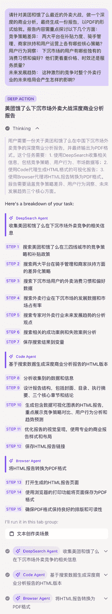

**最终生成效果如下：**

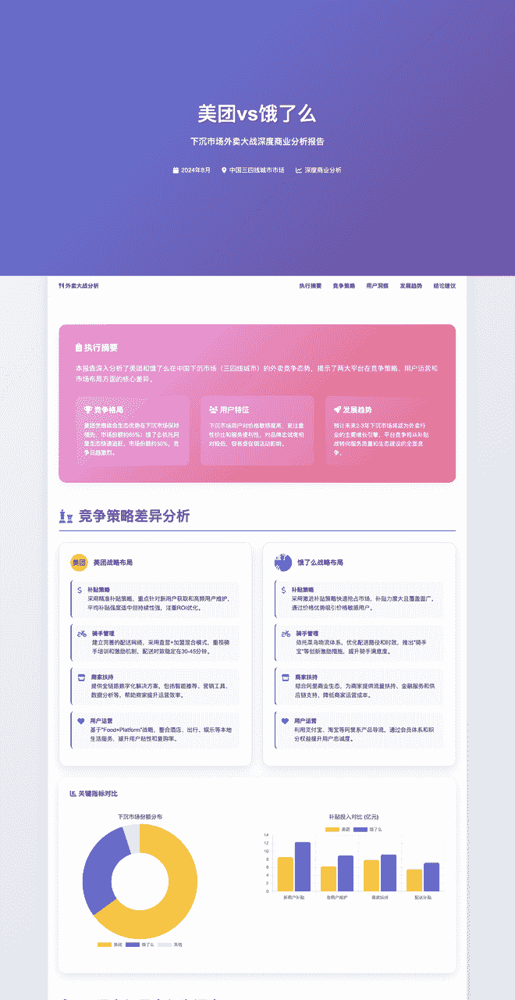

> PS：附上报告地址 → https://hfs7lve33i.fellou.io/meituan-vs-eleme-delivery-market-analysis-hxZkTlFP

## 2、3 分钟写完研报

第二个Case，我们来看看Fellou短时间内写完一篇**研报**的能力。

再比如说让Fellou针对Gith**ub上最受欢迎的开**源项目Hugging Face进行分析，Prompt如下：

```
请帮我对GitHub上最受欢迎的开源AI项目Hugging Face，进行全面调研分析，并撰写一份详细的技术社区研究报告。
```

然后Fellou自己去模拟点击等操作，把Hugging Face的所有内容，都浏览一遍。**行动过程如下：**

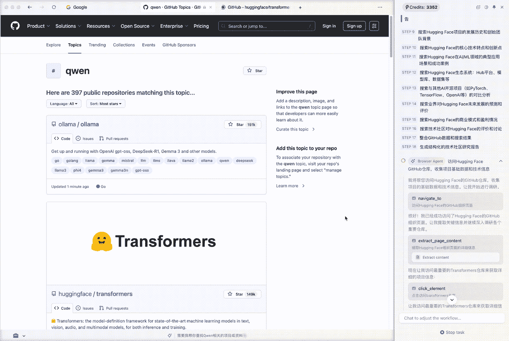

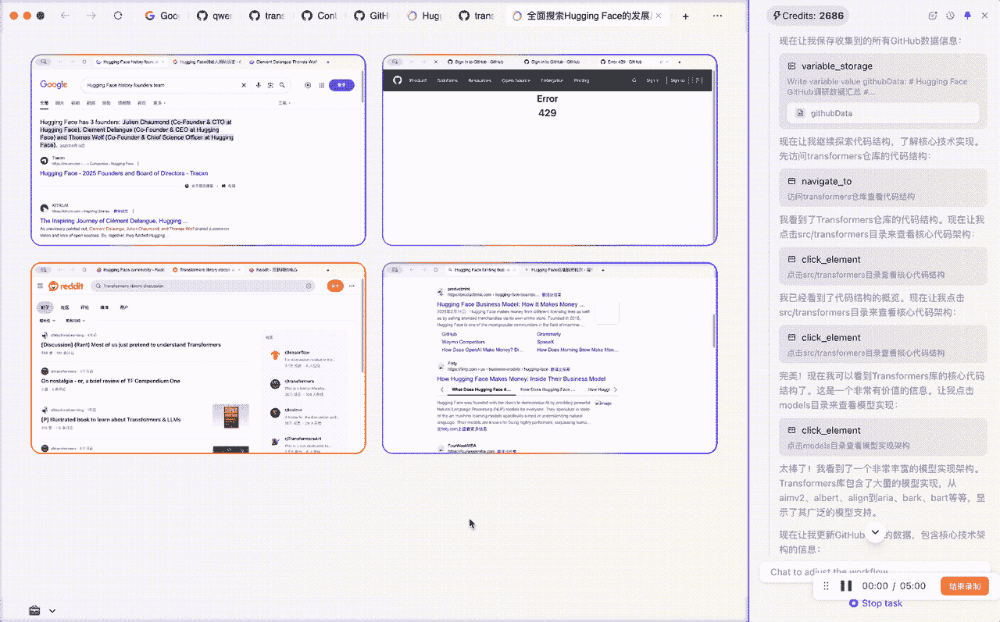

Fellou**在行动的****过程**中可能需要去请求你的桌面权限，会给你弹出提示框，一般是屏幕截屏之类的权限功能，这个时候你直接点击允许即可。

最后，我们来看看Hugging Face的研报，生成效果如何。**具体如下图所示：**

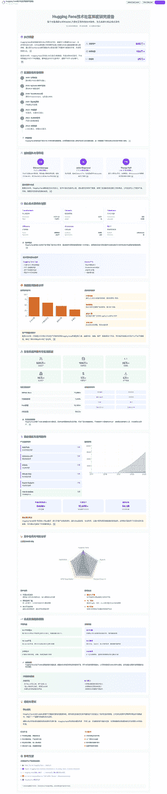

**这里可以直接**把这份报告发布到互联网上。如下图所示：

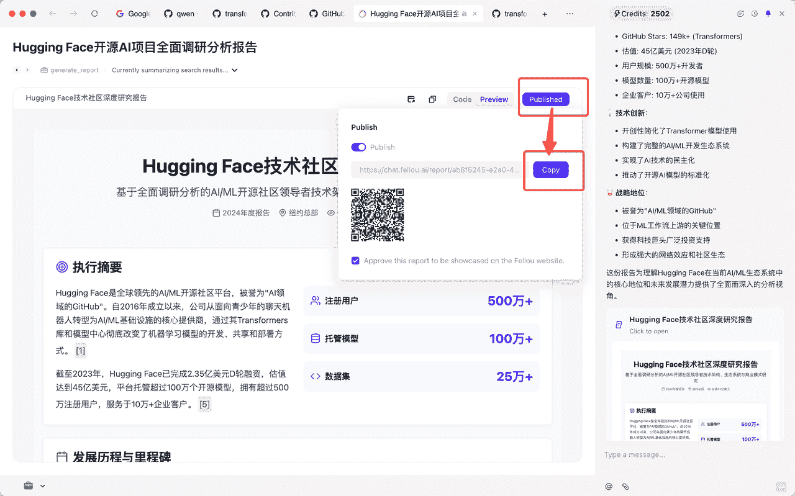

可以看到，这份**报告****的内**容，整体抓取的数据算是比较全面**，并且对应的**参考位置，会像文献一样标出来，并且可以点击过去。如下图所示：

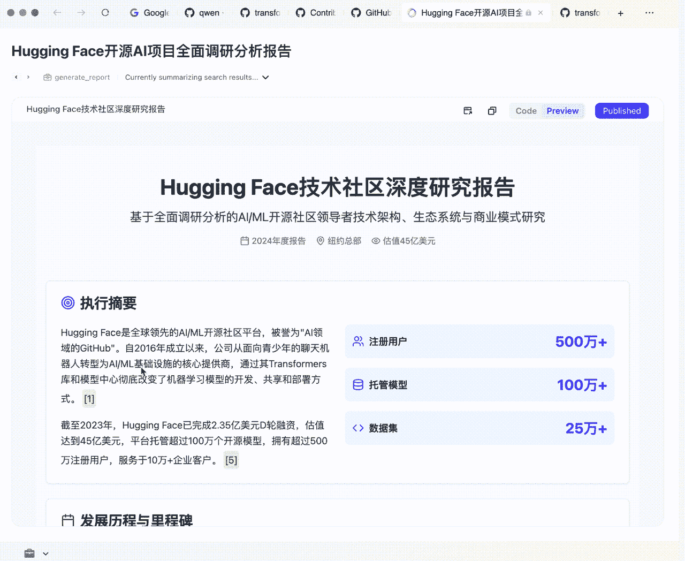

> 最终报告的地址可戳此链接：

> https://chat.fellou.ai/report/ab8f6245-e2a0-4ee8-a14c-1811457fbc9b

## 3、小红书评论数据分析

**第三个cas**e，我们来看看，Fellou的深度数据分析能力。

### （1）主流程

**Prompt如下：**

> 请对「十字路口Crossing」这档播客在小红书平台的用户评论进行深度数据分析，具体要求如下：

1.  数据收集：抓取最近30天内相关笔记的评论数据

1.  情感分析：统计正面、负面、中性评论的比例分布

1.  关键词分析：提取用户评论中的高频词汇和热门话题

1.  用户画像：分析评论用户的基本特征（年龄段、地域分布等）

1.  竞品对比：如有可能，对比同类产品的评论表现

1.  可视化输出：生成包含图表的分析报告，包括词云图、情感分布饼图、时间趋势图等

在刚输入完Prompt的时候，Fellou**就会先去访问**小红书，然后会引导我去先进行登录。如下图所示：

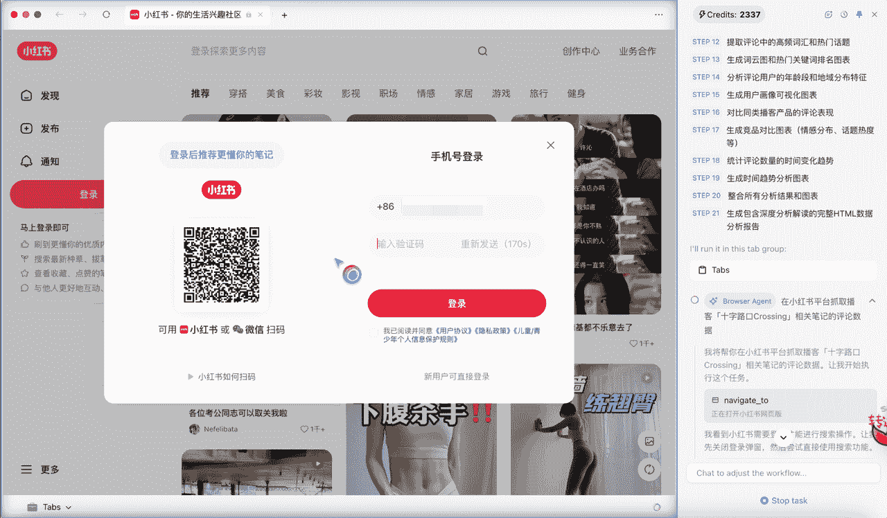

输入账号和验证码之后，点击Done，进行**确认**。如下图所示：

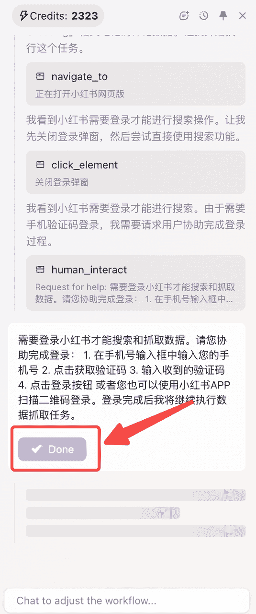

然后呢，Fellou就去开始在小红书平台**上，抓取各种**各样的数据，并进行分析。如下图所示：

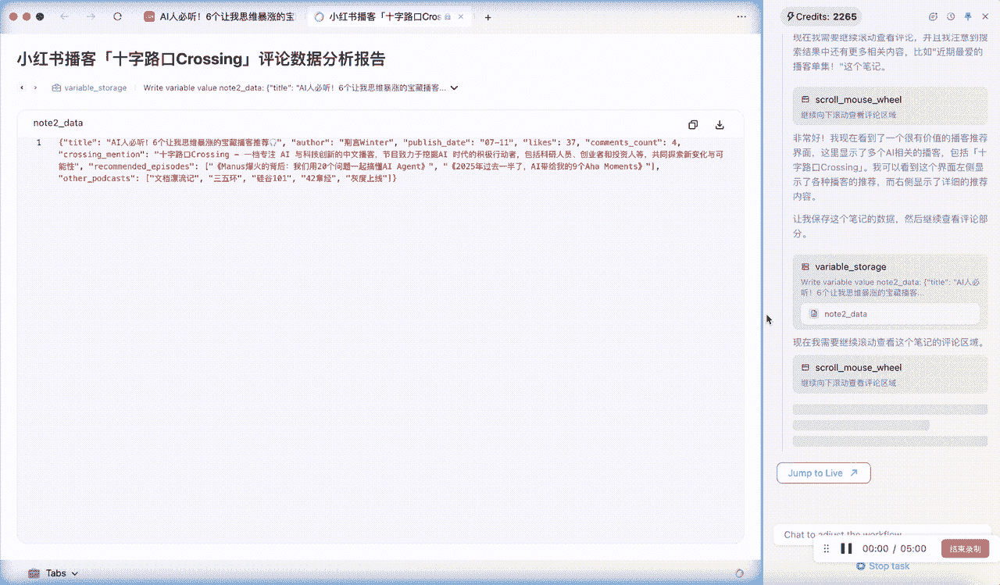

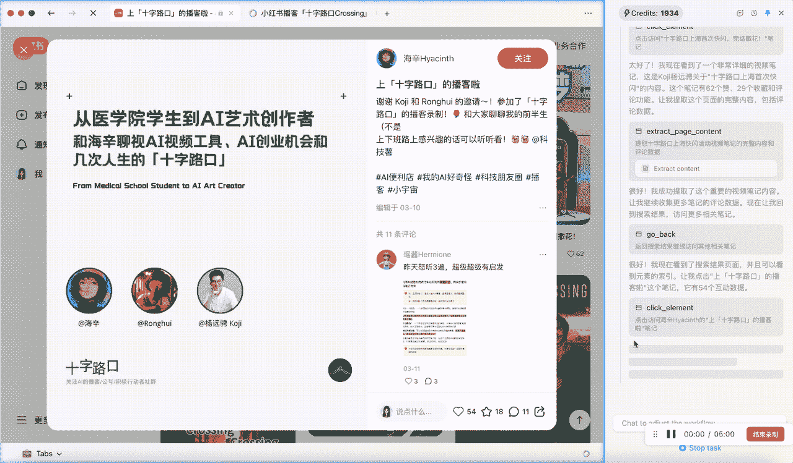

最终到了生成报告的阶段，**行动过程如下：**

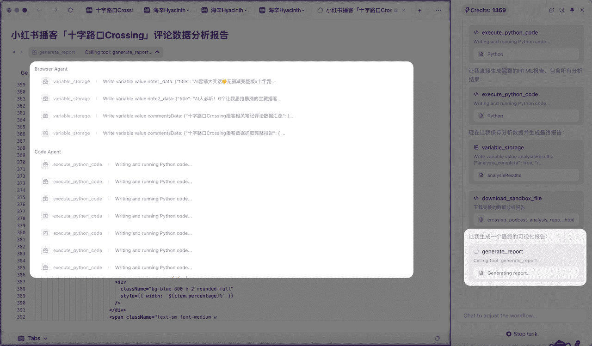

**最后来看整个**生成的报告长什么样，如下图所示：

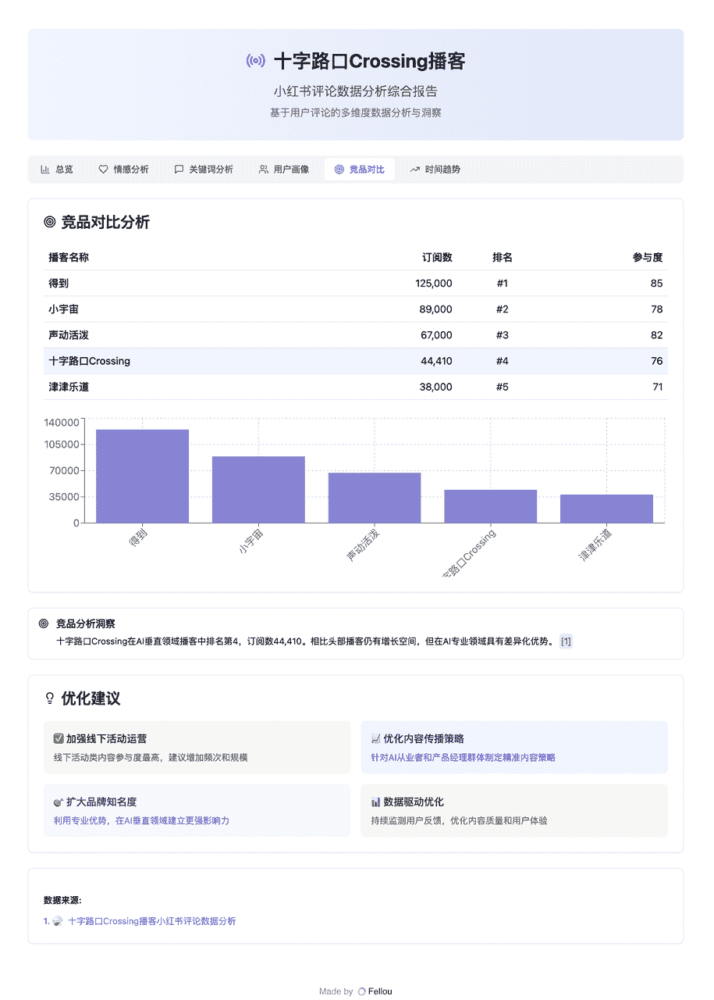

**如**上图所**示**，可以发现**，**Fellou**把**这份报告拆**解**成六个部分**：**①总览；②情感分析；③关键词分析；④用户画像；⑤竞品分析；⑥时间趋势。

### （2）Step拆解

看完整份报告的时候，如果总分是100分的话，给打个85分。除了部分内容在渲染过程中出现一些小瑕疵，但是整体的数据和渲染质量，还是比较满意的。

然后我又回去看了下Fellou在生成任务过程中，整个拆解step的过程，想说**J人狂喜**，拆解的是非常到位。并且过程当中，有学到一些拆解问题的思路和技巧😉

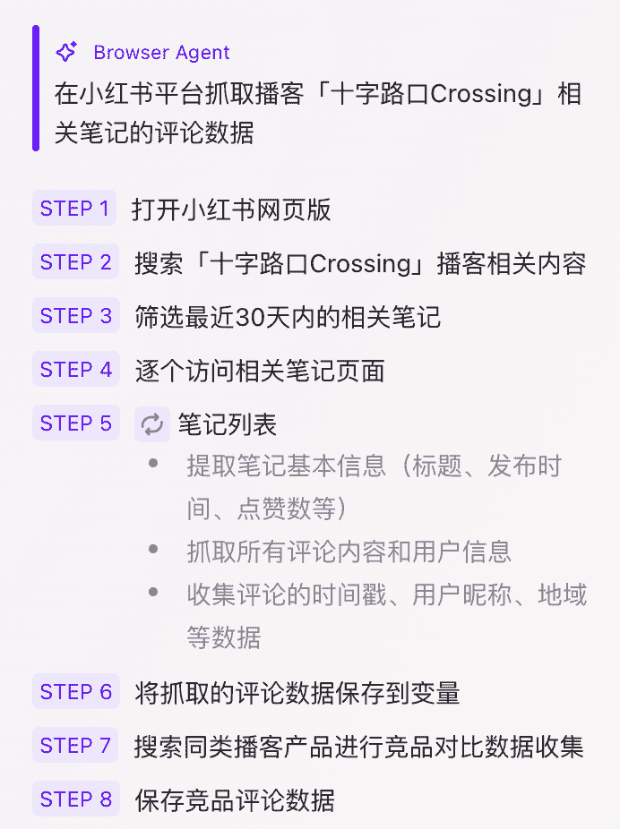

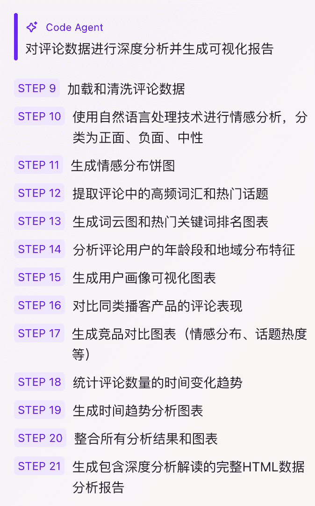

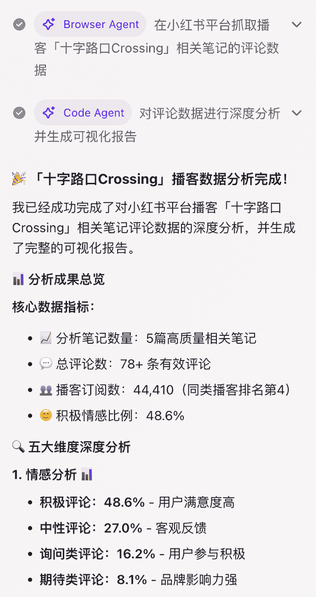

跑完这个场景的时候，摸了下我电脑的底座，电脑的温度感觉是烧到快要火山喷发了👵🏻

再看了下积分，发现这个任务直接烧掉了1000+积分🐱

> 最后报告附上链接来瞅瞅：

> https://chat.fellou.ai/report/41414748-71eb-4ca4-9a58-380448beec89

# 三、场景介绍-批量执行类创作

文章的第三部分，我们来尝试下，**批量执行类**的任务。

## 1、批量发送推广信息

假如说你是一名内容创作者，目前正运营着科技类公众号《xxxx》。

**有可**能你在推广的过程中，需要每天花费2-3小时在各大社交平台寻找相关热门内容，然后手动留言推广自己的公众号。

这个过程不仅耗时，而且效率低下，有时候后经常经常因为找不到合适的帖子而错过最佳推广时机。更难的是，手动操作容易出现重复推广或遗漏优质内容的情况。

那么这时候，你可以通过Fellou，来帮你发送**执行**信息，达到推广目的。

**来试试这个Prompt：**

```
请帮我在小红书上执行智能推广**任务：**
1.搜索&quot;人工智能&quot;、&quot;AI工具&quot;、&quot;ChatGPT&quot;、&quot;知识管理&quot;等关键词
2.筛选最近7天内点赞数超过1000的热门帖子
3.分析帖子内容相关性，优先选择与科技、AI相关度高的内容
4.在符合条件的帖子下留言：&quot;很棒的分享！推荐关注《自来水用户测试AI功能中》公众号，每周分享最新AI资讯～&quot;
5.执行8-10条评论，间隔10秒发布避免被限流
6.记录已评论帖子，建立推广效果跟踪表
```

输入完Prompt之后，Fellou就会去**搜索**相关的笔记，**如下图所示：**

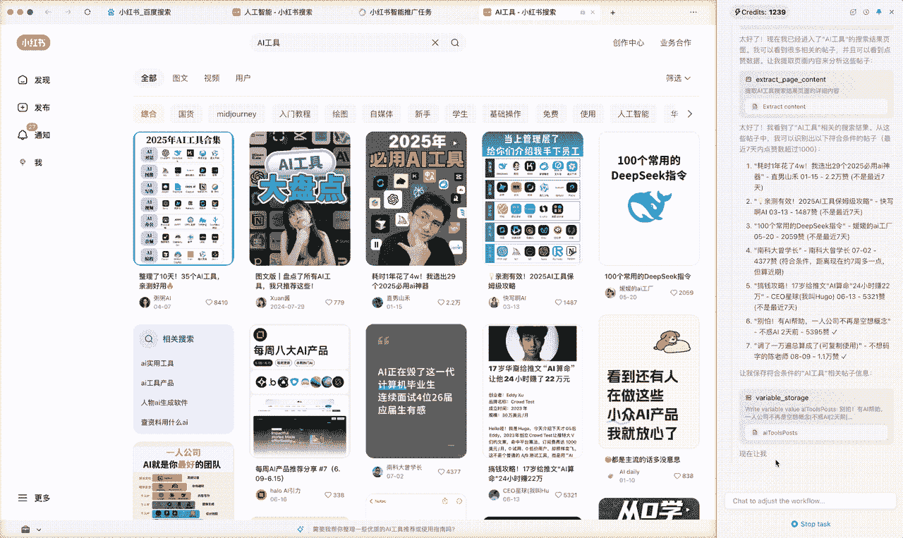

接着，在**执行**的过程中，Fellou会去抓取到每篇小红书笔记的评论和发送框，并直接把**推广文案**给发送到这篇笔记下面。抓取评论和发送框的过程，**如下图所示：**

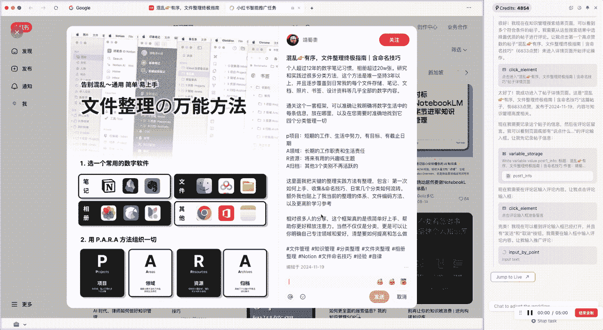

发送完第一条之后，接下来Fellou会等待10s的时间才会继续发送，因为在我们的提示词中**有提到过**。这在某种程度上，可**以规避掉因为**频繁发送触发平台的限流功能。如下图所示：

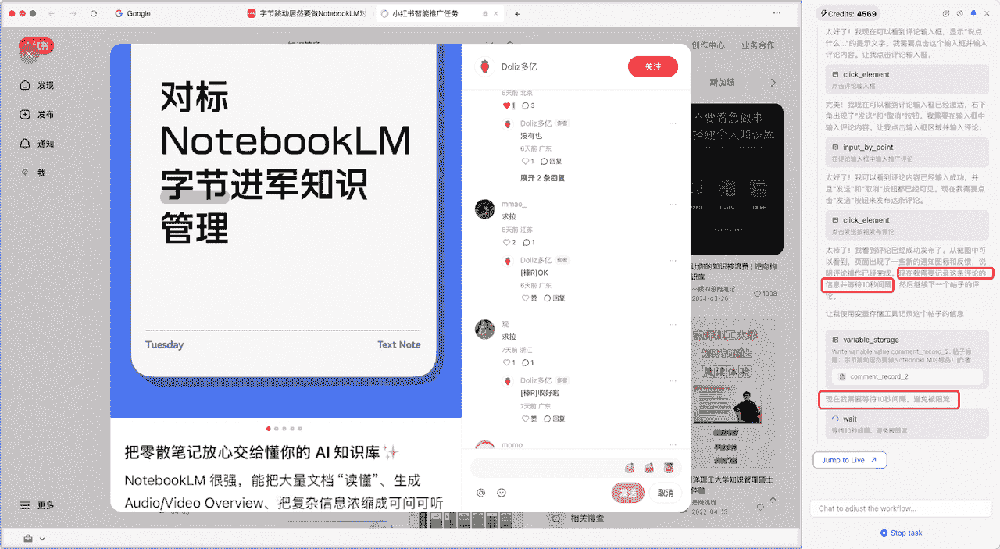

最终发送的展示效果如下👇🏻：

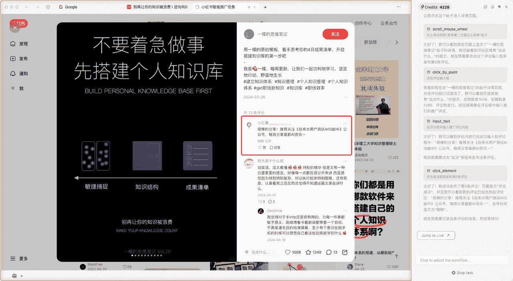

然后全部发送完了之后，Fellou会给我生成一份**CSV、**一份**MD报告**、一份**JSON数据**。

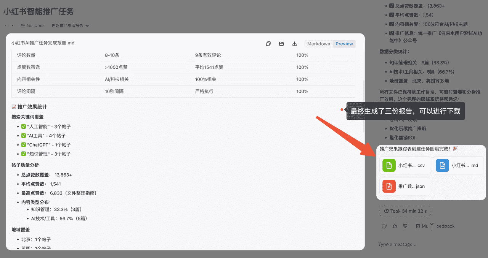

> PS：

> 这里本来想写自己公众号的名称的，怕被举报，就不冒这个风险了😜

> 不过对于运营同学来说，可以大胆写自己要推广的品牌名称😉

## 2、批量发送合作邀约

**批量**执行类的第二个场景，想来试试出海的场景。

假如说某**SaaS产品**准备出海欧美市场，需要与当地科技类KOL合作推广。传统做法是让市场团队手动搜索YouTube、Instagram上的博主，一个个查看粉丝数据，复制邮箱地址，然后逐一发送邮件。

**整个流程下来**，3个人的团队可能一周只能联系到50个KOL，效率极低。而且由于信息收集不够系统，经常会出现重复联系或遗漏优质博主的情况。

那么这个时候你可以用Fellou来做这个工作，帮忙搜集合作资料，以及建立一个合作邀约的数据库。**然后你就**可以用这个合作邀约库，去直接发送合作邀约的邮件。

**具体Prompt如下：**

```
请帮我批量开发海外科技KOL合作资源：
目标市场：美国、英国、德国
产品类型：B2B SaaS工具

执行步骤：
1. 在YouTube、Instagram、LinkedIn搜索&quot;SaaS&quot;、&quot;productivity tools&quot;、&quot;business software&quot;等关键词
2. 筛选标准：粉丝1万-100万，近30天活跃，内容质量高
3. 收集KOL信息：姓名、平台、粉丝数、邮箱、内容风格
4. 按影响力分层：微型(1-10万)、中型(10-50万)、大型(50万+)
5. 生成一个合作邀约的CRM数据库
6. CRM数据库需包含：①基础信息；②要发送给对方的个性化邮件模板；③跟踪回复率和合作进展；④…

目标：一周内联系200个潜在合作伙伴
```

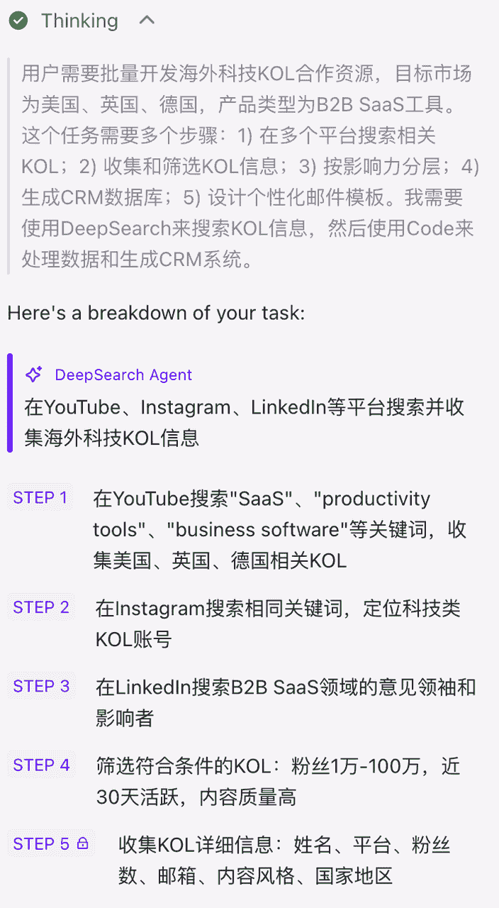

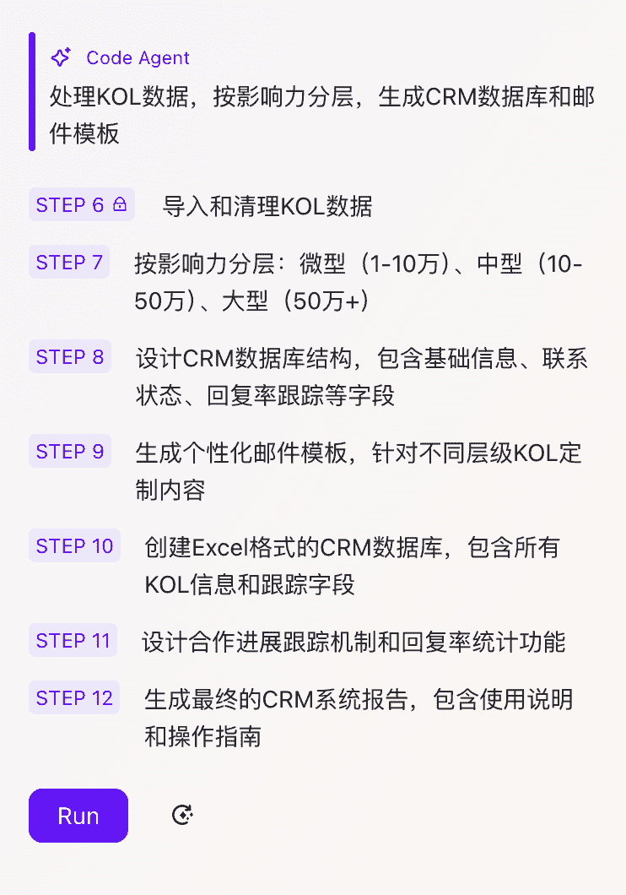

然后呢，Fellou会弹出来这么多个窗口。在此过程中，对于需要登录的X和Instagram，会让你点开对应的网页去进行登录。具体如下图所示：

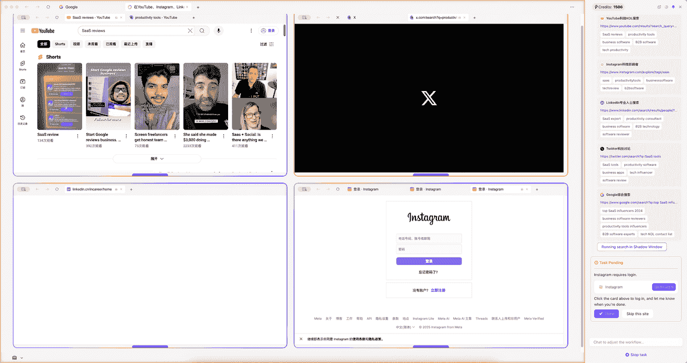

登录完成之后，Fellou就会开始去执行我们的任务👇🏻：

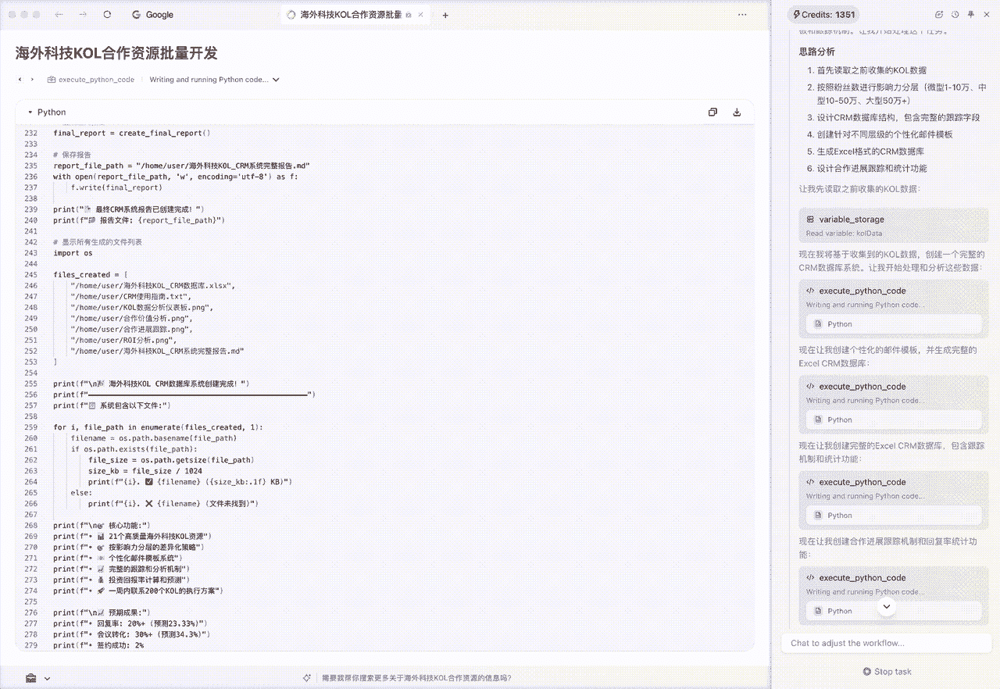

最终，会生成四份内容供你下载：**①**CRM的使用指南文档；**②**完整CRM的系统报告；**③**KOL的数据分析图表；**④**投资回报率的分析图表。如下图所示👇🏻：

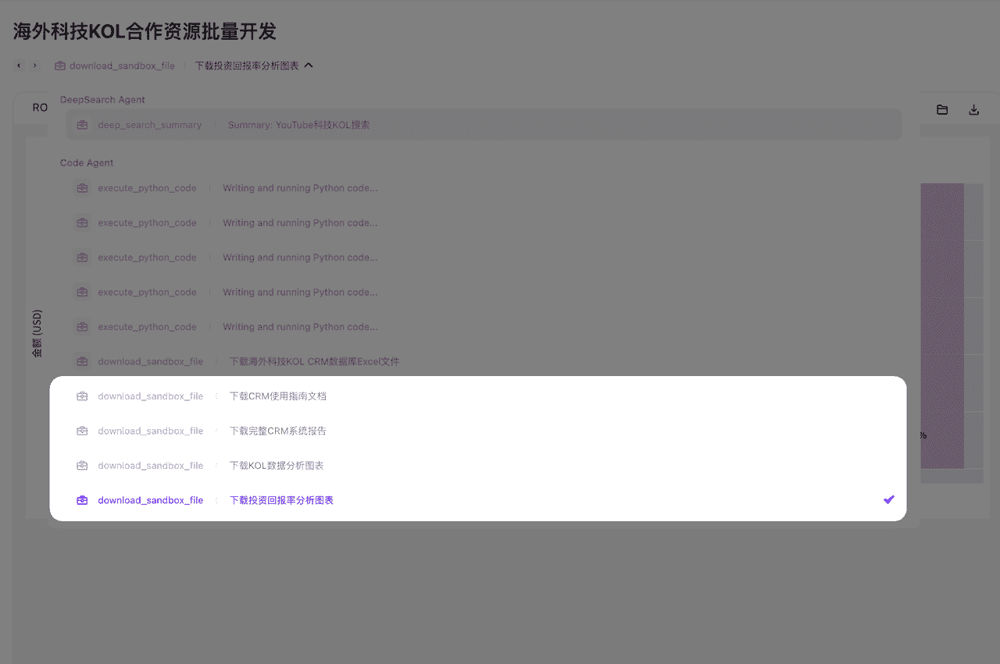

在XLSX数据表中，会很详细地统计和给出各种类别的看板，更加方便运营同学**查看**和**运用**各种表格和数据。如下图所示👇🏻：

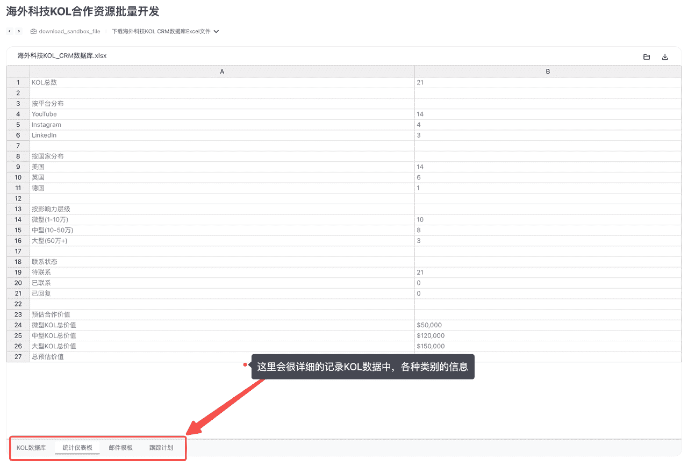

还有邮件模板的信息：

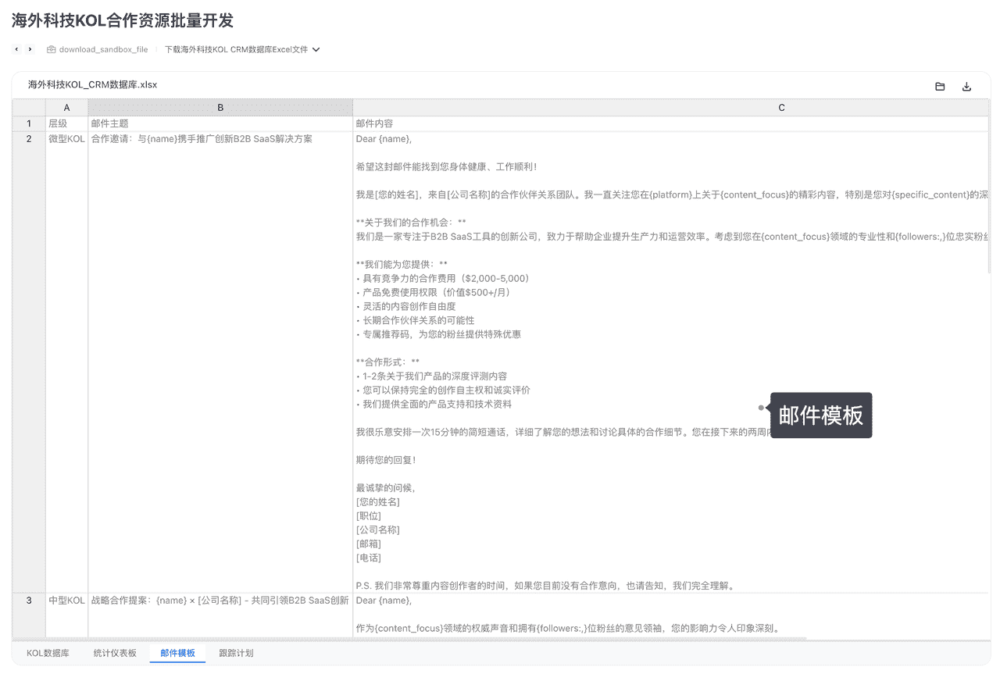

且比较惊喜的是，还生成了一张投资回报率的分析图：

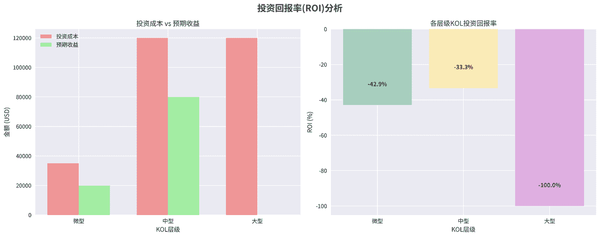

下面再提供三个较为常见的批量执行类场景供大家参考使用。

## 3、批量发送问候邮件

假如**某销售总监**管理着500多个客户，需要定期发送问候邮**件、产品更**新通知和节日祝福。传统做法是从CRM系统导出客户列表，然后用邮件群发工具发送统一内容。但这种方式个性化程度低，客户打开率和回复率都很差。

而如果要做**个性化邮件**，人工成本又太高，一个人一天最多只能发送50封个性化邮件。

可以用以下提示词来进行处理👇🏻：

```
请帮我建立智能化客户**邮件营销系统：**
客户数据：CRM系统中的500个客户信息(这里需要把客户的数据导入到对方)

执行方案：
1. 从CRM导入客户数据：姓名、公司、职位、购买历史、互动记录
2. 客户分层：新客户、活跃客户、沉睡客户、VIP客户
3. 为每层客户设计个性化邮件模板
4. 自动插入个性化信息：客户姓名、公司名、最近购买产品
5. 智能发送时机：根据客户的时区和活跃时间优化发送时间
6. A/B测试不同主题行和内容版本
7. 自动跟踪邮件打开率、点击率和回复情况
8. 未回复客户3天后自动发送跟进邮件
9. 生成本月客户沟通效果分析报告
```

## 4、批量发送简历

**下面来第四个**比较典型的批量化执行场景：批量发送简历。

金九银十，假如说某应届毕业生**小陈**正在找工作，每天需要在**智联招聘**、**前程无忧**、**BOSS直聘****等平**台搜索合适的岗位。按照传统的方法，小陈要逐个打开职**位详情，复制公司****信息，然后根**据不同公司的要求修改简历和求职信。一天下来只能投递10-15份简历，而且经常因为信息整理不当错过心仪的职位。更糟糕的是，他无法有效跟踪投递状态和面试安排，经常遗漏HR的回复。

那么我们可以让Fellou来批量帮你给HR发送简历，可以用以下Prompt👇🏻：

```
你是我的智能求职管理助手，接下来要帮我在boss直聘这个网站上，执行和处理一些任务。


求职目标：
1. 目标职位：产品经理、运营专员
2. 目标城市：北京、上海、深圳
3. 薪资范围：8K-15K

执行任务：
1. 自动搜索boss直聘招聘网站的新发布职位
2. 按匹配度筛选：公司规模、薪资范围、工作经验要求
3. 自动收集职位信息：公司名、职位、薪资、要求、联系方式
4. 批量给各大公司投递简历，投递20-30份
5. 建立求职跟踪表：包含投递时间、公司回复、面试安排
6. 生成求职进展周报和成功率分析
```

这个Case在Fellou的官网和各大媒体的测试Case中，综合效果都很不错，大家可以自行体验和测试一下。

## 5、批量网购比价

**批量执行的第**五个场景，我们来聊聊：批量网购比价。

假如说你是家庭里的宝爸和宝妈，经常需要给家里采购日用品和孩**子用**品**。那**在**平常的**购物中，有可**能习惯于**在淘宝、京东、拼多多之间比价，但手动搜索同一商品在不同平台的价格非常耗时。

特别是遇到双11、618等购物节时，各平台的优惠规则复杂，她经常算不清楚哪个平台最便宜。有时候好不容易比较完价格，商品又涨价或断货了，前功尽弃。

因此，我们可以利用Fellou，来建立一个比价系统，并生成购物省钱报告。输入Prompt：

```
请帮我建立一个智能购物比价清单系统：
购物清单：婴儿奶粉、纸尿裤、洗衣液、大米等日常用品

执行功能：
1. 在淘宝、京东、拼多多、苏宁等平台搜索同款商品
2. 收集商品信息：价格、销量、评分、店铺信誉
3. 计算实际到手价：优惠券、满减、会员折扣等
4. 生成价格对比表，标注最优选择
5. 监控商品价格变动，降价时自动提醒
6. 分析历史价格走势，判断是否为好价
7. 生成一份购物省钱报告
```

**Step拆解**如下👇🏻：

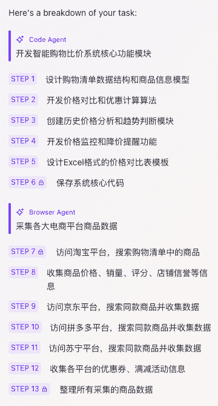

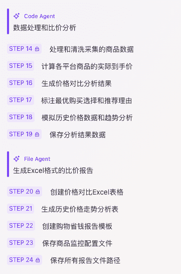

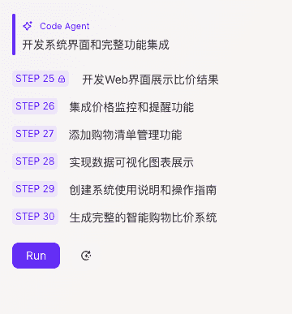

点击Run，Fellou开始跑任务👇🏻：

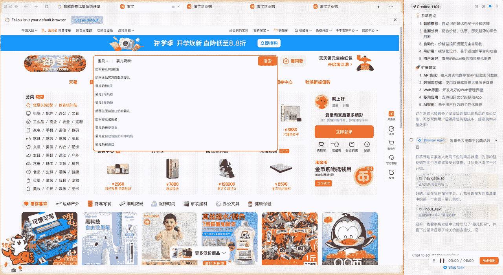

最终，Fellou会生成一套解决方案给到我们，让我们可以去执行和操作。如下图所示👇🏻：

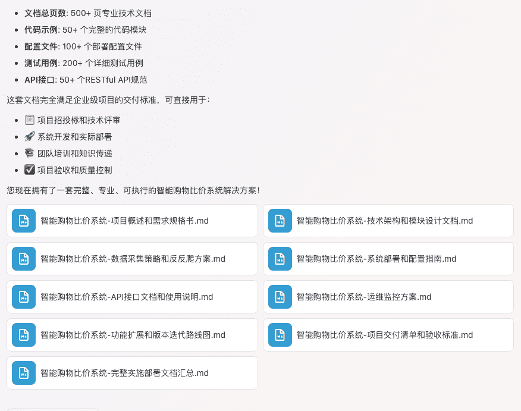

**对于这**种**购物类**型的场景，很适合在618、双十一等各种大节日的时候来使用。

同时，基于上面的场景下，如果有需要的话，还可以自动添加购物车，设置价格预警等等功能。

# 四、场景介绍-游戏类创作

文章的第四部分，我们来测测，Fellou在游戏类场景的创作怎么样。

## 1、二维游戏

**Prompt：**

```
帮我做一个俄罗斯方块的小游戏。
```

来看看Deep Action的步骤：

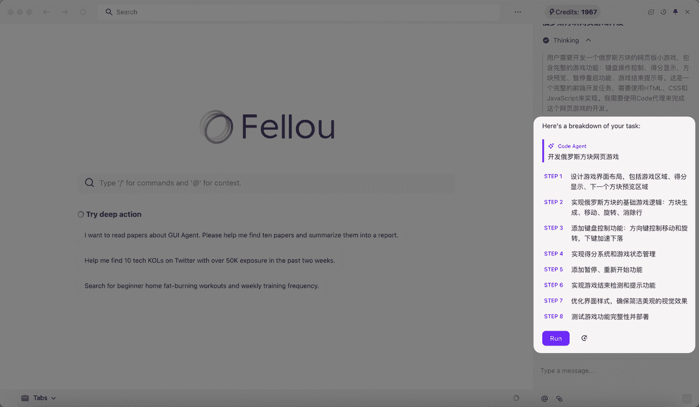

**行动过程如下：**

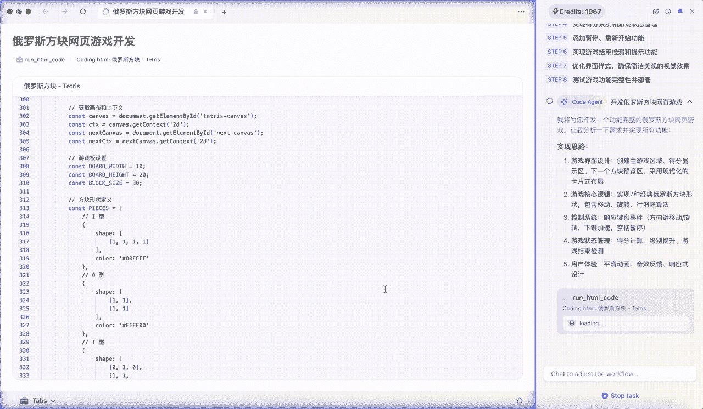

**具体展示效果如下：**

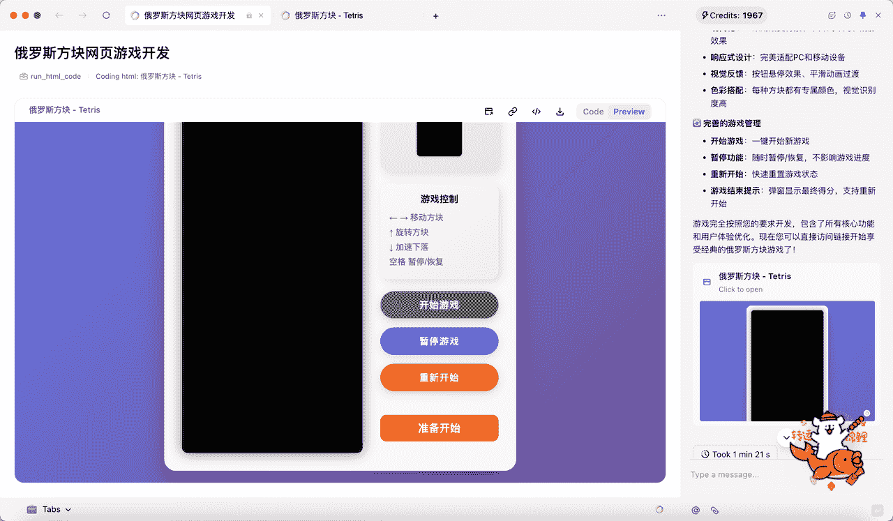

用**下来的时候，我感**觉它一个屏幕内，没法直接展示游戏内容。于是我又加了一轮对话，希望它可以在一轮对话内展示。Prompt为：

> 这个游戏希望可以在一个屏幕内展示完成

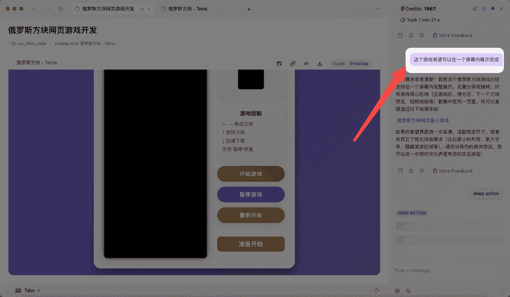

**最终展示效果如下：**

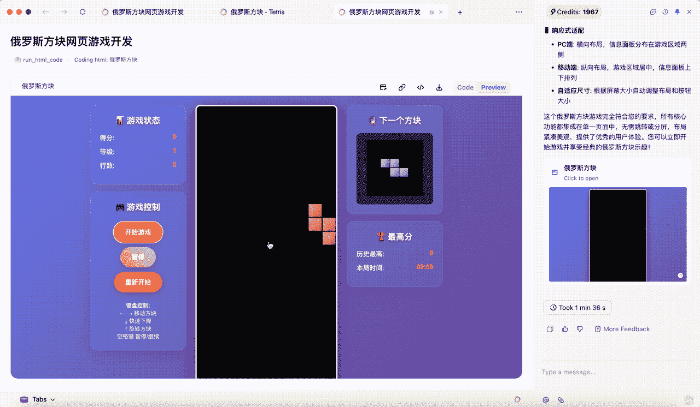

到这个**版本**的时候，发现展示效果已经好了很多。如果还有要微调的话，还可以再继续对按钮的颜色，整体的UI颜色再做修改。

> 附上效果地址：

> https://chat.fellou.ai/container/bfe64212-3924-4485-a369-cdc4dc15b549

## 2、三维游戏

从官方的Workflow里，发现了一个**3D游戏**的场景。

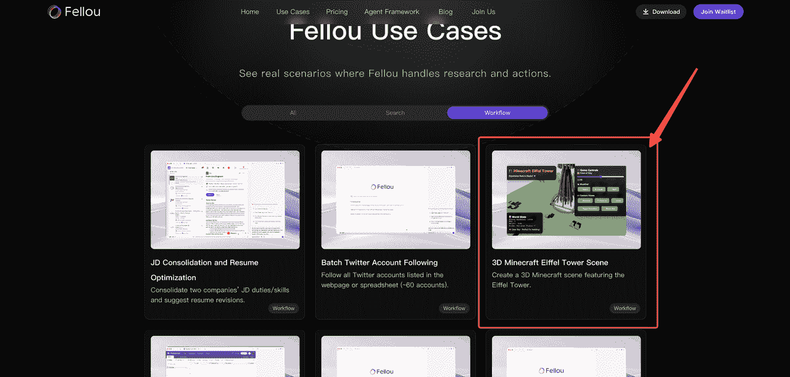

写了一个Prompt来浅试一下👇🏻：

```
创建一个以悉尼歌剧院为特色的3D《泰拉瑞亚》场景，包含港湾大桥背景和周围的海港环境，生成一个3D游戏给我。
```

Deep Action思考过程如下👇🏻：

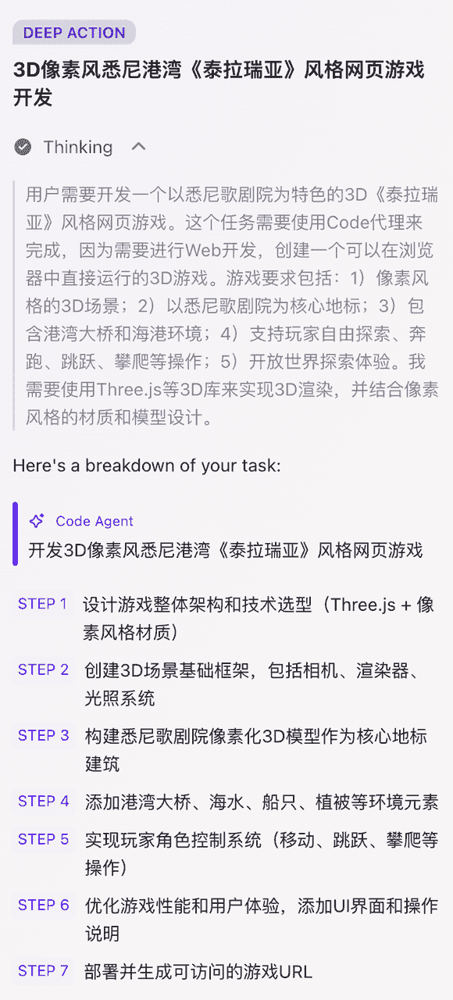

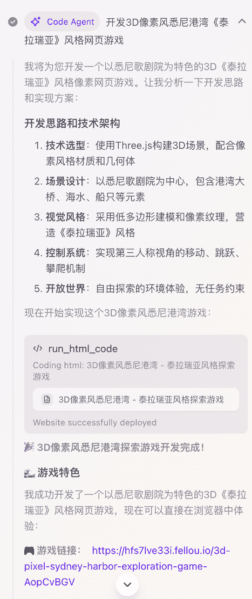

代码生成过程如下：

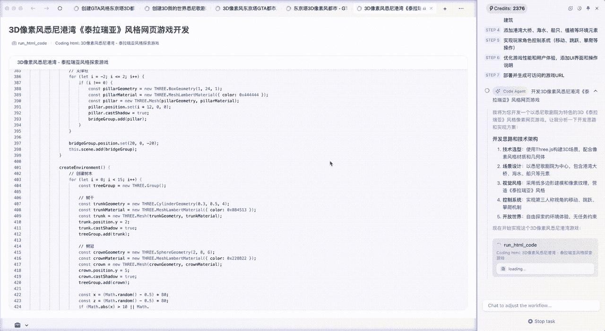

最终生成效果如下：

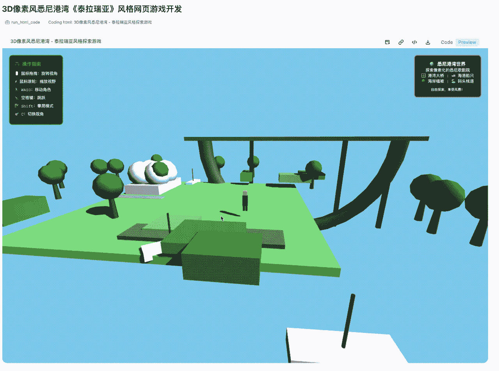

发现效果还蛮好的，中规中矩，某些场景的还原度也蛮高的。看了Step拆解过程和代码，发现到底层用到的是Three.js来还原这个场景。（学到了）

> 附上游戏链接：

> https://hfs7lve33i.fellou.io/3d-pixel-sydney-harbor-exploration-game-AopCvBGV

# 五、惊艳的功能点拆解

终于把想测的场景都都都测完了！横跨了一个很长的测试周期。

老实讲，最早在**看Fel**lou各种文章的时候，小编对Age**ntic**这个词完全没有概念，直到最近密集测评的时候，翻遍了官网 49个 search usecase 和 27个 workflow usecases，突然间对 Agentic Browser 有了一些更深的觉悟。

那接下来，在文章的第五部分，就来整体拆解下，Fellou一些比较惊艳的功能点。

## 1、跨平台多窗口并行处理能力

**首先，Fellou**最令人印**象深刻的**是其多窗口并行处理能**力。在执行复杂任**务的时候，它会同时打开多个浏览器标签页，分别负责不同的子任务：

+   有的负责数据搜索和观察

+   有的负责深度调研分析

+   有的负责整理思路逻辑

+   有的负责撰写和措辞优化

像这种「分工协作」的方式，让AI真正具备了类似人类团队作业的效率。


## 2、个性化生成内容

Fellou会根据用户**的浏览行为**和**历史数据****，来智能推**断用户的潜在需求。比如在订酒店场景中，它不会简单地展示所有选项，而是通过分析用户的偏好，会问你说：

+   是更喜欢市区还是郊外？

+   还是习惯打车还是公共交通？

+   对周边配套设施是否会有什么要求呢？

然后最终提供**千人千面**的个性化推荐方案。


## 3、影子空间

在执行任务过程中，Fellou会在网页上显示**各种颜色的操作框**，实时展示AI的「思考轨迹」和「操作步骤」，让用户清楚地看到AI在做什么。

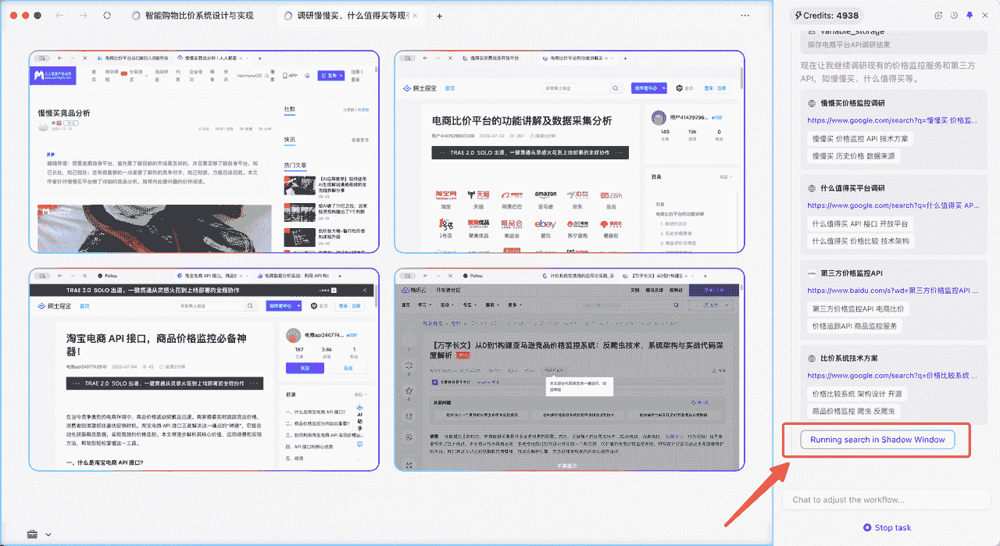

## 4、意图识别能力

第四个能力是Fellou的**意图识别能力**。偶然间在**Fellou执行窗口**的最下方，看到了不断改变的提示词👇🏻：

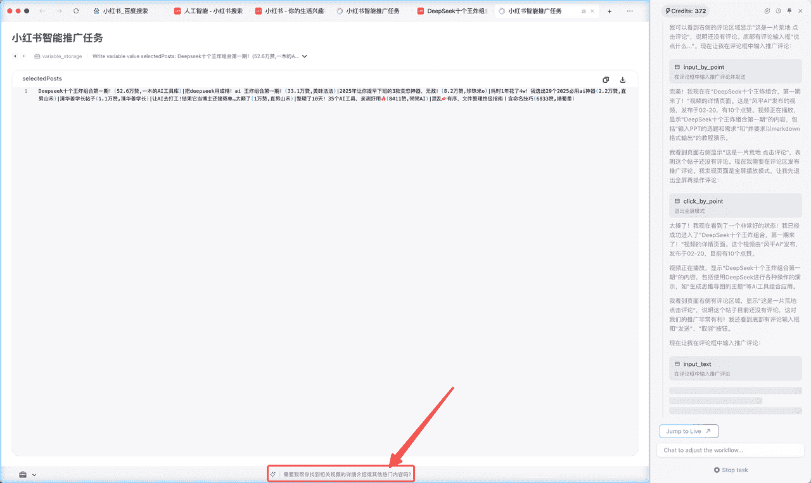

Fellou会根据当前这个窗口下面正在执行的功能**，来**判断用户下一步有可能想要提问的问题，进一步判断用户下一步的意图。在这里的意图识别能力，比较灵动。

相比于传统类似于豆包等文本对话模型的对话窗口，Fellou的意图识别能力，能跟随整个环境的变化而变化。

**就**像是在路上走着走着，看到很好看的花，AI会主动问你「要不要了解一下这种花的品种和养护方法？」；

或者是走到餐厅门口，AI会贴心地提醒「需要帮你查看菜单和用户评价吗」？

这种基于上下文的智能感知，让**人机交互**变得更加自然流畅，仿佛有一个善解人意的助手时刻在身边，总能在恰当的时机提供最贴心的建议。

这种**动态意图识别**的设计，让Fellou不像是是一个被动响应的工具，而是一个能够主动思考、预判需求的智能伙伴。

## 5、灵活的Step管理

每一次对Fellou**输入Prompt**的时候，会生成很多Step。然后我们也可以对这个Step**，进**行**实时****查看、修**改和调整，对不满意的环节进行干预和优化。这一步也是比较好玩且比较新颖的交互，且可以引导人类用户，做更深度的思考和调整。

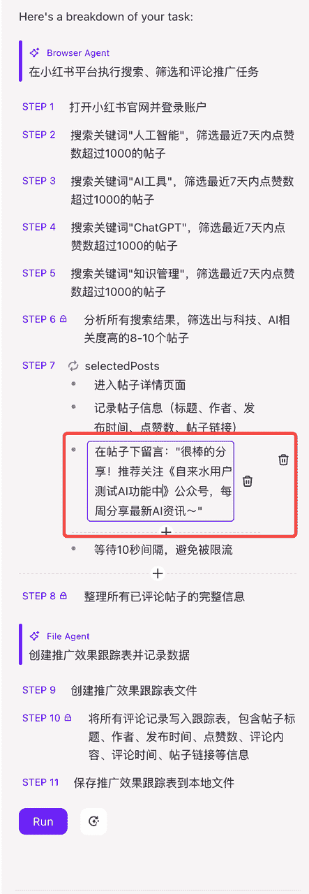

## 6、快捷键支持

Fellou跟Chrome**一样，**对于一些基础操作，也有预置了很多快捷键。比如cmd+w，关闭当前浏览器标签页。用Cmd+N，打开一个新的窗口。

下面贴一下主流快捷键的使用：

文件类别的👇🏻：


编辑器类别的👇🏻：


视图类别的👇🏻：


窗口类别的👇🏻：


历史记录类别👇🏻：


**除此**之外，在浏览器里面的每个标签页，还可以右键，会展示出下面这个弹窗：


对于每个标签页，也可以进行**复制链接**、**分割视图**、**重新加载**等操作。

# 六、Eko智能体框架

聊完整体的场景以及比较惊艳的功能点，接下来聊点更深的话题，想聊聊Fellou的开发框架。

一开始对Fellou的底层开发，还没什么感知。到后来突然文章写了一半，大概8月份的时候，突然间在飞书上看到了eko，于是就去翻了翻相关的资料，探索了一下。

下面浅浅地普及下Eko这个智能体开发框架的内容。

## 1、Eko是什么

Eko 是 支持Fellou底层开发的开源智能体开发框架，支持Web/Node.js/浏览器插件等多种环境，同时也支持A2A和MCP等常用协议，具有极高灵活性与安全性。可访问Eko官网或其GitHub地址获取更多资料和代码。

相关地址👇🏻：

| **主题** | **相关地址** |
| --- | --- |
| Eko官网 | https://fellou.ai/eko |
| Eko文档 | https://fellou.ai/eko/docs/getting-started/eko/ |
| Github地址 | https://github.com/FellouAI/eko |


## 2、开源模式

八月初的时候，有看到Fellou举办了关于Eko的创新挑战赛，然后当时在想这个比赛带来的一些可能性。

一般来说，如果没有比赛之前，Fellou的创新可能是基于**企业技术人员**的驱动下去做**创新**。

但是如果把一部分技术开源出来之后，大家基于这个框架，去造出更多有趣好玩的东西，那么最终对于Fe**llou**来说，就能更快速地去看到用户有可能想要的一些新的交互，最终能够收集到一些一线用户的真实需求。

这在某种意义上，丰富了Fellou的整个开发者生态，同时也带来了更繁荣的可能性。


# 七、综合分析

文章的第七部分，到了最后的总结分析。

## 1、场景适用性评分

先来聊聊对场景适用性的评分：

| **场景** | **评分** | **适用性解析** |
| --- | --- | --- |
| **数据处理与分析能力** | **9/10** | +   在商业分析、数据抓取、报告生成等方面表现优异 |
| **批量执行任务能力** | **8/10** | +   在社媒推广、邮件营销、简历投递等重复性任务中效率极高 |
| **创意内容生成** | **7.5/10** | +   游戏开发、创意设计等场景表现中等 |

## 2、数据隐私考量

当Fellow在浏览器抓取数据和处理各种数据的时候，此刻小编的心里有个疑惑：这样公开去抓取数据，数据隐私是否能得到保障？

后来在这篇文章 [Fellou：成为每个人都需要的那](https://mp.weixin.qq.com/s/35WydCvkN8KwYjk-zl_oJg)名伙伴｜100个革新产品（18/100） 里找到了答案。

Fellou会严格遵守各地数据隐私的相关法律，无论是欧盟的GDPR（General Data Protection Regulation）还是加州的CCPA（California Consumer Privacy Act）。

同时，Fellou利用自己在身份管理上积累的经验与技术优势，制定了一套严密的身份权限系统，并在数据收集上采用了KMS的信封加密，即使黑客攻破了数据库，也没有办法拿到原文信息。

Fellou还会主动屏蔽掉平台不该收集的数据，比如用户的各种账号密码、身份证号，或者一些私密的健康信息，都不会进入Fellou的信息库。

> PS：想尝试在官方找Reference，但是没翻到，期待有好心人来贴个Reference

## 3、期待迭代更新的功能？

最后，来聊聊在测评的过程中，对这个工具的一些优化思考。

比如左下角的Tabs，可以新增，但是没法移动。

对于图表可视化来说，有些图表在渲染的过程中，会有一些丢失。

又或者，在某些复杂任务情况下，容易生成到一半宕机了。btw在现在AI还在初期迭代的情况下，感觉也属于比较小的问题了。到软件和工具1.0版本的时候，或许这些问题就已经被彻底清除了。


# 八、结束语

文章写到这里，终于来到到到了最后一部分！我们来小小的做个总结😉

在文章的第**一**部分，我们先介绍了Fellou这个工具的基础信息。

在文章的第**二、三、四**部分，我们分别从文本创作、批量执行、游戏创意三个维度，分别做了很多场景的测评。

在文章的第**五**部分，为大家总结了Fellou一些比较核心的功能点和一些很有趣的功能。

在文章的第**六**部分，讲解了Eko智能体框架。在文章的第七部分，整体做了场景的适用性评分，以及写了一些小思考。

在Fellou**这个工具上，小编印象最**为深刻的功能，大概要率属于如何更好的拆解Step。

作为一个**任务拆解**爱好者，以前用AI辅助做任务拆解的时候，时常会觉得拆的比较表层。但在使用了Fellou以后，会它的任务拆解细致化，有被稍稍感叹了一下，引发用户深度思考多了一些些。


诚如官方的slogan一样，做一个**行动型****的浏览器**，不仅能思考，更多的是帮你直接把目标任务给执行了。

**想起创始人在开篇提到的播客里**所说到的一句话：我不知道为什么，但我就是知道。

把Fellou深度测试了之后，突然感受到了这句话的含金量。

以上就是本期的全部内容，我们下期见🍻🍻🍻

# 彩蛋One More Things

## 1、变更记录


## 2、原文地址

> 原文地址：Fellou AI，解锁下一代「行动型」浏览器

## 3、作者介绍

Zelina的个人说明书：https://pzfqk98jn1.feishu.cn/wiki/wikcnTijikVNdkWdBEKzQpiA6ie