# 在秒哒上，测试你的AI教师人格

> 来源：[https://my.feishu.cn/docx/WT7HdfiJLoJhZ6xxEhhcKL32n2e](https://my.feishu.cn/docx/WT7HdfiJLoJhZ6xxEhhcKL32n2e)

> 在秒哒上，测试你的AI教师人格，发现你的顶级教学天赋

## 前言

**最近教师节**快到了，昨天刚给导师安利了WPS的AI功能。今天突然想在9月10日的时候，给导师再整点活。

**然后就想着，**要不让每个老师都来测测他们的AI教师人格，看看自己更pick哪一种教师类型。

楷模一下，开始干活~🧙🏻‍♀️🧩

## 01 寻找工具

首先想的是，要找到既能**生成应用**，且能实时**生成图片****的工**具。刚好最近在高度用秒哒生成应用，于是乎，准备用秒哒来尝试下效果。

## 02 写提示词

打开工具后，下一步，就是**准备提示词**了。一开始想象的是，让用户回复5道题，然后根据**题目的回答，**最终生成一张对应的人物形象。提示词如下：

```
设计一个「AI教师人格测试」的应用，为用户发现大家的教学天赋。

场景互动流程：
用户回答5道趣味选择题 → AI分析性格特质 → 生成专属教师形象插画 + 个性化描述
当用户选择完了以后，请根据用户的选择结果，判断他/她的教师类型（学者型/活力型/探索型/艺术型等等），然后：

1.生成一张动漫风格的教师人物形象，要求：
- 采用日系动漫画风，线条清晰流畅
- 人物表情生动，眼神温和亲切
- 服装和配饰要体现对应教师类型的特色
- 背景融入相关的教学场景元素
- 色彩明亮温暖，具有强烈的视觉吸引力
- 整体构图要有动感和活力

2.写一段个性化描述（50字以内），包括：
- 适合的教学科目
- 教学特色
- 学生对你的印象

3.点击分享结果，能够生成一张图片，让用户可以保存。
```

我们来看看首次生成的效果：

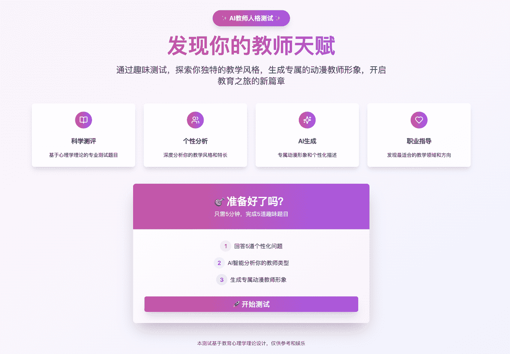

怎么说呢……功能是好的，但是这个紫红色的UI风格，有有点太过于纸醉金迷。

于是，准备再来一波微调。

## 03 应用微调

**第一轮微调提示词：**

```
1.保存结果的图片变形了，希望可以生成一张长图。
2.保存结果要吧描述的东西给一起包含上去。
3.整个应用的配色太脏了，希望换成《跃动青春》这部电视剧靠近的色系。
```

**第二轮微调提示词：**

```
生成的图片里面，个性化描述、教学特色、适合科目，布局可以放在中间
```

**第三轮微调提示词：**

```
在回答题目前，再加一个性别的选项，然后最终的图片生成的性别，要和这个相关。
```

**第四轮微调提示词：**

```
**整体配色用**这个来处理：

（1）整体界面配色方案
基础色彩：
--**primar****y-blu**e: #2563EB /* 主蓝色 /
--light-blue: #DBEAFE / 浅蓝背景 /
--dark-blue: #1E40AF / 深蓝文字 /
--neutral-blue: #64748B / 中性蓝 /
--accent-orange: #F97316 / 强调橙色 /
--campus-white: #FEFEFE / 校园白 */
功能性配色：
背景色：校园白 #FEFEFE
卡片背景：浅蓝 #DBEAFE
主要文字：深蓝 #1E40AF
次要文字：中性蓝 #64748B
按钮主色：学院蓝 #2563EB
选中状态：温暖橙 #F97316
进度条：蓝色渐变 #3B82F6 → #1E40AF

（2）校园风格特色
视觉元素：
线条：简洁直线，体现校园建筑感
圆角：适中圆角（8px），温和不失正式
阴影：轻柔阴影，模拟教室光线
图标：线性图标，简约校园风
色彩层次：
深蓝 #1E40AF - 标题、重要信息
学院蓝 #2563EB - 主要按钮、链接
中蓝 #3B82F6 - 次要元素
浅蓝 #DBEAFE - 背景、卡片
温暖橙 #F97316 - 强调、警示
```

**第五轮微调提示词：**

```
整体风格偏浅色一点，渐变不要太深
```

## 04 结果Showtime

最终，微调了一个还不错的版本。我们来看看应用都有哪些内容？

### （1）首页


### （2）个人信息选择

点击「开始测试」，选择你的个人信息：

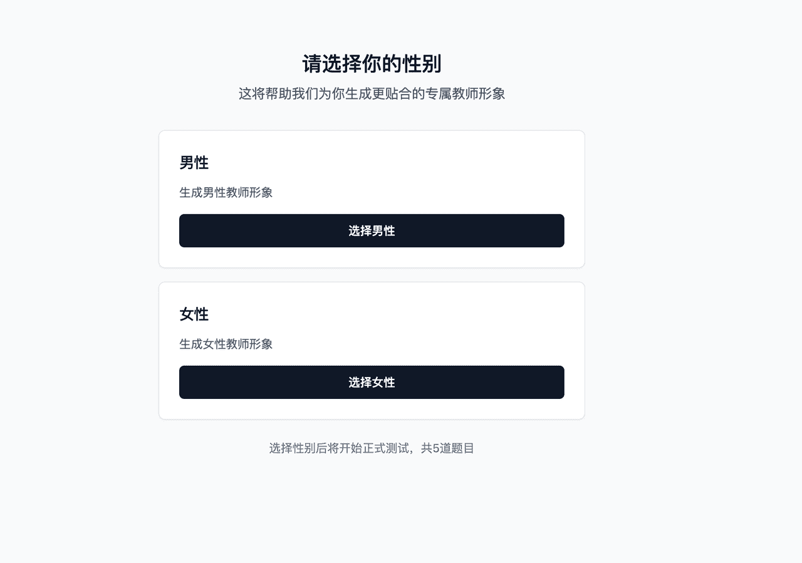

### （3）开始答题

**问题1：**在课堂上，你更倾向于采用哪种教学方式？

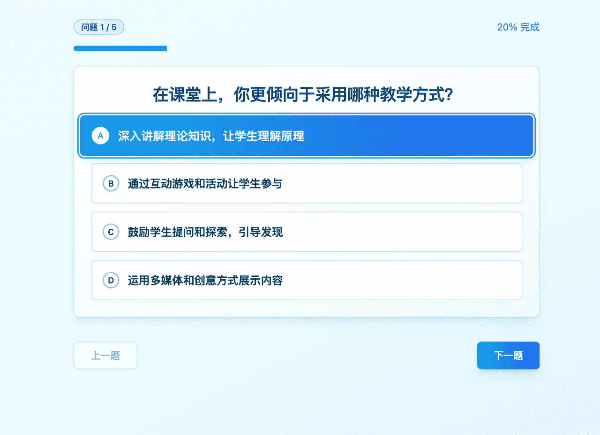

**问题2：**面对学习困难的学生，你会怎么做？

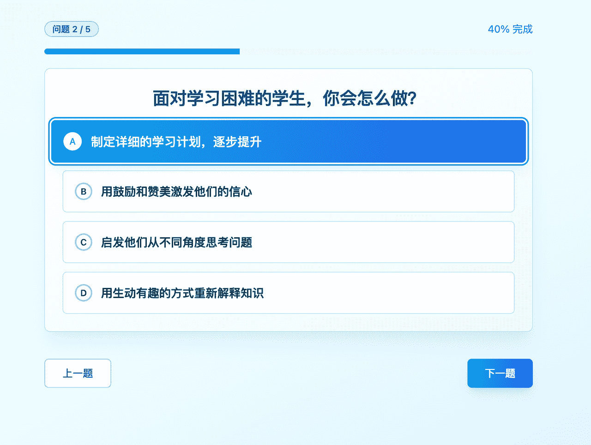

**问题3：**你认为最重要的教学目标是什么？

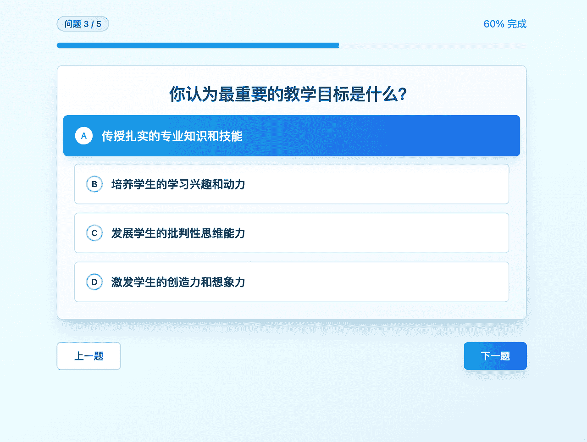

**问题4：**在课堂管理方面，你更倾向于？

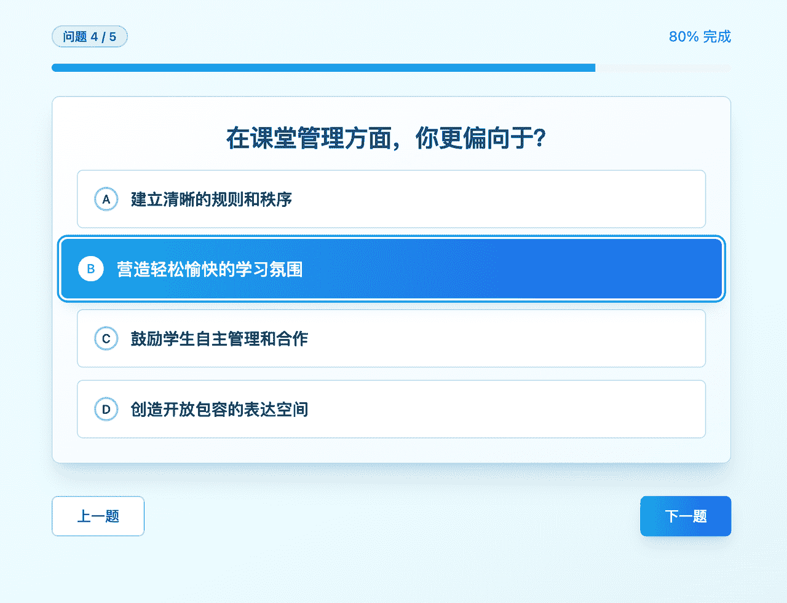

问题5：你最享受教学中的哪个环节？

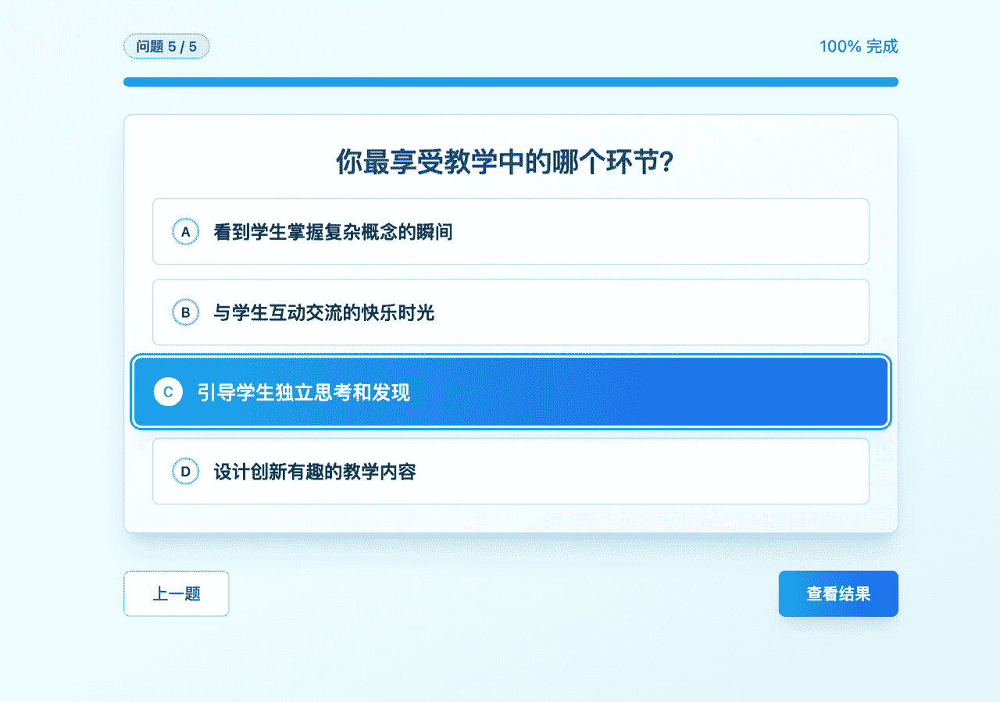

然后点击右下角的查看结果，**秒哒**会去开始生成最终要给用户展示的卡片：

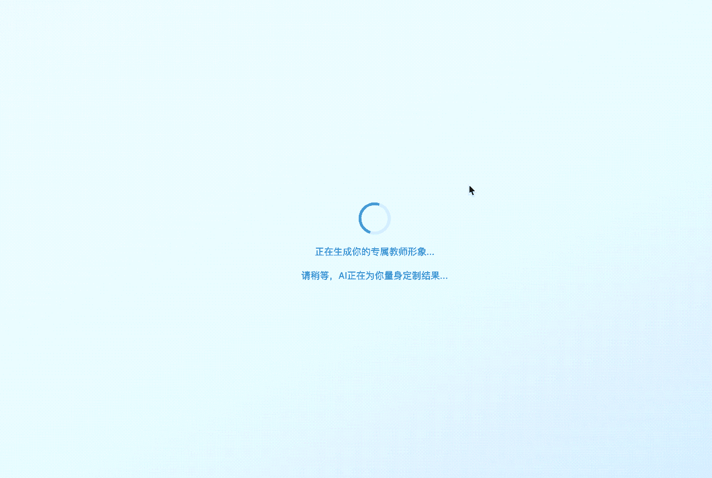

### （4）最终生成效果

最终生成效果如下：

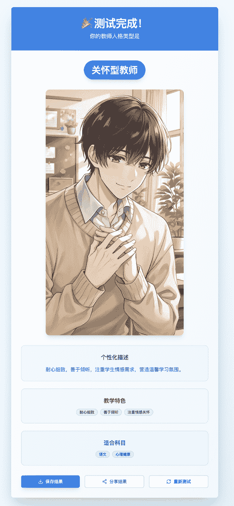

### （5）生成卡片

最终点击「保存结果」，**秒哒**会给你生成一张卡片：

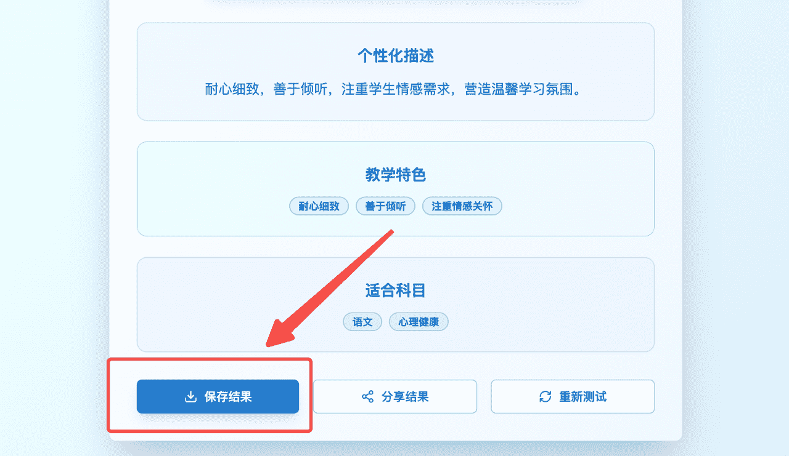

### （6）选择卡片颜色

**但是**到这里**生成**后的图片，总感觉保存的图片有点单调。于是小编又去让秒哒再帮忙生成可选色卡。对秒哒说：

```
保存结果的图片，希望可以选择图片的颜色。
```

然后秒哒经过了**数秒**后，生成了符合需求的应用👇🏻：

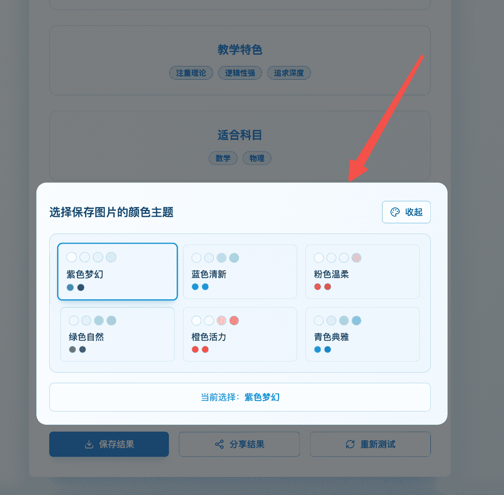

最终在应用的最下方，多了**颜色主题**的选择。然后导出的图片结果，就可以根据你的颜色喜好来进行选择啦~

### （7）色卡盲盒

来看看小编生成的卡片类型：

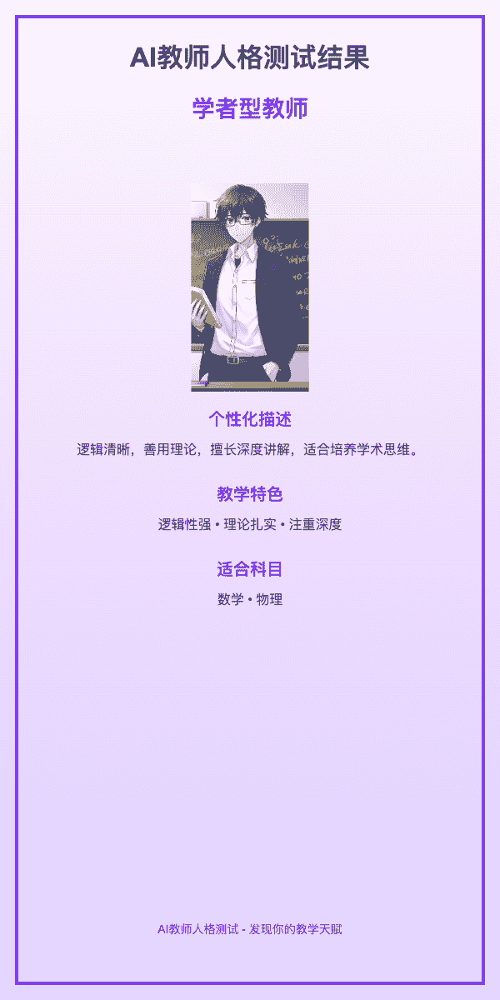

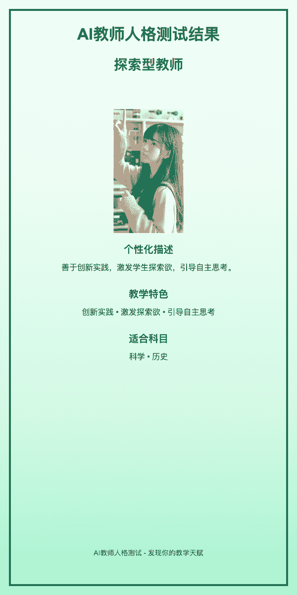

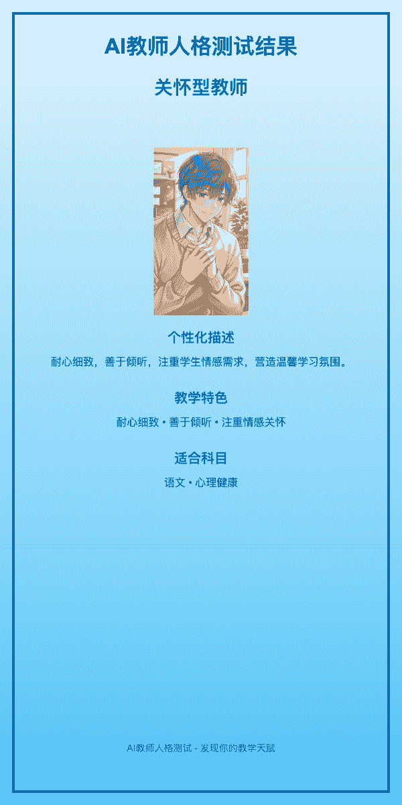

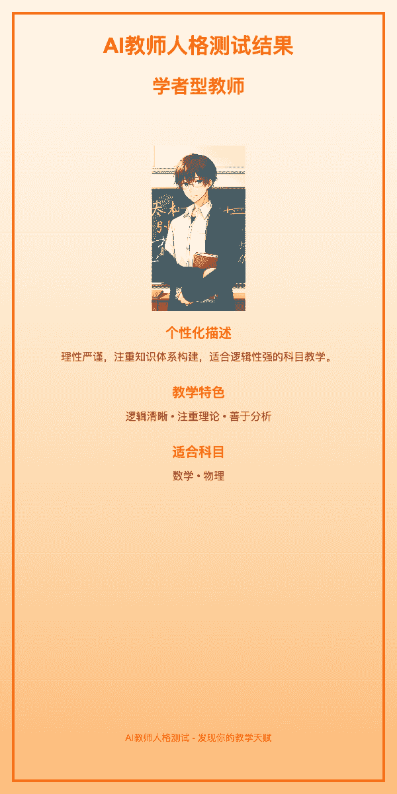

## 05 快来测测你的AI教师人格吧😉

附上应用地址，欢迎来测试你的**AI教师人格**🧙🏻‍♀️

应用地址：https://app-5xxe6hhznksi.appmiaoda.com/

手机扫码体验请戳下图👇🏻：


欢迎评论区附上你的AI教师人格，一起来发现你的顶级教学天赋🎨🎨🎨

也欢迎转发给身边的小伙伴一起测试ta的教师人格😉

以上就是本期的全部内容，我们下期见🍻🍻🍻